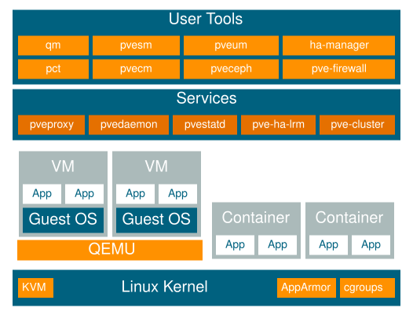

# 1\. 简介 <a href="#chapter_introduction" id="chapter_introduction"></a>

Proxmox VE 是一个用于运行虚拟机和容器的平台。它基于 Debian GNU/Linux，并且完全开源。为提供最大的灵活性，Proxmox VE 提供了两种虚拟化技术——基于内核的虚拟机（KVM）和 Linux 容器（LXC）。

一个核心设计目标是使管理尽可能简单。您可以在单个节点上使用 Proxmox VE，也可以将多个节点组成集群。所有管理任务都可以通过基于 Web 的管理界面完成，即使是新手用户也可以在几分钟内完成 Proxmox VE 的设置和安装。



## 1.1. 集中管理 <a href="#intro_central_management" id="intro_central_management"></a>

虽然许多人从单个节点开始，但 Proxmox VE 可以横向扩展到由大量节点组成的集群。集群栈已完全集成，并随默认安装一起提供。

**独特的多主节点设计**

Proxmox VE 集群中的每个节点都可以执行所有管理任务。不存在单点故障的中央管理服务器——任何节点都可以管理整个集群。即使个别节点暂时不可用，这种多主节点架构也能使集群保持可管理状态。

**Proxmox 集群文件系统（pmxcfs）**

Proxmox VE 使用 Proxmox 集群文件系统（pmxcfs），这是一种用于存储配置文件的数据库驱动文件系统。它可以存储数千台虚拟机的配置。Corosync 将这些文件实时复制到所有集群节点。该文件系统将所有数据存储在磁盘上的持久化数据库中，同时在 RAM 中保留一份副本，最大存储容量为 128 MiB——对于数千台 VM 而言绰绰有余。

Proxmox VE 是唯一使用这种集群文件系统的虚拟化平台。

**基于 Web 的管理界面**

Proxmox VE 简单易用。其内置的基于 Web 的界面构建于 ExtJS JavaScript 框架之上，可清晰概览所有 KVM 客户机和 Linux 容器，并提供对所有集群资源的完全控制。您可以通过 GUI 管理 VM、容器、存储和网络，包括查看每个节点的历史记录和 syslog、运行备份或恢复任务、在线迁移以及 HA 触发的活动。无需安装单独的管理工具或额外的管理节点。

**命令行**

对于偏爱 Unix shell 或 Windows PowerShell 便捷体验的高级用户，Proxmox VE 提供了命令行界面，用于管理虚拟环境的所有组件。此命令行界面具有智能 Tab 补全功能，并以 man 手册页的形式提供完整文档。

**REST API**

Proxmox VE 使用 RESTful API，并以 JSON 作为主要数据格式。整个 API 均使用 JSON Schema 进行形式化定义，使自定义托管环境等第三方管理工具能够快速、轻松地完成集成。

**基于角色的管理**

通过基于角色的用户和权限管理，您可以为所有对象（如虚拟机、存储和节点）定义精细的访问权限。每项权限都按照访问控制列表模型，指定特定路径上的一个主体（用户或组）和一个角色（权限集合）。

**认证域**

Proxmox VE 支持多种认证来源，包括 Microsoft Active Directory、LDAP、Linux PAM 标准认证以及内置的 Proxmox VE 认证服务器。

## 1.2. 灵活的存储 <a href="#flexible_storage" id="flexible_storage"></a>

Proxmox VE 的存储模型非常灵活。虚拟机镜像可以存储在一个或多个本地存储上，也可以存储在 NFS 或 SAN 等共享存储上。您可以根据需要配置任意数量的存储定义，并使用 Debian GNU/Linux 可用的所有存储技术。

将虚拟机存储在共享存储上的一个主要优势是，可以在线迁移正在运行的虚拟机而不会造成任何停机，因为集群中的所有节点都可以直接访问虚拟机磁盘镜像。

支持以下网络存储类型：

- LVM 组（以 iSCSI 目标作为网络后端）
- iSCSI 目标
- iSCSI LUN（直接使用）
- NFS 共享
- CIFS 共享
- Ceph RBD
- CephFS
- Proxmox Backup Server

支持以下本地存储类型：

- LVM 组（本地后端设备，如块设备、光纤通道设备和 DRBD）
- 目录（在现有文件系统上存储）
- ZFS

## 1.3. 集成备份与恢复 <a href="#integrated_backup_and_restore" id="integrated_backup_and_restore"></a>

集成的备份工具（`vzdump`）可为运行中的容器和 KVM 客户机创建一致性快照。它会创建包含虚拟机或容器数据（包括配置文件）的归档文件。

此外，[Proxmox Backup Server 集成](../07-storage/README.md#storage_pbs)提供了高级功能，包括将完整备份与数据去重相结合、执行客户端加密、备份到磁带或 S3 对象存储，以及与异地的其他 Proxmox Backup Server 安装实例同步。

KVM 在线备份适用于所有存储类型，包括位于 NFS、CIFS、iSCSI LUN 和 Ceph RBD 上的虚拟机镜像。该备份格式经过优化，可使用稀疏文件、乱序数据和最小化 I/O 高效存储虚拟机备份。

## 1.4. 高可用性集群 <a href="#high_availability_cluster" id="high_availability_cluster"></a>

多节点 Proxmox VE HA 集群可实现虚拟机和容器的高可用性。集成的[高可用性（HA）管理器](../15-ha-manager/README.md)通过基于看门狗的隔离自动检测节点故障，并在健康节点上重新启动受影响的服务。无需 Pacemaker 等外部工具——HA 堆栈随 Proxmox VE 提供，并且完全通过 Web 界面或命令行进行配置。

## 1.5. 灵活的网络 <a href="#flexible_networking" id="flexible_networking"></a>

Proxmox VE 使用网桥网络模型。所有虚拟机都可以共享一个网桥，就好像每台客户机的虚拟网线都插入了同一台交换机。为将虚拟机连接到外部网络，可将网桥接入物理网卡，并为其分配 TCP/IP 配置。

为了进一步提高灵活性，系统还提供虚拟局域网（VLAN、IEEE 802.1q）以及网络绑定/聚合功能，使您能够为 Proxmox VE 宿主机构建复杂而灵活的虚拟网络，并充分发挥 Linux 网络堆栈的强大功能。

对于大型或多租户环境，[软件定义网络（SDN）](../12-pvesdn/README.md)堆栈提供基于区域的网络隔离，并支持 VXLAN 和 EVPN 等协议。SDN 已完全集成到 Web 界面中，并默认安装。

## 1.6. 集成防火墙 <a href="#integrated_firewall" id="integrated_firewall"></a>

集成防火墙允许您过滤任何虚拟机或容器接口上的网络数据包。常用的防火墙规则集可以分组为“安全组”。

## 1.7. 超融合基础设施 <a href="#chapter_hyper_converged_infrastructure" id="chapter_hyper_converged_infrastructure"></a>

Proxmox VE 是一个紧密集成计算、存储和网络资源的虚拟化平台，可管理高可用性集群、备份/恢复以及灾难恢复。所有组件均由软件定义，并且彼此兼容。

因此，可以通过集中式 Web 管理界面像管理单个系统一样管理这些组件。这些功能使 Proxmox VE 成为部署和管理开源[超融合基础设施](https://en.wikipedia.org/wiki/Hyper-converged_infrastructure)的理想选择。

### 1.7.1. 使用 Proxmox VE 构建超融合基础设施（HCI）的优势 <a href="#benefits_of_a_hyper_converged_infrastructure_hci_with_proxmox_ve" id="benefits_of_a_hyper_converged_infrastructure_hci_with_proxmox_ve"></a>

超融合基础设施（HCI）特别适用于基础设施需求高但管理预算有限的部署、远程和分支机构环境等分布式部署，以及虚拟私有云和公有云。

HCI 具有以下优势：

- 可扩展性：无缝扩展计算、网络和存储设备（即快速且彼此独立地扩展服务器和存储）。
- 低成本：Proxmox VE 是开源软件，集成了您所需的所有组件，如计算、存储、网络、备份和管理中心。它可以取代昂贵的计算/存储基础设施。
- 数据保护与效率：集成了备份和灾难恢复等服务。
- 简单性：配置简便，管理集中。
- 开源：无供应商锁定。

### 1.7.2. 超融合基础设施：存储 <a href="#hyper_converged_infrastructure_storage" id="hyper_converged_infrastructure_storage"></a>

Proxmox VE 紧密集成了部署超融合存储基础设施的支持。例如，您可以仅通过 Web 界面部署和管理以下两种存储技术：

- <strong>Ceph</strong>：一种自愈、自管理的共享存储系统，可靠且高度可扩展。了解[如何在 Proxmox VE 节点上管理 Ceph 服务](../08-pveceph/README.md)
- <strong>ZFS</strong>：集文件系统与逻辑卷管理器于一体，可全面防止数据损坏，支持多种 RAID 模式以及快速、低成本的快照等功能。了解[如何在 Proxmox VE 节点上发挥 ZFS 的强大功能](../03-system-administration/README.md#chapter_zfs)。

除上述技术外，Proxmox VE 还支持集成多种其他存储技术。您可以在[“存储管理器”一章](../07-storage/README.md)中了解这些技术。

## 1.8. 为何选择开源 <a href="#why_open_source" id="why_open_source"></a>

Proxmox VE 使用 Linux 内核，并基于 Debian GNU/Linux 发行版。Proxmox VE 的源代码依据[GNU Affero 通用公共许可证第 3 版](https://www.gnu.org/licenses/agpl-3.0.html)发布。这意味着您可以随时自由查看源代码，或亲自为项目做出贡献。

Proxmox 致力于尽可能使用开源软件。开源软件保证用户可以完整访问所有功能，同时提供高安全性和可靠性。每个人都应有权访问软件源代码，以运行软件、在其基础上进行开发，或向项目提交更改。Proxmox 鼓励每个人做出贡献，同时确保产品始终符合专业质量标准。

开源软件还有助于降低成本，并使核心基础设施不依赖于单一供应商。

## 1.9. 使用 Proxmox VE 的优势 <a href="#your_benefits_with_proxmox_ve" id="your_benefits_with_proxmox_ve"></a>

- 开源软件
- 无供应商锁定
- Linux 内核
- 安装快速，易于使用
- 基于 Web 的管理界面
- REST API
- 庞大而活跃的社区
- 管理成本低，部署简单

## 1.10. 获取帮助 <a href="#getting_help" id="getting_help"></a>

### 1.10.1. Proxmox VE Wiki <a href="#proxmox_ve_wiki" id="proxmox_ve_wiki"></a>

信息的主要来源是[Proxmox VE Wiki](https://pve.proxmox.com/wiki/)。它将参考文档与用户贡献的内容结合在一起。

### 1.10.2. 社区支持论坛 <a href="#community_support_forum" id="community_support_forum"></a>

Proxmox VE 本身完全开源，因此我们始终鼓励用户使用[Proxmox VE 社区论坛](https://forum.proxmox.com/)讨论并分享知识。该论坛由 Proxmox 支持团队管理，拥有来自世界各地的大量用户。毋庸置疑，如此庞大的论坛是获取信息的绝佳渠道。

### 1.10.3. 邮件列表 <a href="#mailing_lists" id="mailing_lists"></a>

这是通过电子邮件与 Proxmox VE 社区沟通的快捷方式。

- 用户邮件列表：[Proxmox VE 用户列表](http://lists.proxmox.com/cgi-bin/mailman/listinfo/pve-user)

Proxmox VE 完全开源，欢迎贡献！开发者的主要沟通渠道是：

- 开发者邮件列表：[Proxmox VE 开发讨论](http://lists.proxmox.com/cgi-bin/mailman/listinfo/pve-devel)

### 1.10.4. 商业支持 <a href="#commercial_support" id="commercial_support"></a>

Proxmox Server Solutions GmbH 还以[Proxmox VE 订阅服务计划](https://proxmox.com/en/proxmox-virtual-environment/pricing)的形式提供企业支持。所有订阅用户均可访问 Proxmox VE [企业版存储库](../03-system-administration/README.md#sysadmin_enterprise_repo)；购买 Basic、Standard 或 Premium 订阅的用户还可访问 Proxmox 客户门户。客户门户由 Proxmox VE 开发人员提供帮助和支持，并保证响应时间。

如需了解批量折扣或更多一般信息，请联系[sales@proxmox.com](mailto:sales@proxmox.com)。

### 1.10.5. 缺陷跟踪系统 <a href="#bug_tracker" id="bug_tracker"></a>

Proxmox 在[https://bugzilla.proxmox.com](https://bugzilla.proxmox.com)运行一个公共缺陷跟踪系统。如果出现问题，请在那里提交报告。问题可以是缺陷，也可以是新功能或改进请求。缺陷跟踪系统有助于跟踪问题，并会在问题解决后发送通知。

## 1.11. 项目历史 <a href="#intro_project_history" id="intro_project_history"></a>

该项目于 2007 年启动，随后于 2008 年发布了第一个稳定版本。当时，它使用 OpenVZ 实现容器，使用 KVM 实现虚拟机。集群功能有限，用户界面也很简单（由服务器生成的网页）。

该项目使用[Corosync](https://corosync.github.io/corosync/)集群堆栈快速开发了新功能，而 Proxmox 集群文件系统（pmxcfs）的引入是向前迈出的一大步，因为它向用户完全隐藏了集群的复杂性。管理一个包含 16 个节点的集群与管理单个节点一样简单。

REST API 的引入及其使用 JSON Schema 编写的完整声明式规范，使其他人能够将 Proxmox VE 集成到自己的基础设施中，也让提供附加服务变得容易。

REST API 还使使用 JavaScript 编写的现代客户端单页应用程序取代原有用户界面成为可能。旧的基于 Java 的 VNC 控制台代码被[noVNC](https://novnc.com/info.html)取代，因此只需 Web 浏览器即可管理虚拟机。

对各种存储类型的支持是另一项重大成就。值得一提的是，Proxmox VE 于 2014 年成为第一个默认附带[ZFS on Linux](https://zfsonlinux.org/)的发行版。另一个里程碑是能够在虚拟化管理程序节点上运行和管理[Ceph](https://ceph.com/)存储。这种部署方式极具成本效益。

项目启动时，Proxmox 是首批为 KVM 提供商业支持的公司之一。KVM 项目本身不断发展，现已成为广泛使用的虚拟化管理程序。每个版本都会带来新功能。由 Proxmox 开发的 KVM 在线备份功能使在任何存储类型上创建快照备份成为可能。

4.0 版本最显著的变化是从 OpenVZ 转向[LXC](https://linuxcontainers.org/)。容器现已深度集成，可以使用与虚拟机相同的存储和网络功能。与此同时，还引入了易于使用的[高可用性（HA）管理器](../15-ha-manager/README.md)，简化了高可用性部署的配置和管理。

在 Proxmox VE 5 的开发过程中，引入了异步[存储复制](../09-pvesr/README.md)以及使用 ACME/Let’s Encrypt 的自动化[证书管理](../03-system-administration/README.md#sysadmin_certificate_management)等诸多功能。

[软件定义网络（SDN）](../12-pvesdn/README.md)堆栈是与社区合作开发的。它在 6.2 版本中作为实验性功能集成到 Web 界面中，简化了复杂网络配置的管理。自 8.1 版本起，SDN 集成已获得全面支持，并默认安装。

2020 年，一个使用 Rust 编程语言编写的新项目[Proxmox Backup Server](https://www.proxmox.com/en/products/proxmox-backup-server/overview)发布。Proxmox Backup Server 与 Proxmox VE 深度集成，通过实现增量备份、去重等功能，显著增强了备份能力。

另一个新工具[Proxmox Offline Mirror](https://pom.proxmox.com)于 2022 年发布，使无法连接公共互联网的系统也能使用订阅。

2023 年，Web 界面引入了备受期待的深色主题。同年晚些时候，8.0 版集成了对 Ceph 企业仓库的访问。任何 Proxmox VE 订阅均包含对最稳定 Ceph 仓库的访问权限。

8.2 版引入了适用于官方 [ISO 安装程序](../02-installation/README.md#installation_installer) 的自动化无人值守安装，显著简化了 Proxmox VE 的大规模部署。

[导入向导](../10-virtual-machines/README.md#qm_import_virtual_machines)同样在 8.2 版中引入，用户可以通过它轻松高效地将客户机直接从 VMware ESXi 等其他虚拟机监控程序迁移过来 [\[1\]](#note-0b153355-1)。此外，现在还可以在 Web 界面中直接从基于文件的存储导入开放虚拟化格式（OVF/OVA）归档文件。

## 1.12. 改进 Proxmox VE 文档 <a href="#howto_improve_pve_docs" id="howto_improve_pve_docs"></a>

始终欢迎对 Proxmox VE 文档作出贡献和改进。您可以通过多种方式参与贡献。

如果您在本文档中发现错误或其他可改进之处，请在 [Proxmox 错误跟踪器](https://bugzilla.proxmox.com/) 中提交错误报告，以提出更正建议。

如果您想提议添加新内容，请选择以下选项之一：

- Wiki：对于特定设置方案、操作指南或教程，Wiki 是合适的贡献渠道。
- 参考文档：对于对所有用户都有帮助的一般性内容，请将您的内容贡献提交给参考文档。这包括有关如何安装、配置、使用 Proxmox VE 功能以及排除其故障的所有信息。参考文档采用 [asciidoc 格式](https://en.wikipedia.org/wiki/AsciiDoc) 编写。要编辑文档，您需要克隆位于 `git://git.proxmox.com/git/pve-docs.git` 的 git 仓库；然后按照 [README.adoc](https://git.proxmox.com/?p=pve-docs.git;a=blob_plain;f=README.adoc;hb=HEAD) 文档中的说明操作。


如果您有兴趣参与 Proxmox VE 代码库的开发，[开发者文档](https://pve.proxmox.com/wiki/Developer_Documentation) Wiki 文章将告诉您从何入手。


## 1.13. 翻译 Proxmox VE <a href="#translation" id="translation"></a>

Proxmox VE 用户界面默认使用英语。不过，得益于社区的贡献，也提供了其他语言的翻译。我们欢迎任何支持，包括添加新语言、翻译最新功能以及改进不完整或不一致的翻译。

我们使用 [gettext](https://www.gnu.org/software/gettext/) 管理翻译文件。[Poedit](https://poedit.net/) 等工具提供了用于编辑翻译文件的良好用户界面，但您可以使用任何自己熟悉的编辑器。翻译无需编程知识。

### 1.13.1. 使用 git 翻译 <a href="#i18n_with_git" id="i18n_with_git"></a>

语言文件以 [git 仓库](https://git.proxmox.com/?p=proxmox-i18n.git) 的形式提供。如果您熟悉 git，请按照我们的 [开发者文档](https://pve.proxmox.com/wiki/Developer_Documentation) 参与贡献。

您可以通过执行以下操作创建新翻译（将 \<LANG\> 替换为语言 ID）：

```text
# git clone git://git.proxmox.com/git/proxmox-i18n.git
# cd proxmox-i18n
# make init-<LANG>.po
```

或者，您可以使用所选的编辑器编辑现有翻译：

```text
# poedit <LANG>.po
```

### 1.13.2. 不使用 git 进行翻译 <a href="#i18n_without_git" id="i18n_without_git"></a>

即使您不熟悉 git，也可以帮助翻译 Proxmox VE。首先，您可以在[此处](https://git.proxmox.com/?p=proxmox-i18n.git;a=tree)下载语言文件。找到要改进的语言，然后右键单击该语言文件的“raw”链接，并选择<em>“将链接另存为…”</em>。对文件进行修改，然后将最终译文连同已签署的[贡献者许可协议](https://pve.proxmox.com/wiki/Developer_Documentation#Software_License_and_Copyright)直接发送至 office(at)proxmox.com。

### 1.13.3. 测试翻译 <a href="#testing_the_translation" id="testing_the_translation"></a>

要在 Proxmox VE 中使用该翻译，必须先将 `.po` 文件转换为 `.js` 文件。您可以通过调用以下脚本完成此操作，该脚本位于同一仓库中：

```text
# ./po2js.pl -t pve xx.po >pve-lang-xx.js
```

然后，可以将生成的文件 `pve-lang-xx.js` 复制到 Proxmox 服务器上的目录 `/usr/share/pve-i18n` 中进行测试。

或者，您可以在仓库根目录下运行以下命令来构建 deb 软件包：

```text
# make deb
```


要使这两种方法中的任意一种正常工作，您需要在系统上安装以下 perl 软件包。对于 Debian/Ubuntu：


```text
# apt-get install perl liblocale-po-perl libjson-perl
```

### 1.13.4. 发送翻译 <a href="#sending_the_translation" id="sending_the_translation"></a>

您可以将完成的翻译（`.po` 文件）连同已签署的贡献者许可协议发送至 Proxmox 团队，地址为 office(at)proxmox.com。或者，如果您有一定的开发经验，可以将其作为补丁发送至 Proxmox VE 开发邮件列表。请参阅[开发者文档](https://pve.proxmox.com/wiki/Developer_Documentation)。

## 注释

### 注释 1 <a href="#note-0b153355-1" id="note-0b153355-1"></a>

迁移到 Proxmox VE [https://pve.proxmox.com/wiki/Migrate\_to\_Proxmox\_VE](https://pve.proxmox.com/wiki/Migrate_to_Proxmox_VE)

---

来源：[Proxmox VE 官方文档](https://pve.proxmox.com/pve-docs/pve-admin-guide.html) · 版本 9.2.13 · 非官方中文翻译。
