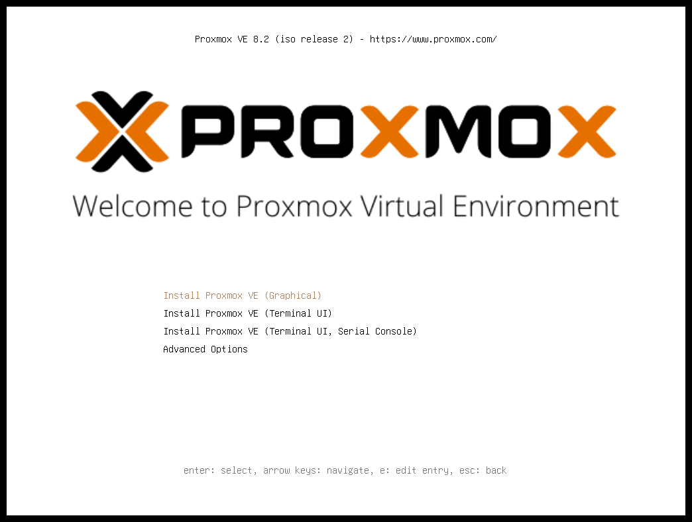
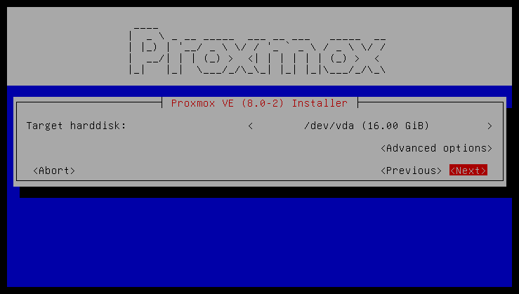
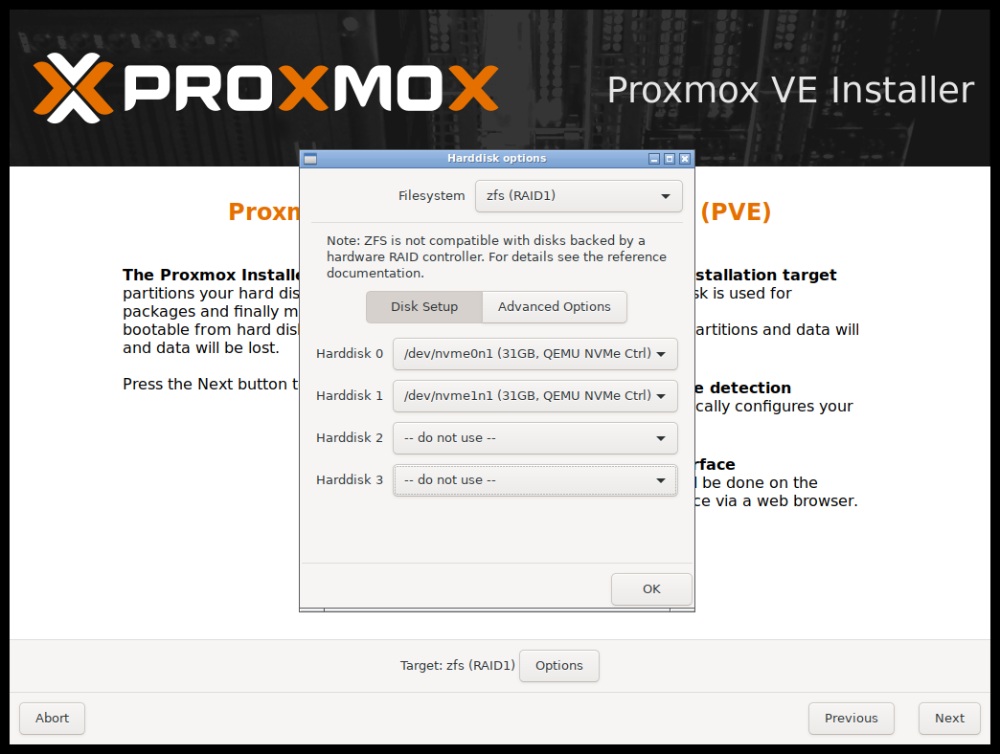
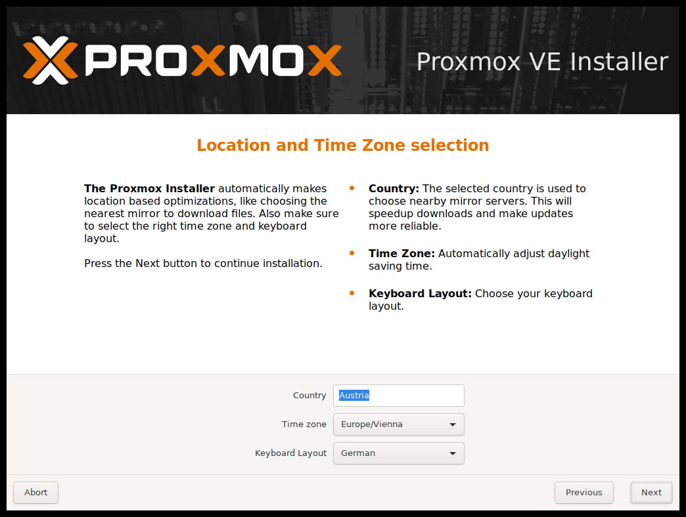
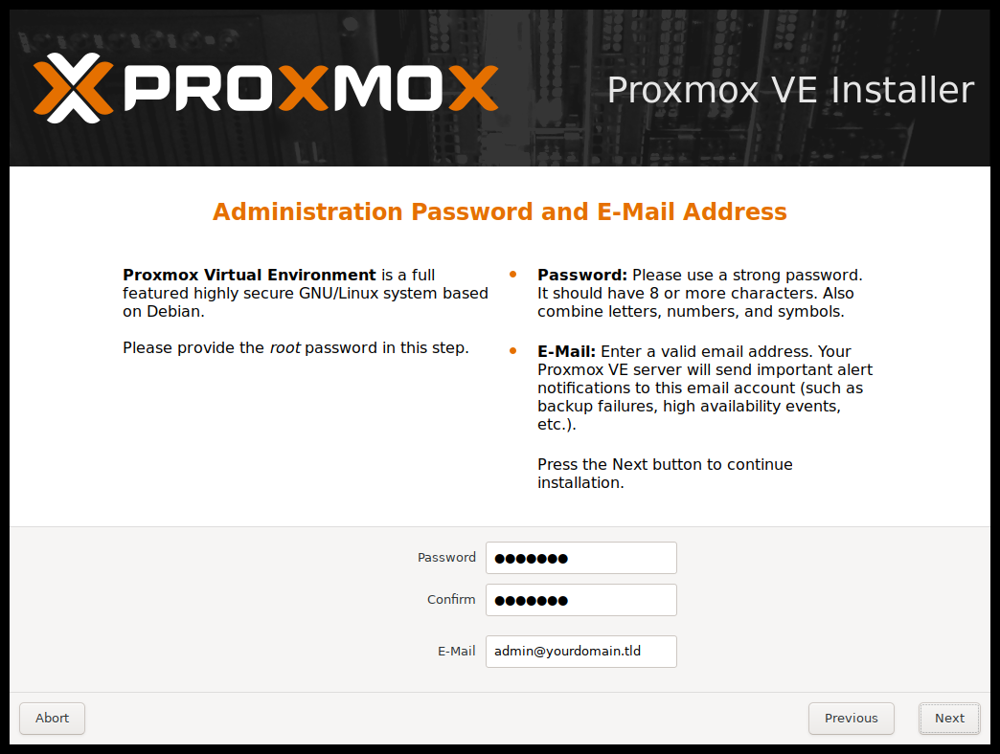
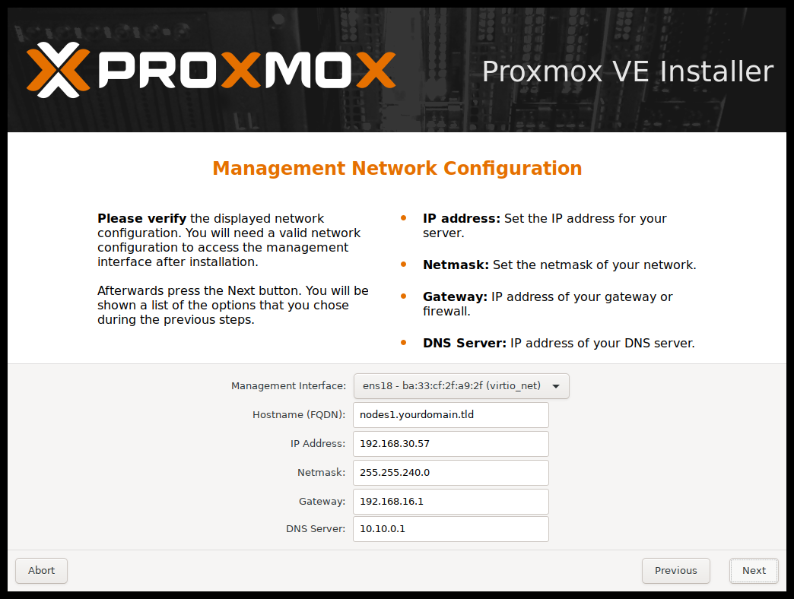
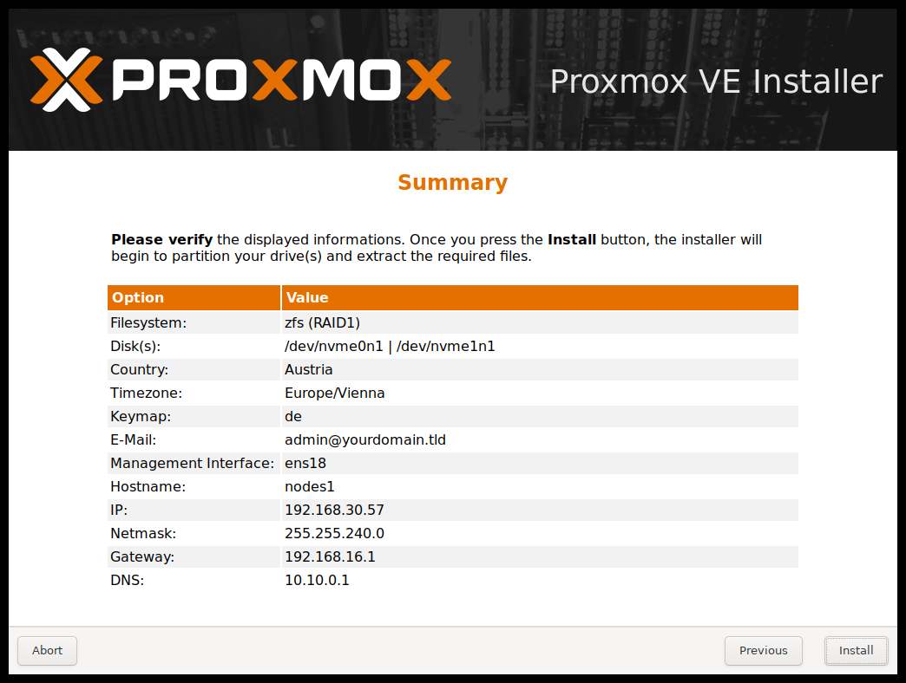
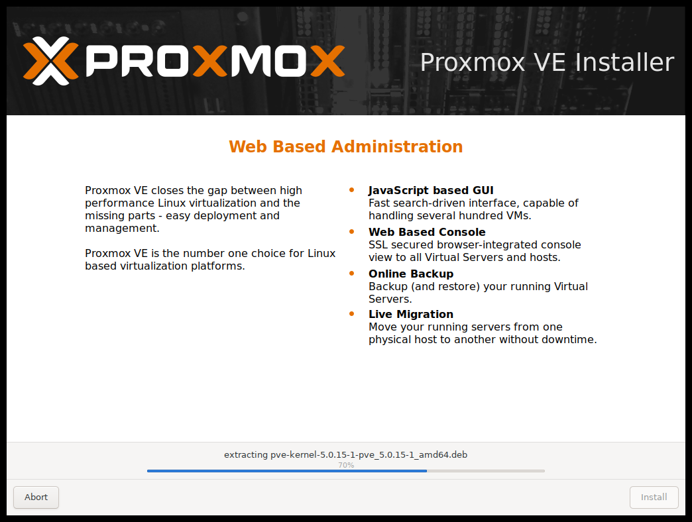
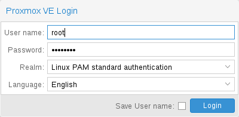

# 2.3. Using the Proxmox VE Installer <a href="#installation_installer" id="installation_installer"></a>

安装程序 ISO 镜像包含以下内容：

- 完整的操作系统（Debian GNU/Linux，64 位）
- Proxmox VE 安装程序，使用 ext4、XFS、BTRFS（技术预览）或 ZFS 对本地磁盘进行分区，并安装操作系统
- 支持 KVM 和 LXC 的 Proxmox VE Linux 内核
- 用于管理虚拟机、容器、宿主机系统、集群及所有必要资源的完整工具集
- 基于 Web 的管理界面


安装过程中，所选驱动器上的所有现有数据都将被删除。安装程序不会为其他操作系统添加启动菜单项。


请插入[准备好的安装介质](02-installation-prepare-media.md)（例如 USB 闪存盘或 CD-ROM），并从该介质启动。


请确保已在服务器的固件设置中启用从安装介质（例如 USB）启动。使用 Proxmox VE 8.1 之前版本的安装程序启动时，需要禁用安全启动。


[](https://pve.proxmox.com/pve-docs/images/screenshot/pve-grub-menu.png)

选择正确的条目（例如 *从 USB 启动*）后，将显示 Proxmox VE 菜单，您可以选择以下选项之一：

**安装 Proxmox VE（图形界面）**

开始正常安装。


可以仅使用键盘操作安装向导。按住 `ALT` 键并同时按下相应按钮上带下划线的字符，即可点击按钮。例如，按 `ALT + N` 可点击 `Next` 按钮。


**安装 Proxmox VE（终端 UI）**

启动终端模式安装向导。它提供与图形安装程序相同的整体安装体验，但通常对非常陈旧和非常新的硬件具有更好的兼容性。

**安装 Proxmox VE（终端 UI，串行控制台）**

启动终端模式安装向导，并额外配置 Linux 内核使用机器的（第一个）串行端口进行输入和输出。如果机器完全无头且只有串行控制台可用，则可以使用此选项。

[](https://pve.proxmox.com/pve-docs/images/screenshot/pve-tui-installer.png)

两种模式的实际安装过程使用相同的代码库，既得益于十多年来积累的错误修复，也确保了功能一致性。


如果图形安装程序无法正常工作（例如由于驱动程序问题），可以使用 *终端 UI* 选项。另请参阅[添加 `nomodeset` 内核参数](#nomodeset_kernel_param)。


**高级选项：安装 Proxmox VE（图形界面，调试模式）**

以调试模式启动安装。在几个安装步骤中会打开控制台。如果出现问题，这有助于调试。要退出调试控制台，请按 `CTRL-D`。此选项可用于启动一个提供所有基本工具的 Live 系统。例如，您可以用它来[修复降级的 ZFS *rpool*](../03-system-administration/09-chapter-zfs.md)，或修复现有 Proxmox VE 安装的[引导加载程序](../03-system-administration/13-sysboot.md)。

**高级选项：安装 Proxmox VE（终端 UI，调试模式）**

与图形调试模式相同，但会将系统准备为运行基于终端的安装程序。

**高级选项：安装 Proxmox VE（串行控制台调试模式）**

与基于终端的调试模式相同，但还会额外配置 Linux 内核使用机器的（第一个）串行端口进行输入和输出。

**高级选项：安装 Proxmox VE（自动化）**

以无人值守模式启动安装程序，即使 ISO 尚未针对自动化安装进行适当准备。此选项可用于收集硬件详细信息，也可能有助于调试自动化安装设置。更多信息请参阅[无人值守安装](04-installation-unattended.md)。

**高级选项：救援启动**

使用此选项可以启动现有安装。它会搜索所有已连接的硬盘。如果找到现有安装，它会使用 ISO 中的 Linux 内核直接从该磁盘启动。如果引导加载程序（GRUB/`systemd-boot`）出现问题，或者 BIOS/UEFI 无法从磁盘读取引导块，此选项会很有用。

**高级选项：测试内存（memtest86\+）**

运行 `memtest86+`。这可用于检查内存是否正常工作且无错误。要运行此选项，必须在 UEFI 固件设置实用程序中关闭安全启动。


此条目仅在 x86 安装介质上可用，因为 `memtest86+` 不支持 arm64。


通常选择**安装 Proxmox VE（图形界面）**来开始安装。

[](https://pve.proxmox.com/pve-docs/images/screenshot/pve-select-target-disk.png)

第一步是阅读 EULA（最终用户许可协议）。然后，您可以选择安装的目标硬盘。


默认情况下，将使用整个服务器，并删除所有现有数据。在继续安装之前，请确保服务器上没有重要数据。


`Options` 按钮可用于选择目标文件系统，默认为 `ext4`。如果选择 `ext4` 或 `xfs` 作为文件系统，安装程序会使用 LVM，并提供用于限制 LVM 空间的额外选项（见[下文](#advanced_lvm_options)）。

Proxmox VE 也可以安装在 ZFS 上。由于 ZFS 提供多种软件 RAID 级别，因此这是没有硬件 RAID 控制器的系统的一种选择。必须在`Options`对话框中选择目标磁盘。可以在[`Advanced Options`](#advanced_zfs_options)下更改更多 ZFS 专用设置。


不支持在任何硬件 RAID 之上使用 ZFS，这可能会导致数据丢失。


[](https://pve.proxmox.com/pve-docs/images/screenshot/pve-select-location.png)

下一页要求提供基本配置选项，例如您所在的位置、时区和键盘布局。位置用于选择附近的下载服务器，以提高更新速度。安装程序通常能够自动检测这些设置，因此只有在自动检测失败的少数情况下，或者当您想使用在所在国家不常用的键盘布局时，才需要更改这些设置。

[](https://pve.proxmox.com/pve-docs/images/screenshot/pve-set-password.png)

您还必须指定超级用户（`root`）的密码和电子邮件地址。密码必须至少包含 8 个字符。强烈建议使用更强的密码。以下是一些准则：

- 使用的密码长度至少为 12 个字符。
- 包含小写和大写字母、数字及符号。
- 避免字符重复、键盘模式、常见词典单词、字母或数字序列、用户名、亲属或宠物的名字、恋爱关系信息（当前或过去）以及个人生平信息（例如身份证号码、祖先姓名或日期）。

该电子邮件地址用于向系统管理员发送通知。例如：

- 有关可用软件包更新的信息。
- 来自周期性 *cron* 作业的错误消息。

[](https://pve.proxmox.com/pve-docs/images/screenshot/pve-setup-network.png)

系统会将所有通知电子邮件发送到指定地址。

最后一步是网络配置。在下拉菜单中，状态为 *UP* 的网络接口名称前会显示一个实心圆。请注意，在安装过程中，您可以指定 IPv4 或 IPv6 地址，但不能同时指定两者。要配置双栈节点，请在安装后添加其他 IP 地址。

[](https://pve.proxmox.com/pve-docs/images/screenshot/pve-install-summary.png)

下一步显示先前所选选项的摘要。请重新检查每项设置，如果需要更改某项设置，请使用 `Previous` 按钮。

点击 `Install` 后，安装程序开始格式化磁盘并将软件包复制到目标磁盘。请等待此步骤完成；然后取出安装介质并重新启动系统。

[](https://pve.proxmox.com/pve-docs/images/screenshot/pve-installation.png)

复制软件包通常需要几分钟，主要取决于安装介质的速度和目标磁盘的性能。

软件包复制和设置完成后，即可重新启动服务器。默认情况下，系统会在几秒钟后自动重新启动。

**安装失败**

如果安装失败，请在第二个 TTY（*CTRL \+ ALT \+ F2*）上查看具体错误，并确保系统满足[最低要求](01-system-requirements.md#install_minimal_requirements)。

如果安装仍无法正常工作，请参阅[如何获取帮助一章](../01-introduction/10-getting-help.md)。

## 2.3.1. Accessing the Management Interface Post-Installation <a href="#_accessing_the_management_interface_post_installation" id="_accessing_the_management_interface_post_installation"></a>

[](https://pve.proxmox.com/pve-docs/images/screenshot/gui-login-window.png)

成功安装并重新启动系统后，您可以使用 Proxmox VE Web 界面进行进一步配置。

1. Point your browser to the IP address given during the installation and port 8006, for example: [https://youripaddress:8006](https://youripaddress:8006)
2. 使用 `root` 用户名（领域为 *PAM*）和安装期间设置的密码登录。
3. 上传您的订阅密钥以访问企业版存储库。否则，您需要设置一个公开的、测试较少的软件包存储库，才能获取安全修复、错误修复和新功能的更新。
4. 检查 IP 配置和主机名。
5. 检查时区。
6. 检查您的[防火墙设置](../13-pve-firewall/README.md)。

## 2.3.2. Advanced LVM Configuration Options <a href="#advanced_lvm_options" id="advanced_lvm_options"></a>

安装程序会创建名为 `pve` 的卷组（VG），以及名为 `root`、`data` 和 `swap` 的其他逻辑卷（LV），前提是使用 `ext4` 或 `xfs`。要控制这些卷的大小，请使用：

**`hdsize`**

定义要使用的硬盘总大小。这样可以在硬盘上保留可用空间，以便进一步分区（例如，在同一硬盘上创建可用于 LVM 存储的额外 PV 和 VG）。

**`swapsize`**

定义 `swap` 卷的大小。默认值为已安装内存的大小，最小 4 GB，最大 8 GB。结果值不能大于硬盘大小的八分之一（`hdsize / 8`）。


如果设置为 `0`，则不会创建 `swap` 卷。


**`maxroot`**

定义存储操作系统的 `root` 卷的最大大小。当可用存储超过 48 GiB 时，默认值为硬盘大小的四分之一（`hdsize / 4`），最大为 96 GiB。当可用存储少于 48 GiB 时，root 卷大小至少为硬盘大小的一半（`hdsize / 2`）。

**`maxvz`**

定义 `data` 卷的最大大小。`data` 卷的实际大小为：

`datasize = hdsize - rootsize - swapsize - minfree`

其中 `datasize` 不能大于 `maxvz`。


In case of LVM thin, the `data` pool will only be created if `datasize` is bigger than 4GB.



如果设置为 `0`，则不会创建 `data` 卷，并且存储配置会相应调整。


**`minfree`**

定义 LVM 卷组 `pve` 中应保留的可用空间量。当可用存储超过 128GB 时，默认值为 16GB，否则将使用 `hdsize/8`。


LVM 要求 VG 中有可用空间才能创建快照（lvmthin 快照不需要）。


## 2.3.3. Advanced ZFS Configuration Options <a href="#advanced_zfs_options" id="advanced_zfs_options"></a>

如果使用 ZFS，安装程序会创建 ZFS 池 `rpool`。不会创建交换空间，但您可以在安装磁盘上保留一些未分区空间用于交换。也可以在安装后创建交换 zvol，但这可能会导致问题（请参阅[ZFS 交换说明](../03-system-administration/09-chapter-zfs.md#zfs_swap)）。

**`ashift`**

定义所创建池的 `ashift` 值。`ashift` 至少需要根据底层磁盘或任何可能加入池的磁盘（例如用于更换故障磁盘的磁盘）的扇区大小进行设置（2 的 `ashift` 次幂即为扇区大小）。

**`compress`**

定义是否为 `rpool` 启用压缩。

**`checksum`**

定义 `rpool` 应使用哪种校验和算法。

**`copies`**

定义 `copies` 参数（用于 `rpool`）。请查阅 `zfs(8)` 手册页以了解其语义，以及为什么它不能替代磁盘级别的冗余。

**`ARC max size`**

定义 ARC 可增长到的最大大小，从而限制 ZFS 将使用的内存量。另请参阅关于[如何限制 ZFS 内存使用量](../03-system-administration/09-chapter-zfs.md#sysadmin_zfs_limit_memory_usage)一节，了解更多详情。

**`hdsize`**

定义要使用的硬盘总大小。这有助于在硬盘上保留可用空间，以便进一步分区（例如创建交换分区）。`hdsize` 仅对可引导磁盘生效，即对于 RAID0、RAID1 或 RAID10，仅第一块磁盘或镜像生效；对于 RAID-Z\[123\]，则对所有磁盘生效。

## 2.3.4. Advanced BTRFS Configuration Options <a href="#advanced_btrfs_options" id="advanced_btrfs_options"></a>

使用 BTRFS 时不会创建交换空间，但您可以在安装磁盘上保留一些未分区空间用于交换。您可以创建独立分区、BTRFS 子卷，或使用 `btrfs filesystem
mkswapfile` 命令创建交换文件。

**`compress`**

定义是否为 BTRFS 子卷启用压缩。支持不同的压缩算法：*on*（等同于 *zlib*）、*zlib*、*lzo* 和 *zstd*。默认为 *off*。

**`hdsize`**

定义要使用的硬盘总大小。这有助于在硬盘上保留可用空间，以便进一步分区（例如创建交换分区）。

## 2.3.5. ZFS Performance Tips <a href="#_zfs_performance_tips" id="_zfs_performance_tips"></a>

ZFS 在配备大量内存时性能最佳。如果打算使用 ZFS，请确保为其提供足够的 RAM。一个较好的计算方法是 4GB 加上每 TB 原始磁盘空间 1GB RAM。

ZFS 可以使用专用驱动器作为写缓存，称为 ZFS 意图日志（ZIL）。请为其使用高速驱动器（SSD）。安装后可以使用以下命令添加：

```text
# zpool add <pool-name> log </dev/path_to_fast_ssd>
```

## 2.3.6. Adding the `nomodeset` Kernel Parameter <a href="#nomodeset_kernel_param" id="nomodeset_kernel_param"></a>

由于显卡驱动程序问题，非常旧或非常新的硬件可能会出现问题。如果安装在引导过程中挂起，可以尝试添加 `nomodeset` 参数。这会阻止 Linux 内核加载任何显卡驱动程序，并强制其继续使用 BIOS/UEFI 提供的帧缓冲区。

在 Proxmox VE 引导加载程序菜单中，导航至 *Install Proxmox VE (Terminal UI)* 并按 `e` 编辑该条目。使用方向键导航到以 `linux` 开头的行，将光标移至该行末尾，并添加参数 `nomodeset`，与原有的最后一个参数之间用一个空格分隔。

然后按 `Ctrl-X` 或 `F10` 引导该配置。

---

来源：[Proxmox VE 官方文档](https://pve.proxmox.com/pve-docs/pve-admin-guide.html) · 版本 9.2.13 · 非官方中文翻译。
