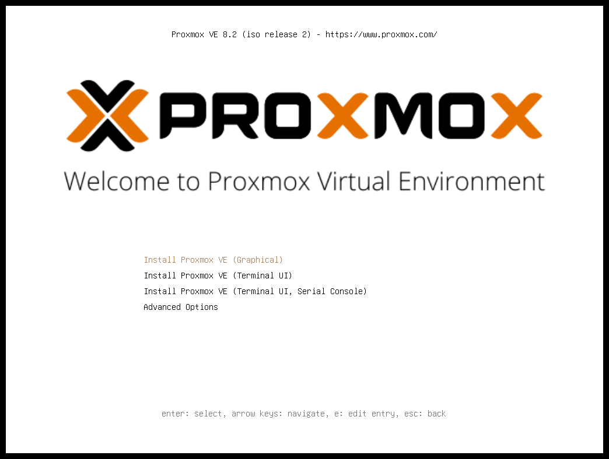
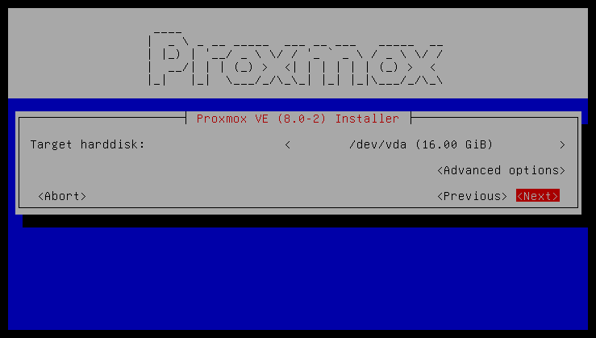
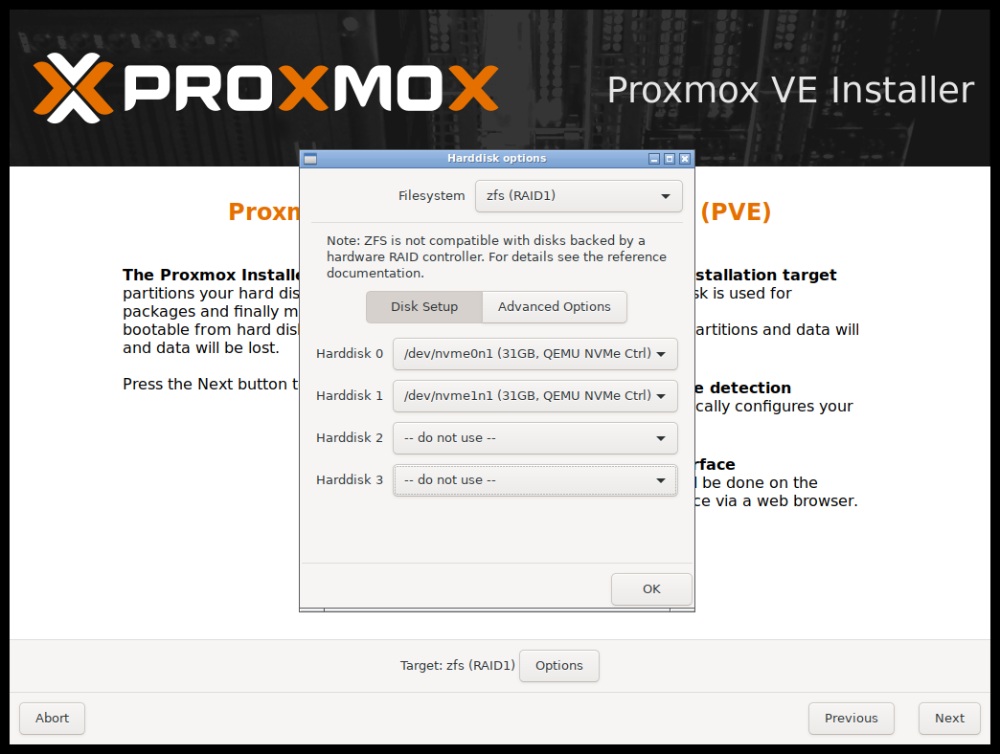
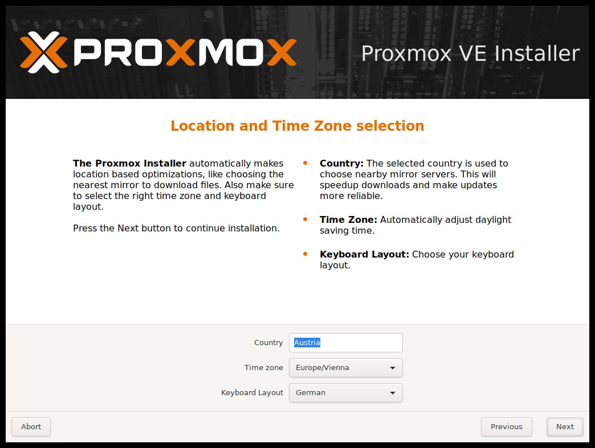
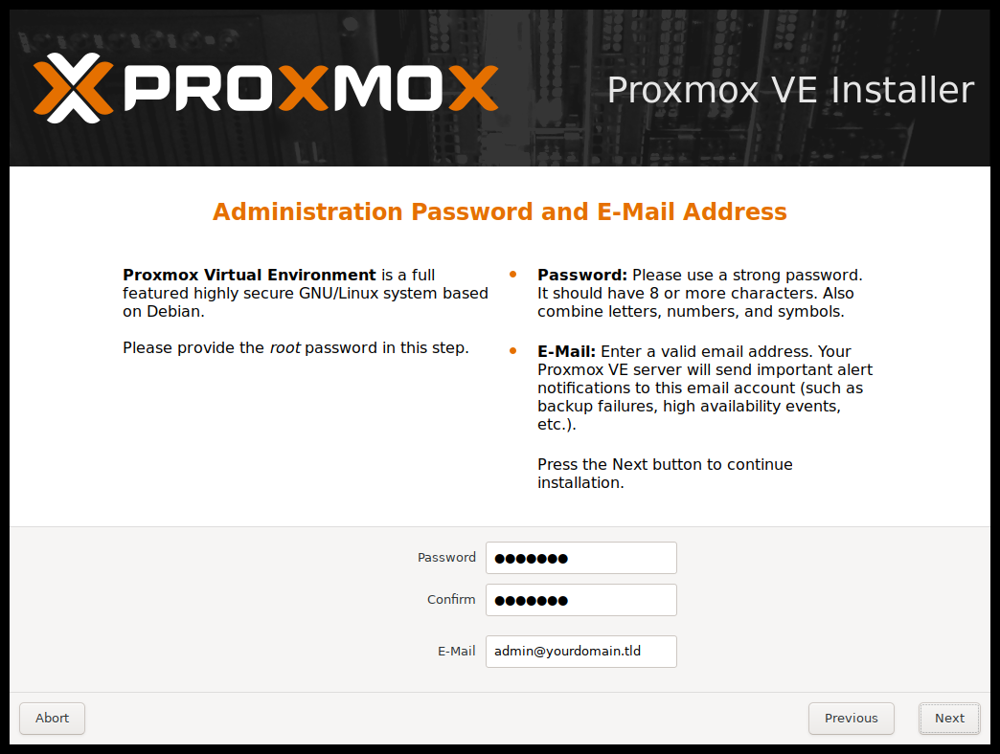
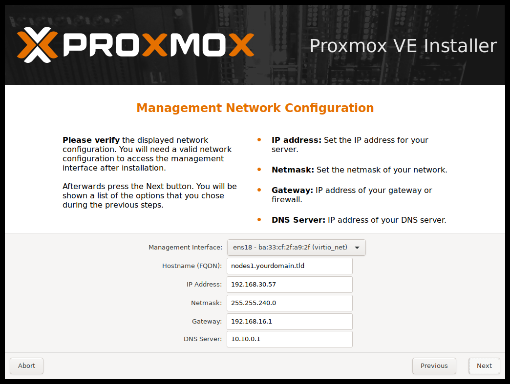
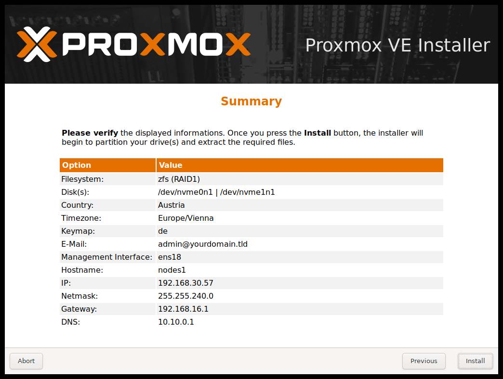
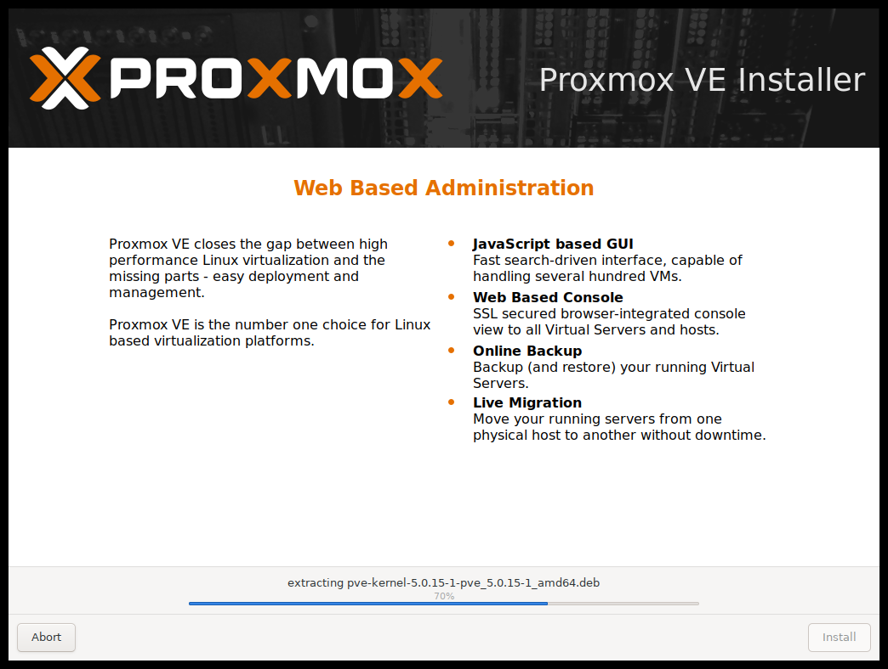
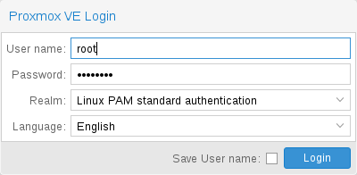

# 2\. 安装 Proxmox VE <a href="#chapter_installation" id="chapter_installation"></a>

Proxmox VE 基于 Debian GNU/Linux。Proxmox 提供的安装磁盘映像（ISO 文件）包含完整的 Debian 系统以及所有必要的 Proxmox VE 软件包。


有关 Proxmox VE 版本与 Debian 版本之间的对应关系，请参阅[常见问题解答中的支持表格](../20-frequently-asked-questions-2/README.md)。


安装程序会引导您完成设置，允许您对本地磁盘进行分区、应用基本系统配置（例如时区、语言、网络），并安装所有必需的软件包。此过程应不超过几分钟。对于新用户和现有用户，推荐使用提供的 ISO 进行安装。

或者，可以在现有 Debian 系统之上安装 Proxmox VE。此选项仅建议高级用户使用，因为需要具备关于 Proxmox VE 的详细知识。

## 2.1. 系统要求 <a href="#system_requirements" id="system_requirements"></a>

在生产环境运行 Proxmox VE 时，我们建议使用高质量的服务器硬件。为了进一步降低宿主机故障造成的影响，您可以在集群中运行 Proxmox VE，并使用高可用性（HA）虚拟机和容器。

Proxmox VE 可以使用本地存储（DAS）、SAN、NAS 以及 Ceph RBD 等分布式存储。详情请参阅[存储章节](../07-storage/README.md)。

### 2.1.1. 评估用途的最低要求 <a href="#install_minimal_requirements" id="install_minimal_requirements"></a>

这些最低要求仅用于评估目的，不应在生产环境中使用。

- CPU：64 位 x86（Intel 64 或 AMD64）。或者，配备 ARMv8-A 或更新 CPU 的 64 位 ARM（arm64、aarch64），请参阅[64 位 ARM（arm64）支持](#install_arm64_support)。
- 对于 x86 宿主机，需要支持 Intel VT 或 AMD-V 的 CPU 和主板，以支持 KVM 完全虚拟化。在受支持的 arm64 平台上，KVM 硬件辅助虚拟化不需要同等的 CPU 标志。
- 内存：1 GB 内存，另加客户机所需的额外内存
- 硬盘
- 一块网卡（NIC）

### 2.1.2. 推荐的系统要求 <a href="#install_recommended_requirements" id="install_recommended_requirements"></a>

- Intel 64 或 AMD64，并带有 Intel VT 或 AMD-V CPU 标志。或者，配备 ARMv9-A 或更新 CPU 的 64 位 ARM 宿主机，请参阅[64 位 ARM（arm64）支持](#install_arm64_support)。
- 内存：操作系统和 Proxmox VE 服务至少需要 2 GB，另加为客户机分配的内存。对于 Ceph 和 ZFS，还需要额外内存；每 TB 已用存储空间约需 1GB 内存。
- 快速且冗余的存储，使用 SSD 可获得最佳效果。
- 操作系统存储：使用带电池保护写缓存（“BBU”）的硬件 RAID，或使用非 RAID 配置搭配 ZFS（可选配用于 ZIL 的 SSD）。
- 虚拟机存储：

  - 对于本地存储，可使用带电池备份写缓存（BBU）的硬件 RAID，或为 ZFS 和 Ceph 使用非 RAID 配置。ZFS 和 Ceph 均不兼容硬件 RAID 控制器。
  - 可以使用共享和分布式存储。
  - 建议使用具有掉电保护（PLP）的 SSD 以获得良好性能。不建议使用消费级 SSD。
- 冗余的（多）Gbit 网卡，并根据所选的存储技术和集群设置配备额外网卡。
- 对于 PCI(e) 直通，CPU 和主板需要支持输入/输出内存管理单元（IOMMU）：x86 上的 Intel VT-d 或 AMD-Vi，或 arm64 上的系统内存管理单元（SMMU）。


通常还需要在 BIOS/UEFI 中启用 IOMMU。详情请参阅[PCI(e) 直通](../10-virtual-machines/README.md#qm_pci_passthrough)章节。


### 2.1.3. 64 位 ARM（arm64）支持 <a href="#install_arm64_support" id="install_arm64_support"></a>

Proxmox VE 在 NVIDIA Grace Hopper 和 NVIDIA Vera 平台上支持原生 64 位 ARM（arm64、aarch64）。对于其他基于 UEFI 的 ARMv9-A 或更新硬件，仅提供尽力而为的支持。不支持仅使用设备树的单板计算机，例如 Raspberry Pi。

arm64 宿主机必须通过 UEFI 启动，并通过 ACPI（高级配置和电源接口）描述其硬件。Proxmox VE 不支持 arm64 上仅使用设备树或传统 BIOS 启动。

以下几项 x86 特有功能在 arm64 上不可用：

- 虚拟机无法使用 SeaBIOS。在 arm64 上，客户机始终通过 UEFI 启动，该 UEFI 由 OVMF 的 ARM 构建版本提供，也称为 AAVMF。
- AMD SEV（安全加密虚拟化）内存加密和 Intel 的 GVT-g 中介型 vGPU 仅支持 x86。
- 与 x86 上的 `intel-microcode` 和 `amd64-microcode` 不同，这里没有操作系统级的 CPU 微码软件包。

一个集群可以同时包含 x86 和 arm64 节点，但运行中的客户机不能在不同架构的节点之间移动：

- 在线迁移只能在相同架构的节点之间进行，因为运行中客户机的 CPU 状态无法跨架构传输。
- 无论是虚拟机还是容器，客户机都只能在与该客户机架构匹配的节点上运行。离线迁移、备份和恢复或共享存储可以将客户机的数据移动到不同架构的节点，但客户机仍需针对该架构重新安装或重新配置后才能启动。

### 2.1.4. 简单性能概览 <a href="#simple_performance_overview" id="simple_performance_overview"></a>

要概览已安装 Proxmox VE 系统的 CPU 和硬盘性能，请运行随附的 `pveperf` 工具。


这只是一个非常快速且笼统的基准测试。建议进行更详细的测试，尤其是针对系统 I/O 性能的测试。


### 2.1.5. 访问 Web 界面支持的浏览器 <a href="#supported_web_browsers_for_accessing_the_web_interface" id="supported_web_browsers_for_accessing_the_web_interface"></a>

要访问基于 Web 的用户界面，我们建议使用以下浏览器之一：

- Firefox，当年发布的版本，或最新的延长支持版本
- Chrome，当年发布的版本
- Microsoft 当前支持的 Edge 版本
- Safari，当年发布的版本

从移动设备访问时，Proxmox VE 会显示基于触摸操作的轻量级界面。

## 2.2. 准备安装介质 <a href="#installation_prepare_media" id="installation_prepare_media"></a>

从以下地址下载安装程序 ISO 映像：[https://www.proxmox.com/en/downloads/proxmox-virtual-environment/iso](https://www.proxmox.com/en/downloads/proxmox-virtual-environment/iso)

Proxmox VE 安装介质是混合 ISO 映像。它有以下两种使用方式：

- 可刻录到 CD 或 DVD 的 ISO 映像文件。
- 可复制到 USB 闪存驱动器（U 盘）的原始扇区（IMG）映像文件。

建议使用 USB 闪存驱动器安装 Proxmox VE，因为这种方式速度更快。

### 2.2.1. 准备 USB 闪存驱动器作为安装介质 <a href="#prepare_a_usb_flash_drive_as_installation_medium" id="prepare_a_usb_flash_drive_as_installation_medium"></a>

闪存驱动器的容量必须大于 ISO 映像。


请勿使用 UNetbootin。它无法与 Proxmox VE 安装映像配合使用。



请确保 USB 闪存驱动器未挂载，且其中不包含任何重要数据。


### 2.2.2. GNU/Linux 操作说明 <a href="#instructions_for_gnu_linux" id="instructions_for_gnu_linux"></a>

在类 Unix 操作系统上，使用 `dd` 命令将 ISO 映像复制到 USB 闪存驱动器。首先找到 USB 闪存驱动器的正确设备名称（见下文）。然后运行 `dd` 命令。

```text
# dd bs=1M conv=fdatasync if=./proxmox-ve_*.iso of=/dev/XYZ
```


请务必将 /dev/XYZ 替换为正确的设备名称，并调整输入文件名（<em>if</em>）的路径。



请务必小心，不要覆盖错误的磁盘！


#### 查找正确的 USB 设备名称 <a href="#find_the_correct_usb_device_name" id="find_the_correct_usb_device_name"></a>

有两种方法可以确定 USB 闪存驱动器的名称。第一种方法是比较插入闪存驱动器前后 `dmesg` 命令输出的最后几行。第二种方法是比较 `lsblk` 命令的输出。打开终端并运行：

```text
# lsblk
```

然后插入 USB 闪存驱动器，并再次运行该命令：

```text
# lsblk
```

此时会出现一个新设备。这就是您要使用的设备。为更加稳妥，请检查报告的大小是否与您的 USB 闪存驱动器相符。

### 2.2.3. macOS 操作说明 <a href="#instructions_for_macos" id="instructions_for_macos"></a>

打开终端（在 Spotlight 中搜索 Terminal）。

将 `.iso` 文件转换为 `.dmg` 格式，可使用 `hdiutil` 的 convert 选项，例如：

```text
# hdiutil convert proxmox-ve_*.iso -format UDRW -o proxmox-ve_*.dmg
```


macOS 往往会自动将 <em>.dmg</em> 附加到输出文件名中。


要获取当前设备列表，请运行以下命令：

```text
# diskutil list
```

现在插入 USB 闪存驱动器，然后再次运行此命令，以确定分配给它的设备节点（例如 /dev/diskX）。

```text
# diskutil list
# diskutil unmountDisk /dev/diskX
```


将 X 替换为上一条命令中的磁盘编号。


```text
# sudo dd if=proxmox-ve_*.dmg bs=1M of=/dev/rdiskX
```


上一条命令中故意使用的是 <em>rdiskX</em>，而不是 <em>diskX</em>。这样可以提高写入速度。


### 2.2.4. Windows 使用说明 <a href="#instructions_for_windows" id="instructions_for_windows"></a>

#### 使用 Etcher <a href="#using_etcher" id="using_etcher"></a>

Etcher 开箱即用。请从 [https://etcher.io](https://etcher.io) 下载 Etcher。它会引导您完成选择 ISO 和 USB 闪存盘的过程。

#### 使用 Rufus <a href="#using_rufus" id="using_rufus"></a>

Rufus 是一种更轻量级的替代方案，但您需要使用 <strong>DD 模式</strong> 才能正常工作。请从 [https://rufus.ie/](https://rufus.ie/) 下载 Rufus。您可以安装它，也可以使用便携版。选择目标驱动器和 Proxmox VE ISO 文件。


点击 <em>开始</em> 后，在询问是否下载其他版本 GRUB 的对话框中，必须点击 <em>否</em>。在下一个对话框中选择 <em>DD</em> 模式。


## 2.3. 使用 Proxmox VE 安装程序 <a href="#installation_installer" id="installation_installer"></a>

安装程序 ISO 镜像包含以下内容：

- 完整的操作系统（Debian GNU/Linux，64 位）
- Proxmox VE 安装程序，使用 ext4、XFS、BTRFS（技术预览）或 ZFS 对本地磁盘进行分区，并安装操作系统
- 支持 KVM 和 LXC 的 Proxmox VE Linux 内核
- 用于管理虚拟机、容器、宿主机系统、集群及所有必要资源的完整工具集
- 基于 Web 的管理界面


安装过程中，所选驱动器上的所有现有数据都将被删除。安装程序不会为其他操作系统添加启动菜单项。


请插入[准备好的安装介质](#installation_prepare_media)（例如 USB 闪存盘或 CD-ROM），并从该介质启动。


请确保已在服务器的固件设置中启用从安装介质（例如 USB）启动。使用 Proxmox VE 8.1 之前版本的安装程序启动时，需要禁用安全启动。


[](https://pve.proxmox.com/pve-docs/images/screenshot/pve-grub-menu.png)

选择正确的条目（例如 <em>从 USB 启动</em>）后，将显示 Proxmox VE 菜单，您可以选择以下选项之一：

**安装 Proxmox VE（图形界面）**

开始正常安装。


可以仅使用键盘操作安装向导。按住 `ALT` 键并同时按下相应按钮上带下划线的字符，即可点击按钮。例如，按 `ALT + N` 可点击 `Next` 按钮。


**安装 Proxmox VE（终端 UI）**

启动终端模式安装向导。它提供与图形安装程序相同的整体安装体验，但通常对非常陈旧和非常新的硬件具有更好的兼容性。

**安装 Proxmox VE（终端 UI，串行控制台）**

启动终端模式安装向导，并额外配置 Linux 内核使用机器的（第一个）串行端口进行输入和输出。如果机器完全无头且只有串行控制台可用，则可以使用此选项。

[](https://pve.proxmox.com/pve-docs/images/screenshot/pve-tui-installer.png)

两种模式的实际安装过程使用相同的代码库，既得益于十多年来积累的错误修复，也确保了功能一致性。


如果图形安装程序无法正常工作（例如由于驱动程序问题），可以使用 <em>终端 UI</em> 选项。另请参阅[添加 `nomodeset` 内核参数](#nomodeset_kernel_param)。


**高级选项：安装 Proxmox VE（图形界面，调试模式）**

以调试模式启动安装。在几个安装步骤中会打开控制台。如果出现问题，这有助于调试。要退出调试控制台，请按 `CTRL-D`。此选项可用于启动一个提供所有基本工具的 Live 系统。例如，您可以用它来[修复降级的 ZFS <em>rpool</em>](../03-system-administration/README.md#chapter_zfs)，或修复现有 Proxmox VE 安装的[引导加载程序](../03-system-administration/README.md#sysboot)。

**高级选项：安装 Proxmox VE（终端 UI，调试模式）**

与图形调试模式相同，但会将系统准备为运行基于终端的安装程序。

**高级选项：安装 Proxmox VE（串行控制台调试模式）**

与基于终端的调试模式相同，但还会额外配置 Linux 内核使用机器的（第一个）串行端口进行输入和输出。

**高级选项：安装 Proxmox VE（自动化）**

以无人值守模式启动安装程序，即使 ISO 尚未针对自动化安装进行适当准备。此选项可用于收集硬件详细信息，也可能有助于调试自动化安装设置。更多信息请参阅[无人值守安装](#installation_unattended)。

**高级选项：救援启动**

使用此选项可以启动现有安装。它会搜索所有已连接的硬盘。如果找到现有安装，它会使用 ISO 中的 Linux 内核直接从该磁盘启动。如果引导加载程序（GRUB/`systemd-boot`）出现问题，或者 BIOS/UEFI 无法从磁盘读取引导块，此选项会很有用。

**高级选项：测试内存（memtest86\+）**

运行 `memtest86+`。这可用于检查内存是否正常工作且无错误。要运行此选项，必须在 UEFI 固件设置实用程序中关闭安全启动。


此条目仅在 x86 安装介质上可用，因为 `memtest86+` 不支持 arm64。


通常选择<strong>安装 Proxmox VE（图形界面）</strong>来开始安装。

[](https://pve.proxmox.com/pve-docs/images/screenshot/pve-select-target-disk.png)

第一步是阅读 EULA（最终用户许可协议）。然后，您可以选择安装的目标硬盘。


默认情况下，将使用整个服务器，并删除所有现有数据。在继续安装之前，请确保服务器上没有重要数据。


`Options` 按钮可用于选择目标文件系统，默认为 `ext4`。如果选择 `ext4` 或 `xfs` 作为文件系统，安装程序会使用 LVM，并提供用于限制 LVM 空间的额外选项（见[下文](#advanced_lvm_options)）。

Proxmox VE 也可以安装在 ZFS 上。由于 ZFS 提供多种软件 RAID 级别，因此这是没有硬件 RAID 控制器的系统的一种选择。必须在`Options`对话框中选择目标磁盘。可以在[`Advanced Options`](#advanced_zfs_options)下更改更多 ZFS 专用设置。


不支持在任何硬件 RAID 之上使用 ZFS，这可能会导致数据丢失。


[](https://pve.proxmox.com/pve-docs/images/screenshot/pve-select-location.png)

下一页要求提供基本配置选项，例如您所在的位置、时区和键盘布局。位置用于选择附近的下载服务器，以提高更新速度。安装程序通常能够自动检测这些设置，因此只有在自动检测失败的少数情况下，或者当您想使用在所在国家不常用的键盘布局时，才需要更改这些设置。

[](https://pve.proxmox.com/pve-docs/images/screenshot/pve-set-password.png)

您还必须指定超级用户（`root`）的密码和电子邮件地址。密码必须至少包含 8 个字符。强烈建议使用更强的密码。以下是一些准则：

- 使用的密码长度至少为 12 个字符。
- 包含小写和大写字母、数字及符号。
- 避免字符重复、键盘模式、常见词典单词、字母或数字序列、用户名、亲属或宠物的名字、恋爱关系信息（当前或过去）以及个人生平信息（例如身份证号码、祖先姓名或日期）。

该电子邮件地址用于向系统管理员发送通知。例如：

- 有关可用软件包更新的信息。
- 来自周期性 <em>cron</em> 作业的错误消息。

[](https://pve.proxmox.com/pve-docs/images/screenshot/pve-setup-network.png)

系统会将所有通知电子邮件发送到指定地址。

最后一步是网络配置。在下拉菜单中，状态为 <em>UP</em> 的网络接口名称前会显示一个实心圆。请注意，在安装过程中，您可以指定 IPv4 或 IPv6 地址，但不能同时指定两者。要配置双栈节点，请在安装后添加其他 IP 地址。

[](https://pve.proxmox.com/pve-docs/images/screenshot/pve-install-summary.png)

下一步显示先前所选选项的摘要。请重新检查每项设置，如果需要更改某项设置，请使用 `Previous` 按钮。

点击 `Install` 后，安装程序开始格式化磁盘并将软件包复制到目标磁盘。请等待此步骤完成；然后取出安装介质并重新启动系统。

[](https://pve.proxmox.com/pve-docs/images/screenshot/pve-installation.png)

复制软件包通常需要几分钟，主要取决于安装介质的速度和目标磁盘的性能。

软件包复制和设置完成后，即可重新启动服务器。默认情况下，系统会在几秒钟后自动重新启动。

**安装失败**

如果安装失败，请在第二个 TTY（<em>CTRL \+ ALT \+ F2</em>）上查看具体错误，并确保系统满足[最低要求](#install_minimal_requirements)。

如果安装仍无法正常工作，请参阅[如何获取帮助一章](../01-introduction/README.md#getting_help)。

### 2.3.1. 安装后访问管理界面 <a href="#accessing_the_management_interface_post_installation" id="accessing_the_management_interface_post_installation"></a>

[](https://pve.proxmox.com/pve-docs/images/screenshot/gui-login-window.png)

成功安装并重新启动系统后，您可以使用 Proxmox VE Web 界面进行进一步配置。

1. 将浏览器指向安装期间指定的 IP 地址和端口 8006，例如：[https://youripaddress:8006](https://youripaddress:8006)
2. 使用 `root` 用户名（领域为 <em>PAM</em>）和安装期间设置的密码登录。
3. 上传您的订阅密钥以访问企业版存储库。否则，您需要设置一个公开的、测试较少的软件包存储库，才能获取安全修复、错误修复和新功能的更新。
4. 检查 IP 配置和主机名。
5. 检查时区。
6. 检查您的[防火墙设置](../13-pve-firewall/README.md)。

### 2.3.2. 高级 LVM 配置选项 <a href="#advanced_lvm_options" id="advanced_lvm_options"></a>

安装程序会创建名为 `pve` 的卷组（VG），以及名为 `root`、`data` 和 `swap` 的其他逻辑卷（LV），前提是使用 `ext4` 或 `xfs`。要控制这些卷的大小，请使用：

**`hdsize`**

定义要使用的硬盘总大小。这样可以在硬盘上保留可用空间，以便进一步分区（例如，在同一硬盘上创建可用于 LVM 存储的额外 PV 和 VG）。

**`swapsize`**

定义 `swap` 卷的大小。默认值为已安装内存的大小，最小 4 GB，最大 8 GB。结果值不能大于硬盘大小的八分之一（`hdsize / 8`）。


如果设置为 `0`，则不会创建 `swap` 卷。


**`maxroot`**

定义存储操作系统的 `root` 卷的最大大小。当可用存储超过 48 GiB 时，默认值为硬盘大小的四分之一（`hdsize / 4`），最大为 96 GiB。当可用存储少于 48 GiB 时，root 卷大小至少为硬盘大小的一半（`hdsize / 2`）。

**`maxvz`**

定义 `data` 卷的最大大小。`data` 卷的实际大小为：

`datasize = hdsize - rootsize - swapsize - minfree`

其中 `datasize` 不能大于 `maxvz`。


对于 LVM thin，`data` 池仅在 `datasize` 大于 4GB 时创建。



如果设置为 `0`，则不会创建 `data` 卷，并且存储配置会相应调整。


**`minfree`**

定义 LVM 卷组 `pve` 中应保留的可用空间量。当可用存储超过 128GB 时，默认值为 16GB，否则将使用 `hdsize/8`。


LVM 要求 VG 中有可用空间才能创建快照（lvmthin 快照不需要）。


### 2.3.3. 高级 ZFS 配置选项 <a href="#advanced_zfs_options" id="advanced_zfs_options"></a>

如果使用 ZFS，安装程序会创建 ZFS 池 `rpool`。不会创建交换空间，但您可以在安装磁盘上保留一些未分区空间用于交换。也可以在安装后创建交换 zvol，但这可能会导致问题（请参阅[ZFS 交换说明](../03-system-administration/README.md#zfs_swap)）。

**`ashift`**

定义所创建池的 `ashift` 值。`ashift` 的设置必须确保所表示的扇区大小（即 2 的 `ashift` 次幂）不小于底层磁盘或任何可能加入池的磁盘（例如用于更换故障磁盘的磁盘）的扇区大小。

**`compress`**

定义是否为 `rpool` 启用压缩。

**`checksum`**

定义 `rpool` 应使用哪种校验和算法。

**`copies`**

定义 `copies` 参数（用于 `rpool`）。请查阅 `zfs(8)` 手册页以了解其语义，以及为什么它不能替代磁盘级别的冗余。

**`ARC max size`**

定义 ARC 可增长到的最大大小，从而限制 ZFS 将使用的内存量。另请参阅关于[如何限制 ZFS 内存使用量](../03-system-administration/README.md#sysadmin_zfs_limit_memory_usage)一节，了解更多详情。

**`hdsize`**

定义要使用的硬盘总大小。这有助于在硬盘上保留可用空间，以便进一步分区（例如创建交换分区）。`hdsize` 仅对可引导磁盘生效，即对于 RAID0、RAID1 或 RAID10，仅第一块磁盘或镜像生效；对于 RAID-Z\[123\]，则对所有磁盘生效。

### 2.3.4. BTRFS 高级配置选项 <a href="#advanced_btrfs_options" id="advanced_btrfs_options"></a>

使用 BTRFS 时不会创建交换空间，但您可以在安装磁盘上保留一些未分区空间用于交换。您可以创建独立分区、BTRFS 子卷，或使用 `btrfs filesystem
mkswapfile` 命令创建交换文件。

**`compress`**

定义是否为 BTRFS 子卷启用压缩。支持不同的压缩算法：<em>on</em>（等同于 <em>zlib</em>）、<em>zlib</em>、<em>lzo</em> 和 <em>zstd</em>。默认为 <em>off</em>。

**`hdsize`**

定义要使用的硬盘总大小。这有助于在硬盘上保留可用空间，以便进一步分区（例如创建交换分区）。

### 2.3.5. ZFS 性能提示 <a href="#zfs_performance_tips" id="zfs_performance_tips"></a>

ZFS 在配备大量内存时性能最佳。如果打算使用 ZFS，请确保为其提供足够的 RAM。一个较好的计算方法是 4GB 加上每 TB 原始磁盘空间 1GB RAM。

ZFS 可以使用专用驱动器作为写缓存，称为 ZFS 意图日志（ZIL）。请为其使用高速驱动器（SSD）。安装后可以使用以下命令添加：

```text
# zpool add <pool-name> log </dev/path_to_fast_ssd>
```

### 2.3.6. 添加 `nomodeset` 内核参数 <a href="#nomodeset_kernel_param" id="nomodeset_kernel_param"></a>

由于显卡驱动程序问题，非常旧或非常新的硬件可能会出现问题。如果安装在引导过程中挂起，可以尝试添加 `nomodeset` 参数。这会阻止 Linux 内核加载任何显卡驱动程序，并强制其继续使用 BIOS/UEFI 提供的帧缓冲区。

在 Proxmox VE 引导加载程序菜单中，导航至 <em>Install Proxmox VE (Terminal UI)</em> 并按 `e` 编辑该条目。使用方向键导航到以 `linux` 开头的行，将光标移至该行末尾，并添加参数 `nomodeset`，与原有的最后一个参数之间用一个空格分隔。

然后按 `Ctrl-X` 或 `F10` 引导该配置。

## 2.4. 无人值守安装 <a href="#installation_unattended" id="installation_unattended"></a>

自动化安装方法允许以无人值守方式安装 Proxmox VE。这使您能够在裸机上完全自动化设置过程。安装完成且宿主机启动后，可以使用 Ansible 等自动化工具进一步配置安装。

必须在应答文件中提供安装程序所需的选项。此文件允许使用过滤规则来确定应使用哪些磁盘和网卡。

要使用自动化安装，首先选择获取应答文件的来源，然后根据该选择准备安装 ISO。

ISO 准备好后，其初始引导菜单将显示一个名为 <em>Automated Installation</em> 的新引导条目，该条目会在 10 秒超时后自动选中。

[访问 Wiki](https://pve.proxmox.com/wiki/Automated_Installation)，了解有关无人值守安装的更多详情和信息。

## 2.5. 在 Debian 上安装 Proxmox VE <a href="#install_proxmox_ve_on_debian" id="install_proxmox_ve_on_debian"></a>

Proxmox VE 以一组 Debian 软件包的形式提供，可以安装在标准 Debian 安装之上。[配置软件仓库后](../03-system-administration/README.md#sysadmin_package_repositories)，您需要运行以下命令：

```text
# apt-get update
# apt-get install proxmox-ve
```

在现有 Debian 安装之上进行安装看起来很简单，但它假定基础系统已正确安装，并且您知道要如何配置和使用本地存储。您还需要手动配置网络。

通常，这并不简单，尤其是在使用 LVM 或 ZFS 时。

可以在 [wiki](https://pve.proxmox.com/wiki/Install_Proxmox_VE_on_Debian_13_Trixie) 上找到详细的分步操作指南。

---

来源：[Proxmox VE 官方文档](https://pve.proxmox.com/pve-docs/pve-admin-guide.html) · 版本 9.2.13 · 非官方中文翻译。
