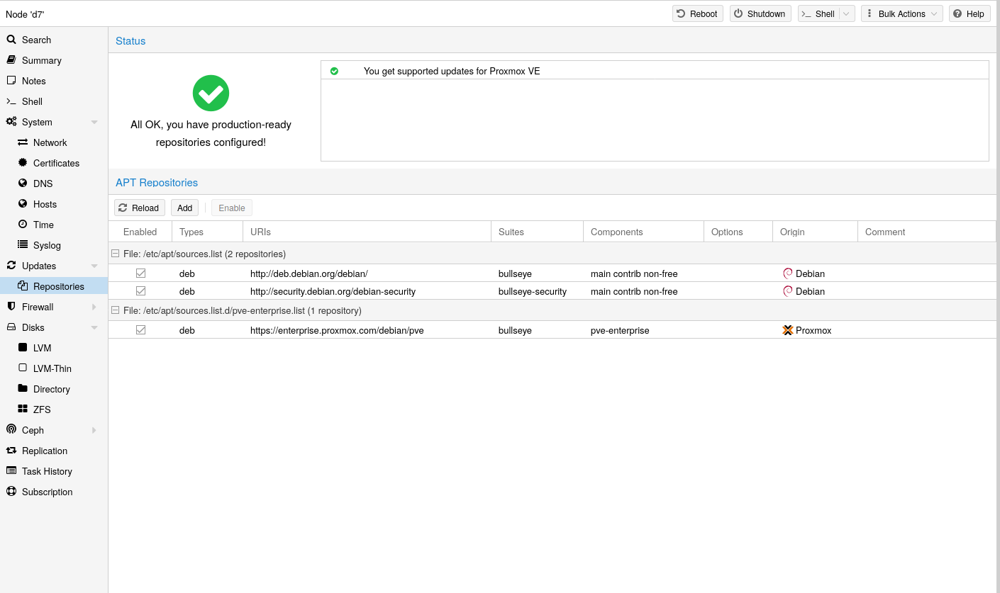

# 3.1. 软件包仓库 <a href="#sysadmin_package_repositories" id="sysadmin_package_repositories"></a>

与其他基于 Debian 的系统一样，Proxmox VE 使用 [APT](http://en.wikipedia.org/wiki/Advanced_Packaging_Tool) 作为软件包管理工具。

Proxmox VE 每天自动检查软件包更新。`root@pam` 用户会通过电子邮件收到有关可用更新的通知。在 GUI 中，可以使用 *Changelog* 按钮查看所选更新的更多详情。

## 3.1.1. Proxmox VE 中的软件仓库 <a href="#repositories_in_proxmox_ve" id="repositories_in_proxmox_ve"></a>

软件仓库是软件包的集合，可用于安装新软件，也对获取新更新非常重要。


您需要有效的 Debian 和 Proxmox 软件仓库，才能获取最新的安全更新、错误修复和新功能。


APT 软件仓库的旧式单行格式定义在文件 `/etc/apt/sources.list` 中，现代 deb822 多行格式定义在 `.sources` 文件中，这些文件位于 `/etc/apt/sources.list.d/`；详情请参阅[软件仓库格式](#sysadmin_apt_repo_formats)。

### 软件仓库管理 <a href="#repository_management" id="repository_management"></a>

[](https://pve.proxmox.com/pve-docs/images/screenshot/gui-node-repositories.png)

自 Proxmox VE 7 起，您可以在 Web 界面中检查软件仓库状态。节点摘要面板显示高层级状态概览，而单独的 *Repository* 面板显示详细状态和所有已配置软件仓库的列表。

还支持基本的软件仓库管理，例如启用或禁用软件仓库。

通过运行 `apt update` 获取软件仓库中的可用软件包。可以直接使用 `apt` 安装更新，也可以通过 GUI（节点 → 更新）安装。

### 软件仓库格式 <a href="#sysadmin_apt_repo_formats" id="sysadmin_apt_repo_formats"></a>

软件包仓库可以在源列表 */etc/apt/sources.list* 以及 */etc/apt/sources.list.d/* 中包含的文件中进行配置。

支持两种格式：

**单行**

在单行 `sources.list` 文件中，每行定义一个软件包仓库。空行会被忽略。一行中任意位置的 `#` 字符会将该行剩余部分标记为注释。这是旧式格式。从 Debian 13 Trixie 开始，apt 会对使用这种格式发出警告。您可以使用 `apt
modernize-sources` 命令自动迁移大多数软件仓库。

**deb822**

在多行格式 `repo.sources` 文件中，每个条目由多行键值对组成。一个文件可以通过用空行分隔各组来包含多个条目。这是现代格式。

### 可用的软件仓库 <a href="#available_repositories" id="available_repositories"></a>

除了需要基础 Debian 软件仓库外，Proxmox VE 还提供三个不同的软件包仓库。

## 3.1.2. Debian 基础软件仓库 <a href="#debian_base_repositories" id="debian_base_repositories"></a>

**文件 `/etc/apt/sources.list.d/debian.sources`**

```text
Types: deb deb-src
URIs: http://deb.debian.org/debian/
Suites: trixie trixie-updates
Components: main non-free-firmware
Signed-By: /usr/share/keyrings/debian-archive-keyring.gpg

Types: deb deb-src
URIs: http://security.debian.org/debian-security/
Suites: trixie-security
Components: main non-free-firmware
Signed-By: /usr/share/keyrings/debian-archive-keyring.gpg
```

## 3.1.3. Proxmox VE 企业版软件仓库 <a href="#sysadmin_enterprise_repo" id="sysadmin_enterprise_repo"></a>

这是推荐的软件仓库，面向所有 Proxmox VE 订阅用户开放。它包含最稳定的软件包，适合生产环境使用。默认启用 `pve-enterprise` 软件仓库：

**文件 `/etc/apt/sources.list.d/pve-enterprise.sources`**

```text
Types: deb
URIs: https://enterprise.proxmox.com/debian/pve
Suites: trixie
Components: pve-enterprise
Signed-By: /usr/share/keyrings/proxmox-archive-keyring.gpg
```

请注意，您需要有效的订阅密钥才能访问 `pve-enterprise` 软件仓库。我们提供不同的支持级别，您可以在 [https://proxmox.com/en/proxmox-virtual-environment/pricing](https://proxmox.com/en/proxmox-virtual-environment/pricing) 找到更多详情。


订阅密钥与宿主机架构绑定。arm64 宿主机需要专用的 arm64 订阅密钥；x86 密钥在其上无效，反之亦然。



您可以通过在文件中相关条目添加一行 `Enabled: no` 来禁用此软件仓库。如果您的宿主机没有订阅密钥，这将防止出现错误消息。在这种情况下，请配置 `pve-no-subscription` 软件仓库。


## 3.1.4. Proxmox VE 无订阅软件仓库 <a href="#sysadmin_no_subscription_repo" id="sysadmin_no_subscription_repo"></a>

顾名思义，访问此软件仓库无需订阅密钥。它可用于测试和非生产环境。不建议在生产服务器上使用它，因为这些软件包并非总是经过同样充分的测试和验证。

我们建议在 `/etc/apt/sources.list.d/proxmox.sources` 中配置此软件仓库。

**文件 `/etc/apt/sources.list.d/proxmox.sources`**

```text
Types: deb
URIs: http://download.proxmox.com/debian/pve
Suites: trixie
Components: pve-no-subscription
Signed-By: /usr/share/keyrings/proxmox-archive-keyring.gpg
```


请记住，除了 Proxmox VE Proxmox 软件仓库之外，您始终还需要基础 Debian 软件仓库。


## 3.1.5. Proxmox VE 测试软件仓库 <a href="#sysadmin_test_repo" id="sysadmin_test_repo"></a>

此软件仓库包含最新的软件包，主要由开发人员用于测试新功能。要配置它，请将以下配置节添加到文件 `/etc/apt/sources.list.d/proxmox.sources`：

**文件 `/etc/apt/sources.list.d/proxmox.sources`**

```text
Types: deb
URIs: http://download.proxmox.com/debian/pve
Suites: trixie
Components: pve-test
Signed-By: /usr/share/keyrings/proxmox-archive-keyring.gpg
```


`pve-test` 软件仓库应（顾名思义）仅用于测试新功能或错误修复。


## 3.1.6. Proxmox VE 调试符号软件仓库 <a href="#sysadmin_dbgsym_repo" id="sysadmin_dbgsym_repo"></a>

调试符号软件包名为 `<package>-dbgsym`，包含与相应二进制软件包匹配的分离调试信息。正常运行不需要它们，但在分析崩溃或挂起时，它们能让 `gdb`、`systemd-coredump` 或 `crash` 等工具生成有用的回溯信息。对于基于 Debian Bookworm 和 Trixie 的 Proxmox VE 版本（及更新版本），这些软件包在一个独立于常规软件仓库的专用软件仓库中提供。

**文件 `/etc/apt/sources.list.d/pve-dbgsym.sources`**

```text
Types: deb
URIs: https://dbgsym.proxmox.com/debian/pve
Suites: trixie
Components: pve-dbgsym
Signed-By: /usr/share/keyrings/proxmox-archive-keyring.gpg
```

启用软件仓库后，安装与要调试的二进制文件相匹配的 `-dbgsym` 软件包。

## 3.1.7. Ceph 软件仓库 <a href="#sysadmin_package_repositories_ceph" id="sysadmin_package_repositories_ceph"></a>

Ceph 相关软件包通过预配置的 Ceph 企业版软件仓库保持最新。预装的软件包支持连接外部 Ceph 集群，并将其 [RBD](../07-storage/14-ceph-rados-block-devices.md) 或 [CephFS](../07-storage/15-storage-cephfs.md) 池添加为存储。您还可以构建 [超融合基础设施 (HCI)](../01-introduction/07-chapter-hyper-converged-infrastructure.md)，方法是在 Proxmox VE 集群之上运行 [Ceph](../08-pveceph/README.md)。

本章信息在以下情况下会有所帮助：

**安装 Ceph 以构建 HCI**

选择一个下文介绍的软件仓库和较新的 Ceph 版本，然后您可以在 [基于 Web 的向导或 CLI 工具](../08-pveceph/04-pve-ceph-install-wizard.md)中选择它们。

**已在运行 HCI，并希望升级到下一个 *Ceph* 主要版本**

请遵循相关的 [Ceph 升级指南](https://pve.proxmox.com/wiki/Category:Ceph_Upgrade)。

**已在运行 HCI，并希望升级到下一个 *Proxmox VE* 主要版本**

在 HCI 中，每个 Proxmox VE 主要版本都需要相应的最低 Ceph 主要版本，请遵循相关的 [Proxmox VE 升级指南](https://pve.proxmox.com/wiki/Category:Upgrade)。

**未运行 HCI，但使用外部 Ceph 集群**

要安装用于连接 Ceph 的较新软件包，请应用可用的系统更新，选择下面列出的软件仓库和 Ceph 版本，通过 *[Repository](#repository_management)* 面板将其添加到您的节点，应用新可用的系统更新，通过运行 `ceph --version` 验证结果，并禁用旧的 Ceph 软件仓库。

### Proxmox VE 9 中可用的 Ceph 版本 <a href="#ceph_release_table" id="ceph_release_table"></a>

要阅读适用于您 Proxmox VE 版本的最新版管理指南，请确保已安装所有系统更新，并已重新加载此页面。

<table>


<tbody>
<tr>
<td><p></p></td>
<td><p><a href="https://docs.ceph.com/en/tentacle/releases/">预计生命周期结束时间</a></p></td>
<td><p><strong><code>enterprise</code></strong></p></td>
<td><p><strong><code>no-subscription</code></strong></p></td>
<td><p><strong><code>test</code></strong></p></td>
</tr>
<tr>
<td><p><strong><code>ceph-tentacle</code></strong></p></td>
<td><p>2027-11 (v20.2)</p></td>
<td><p>推荐</p></td>
<td><p>可用</p></td>
<td><p>可用</p></td>
</tr>
<tr>
<td><p><strong><code>ceph-squid</code></strong></p></td>
<td><p>2026-09 (v19.2)</p></td>
<td><p>可用</p></td>
<td><p>可用</p></td>
<td><p>可用</p></td>
</tr>
</tbody>
</table>

**适用于 Proxmox VE 9 的 Ceph 软件仓库**

下方 `ceph.sources` 文件的内容作为参考（在 Proxmox VE 9 之前使用的是文件 `ceph.list`）。要进行更改，请按照本子章节开头所述，采用适用于您情况的处理方式。如果您已在 Web UI 中禁用某个软件仓库，并且还想将其从列表中移除，可以手动从文件中删除相应条目。

**`enterprise`**

此软件仓库建议用于生产环境，包含最稳定的软件包版本。如果 Proxmox VE 节点拥有任何级别的有效订阅，即可访问该软件仓库。有关详情和包含的客户支持级别，请访问：

[https://proxmox.com/en/proxmox-virtual-environment/pricing](https://proxmox.com/en/proxmox-virtual-environment/pricing)

**文件 `/etc/apt/sources.list.d/ceph.sources`**

```text
Types: deb
URIs: https://enterprise.proxmox.com/debian/ceph-tentacle
Suites: trixie
Components: enterprise
Signed-By: /usr/share/keyrings/proxmox-archive-keyring.gpg
```

**`no-subscription`**

此软件仓库适用于测试和非生产环境。它可自由访问，无需有效订阅。一段时间后，其软件包版本也会在企业版软件仓库中提供。

**文件 `/etc/apt/sources.list.d/ceph.sources`**

```text
Types: deb
URIs: http://download.proxmox.com/debian/ceph-tentacle
Suites: trixie
Components: no-subscription
Signed-By: /usr/share/keyrings/proxmox-archive-keyring.gpg
```

**`test`**

此存储库包含最新的软件包版本，主要供开发人员用于测试新功能和错误修复。

**文件 `/etc/apt/sources.list.d/ceph.sources`**

```text
Types: deb
URIs: http://download.proxmox.com/debian/ceph-tentacle
Suites: trixie
Components: test
Signed-By: /usr/share/keyrings/proxmox-archive-keyring.gpg
```


Ceph **`test`** 存储库应（顾名思义）仅用于测试新功能或错误修复。


## 3.1.8. Debian 固件存储库 <a href="#sysadmin_debian_firmware_repo" id="sysadmin_debian_firmware_repo"></a>

从 Debian Bookworm（Proxmox VE 8）开始，非自由固件（按 [DFSG](https://www.debian.org/social_contract#guidelines) 的定义）已移至新创建的 Debian 存储库组件 `non-free-firmware`。

自 Proxmox VE 9 起，新安装默认启用此存储库，以确保能够获得 [操作系统早期微码更新](03-chapter-firmware-updates.md#sysadmin_firmware_cpu)。

您还可以获取额外的 [运行时固件文件](03-chapter-firmware-updates.md#sysadmin_firmware_runtime_files)，这些文件尚未包含在预装软件包 `pve-firmware` 中。

要能够安装来自此组件的软件包，请运行 `editor /etc/apt/sources.list`，将 `non-free-firmware` 追加到每个 `.debian.org` 存储库行的末尾，然后运行 `apt update`。

如果您从早期版本的 Proxmox VE 升级到 Proxmox VE 9，并且已将软件包存储库现代化为新的 deb822 样式，则需要改为调整 `/etc/apt/sources.list.d/debian.sources`。请运行 `editor
/etc/apt/sources.list.d/debian.sources`，并将 `non-free-firmware` 添加到每个配置节中以 `Components:` 开头的行。


建议将软件包存储库现代化。否则，Debian Trixie 上的 `apt` 会发出警告。您可以运行 `apt modernize-sources` 来完成此操作。


## 3.1.9. SecureApt <a href="#repos_secure_apt" id="repos_secure_apt"></a>

存储库中的 *Release* 文件使用 GnuPG 签名。APT 使用这些签名来验证所有软件包均来自可信来源。

如果您从官方 ISO 镜像安装 Proxmox VE，用于验证的密钥已经安装。

如果您在 Debian 之上安装 Proxmox VE，请使用以下命令下载并安装密钥：

```text
 # wget https://enterprise.proxmox.com/debian/proxmox-archive-keyring-trixie.gpg -O /usr/share/keyrings/proxmox-archive-keyring.gpg
```


上面的 `wget` 命令会添加适用于基于 Debian Trixie 的 Proxmox 版本的密钥环。安装 `proxmox-archive-keyring` 软件包后，该软件包将管理此文件。届时，随着新 Proxmox 版本的密钥被添加或移除，下面的哈希值可能不再与此文件的哈希值匹配。这是预期行为，`apt` 将确保仅使用可信密钥。**安装 `proxmox-archive-keyring` 后，不建议修改此文件。**


随后使用 `sha512sum` 命令行工具验证校验和：

```text
# sha256sum /usr/share/keyrings/proxmox-archive-keyring.gpg
 136673be77aba35dcce385b28737689ad64fd785a797e57897589aed08db6e45 /usr/share/keyrings/proxmox-archive-keyring.gpg
```

或者使用 `md5sum` 命令行工具：

```text
# md5sum /usr/share/keyrings/proxmox-archive-keyring.gpg
77c8b1166d15ce8350102ab1bca2fcbf /usr/share/keyrings/proxmox-archive-keyring.gpg
```


请确保安装密钥的路径与存储库配置节中的 `Signed-By:` 行相匹配。


---

来源：[Proxmox VE 官方文档](https://pve.proxmox.com/pve-docs/pve-admin-guide.html) · 版本 9.2.13 · 非官方中文翻译。
