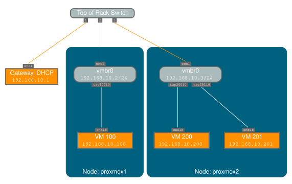
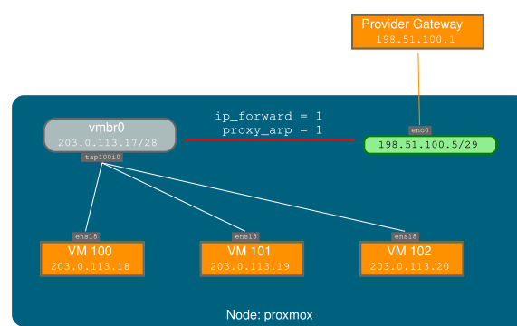
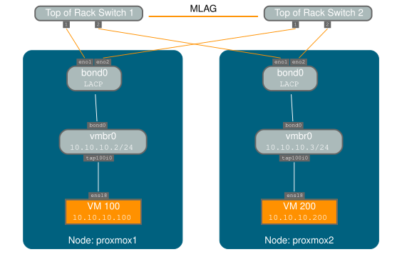

# 3.4. 网络配置 <a href="#sysadmin_network_configuration" id="sysadmin_network_configuration"></a>

Proxmox VE 使用 Linux 网络协议栈。这为在 Proxmox VE 节点上设置网络提供了很大的灵活性。可以通过图形用户界面进行配置，也可以手动编辑包含完整网络配置的文件 `/etc/network/interfaces`。`interfaces(5)` 手册页包含完整的格式说明。所有 Proxmox VE 工具都会尽力保留用户的直接修改，但仍建议优先使用图形用户界面，因为它可以防止您出错。

需要 Linux 网桥接口（通常称为 *vmbrX*）才能将客户机连接到底层物理网络。可以将其视为一个虚拟交换机，客户机和物理接口都连接到该交换机。本节提供一些网络设置示例，以满足不同用例的需求，例如使用 [*绑定*](#sysadmin_network_bond) 实现冗余、[*VLAN*](#sysadmin_network_vlan)，或 [*路由*](#sysadmin_network_routed) 和 [*NAT*](#sysadmin_network_masquerading) 设置。

[软件定义网络](../12-pvesdn/README.md) 是 Proxmox VE 集群中更复杂虚拟网络的一种选择。


如果不确定，不建议使用传统的 Debian 工具 `ifup` 和 `ifdown`，因为它们存在一些隐患，例如在 `ifdown vmbrX` 时中断所有客户机流量，但之后在同一网桥上执行 `ifup` 时却不会重新连接这些客户机。


## 3.4.1. 应用网络更改 <a href="#_apply_network_changes" id="_apply_network_changes"></a>

Proxmox VE 不会将更改直接写入 `/etc/network/interfaces`。相反，我们会写入一个名为 `/etc/network/interfaces.new` 的临时文件，这样您可以一次进行多项相关更改。这还允许您在应用之前确保更改正确，因为错误的网络配置可能会导致节点无法访问。

### 使用 ifupdown2 实时重新加载网络 <a href="#_live_reload_network_with_ifupdown2" id="_live_reload_network_with_ifupdown2"></a>

使用推荐的 *ifupdown2* 软件包（自 Proxmox VE 7.0 起新安装的默认软件包），无需重启即可应用网络配置更改。如果通过图形用户界面更改网络配置，可以单击 *应用配置* 按钮。这会将更改从暂存的 `interfaces.new` 文件移至 `/etc/network/interfaces` 并实时应用。

如果您直接手动更改了 `/etc/network/interfaces` 文件，可以运行 `ifreload -a` 来应用这些更改


如果您是在 Debian 之上安装的 Proxmox VE，或者是从旧版 Proxmox VE 安装升级到 Proxmox VE 7.0，请确保已安装 *ifupdown2*：`apt install
ifupdown2`


### 重启节点以应用 <a href="#_reboot_node_to_apply" id="_reboot_node_to_apply"></a>

Another way to apply a new network configuration is to reboot the node. In that case the systemd service `pvenetcommit` will activate the staging `interfaces.new` file before the `networking` service will apply that configuration.

## 3.4.2. 命名约定 <a href="#_naming_conventions" id="_naming_conventions"></a>

我们目前对设备名称采用以下命名约定：

- 以太网设备：`en*`，即 systemd 网络接口名称。自 5.0 版起，新的 Proxmox VE 安装使用此命名方案。
- 以太网设备：`eth[N]`，其中 0 ≤ N（`eth0`、`eth1`、……）。此命名方案用于在 5.0 版发布之前安装的 Proxmox VE 宿主机。升级到 5.0 时，名称保持不变。
- 网桥名称：通常为 `vmbr[N]`，其中 0 ≤ N ≤ 4094（`vmbr0` \- `vmbr4094`），但您可以使用任何以字母开头且长度不超过 10 个字符的字母数字字符串。
- 绑定：`bond[N]`，其中 0 ≤ N（`bond0`、`bond1`、……）
- VLAN：只需在设备名称后添加 VLAN 编号，并用句点分隔（`eno1.50`、`bond1.30`）

这样可以更轻松地调试网络问题，因为设备名称表明了设备类型。

### Systemd 网络接口名称 <a href="#systemd_network_interface_names" id="systemd_network_interface_names"></a>

Systemd 为网络设备名称定义了带版本的命名方案。该方案对以太网网络设备使用双字符前缀 `en`。后续字符取决于设备驱动程序、设备位置和其他属性。一些可能的模式如下：

- `o<index>[n<phys_port_name>|d<dev_port>]` — 板载设备
- `s<slot>[f<function>][n<phys_port_name>|d<dev_port>]` — 按热插拔 ID 标识的设备
- `[P<domain>]p<bus>s<slot>[f<function>][n<phys_port_name>|d<dev_port>]` — 按总线 ID 标识的设备
- `x<MAC>` — 按 MAC 地址标识的设备

最常见模式的一些示例如下：

- `eno1` — 第一块板载 NIC
- `enp3s0f1` — PCI 总线 3、插槽 0 上 NIC 的功能 1

有关可能的设备名称模式的完整列表，请参阅 [systemd.net-naming-scheme(7) 手册页](https://manpages.debian.org/stable/systemd/systemd.net-naming-scheme.7.en.html)。

新版 systemd 可能会定义新版网络设备命名方案，并默认使用该方案。因此，更新到较新的 systemd 版本（例如在 Proxmox VE 主版本升级期间）可能会更改网络设备名称，并需要调整网络配置。为避免因新版命名方案而导致名称更改，您可以手动固定特定的命名方案版本（见[下文](#network_pin_naming_scheme_version)）。

但是，即使固定了命名方案版本，网络设备名称仍可能因内核或驱动程序更新而更改。为了完全避免特定网络设备的名称更改，您可以使用 link 文件手动覆盖其名称（见[下文](#network_override_device_names)）。

有关网络接口名称的更多信息，请参阅[可预测的网络接口名称](https://systemd.io/PREDICTABLE_INTERFACE_NAMES/)。

### 固定特定的命名方案版本 <a href="#network_pin_naming_scheme_version" id="network_pin_naming_scheme_version"></a>

您可以通过将 `net.naming-scheme=<version>` 参数添加到[内核命令行](13-sysboot.md#sysboot_edit_kernel_cmdline)，来固定网络设备命名方案的特定版本。有关命名方案版本的列表，请参阅[systemd.net-naming-scheme(7) 手册页](https://manpages.debian.org/stable/systemd/systemd.net-naming-scheme.7.en.html)。

例如，要固定版本 `v252`（全新安装 Proxmox VE 8.0 时的最新命名方案版本），请添加以下内核命令行参数：

```text
net.naming-scheme=v252
```

另请参阅[本节](13-sysboot.md#sysboot_edit_kernel_cmdline)中有关编辑内核命令行的内容。您需要重启才能使更改生效。

### 覆盖网络设备名称 <a href="#network_override_device_names" id="network_override_device_names"></a>

#### 使用 pve-network-interface-pinning 工具 <a href="#_using_the_pve_network_interface_pinning_tool" id="_using_the_pve_network_interface_pinning_tool"></a>

Proxmox VE 提供了一个用于自动生成 .link 文件的工具，以覆盖网络设备名称。它还会自动替换以下文件中出现的旧接口名称：

- `/etc/network/interfaces`
- `/etc/pve/nodes/<nodename>/host.fw`
- `/etc/pve/sdn/controllers.cfg`
- `/etc/pve/sdn/fabrics.cfg`


由于生成的映射仅在生成它的节点上有效，因此防火墙数据中心配置（`/etc/pve/firewall/cluster.fw`）中包含的接口名称**不会**自动更新。


生成的 link 文件存储在 `/usr/local/lib/systemd/network` 中。对于配置文件，将在同一位置生成一个带有 `.new` 后缀的新文件。这样，您可以使用 diff（或您选择的其他 diff 查看器）检查对配置所做的更改：

```text
diff -y /etc/network/interfaces /etc/network/interfaces.new
```

如果您发现任何有问题的更改，或希望**在重启之前**撤销固定工具所做的更改，只需删除所有 `.new` 文件以及 `/usr/local/lib/systemd/network` 中相应的 link 文件。

以下命令将为所有尚无 .link 文件的物理网络接口生成 .link 文件，并更新选定的 Proxmox VE 配置文件（见上文）。生成的名称将使用默认前缀 `nic`，因此生成的接口名称将是 `nic1`、`nic2`、……

```text
pve-network-interface-pinning generate
```

您可以使用 `--prefix` 标志覆盖默认前缀：

```text
pve-network-interface-pinning generate --prefix myprefix
```

也可以仅固定特定接口：

```text
pve-network-interface-pinning generate --interface enp1s0
```

固定特定接口时，您可以指定该接口应固定到的确切名称：

```text
pve-network-interface-pinning generate --interface enp1s0 --target-name if42
```

要应用 `pve-network-interface-pinning` 对网络配置所做的更改，需要重启节点。

#### 手动创建 .Link 文件 <a href="#_manually_creating_link_files" id="_manually_creating_link_files"></a>

您可以使用自定义的[systemd.link 文件](https://manpages.debian.org/stable/udev/systemd.link.5.en.html)，手动为特定网络设备分配名称。这会覆盖根据最新网络设备命名方案本应分配的名称。这样，您可以避免因内核更新、驱动程序更新或较新版本的命名方案而导致的命名更改。

自定义 link 文件应放在 `/etc/systemd/network/` 中，并命名为 `<n>-<id>.link`，其中 `n` 是小于 `99` 的优先级，`id` 是某个标识符。link 文件包含两个部分：`[Match]` 确定该文件将应用于哪些接口；`[Link]` 确定应如何配置这些接口，包括其命名。

要为特定网络设备分配名称，您需要在 `[Match]` 部分中提供一种唯一且永久地标识该设备的方法。一种可能的方法是使用 `MACAddress` 选项匹配设备的 MAC 地址，因为 MAC 地址不太可能更改。

`[Match]` 部分还应包含 `Type` 选项，以确保它仅匹配预期的物理接口，而不匹配具有相同 MAC 地址的网桥/绑定/VLAN 接口。在大多数设置中，应将 `Type` 设置为 `ether`，以便仅匹配以太网设备，但某些设置可能需要其他选择。有关更多详细信息，请参阅[systemd.link(5) 手册页](https://manpages.debian.org/stable/udev/systemd.link.5.en.html)。

然后，您可以使用 `Name` 选项在 `[Link]` 部分中分配名称。

link 文件会被复制到 `initramfs`，因此建议在添加、修改或删除 link 文件后刷新 `initramfs`：

```text
# update-initramfs -u -k all
```

例如，要将名称 `enwan0` 分配给 MAC 地址为 `aa:bb:cc:dd:ee:ff` 的以太网设备，请创建文件 `/etc/systemd/network/10-enwan0.link`，内容如下：

```text
[Match]
MACAddress=aa:bb:cc:dd:ee:ff
Type=ether

[Link]
Name=enwan0
```

不要忘记调整 `/etc/network/interfaces` 以使用新名称，并按上述说明刷新您的 `initramfs`。您需要重启节点才能使更改生效。


建议分配以 `en` 或 `eth` 开头的名称，以便 Proxmox VE 将该接口识别为物理网络设备，然后即可通过 GUI 对其进行配置。此外，您应确保该名称将来不会与其他接口名称冲突。一种可能的方法是分配一个与 systemd 用于网络接口的任何名称模式都不匹配的名称（[见上文](#systemd_network_interface_names)），例如上例中的 `enwan0`。


有关 link 文件的更多信息，请参阅[systemd.link(5) 手册页](https://manpages.debian.org/stable/udev/systemd.link.5.en.html)。

## 3.4.3. 选择网络配置 <a href="#_choosing_a_network_configuration" id="_choosing_a_network_configuration"></a>

根据您当前的网络组织方式和资源，您可以选择桥接、路由或伪装网络设置。

### 位于私有 LAN 中的 Proxmox VE 服务器，使用外部网关访问互联网 <a href="#_proxmox_ve_server_in_a_private_lan_using_an_external_gateway_to_reach_the_internet" id="_proxmox_ve_server_in_a_private_lan_using_an_external_gateway_to_reach_the_internet"></a>

在这种情况下，**桥接**模型最合理，这也是新安装 Proxmox VE 时的默认模式。每个客户机系统都将有一个连接到 Proxmox VE 网桥的虚拟接口。其效果类似于将客户机网卡直接连接到 LAN 上的新交换机，而 Proxmox VE 宿主机充当交换机的角色。

### 托管服务提供商处的 Proxmox VE 服务器，具有供客户机使用的公有 IP 地址范围 <a href="#_proxmox_ve_server_at_hosting_provider_with_public_ip_ranges_for_guests" id="_proxmox_ve_server_at_hosting_provider_with_public_ip_ranges_for_guests"></a>

对于这种设置，您可以使用**桥接**或**路由**模型，具体取决于您的提供商允许的方式。

### 托管服务提供商处的 Proxmox VE 服务器，仅有一个公有 IP 地址 <a href="#_proxmox_ve_server_at_hosting_provider_with_a_single_public_ip_address" id="_proxmox_ve_server_at_hosting_provider_with_a_single_public_ip_address"></a>

在这种情况下，让客户机系统获得出站网络访问的唯一方法是使用**伪装**。对于到客户机的入站网络访问，您需要配置**端口转发**。

为了获得更大的灵活性，您可以配置 VLAN（IEEE 802.1q）和网络绑定（也称为“链路聚合”）。这样可以构建复杂而灵活的虚拟网络。

## 3.4.4. 使用网桥的默认配置 <a href="#_default_configuration_using_a_bridge" id="_default_configuration_using_a_bridge"></a>

[](https://pve.proxmox.com/pve-docs/images/default-network-setup-bridge.svg)

网桥就像以软件实现的物理网络交换机。所有虚拟客户机可以共享单个网桥，或者您可以创建多个网桥来分隔网络域。每台宿主机最多可以有 4094 个网桥。

安装程序会创建一个名为 `vmbr0` 的网桥，并将其连接到第一块以太网卡。`/etc/network/interfaces` 中的相应配置可能如下所示：

```text
auto lo
iface lo inet loopback

iface eno1 inet manual

auto vmbr0
iface vmbr0 inet static
        address 192.168.10.2/24
        gateway 192.168.10.1
        bridge-ports eno1
        bridge-stp off
        bridge-fd 0
```

虚拟机的行为就好像它们直接连接到物理网络一样。反过来，网络会将每台虚拟机视为拥有自己的 MAC 地址，即使只有一根网线将所有这些 VM 连接到网络。

## 3.4.5. 路由配置 <a href="#sysadmin_network_routed" id="sysadmin_network_routed"></a>

大多数托管服务提供商不支持上述设置。出于安全原因，一旦他们在单个接口上检测到多个 MAC 地址，就会禁用网络。


一些提供商允许您通过其管理界面注册额外的 MAC 地址。这可以避免该问题，但配置起来可能很繁琐，因为您需要为每台 VM 注册一个 MAC 地址。


您可以通过单个接口“路由”所有流量来避免该问题。这可确保所有网络数据包使用相同的 MAC 地址。

[](https://pve.proxmox.com/pve-docs/images/default-network-setup-routed.svg)

一个常见场景是，您有一个公有 IP 地址（本例假设为 `198.51.100.5`），以及一个供 VM 使用的额外 IP 地址块（`203.0.113.16/28`）。对于这种情况，我们建议采用以下设置：

```text
auto lo
iface lo inet loopback

auto eno0
iface eno0 inet static
        address  198.51.100.5/29
        gateway  198.51.100.1
        post-up echo 1 > /proc/sys/net/ipv4/ip_forward
        post-up echo 1 > /proc/sys/net/ipv4/conf/eno0/proxy_arp


auto vmbr0
iface vmbr0 inet static
        address  203.0.113.17/28
        bridge-ports none
        bridge-stp off
        bridge-fd 0
```

`vmbr0` 地址 `203.0.113.17` 是 `203.0.113.16/28` 地址块的第一个可用主机地址；该地址块的网络地址 `203.0.113.16` 不能分配给接口。

## 3.4.6. 使用 `iptables` 进行伪装（NAT） <a href="#sysadmin_network_masquerading" id="sysadmin_network_masquerading"></a>

伪装允许仅有私有 IP 地址的客户机通过使用宿主机 IP 地址进行出站通信来访问网络。每个出站数据包都会被 `iptables` 重写，使其看起来源自宿主机，响应也会相应地被重写，以路由到原始发送方。

```text
auto lo
iface lo inet loopback

auto eno1
#real IP address
iface eno1 inet static
        address  198.51.100.5/24
        gateway  198.51.100.1

auto vmbr0
#private sub network
iface vmbr0 inet static
        address  10.10.10.1/24
        bridge-ports none
        bridge-stp off
        bridge-fd 0

        post-up   echo 1 > /proc/sys/net/ipv4/ip_forward
        post-up   iptables -t nat -A POSTROUTING -s '10.10.10.0/24' -o eno1 -j MASQUERADE
        post-down iptables -t nat -D POSTROUTING -s '10.10.10.0/24' -o eno1 -j MASQUERADE
```


在某些启用了防火墙的伪装设置中，出站连接可能需要 conntrack 区域。否则，防火墙可能会阻止出站连接，因为它们会优先使用 VM 网桥的 `POSTROUTING`（而不是 `MASQUERADE`）。


在 `/etc/network/interfaces` 中添加以下行可以解决此问题：

```text
post-up   iptables -t raw -I PREROUTING -i fwbr+ -j CT --zone 1
post-down iptables -t raw -D PREROUTING -i fwbr+ -j CT --zone 1
```

有关此问题的更多信息，请参阅以下链接：

[Netfilter 数据包流](https://commons.wikimedia.org/wiki/File:Netfilter-packet-flow.svg)

[netdev-list 上介绍 conntrack 区域的补丁](https://lwn.net/Articles/370152/)

[一篇通过在 raw 表中使用 TRACE 给出清晰解释的博客文章](https://web.archive.org/web/20220610151210/https://blog.lobraun.de/2019/05/19/prox/)

## 3.4.7. Linux 绑定 <a href="#sysadmin_network_bond" id="sysadmin_network_bond"></a>

绑定（也称为 NIC 组队或链路聚合）是一种将多个 NIC 绑定到单个网络设备的技术。它可以实现不同的目标，例如使网络具备容错能力、提高性能，或同时实现两者。

Fibre Channel 等高速硬件及相关交换硬件可能相当昂贵。通过链路聚合，两个 NIC 可以表现为一个逻辑接口，从而使速度翻倍。这是大多数交换机都支持的 Linux 内核原生功能。如果您的节点有多个以太网端口，您可以通过将网线连接到不同的交换机来分散故障点，并且在出现网络故障时，绑定连接会故障转移到其中一根或另一根网线。

聚合链路可以缩短在线迁移的延迟，并提高 Proxmox VE 集群节点之间的数据复制速度。

绑定有 7 种模式：

- **轮询（balance-rr）：**按顺序通过第一个至最后一个可用的从属网络接口（NIC）传输网络数据包。此模式提供负载均衡和容错能力。
- **主备（active-backup）：**绑定中只有一个 NIC 从接口处于活动状态。当且仅当活动从接口发生故障时，另一个从接口才会变为活动状态。单个逻辑绑定接口的 MAC 地址在外部仅在一个 NIC（端口）上可见，以避免网络交换机中出现混乱。此模式提供容错能力。
- **XOR（balance-xor）：**根据\[（源 MAC 地址与目标 MAC 地址的 XOR 结果）对 NIC 从接口数量取模\]来传输网络数据包。这会为每个目标 MAC 地址选择相同的 NIC 从接口。此模式提供负载均衡和容错能力。
- **广播（broadcast）：**在所有从属网络接口上传输网络数据包。此模式提供容错能力。
- **IEEE 802.3ad 动态链路聚合（802.3ad）（LACP）：**创建具有相同速率和双工设置的聚合组。根据 802.3ad 规范，利用活动聚合器组中的所有从属网络接口。
- **自适应传输负载均衡（balance-tlb）：**Linux 绑定驱动程序模式，无需网络交换机的任何特殊支持。根据各从属网络接口的当前负载（相对于其速度计算）分配传出网络数据包流量。传入流量由当前指定的一个从属网络接口接收。如果此接收从接口发生故障，另一个从接口将接管发生故障的接收从接口的 MAC 地址。
- **自适应负载均衡（balance-alb）：**包括 balance-tlb 和针对 IPV4 流量的接收负载均衡（rlb），无需网络交换机的任何特殊支持。接收负载均衡通过 ARP 协商实现。绑定驱动程序在本地系统发出的 ARP 应答发送途中将其拦截，并将源硬件地址覆盖为单一逻辑绑定接口中某个 NIC 从接口的唯一硬件地址，从而使不同的网络对等端在其网络数据包流量中使用不同的 MAC 地址。

如果您的交换机支持 LACP（IEEE 802.3ad）协议，我们建议使用相应的绑定模式（802.3ad）。否则，通常应使用 active-backup 模式。


当宿主机不知道本地地址时，绑定模式 *balance-alb* 和 *balance-tlb* 不适用。当带有客户机的 Linux 网桥与绑定结合使用时，不应使用这些绑定模式。


对于集群网络（Corosync），我们建议为其配置多个网络。Corosync 不需要绑定来实现网络冗余，因为如果某个网络不可用，它可以自行在网络之间切换。已知某些绑定模式会导致 Corosync 出现问题，请参阅 [在绑定上使用 Corosync](../05-pvecm/08-pvecm-cluster-network.md#pvecm_corosync_over_bonds)。

以下绑定配置可用作分布式/共享存储网络。其优点是您可以获得更高的速度，并且网络将具备容错能力。

**示例：使用具有固定 IP 地址的绑定**

```text
auto lo
iface lo inet loopback

iface eno1 inet manual

iface eno2 inet manual

iface eno3 inet manual

auto bond0
iface bond0 inet static
      bond-slaves eno1 eno2
      address  192.168.1.2/24
      bond-miimon 100
      bond-mode 802.3ad
      bond-xmit-hash-policy layer2+3

auto vmbr0
iface vmbr0 inet static
        address  10.10.10.2/24
        gateway  10.10.10.1
        bridge-ports eno3
        bridge-stp off
        bridge-fd 0
```

[](https://pve.proxmox.com/pve-docs/images/default-network-setup-bond.svg)

另一种可能的方法是直接将绑定用作网桥端口。这可用于使客户机网络具备容错能力。

**示例：将绑定用作网桥端口**

```text
auto lo
iface lo inet loopback

iface eno1 inet manual

iface eno2 inet manual

auto bond0
iface bond0 inet manual
      bond-slaves eno1 eno2
      bond-miimon 100
      bond-mode 802.3ad
      bond-xmit-hash-policy layer2+3

auto vmbr0
iface vmbr0 inet static
        address  10.10.10.2/24
        gateway  10.10.10.1
        bridge-ports bond0
        bridge-stp off
        bridge-fd 0
```

## 3.4.8. VLAN 802.1Q <a href="#sysadmin_network_vlan" id="sysadmin_network_vlan"></a>

虚拟局域网（VLAN）是在网络的第二层进行划分和隔离的广播域。因此，一个物理网络中可以有多个（4096 个）网络，且每个网络都独立于其他网络。

每个 VLAN 网络都由一个通常称为 *标签* 的编号标识。然后对网络数据包进行 *标记*，以标识它们属于哪个虚拟网络。

### 客户机网络的 VLAN <a href="#_vlan_for_guest_networks" id="_vlan_for_guest_networks"></a>

Proxmox VE 开箱即用地支持此配置。您可以在创建 VM 时指定 VLAN 标签。VLAN 标签是客户机网络配置的一部分。网络层支持不同的 VLAN 实现模式，具体取决于网桥配置：

- **Linux 网桥上的 VLAN 感知：**在这种情况下，每个客户机的虚拟网卡都会分配一个 VLAN 标签，Linux 网桥会透明地支持该标签。也可以使用 Trunk 模式，但这需要在客户机中进行配置。
- **Linux 网桥上的“传统”VLAN：**与 VLAN 感知方法不同，此方法不是透明的，并会为每个 VLAN 创建一个 VLAN 设备和关联的网桥。也就是说，例如，在 VLAN 5 上创建客户机将创建 eno1.5 和 vmbr0v5 两个接口，它们会一直保留到系统重启。
- **Open vSwitch VLAN：**此模式使用 OVS VLAN 功能。
- **客户机配置的 VLAN：**VLAN 在客户机内部分配。在这种情况下，配置完全在客户机内部完成，无法从外部进行干预。其好处是可以在单个虚拟 NIC 上使用多个 VLAN。

### 宿主机上的 VLAN <a href="#_vlan_on_the_host" id="_vlan_on_the_host"></a>

为允许宿主机与隔离网络通信，可以将 VLAN 标签应用于任何网络设备（NIC、Bond、Bridge）。通常，应在自身与物理 NIC 之间抽象层最少的接口上配置 VLAN。

例如，在默认配置中，您希望将宿主机管理地址放在单独的 VLAN 上。

**示例：通过传统 Linux 网桥将 VLAN 5 用于 Proxmox VE 管理 IP**

```text
auto lo
iface lo inet loopback

iface eno1 inet manual

iface eno1.5 inet manual

auto vmbr0v5
iface vmbr0v5 inet static
        address  10.10.10.2/24
        gateway  10.10.10.1
        bridge-ports eno1.5
        bridge-stp off
        bridge-fd 0

auto vmbr0
iface vmbr0 inet manual
        bridge-ports eno1
        bridge-stp off
        bridge-fd 0
```

**示例：通过 VLAN 感知 Linux 网桥将 VLAN 5 用于 Proxmox VE 管理 IP**

```text
auto lo
iface lo inet loopback

iface eno1 inet manual


auto vmbr0.5
iface vmbr0.5 inet static
        address  10.10.10.2/24
        gateway  10.10.10.1

auto vmbr0
iface vmbr0 inet manual
        bridge-ports eno1
        bridge-stp off
        bridge-fd 0
        bridge-vlan-aware yes
        bridge-vids 2-4094
```

下一个示例采用相同的设置，但使用绑定来使该网络具备故障安全性。

**示例：通过传统 Linux 网桥将 VLAN 5 与 bond0 结合用于 Proxmox VE 管理 IP**

```text
auto lo
iface lo inet loopback

iface eno1 inet manual

iface eno2 inet manual

auto bond0
iface bond0 inet manual
      bond-slaves eno1 eno2
      bond-miimon 100
      bond-mode 802.3ad
      bond-xmit-hash-policy layer2+3

iface bond0.5 inet manual

auto vmbr0v5
iface vmbr0v5 inet static
        address  10.10.10.2/24
        gateway  10.10.10.1
        bridge-ports bond0.5
        bridge-stp off
        bridge-fd 0

auto vmbr0
iface vmbr0 inet manual
        bridge-ports bond0
        bridge-stp off
        bridge-fd 0
```

## 3.4.9. 在节点上禁用 IPv6 <a href="#_disabling_ipv6_on_the_node" id="_disabling_ipv6_on_the_node"></a>

无论是否部署 IPv6，Proxmox VE 都能在所有环境中正常工作。我们建议将所有设置保留为提供的默认值。

如果您仍需要禁用节点对 IPv6 的支持，请创建适当的 `sysctl.conf (5)` 片段文件并设置正确的 [sysctls](https://www.kernel.org/doc/Documentation/networking/ip-sysctl.txt)，例如添加 `/etc/sysctl.d/disable-ipv6.conf`，内容为：

```text
net.ipv6.conf.all.disable_ipv6 = 1
net.ipv6.conf.default.disable_ipv6 = 1
```

此方法比在 [内核命令行](https://www.kernel.org/doc/Documentation/networking/ipv6.rst) 上禁用 IPv6 模块加载更为可取。

## 3.4.10. 在网桥上禁用 MAC 学习 <a href="#_disabling_mac_learning_on_a_bridge" id="_disabling_mac_learning_on_a_bridge"></a>

默认情况下，网桥上会启用 MAC 学习，以确保虚拟客户机及其网络的使用体验顺畅。

但在某些环境中，这可能并不理想。从 Proxmox VE 7.3 开始，您可以通过设置‘bridge-disable-mac-learning 1\` configuration on a bridge in \`/etc/network/interfaces’来禁用网桥上的 MAC 学习，例如：

```text
# ...

auto vmbr0
iface vmbr0 inet static
        address  10.10.10.2/24
        gateway  10.10.10.1
        bridge-ports ens18
        bridge-stp off
        bridge-fd 0
        bridge-disable-mac-learning 1
```

启用后，Proxmox VE 会手动将 VM 和容器中配置的 MAC 地址添加到网桥的转发数据库，以确保客户机仍可使用网络——但仅当它们使用自己的实际 MAC 地址时。

---

来源：[Proxmox VE 官方文档](https://pve.proxmox.com/pve-docs/pve-admin-guide.html) · 版本 9.2.13 · 非官方中文翻译。
