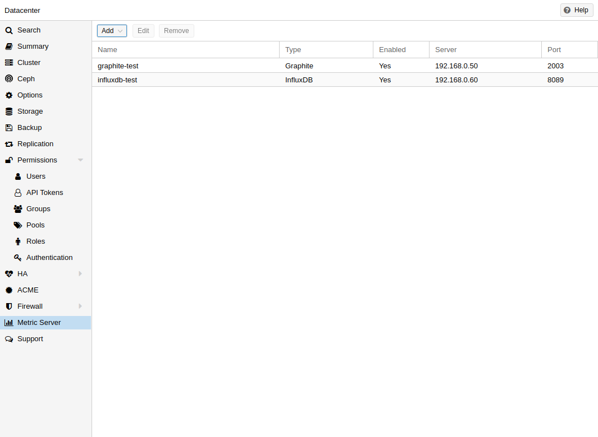
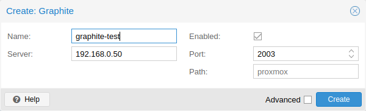
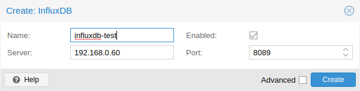

# 3.6. External Metric Server <a href="#external_metric_server" id="external_metric_server"></a>

[](https://pve.proxmox.com/pve-docs/images/screenshot/gui-datacenter-metric-server-list.png)

In Proxmox VE, you can define external metric servers, which will periodically receive various stats about your hosts, virtual guests and storages.

Currently supported are:

- Graphite (see [https://graphiteapp.org](https://graphiteapp.org) )
- InfluxDB (see [https://www.influxdata.com/time-series-platform/influxdb/](https://www.influxdata.com/time-series-platform/influxdb/) )
- OpenTelemetry (see [https://opentelemetry.io/](https://opentelemetry.io/) )

The external metric server definitions are saved in */etc/pve/status.cfg*, and can be edited through the web interface.

## 3.6.1. Graphite server configuration <a href="#metric_server_graphite" id="metric_server_graphite"></a>

[](https://pve.proxmox.com/pve-docs/images/screenshot/gui-datacenter-metric-server-graphite.png)

The default port is set to **2003** and the default graphite path is **proxmox**.

By default, Proxmox VE sends the data over UDP, so the graphite server has to be configured to accept this. Here the maximum transmission unit (MTU) can be configured for environments not using the standard **1500** MTU.

You can also configure the plugin to use TCP. In order not to block the important `pvestatd` statistic collection daemon, a timeout is required to cope with network problems.

## 3.6.2. Influxdb plugin configuration <a href="#metric_server_influxdb" id="metric_server_influxdb"></a>

[](https://pve.proxmox.com/pve-docs/images/screenshot/gui-datacenter-metric-server-influxdb.png)

Proxmox VE sends the data over UDP, so the influxdb server has to be configured for this. The MTU can also be configured here, if necessary.

Here is an example configuration for influxdb (on your influxdb server):

```text
[[udp]]
   enabled = true
   bind-address = "0.0.0.0:8089"
   database = "proxmox"
   batch-size = 1000
   batch-timeout = "1s"
```

With this configuration, your server listens on all IP addresses on port 8089, and writes the data in the **proxmox** database

Alternatively, the plugin can be configured to use the http(s) API of InfluxDB 2.x. InfluxDB 1.8.x does contain a forwards compatible API endpoint for this v2 API.

To use it, set *influxdbproto* to *http* or *https* (depending on your configuration). By default, Proxmox VE uses the organization *proxmox* and the bucket/db *proxmox* (They can be set with the configuration *organization* and *bucket* respectively).

Since InfluxDB’s v2 API is only available with authentication, you have to generate a token that can write into the correct bucket and set it.

In the v2 compatible API of 1.8.x, you can use *user:password* as token (if required), and can omit the *organization* since that has no meaning in InfluxDB 1.x.

You can also set the HTTP Timeout (default is 1s) with the *timeout* setting, as well as the maximum batch size (default 25000000 bytes) with the *max-body-size* setting (this corresponds to the InfluxDB setting with the same name).

---

来源：[Proxmox VE 官方文档](https://pve.proxmox.com/pve-docs/pve-admin-guide.html) · 版本 9.2.13 · 非官方中文翻译。
