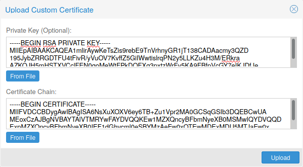
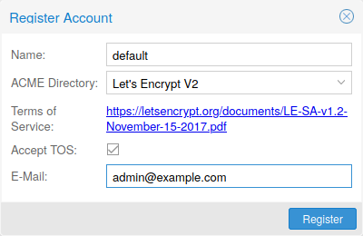
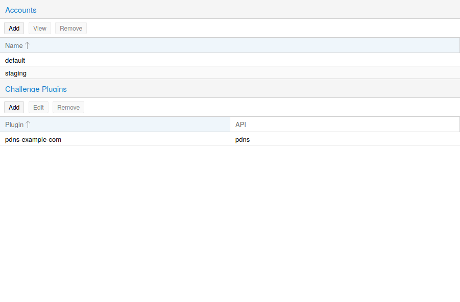
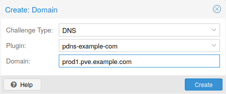
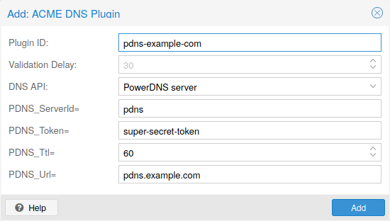

# 3.12. 证书管理 <a href="#sysadmin_certificate_management" id="sysadmin_certificate_management"></a>

## 3.12.1. 集群内部通信证书 <a href="#_certificates_for_intra_cluster_communication" id="_certificates_for_intra_cluster_communication"></a>

每个 Proxmox VE 集群默认都会创建自己的（自签名）证书颁发机构（CA），并为每个节点生成一个由上述 CA 签名的证书。这些证书用于与集群的 `pveproxy` 服务进行加密通信，以及在使用 SPICE 时用于 Shell/Console 功能。

CA 证书和密钥存储在[Proxmox 集群文件系统（pmxcfs）](../06-pmxcfs/README.md)中。

为了将集群 CA 分发到管理员工作站并避免浏览器警告，请通过带外方式从任意集群节点复制 `/etc/pve/pve-root-ca.pem`（例如通过 `scp`，或通过现有 SSH 会话读取该文件），然后将其导入操作系统或浏览器的信任库。没有可用于下载该文件的 API 或 Web 界面端点。

## 3.12.2. API 和 Web GUI 证书 <a href="#sysadmin_certs_api_gui" id="sysadmin_certs_api_gui"></a>

REST API 和 Web GUI 由在每个节点上运行的 `pveproxy` 服务提供。

对于 `pveproxy` 使用的证书，有以下选项：

1. 默认使用 `/etc/pve/nodes/NODENAME/pve-ssl.pem` 中节点特定的证书。此证书由集群 CA 签名，因此不会自动受到浏览器和操作系统的信任。
2. 使用外部提供的证书（例如由商业 CA 签名的证书）。
3. 使用 ACME（Let’s Encrypt）获取可自动续期的受信任证书，此功能也已集成到 Proxmox VE API 和 Web 界面中。

对于选项 2 和 3，使用文件 `/etc/pve/local/pveproxy-ssl.pem`（以及 `/etc/pve/local/pveproxy-ssl.key`，后者必须没有密码保护）。


请记住，`/etc/pve/local` 是指向 `/etc/pve/nodes/NODENAME` 的节点特定符号链接。


证书通过 Proxmox VE 节点管理命令进行管理（参见 `pvenode(1)` 手册页）。


不要替换或手动修改 `/etc/pve/local/pve-ssl.pem` 和 `/etc/pve/local/pve-ssl.key` 中自动生成的节点证书文件，也不要替换或手动修改 `/etc/pve/pve-root-ca.pem` 和 `/etc/pve/priv/pve-root-ca.key` 中的集群 CA 文件。


## 3.12.3. 上传自定义证书 <a href="#sysadmin_certs_upload_custom" id="sysadmin_certs_upload_custom"></a>

如果已有要用于 Proxmox VE 节点的证书，可以直接通过 Web 界面上传该证书。

[](https://pve.proxmox.com/pve-docs/images/screenshot/gui-node-certs-upload-custom.png)

请注意，如果提供证书密钥文件，该文件不得受密码保护。

## 3.12.4. 通过 Let’s Encrypt（ACME）获取受信任证书 <a href="#sysadmin_certs_get_trusted_acme_cert" id="sysadmin_certs_get_trusted_acme_cert"></a>

Proxmox VE 包含对 **A**utomatic **C**ertificate **M**anagement **E**nvironment **ACME** 协议的实现，允许 Proxmox VE 管理员使用 Let’s Encrypt 等 ACME 提供商，轻松设置现代操作系统和 Web 浏览器开箱即接受并信任的 TLS 证书。

目前实现的两个 ACME 端点是 [Let’s Encrypt (LE)](https://letsencrypt.org) 生产环境及其预发布环境。我们的 ACME 客户端支持使用内置 Web 服务器验证 `http-01` 挑战，并支持使用 DNS 插件验证 `dns-01` 挑战；该 DNS 插件支持 [acme.sh](https://acme.sh) 所支持的所有 DNS API 端点。

### ACME 账户 <a href="#sysadmin_certs_acme_account" id="sysadmin_certs_acme_account"></a>

[](https://pve.proxmox.com/pve-docs/images/screenshot/gui-datacenter-acme-register-account.png)

需要为每个集群在要使用的端点处注册一个 ACME 账户。该账户使用的电子邮件地址将作为 ACME 端点发送续期到期或类似通知的联系地址。

可以通过 Web 界面 `Datacenter -> ACME` 或使用 `pvenode` 命令行工具注册和停用 ACME 账户。

```text
 pvenode acme account register account-name mail@example.com
```


由于[速率限制](https://letsencrypt.org/docs/rate-limits/)，进行实验或首次使用 ACME 时，应使用 LE `staging`。


### ACME 插件 <a href="#sysadmin_certs_acme_plugins" id="sysadmin_certs_acme_plugins"></a>

ACME 插件的作用是自动验证您以及由您管理的 Proxmox VE 集群确实是域名的所有者。这是自动证书管理的基础。

ACME 协议规定了不同类型的挑战，例如 `http-01`：由 Web 服务器提供具有特定内容的文件，以证明其控制某个域名。有时由于技术限制，或者由于记录的地址无法从公共互联网访问，这种方法并不可行。在这些情况下可以使用 `dns-01` 挑战。该挑战通过在域名的区域中创建特定 DNS 记录来完成。

[](https://pve.proxmox.com/pve-docs/images/screenshot/gui-datacenter-acme-overview.png)

Proxmox VE 开箱即支持这两种挑战类型，可以在 Web 界面的 `Datacenter -> ACME` 下配置插件，也可以使用 `pvenode acme plugin add` 命令进行配置。

ACME 插件配置存储在 `/etc/pve/priv/acme/plugins.cfg` 中。插件对集群中的所有节点均可用。

### 节点域名 <a href="#_node_domains" id="_node_domains"></a>

每个域名都是节点特定的。可以在 `Node -> Certificates` 下添加新域名条目或管理现有域名条目，也可以使用 `pvenode config` 命令。

[](https://pve.proxmox.com/pve-docs/images/screenshot/gui-node-certs-add-domain.png)

为节点配置所需域名并确保选择了所需的 ACME 账户后，即可通过 Web 界面订购新证书。成功后，界面将在 10 秒后重新加载。

续期将[自动](#sysadmin_certs_acme_automatic_renewal)进行。

## 3.12.5. ACME HTTP 挑战插件 <a href="#sysadmin_certs_acme_http_challenge" id="sysadmin_certs_acme_http_challenge"></a>

始终存在一个隐式配置的 `standalone` 插件，用于通过在端口 80 上启动的内置 Web 服务器验证 `http-01` 挑战。


名称 `standalone` 表示它可以自行提供验证，无需任何第三方服务。因此，此插件也适用于集群节点。


将其用于 Let’s Encrypt 的 ACME 证书管理需要满足一些前提条件。

- 必须接受 Let’s Encrypt 的服务条款（ToS）才能注册账户。
- 节点的**端口 80**必须能够从互联网访问。
- 端口 80 上**不得**有其他监听器。
- 请求的（子）域名需要解析到节点的公网 IP。

## 3.12.6. ACME DNS API 挑战插件 <a href="#sysadmin_certs_acme_dns_challenge" id="sysadmin_certs_acme_dns_challenge"></a>

对于无法或不希望通过 `http-01` 方法进行外部访问验证的系统，可以使用 `dns-01` 验证方法。此验证方法要求 DNS 服务器允许通过 API 配置 `TXT` 记录。

### 配置用于验证的 ACME DNS API <a href="#sysadmin_certs_acme_dns_api_config" id="sysadmin_certs_acme_dns_api_config"></a>

Proxmox VE 复用了为 `acme.sh` [\[1\]](#note-72f8bd77-1) 项目开发的 DNS 插件，有关特定 API 的配置详情，请参阅其文档。

配置使用 DNS API 的新插件，最简单的方法是使用 Web 界面（`Datacenter -> ACME`）。

[](https://pve.proxmox.com/pve-docs/images/screenshot/gui-datacenter-acme-add-dns-plugin.png)

选择 `DNS` 作为挑战类型。然后可以选择 API 提供商，并输入通过其 API 访问账户所需的凭据数据。验证延迟决定从设置 DNS 记录到提示 ACME 提供商验证该记录之间的秒数，因为提供商通常需要一些时间才能在其基础设施中传播该记录。


有关获取提供商 API 凭据的更详细信息，请参阅 acme.sh [如何使用 DNS API](https://github.com/acmesh-official/acme.sh/wiki/dnsapi#how-to-use-dns-api) Wiki。


由于 DNS 提供商和 API 端点众多，Proxmox VE 会自动为某些提供商生成凭据表单。对于其他提供商，您会看到一个较大的文本区域，只需将所有凭据 `KEY`\=`VALUE` 对复制到其中即可。

### 通过 CNAME 别名进行 DNS 验证 <a href="#_dns_validation_through_cname_alias" id="_dns_validation_through_cname_alias"></a>

A special `alias` mode can be used to handle the validation on a different domain/DNS server, in case your primary/real DNS does not support provisioning via an API. Manually set up a permanent `CNAME` record for `_acme-challenge.domain1.example` pointing to `_acme-challenge.domain2.example` and set the `alias` property on the corresponding `acmedomainX` key in the Proxmox VE node configuration file to `domain2.example` to allow the DNS server of `domain2.example` to validate all challenges for `domain1.example`.

### 插件组合 <a href="#_combination_of_plugins" id="_combination_of_plugins"></a>

如果节点可通过多个具有不同要求或 DNS 置备能力的域名访问，则可以组合 `http-01` 和 `dns-01` 验证。通过为每个域名指定不同的插件实例，也可以混用来自多个提供商或实例的 DNS API。


通过多个域名访问同一服务会增加复杂性，应尽可能避免。


## 3.12.7. ACME 证书的自动续期 <a href="#sysadmin_certs_acme_automatic_renewal" id="sysadmin_certs_acme_automatic_renewal"></a>

如果节点已成功配置为由 ACME 提供的证书（通过 pvenode 或 GUI），证书将由 `pve-daily-update.service` 自动续期。目前，如果证书已经过期，或将在未来 30 天内过期，就会尝试续期。


如果使用颁发短期证书的自定义目录，建议禁用 `pve-daily-update.timer` 单元的随机延迟，以避免重启后错过证书续期。


## 3.12.8. `pvenode` 的 ACME 示例 <a href="#_acme_examples_with_span_class_monospaced_pvenode_span" id="_acme_examples_with_span_class_monospaced_pvenode_span"></a>

### 示例：使用 Let’s Encrypt 证书的 `pvenode` 调用示例 <a href="#_example_sample_span_class_monospaced_pvenode_span_invocation_for_using_let_8217_s_encrypt_certificates" id="_example_sample_span_class_monospaced_pvenode_span_invocation_for_using_let_8217_s_encrypt_certificates"></a>

```text
root@proxmox:~# pvenode acme account register default mail@example.invalid
Directory endpoints:
0) Let's Encrypt V2 (https://acme-v02.api.letsencrypt.org/directory)
1) Let's Encrypt V2 Staging (https://acme-staging-v02.api.letsencrypt.org/directory)
2) Custom
Enter selection: 1

Terms of Service: https://letsencrypt.org/documents/LE-SA-v1.2-November-15-2017.pdf
Do you agree to the above terms? [y|N]y
...
Task OK
root@proxmox:~# pvenode config set --acme domains=example.invalid
root@proxmox:~# pvenode acme cert order
Loading ACME account details
Placing ACME order
...
Status is 'valid'!

All domains validated!
...
Downloading certificate
Setting pveproxy certificate and key
Restarting pveproxy
Task OK
```

### 示例：设置 OVH API 以验证域名 <a href="#_example_setting_up_the_ovh_api_for_validating_a_domain" id="_example_setting_up_the_ovh_api_for_validating_a_domain"></a>


无论使用哪种插件，账户注册步骤都相同，此处不再重复。



需要根据 OVH API 文档从 OVH 获取 `OVH_AK` 和 `OVH_AS`


首先，需要获取所有信息，以便您和 Proxmox VE 能够访问 API。

```text
root@proxmox:~# cat /path/to/api-token
OVH_AK=XXXXXXXXXXXXXXXX
OVH_AS=YYYYYYYYYYYYYYYYYYYYYYYYYYYYYYYY
root@proxmox:~# source /path/to/api-token
root@proxmox:~# curl -XPOST -H"X-Ovh-Application: $OVH_AK" -H "Content-type: application/json" \
https://eu.api.ovh.com/1.0/auth/credential  -d '{
  "accessRules": [
    {"method": "GET","path": "/auth/time"},
    {"method": "GET","path": "/domain"},
    {"method": "GET","path": "/domain/zone/*"},
    {"method": "GET","path": "/domain/zone/*/record"},
    {"method": "POST","path": "/domain/zone/*/record"},
    {"method": "POST","path": "/domain/zone/*/refresh"},
    {"method": "PUT","path": "/domain/zone/*/record/"},
    {"method": "DELETE","path": "/domain/zone/*/record/*"}
]
}'
{"consumerKey":"ZZZZZZZZZZZZZZZZZZZZZZZZZZZZZZZZ","state":"pendingValidation","validationUrl":"https://eu.api.ovh.com/auth/?credentialToken=AAAAAAAAAAAAAAAAAAAAAAAAAAAAAAAAAAAAAAAAAAAAAAAAAAAAAAAAAAAAAAAA"}

(open validation URL and follow instructions to link Application Key with account/Consumer Key)

root@proxmox:~# echo "OVH_CK=ZZZZZZZZZZZZZZZZZZZZZZZZZZZZZZZZ" >> /path/to/api-token
```

现在可以设置 ACME 插件：

```text
root@proxmox:~# pvenode acme plugin add dns example_plugin --api ovh --data /path/to/api_token
root@proxmox:~# pvenode acme plugin config example_plugin
┌────────┬──────────────────────────────────────────┐
│ key    │ value                                    │
╞════════╪══════════════════════════════════════════╡
│ api    │ ovh                                      │
├────────┼──────────────────────────────────────────┤
│ data   │ OVH_AK=XXXXXXXXXXXXXXXX                  │
│        │ OVH_AS=YYYYYYYYYYYYYYYYYYYYYYYYYYYYYYYY  │
│        │ OVH_CK=ZZZZZZZZZZZZZZZZZZZZZZZZZZZZZZZZ  │
├────────┼──────────────────────────────────────────┤
│ digest │ 867fcf556363ca1bea866863093fcab83edf47a1 │
├────────┼──────────────────────────────────────────┤
│ plugin │ example_plugin                           │
├────────┼──────────────────────────────────────────┤
│ type   │ dns                                      │
└────────┴──────────────────────────────────────────┘
```

最后，可以配置要为其获取证书的域名，并为该域名提交证书订单：

```text
root@proxmox:~# pvenode config set -acmedomain0 example.proxmox.com,plugin=example_plugin
root@proxmox:~# pvenode acme cert order
Loading ACME account details
Placing ACME order
Order URL: https://acme-staging-v02.api.letsencrypt.org/acme/order/11111111/22222222

Getting authorization details from 'https://acme-staging-v02.api.letsencrypt.org/acme/authz-v3/33333333'
The validation for example.proxmox.com is pending!
[Wed Apr 22 09:25:30 CEST 2020] Using OVH endpoint: ovh-eu
[Wed Apr 22 09:25:30 CEST 2020] Checking authentication
[Wed Apr 22 09:25:30 CEST 2020] Consumer key is ok.
[Wed Apr 22 09:25:31 CEST 2020] Adding record
[Wed Apr 22 09:25:32 CEST 2020] Added, sleep 10 seconds.
Add TXT record: _acme-challenge.example.proxmox.com
Triggering validation
Sleeping for 5 seconds
Status is 'valid'!
[Wed Apr 22 09:25:48 CEST 2020] Using OVH endpoint: ovh-eu
[Wed Apr 22 09:25:48 CEST 2020] Checking authentication
[Wed Apr 22 09:25:48 CEST 2020] Consumer key is ok.
Remove TXT record: _acme-challenge.example.proxmox.com

All domains validated!

Creating CSR
Checking order status
Order is ready, finalizing order
valid!

Downloading certificate
Setting pveproxy certificate and key
Restarting pveproxy
Task OK
```

### 示例：从 `staging` 切换到常规 ACME 目录 <a href="#sysadmin_certs_acme_switch_from_staging" id="sysadmin_certs_acme_switch_from_staging"></a>

不支持更改账户的 ACME 目录，但由于 Proxmox VE 支持多个账户，您可以直接创建一个新账户，并将生产（受信任的）ACME 目录作为端点。您也可以停用暂存账户，然后重新创建它。

**Example: Changing the `default` ACME account from `staging` to directory using `pvenode`**

```text
root@proxmox:~# pvenode acme account deactivate default
Renaming account file from '/etc/pve/priv/acme/default' to '/etc/pve/priv/acme/_deactivated_default_4'
Task OK

root@proxmox:~# pvenode acme account register default example@proxmox.com
Directory endpoints:
0) Let's Encrypt V2 (https://acme-v02.api.letsencrypt.org/directory)
1) Let's Encrypt V2 Staging (https://acme-staging-v02.api.letsencrypt.org/directory)
2) Custom
Enter selection: 0

Terms of Service: https://letsencrypt.org/documents/LE-SA-v1.2-November-15-2017.pdf
Do you agree to the above terms? [y|N]y
...
Task OK
```

## 注释

### 注释 1 <a href="#note-72f8bd77-1" id="note-72f8bd77-1"></a>

acme.sh [https://github.com/acmesh-official/acme.sh](https://github.com/acmesh-official/acme.sh)

---

来源：[Proxmox VE 官方文档](https://pve.proxmox.com/pve-docs/pve-admin-guide.html) · 版本 9.2.13 · 非官方中文翻译。
