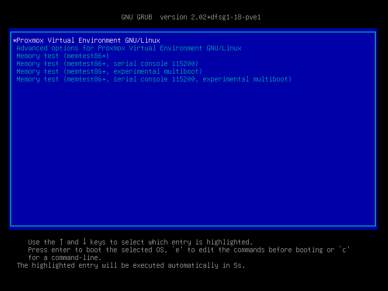
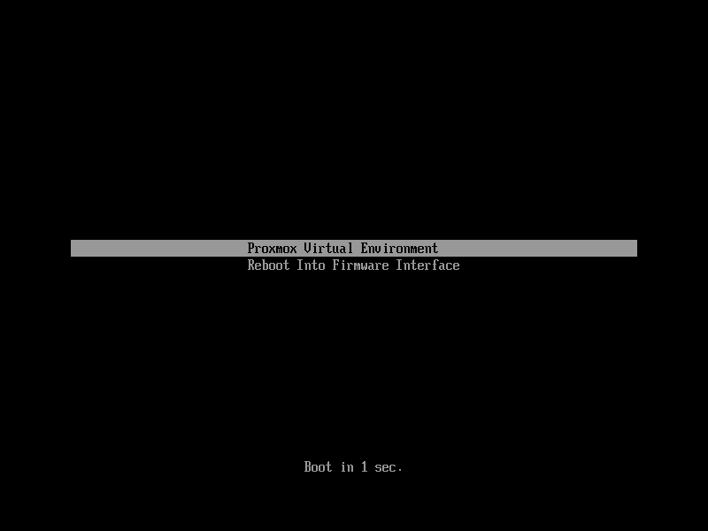

# 3.13. Host Bootloader <a href="#sysboot" id="sysboot"></a>

Proxmox VE currently uses one of two bootloaders depending on the disk setup selected in the installer.

For EFI Systems installed with ZFS as the root filesystem `systemd-boot` is used, unless Secure Boot is enabled. All other deployments use the standard GRUB bootloader (this usually also applies to systems which are installed on top of Debian).

## 3.13.1. Partitioning Scheme Used by the Installer <a href="#sysboot_installer_part_scheme" id="sysboot_installer_part_scheme"></a>

The Proxmox VE installer creates 3 partitions on all disks selected for installation.

The created partitions are:

- a 1 MB BIOS Boot Partition (gdisk type EF02)
- a 512 MB EFI System Partition (ESP, gdisk type EF00)
- a third partition spanning the set `hdsize` parameter or the remaining space used for the chosen storage type

Systems using ZFS as root filesystem are booted with a kernel and initrd image stored on the 512 MB EFI System Partition. For legacy BIOS systems, and EFI systems with Secure Boot enabled, GRUB is used, for EFI systems without Secure Boot, `systemd-boot` is used. Both are installed and configured to point to the ESPs.

GRUB in BIOS mode (`--target i386-pc`) is installed onto the BIOS Boot Partition of all selected disks on all systems booted with GRUB   
[These are all installs with root on `ext4` or `xfs` and installs with root on ZFS on non-EFI systems]  
.


This applies to x86 hosts. On arm64, Proxmox VE boots through UEFI only, so there is no BIOS Boot Partition and no `i386-pc` GRUB target; GRUB is installed in EFI mode using the `arm64-efi` target instead.


## 3.13.2. Synchronizing the content of the ESP with `proxmox-boot-tool` <a href="#sysboot_proxmox_boot_tool" id="sysboot_proxmox_boot_tool"></a>

`proxmox-boot-tool` is a utility used to keep the contents of the EFI System Partitions properly configured and synchronized. It copies certain kernel versions to all ESPs and configures the respective bootloader to boot from the `vfat` formatted ESPs. In the context of ZFS as root filesystem this means that you can use all optional features on your root pool instead of the subset which is also present in the ZFS implementation in GRUB or having to create a separate small boot-pool   
[Booting ZFS on root with GRUB [https://openzfs.github.io/openzfs-docs/Getting%20Started/Debian/Debian%20Bookworm%20Root%20on%20ZFS.html](https://openzfs.github.io/openzfs-docs/Getting%20Started/Debian/Debian%20Bookworm%20Root%20on%20ZFS.html)]  
.

In setups with redundancy all disks are partitioned with an ESP, by the installer. This ensures the system boots even if the first boot device fails or if the BIOS can only boot from a particular disk.

The ESPs are not kept mounted during regular operation. This helps to prevent filesystem corruption to the `vfat` formatted ESPs in case of a system crash, and removes the need to manually adapt `/etc/fstab` in case the primary boot device fails.

`proxmox-boot-tool` handles the following tasks:

- formatting and setting up a new partition
- copying and configuring new kernel images and initrd images to all listed ESPs
- synchronizing the configuration on kernel upgrades and other maintenance tasks
- managing the list of kernel versions which are synchronized
- configuring the boot-loader to boot a particular kernel version (pinning)

You can view the currently configured ESPs and their state by running:

```text
# proxmox-boot-tool status
```

<a id="sysboot_proxmox_boot_setup"></a>


**Setting up a new partition for use as synced ESP**

To format and initialize a partition as synced ESP, e.g., after replacing a failed vdev in an rpool, or when converting an existing system that pre-dates the sync mechanism, `proxmox-boot-tool` from `proxmox-kernel-helper` can be used.


the `format` command will format the `<partition>`, make sure to pass in the right device/partition!


For example, to format an empty partition `/dev/sda2` as ESP, run the following:

```text
# proxmox-boot-tool format /dev/sda2
```

To setup an existing, unmounted ESP located on `/dev/sda2` for inclusion in Proxmox VE’s kernel update synchronization mechanism, use the following:

```text
# proxmox-boot-tool init /dev/sda2
```

或

```text
# proxmox-boot-tool init /dev/sda2 grub
```

to force initialization with GRUB instead of `systemd-boot`, for example for Secure Boot support.

Afterwards `/etc/kernel/proxmox-boot-uuids` should contain a new line with the UUID of the newly added partition. The `init` command will also automatically trigger a refresh of all configured ESPs.

<a id="sysboot_proxmox_boot_refresh"></a>


**Updating the configuration on all ESPs**

To copy and configure all bootable kernels and keep all ESPs listed in `/etc/kernel/proxmox-boot-uuids` in sync you just need to run:

```text
# proxmox-boot-tool refresh
```

(The equivalent to running `update-grub` systems with `ext4` or `xfs` on root).

This is necessary should you make changes to the kernel commandline, or want to sync all kernels and initrds.


Both `update-initramfs` and `apt` (when necessary) will automatically trigger a refresh.


**Kernel Versions considered by `proxmox-boot-tool`**

The following kernel versions are configured by default:

- the currently running kernel
- the version being newly installed on package updates
- the two latest already installed kernels
- the latest version of the second-to-last kernel series (e.g. 5.0, 5.3), if applicable
- any manually selected kernels

**Manually keeping a kernel bootable**

Should you wish to add a certain kernel and initrd image to the list of bootable kernels use `proxmox-boot-tool kernel add`.

For example run the following to add the kernel with ABI version `5.0.15-1-pve` to the list of kernels to keep installed and synced to all ESPs:

```text
# proxmox-boot-tool kernel add 5.0.15-1-pve
```

`proxmox-boot-tool kernel list` will list all kernel versions currently selected for booting:

```text
# proxmox-boot-tool kernel list
Manually selected kernels:
5.0.15-1-pve

Automatically selected kernels:
5.0.12-1-pve
4.15.18-18-pve
```

Run `proxmox-boot-tool kernel remove` to remove a kernel from the list of manually selected kernels, for example:

```text
# proxmox-boot-tool kernel remove 5.0.15-1-pve
```


It’s required to run `proxmox-boot-tool refresh` to update all EFI System Partitions (ESPs) after a manual kernel addition or removal from above.


## 3.13.3. Determine which Bootloader is Used <a href="#sysboot_determine_bootloader_used" id="sysboot_determine_bootloader_used"></a>

[](https://pve.proxmox.com/pve-docs/images/screenshot/boot-grub.png)

The simplest and most reliable way to determine which bootloader is used, is to watch the boot process of the Proxmox VE node.

You will either see the blue box of GRUB or the simple black on white `systemd-boot`.

[](https://pve.proxmox.com/pve-docs/images/screenshot/boot-systemdboot.png)

Determining the bootloader from a running system might not be 100% accurate. The safest way is to run the following command:

```text
# efibootmgr -v
```

If it returns a message that EFI variables are not supported, GRUB is used in BIOS/Legacy mode.

If the output contains a line that looks similar to the following, GRUB is used in UEFI mode.

```text
Boot0005* proxmox       [...] File(\EFI\proxmox\grubx64.efi)
```

If the active boot entry points to `\EFI\proxmox\shimx64.efi` like in the following example, GRUB is used in UEFI mode with Secure Boot enabled.

```text
Boot0005* proxmox       [...] File(\EFI\proxmox\shimx64.efi)
```

If the output contains a line similar to the following, `systemd-boot` is used.

```text
Boot0006* Linux Boot Manager    [...] File(\EFI\systemd\systemd-bootx64.efi)
```


The file names above are for x86 hosts. On arm64, the equivalent binaries are named `grubaa64.efi`, `shimaa64.efi`, and `systemd-bootaa64.efi`.


By running:

```text
# proxmox-boot-tool status
```

you can find out if `proxmox-boot-tool` is configured, which is a good indication of how the system is booted.

## 3.13.4. GRUB <a href="#sysboot_grub" id="sysboot_grub"></a>

GRUB has been the de-facto standard for booting Linux systems for many years and is quite well documented   
[GRUB Manual [https://www.gnu.org/software/grub/manual/grub/grub.html](https://www.gnu.org/software/grub/manual/grub/grub.html)]  
.

### Configuration <a href="#_configuration" id="_configuration"></a>

Changes to the GRUB configuration are done via the defaults file `/etc/default/grub` or config snippets in `/etc/default/grub.d`. To regenerate the configuration file after a change to the configuration run:   
[Systems using `proxmox-boot-tool` will call `proxmox-boot-tool
refresh` upon `update-grub`.]

```text
# update-grub
```

## 3.13.5. Systemd-boot <a href="#sysboot_systemd_boot" id="sysboot_systemd_boot"></a>

`systemd-boot` is a lightweight EFI bootloader. It reads the kernel and initrd images directly from the EFI Service Partition (ESP) where it is installed. The main advantage of directly loading the kernel from the ESP is that it does not need to reimplement the drivers for accessing the storage. In Proxmox VE [`proxmox-boot-tool`](#sysboot_proxmox_boot_tool) is used to keep the configuration on the ESPs synchronized.

### Configuration <a href="#sysboot_systemd_boot_config" id="sysboot_systemd_boot_config"></a>

`systemd-boot` is configured via the file `loader/loader.conf` in the root directory of an EFI System Partition (ESP). See the `loader.conf(5)` manpage for details.

Each bootloader entry is placed in a file of its own in the directory `loader/entries/`

An example entry.conf looks like this (`/` refers to the root of the ESP):

```text
title    Proxmox
version  5.0.15-1-pve
options   root=ZFS=rpool/ROOT/pve-1 boot=zfs
linux    /EFI/proxmox/5.0.15-1-pve/vmlinuz-5.0.15-1-pve
initrd   /EFI/proxmox/5.0.15-1-pve/initrd.img-5.0.15-1-pve
```

## 3.13.6. Editing the Kernel Commandline <a href="#sysboot_edit_kernel_cmdline" id="sysboot_edit_kernel_cmdline"></a>

You can modify the kernel commandline in the following places, depending on the bootloader used:

**GRUB**

The kernel commandline needs to be placed in the variable `GRUB_CMDLINE_LINUX_DEFAULT` in the file `/etc/default/grub`. Running `update-grub` appends its content to all `linux` entries in `/boot/grub/grub.cfg`.

**Systemd-boot**

The kernel commandline needs to be placed as one line in `/etc/kernel/cmdline`. To apply your changes, run `proxmox-boot-tool refresh`, which sets it as the `option` line for all config files in `loader/entries/proxmox-*.conf`.

A complete list of kernel parameters can be found at *https://www.kernel.org/doc/html/v<YOUR-KERNEL-VERSION>/admin-guide/kernel-parameters.html*. replace <YOUR-KERNEL-VERSION> with the major.minor version, for example, for kernels based on version 6.5 the URL would be: [https://www.kernel.org/doc/html/v6.5/admin-guide/kernel-parameters.html](https://www.kernel.org/doc/html/v6.5/admin-guide/kernel-parameters.html)

You can find your kernel version by checking the web interface (*Node → Summary*), or by running

```text
# uname -r
```

Use the first two numbers at the front of the output.

## 3.13.7. Override the Kernel-Version for next Boot <a href="#sysboot_kernel_pin" id="sysboot_kernel_pin"></a>

To select a kernel that is not currently the default kernel, you can either:

- use the boot loader menu that is displayed at the beginning of the boot process
- use the `proxmox-boot-tool` to `pin` the system to a kernel version either once or permanently (until pin is reset).

This should help you work around incompatibilities between a newer kernel version and the hardware.


Such a pin should be removed as soon as possible so that all current security patches of the latest kernel are also applied to the system.


For example: To permanently select the version `5.15.30-1-pve` for booting you would run:

```text
# proxmox-boot-tool kernel pin 5.15.30-1-pve
```


The pinning functionality works for all Proxmox VE systems, not only those using `proxmox-boot-tool` to synchronize the contents of the ESPs, if your system does not use `proxmox-boot-tool` for synchronizing you can also skip the `proxmox-boot-tool refresh` call in the end.


You can also set a kernel version to be booted on the next system boot only. This is for example useful to test if an updated kernel has resolved an issue, which caused you to `pin` a version in the first place:

```text
# proxmox-boot-tool kernel pin 5.15.30-1-pve --next-boot
```

To remove any pinned version configuration use the `unpin` subcommand:

```text
# proxmox-boot-tool kernel unpin
```

While `unpin` has a `--next-boot` option as well, it is used to clear a pinned version set with `--next-boot`. As that happens already automatically on boot, invoking it manually is of little use.

After setting, or clearing pinned versions you also need to synchronize the content and configuration on the ESPs by running the `refresh` subcommand.


You will be prompted to automatically do for `proxmox-boot-tool` managed systems if you call the tool interactively.


```text
# proxmox-boot-tool refresh
```

## 3.13.8. Secure Boot <a href="#sysboot_secure_boot" id="sysboot_secure_boot"></a>

Since Proxmox VE 8.1, Secure Boot is supported out of the box via signed packages and integration in `proxmox-boot-tool`.

The following packages are required for secure boot to work. You can install them all at once by using the ‘proxmox-secure-boot-support’ meta-package.

- `shim-signed` (shim bootloader signed by Microsoft)
- `shim-helpers-amd64-signed` (fallback bootloader and MOKManager, signed by Proxmox)
- `grub-efi-amd64-signed` (GRUB EFI bootloader, signed by Proxmox)
- `proxmox-kernel-6.X.Y-Z-pve-signed` (Kernel image, signed by Proxmox)


The `shim-helpers-amd64-signed` and `grub-efi-amd64-signed` package names are for x86 hosts. On arm64, the corresponding packages are `shim-helpers-arm64-signed` and `grub-efi-arm64-signed`.


Only GRUB is supported as bootloader out of the box, since other bootloader are currently not eligible for secure boot code-signing.

Any new installation of Proxmox VE will automatically have all of the above packages included.

More details about how Secure Boot works, and how to customize the setup, are available in [our wiki](https://pve.proxmox.com/wiki/Secure_Boot_Setup).

### Switching an Existing Installation to Secure Boot <a href="#_switching_an_existing_installation_to_secure_boot" id="_switching_an_existing_installation_to_secure_boot"></a>


This can lead to an unbootable installation in some cases if not done correctly. Reinstalling the host will setup Secure Boot automatically if available, without any extra interactions. **Make sure you have a working and well-tested backup of your Proxmox VE host!**


An existing UEFI installation can be switched over to Secure Boot if desired, without having to reinstall Proxmox VE from scratch.

First, ensure all your system is up-to-date. Next, install `proxmox-secure-boot-support`. GRUB automatically creates the needed EFI boot entry for booting via the default shim.

**systemd-boot**

If `systemd-boot` is used as a bootloader (see [Determine which Bootloader is used](#sysboot_determine_bootloader_used)), some additional setup is needed. This is only the case if Proxmox VE was installed with ZFS-on-root.

To check the latter, run:

```text
# findmnt /
```

If the host is indeed using ZFS as root filesystem, the `FSTYPE` column should contain `zfs`:

```text
TARGET SOURCE           FSTYPE OPTIONS
/      rpool/ROOT/pve-1 zfs    rw,relatime,xattr,noacl,casesensitive
```

Next, a suitable potential ESP (EFI system partition) must be found. This can be done using the `lsblk` command as following:

```text
# lsblk -o +FSTYPE
```

The output should look something like this:

```text
NAME   MAJ:MIN RM  SIZE RO TYPE MOUNTPOINTS FSTYPE
sda      8:0    0   32G  0 disk
├─sda1   8:1    0 1007K  0 part
├─sda2   8:2    0  512M  0 part             vfat
└─sda3   8:3    0 31.5G  0 part             zfs_member
sdb      8:16   0   32G  0 disk
├─sdb1   8:17   0 1007K  0 part
├─sdb2   8:18   0  512M  0 part             vfat
└─sdb3   8:19   0 31.5G  0 part             zfs_member
```

In this case, the partitions `sda2` and `sdb2` are the targets. They can be identified by the their size of 512M and their `FSTYPE` being `vfat`, in this case on a ZFS RAID-1 installation.

These partitions must be properly set up for booting through GRUB using `proxmox-boot-tool`. This command (using `sda2` as an example) must be run separately for each individual ESP:

```text
# proxmox-boot-tool init /dev/sda2 grub
```

Afterwards, you can sanity-check the setup by running the following command:

```text
# efibootmgr -v
```

This list should contain an entry looking similar to this:

```text
[..]
Boot0009* proxmox       HD(2,GPT,..,0x800,0x100000)/File(\EFI\proxmox\shimx64.efi)
[..]
```


The old `systemd-boot` bootloader will be kept, but GRUB will be preferred. This way, if booting using GRUB in Secure Boot mode does not work for any reason, the system can still be booted using `systemd-boot` with Secure Boot turned off.


Now the host can be rebooted and Secure Boot enabled in the UEFI firmware setup utility.

On reboot, a new entry named `proxmox` should be selectable in the UEFI firmware boot menu, which boots using the pre-signed EFI shim.

If, for any reason, no `proxmox` entry can be found in the UEFI boot menu, you can try adding it manually (if supported by the firmware), by adding the file `\EFI\proxmox\shimx64.efi` as a custom boot entry.


Some UEFI firmwares are known to drop the `proxmox` boot option on reboot. This can happen if the `proxmox` boot entry is pointing to a GRUB installation on a disk, where the disk itself is not a boot option. If possible, try adding the disk as a boot option in the UEFI firmware setup utility and run `proxmox-boot-tool` again.



To enroll custom keys, see the accompanying [Secure Boot wiki page](https://pve.proxmox.com/wiki/Secure_Boot_Setup#Setup_instructions_for_db_key_variant).


### Using DKMS/Third Party Modules With Secure Boot <a href="#_using_dkms_third_party_modules_with_secure_boot" id="_using_dkms_third_party_modules_with_secure_boot"></a>

On systems with Secure Boot enabled, the kernel will refuse to load modules which are not signed by a trusted key. The default set of modules shipped with the kernel packages is signed with an ephemeral key embedded in the kernel image which is trusted by that specific version of the kernel image.

In order to load other modules, such as those built with DKMS or manually, they need to be signed with a key trusted by the Secure Boot stack. The easiest way to achieve this is to enroll them as Machine Owner Key (`MOK`) with `mokutil`.

The `dkms` tool will automatically generate a keypair and certificate in `/var/lib/dkms/mok.key` and `/var/lib/dkms/mok.pub` and use it for signing the kernel modules it builds and installs.

You can view the certificate contents with

```text
# openssl x509 -in /var/lib/dkms/mok.pub -noout -text
```

and enroll it on your system using the following command:

```text
# mokutil --import /var/lib/dkms/mok.pub
input password:
input password again:
```

The `mokutil` command will ask for a (temporary) password twice, this password needs to be entered one more time in the next step of the process! Rebooting the system should automatically boot into the `MOKManager` EFI binary, which allows you to verify the key/certificate and confirm the enrollment using the password selected when starting the enrollment using `mokutil`. Afterwards, the kernel should allow loading modules built with DKMS (which are signed with the enrolled `MOK`). The `MOK` can also be used to sign custom EFI binaries and kernel images if desired.

The same procedure can also be used for custom/third-party modules not managed with DKMS, but the key/certificate generation and signing steps need to be done manually in that case.

---

来源：[Proxmox VE 官方文档](https://pve.proxmox.com/pve-docs/pve-admin-guide.html) · 版本 9.2.13 · 非官方中文翻译。
