# 3\. 宿主机系统管理 <a href="#chapter_system_administration" id="chapter_system_administration"></a>

以下各节将重点介绍常见的虚拟化任务，并说明 Proxmox VE 在宿主机管理方面的特定事项。

Proxmox VE 基于 [Debian GNU/Linux](https://www.debian.org/)，并通过额外的软件仓库提供 Proxmox VE 相关软件包。这意味着可以使用全系列的 Debian 软件包，包括安全更新和错误修复。Proxmox VE 提供自己基于 Ubuntu 内核的 Linux 内核。该内核启用了所有必要的虚拟化和容器功能，并包含 [ZFS](https://zfsonlinux.org) 和若干额外的硬件驱动程序。

对于以下各节未涉及的其他主题，请参阅 Debian 文档。[Debian Administrator's Handbook](https://debian-handbook.info/get) 可在线获取，其中全面介绍了 Debian 操作系统（见 [\[Hertzog13\]](../21-bibliography/README.md#hertzog13)）。

## 3.1. 软件包仓库 <a href="#sysadmin_package_repositories" id="sysadmin_package_repositories"></a>

与其他基于 Debian 的系统一样，Proxmox VE 使用 [APT](http://en.wikipedia.org/wiki/Advanced_Packaging_Tool) 作为软件包管理工具。

Proxmox VE 每天自动检查软件包更新。`root@pam` 用户会通过电子邮件收到有关可用更新的通知。在 GUI 中，可以使用 <em>Changelog</em> 按钮查看所选更新的更多详情。

### 3.1.1. Proxmox VE 中的软件仓库 <a href="#repositories_in_proxmox_ve" id="repositories_in_proxmox_ve"></a>

软件仓库是软件包的集合，可用于安装新软件，也对获取新更新非常重要。


您需要有效的 Debian 和 Proxmox 软件仓库，才能获取最新的安全更新、错误修复和新功能。


APT 软件仓库的旧式单行格式定义在文件 `/etc/apt/sources.list` 中，现代 deb822 多行格式定义在 `.sources` 文件中，这些文件位于 `/etc/apt/sources.list.d/`；详情请参阅[软件仓库格式](#sysadmin_apt_repo_formats)。

#### 软件仓库管理 <a href="#repository_management" id="repository_management"></a>

[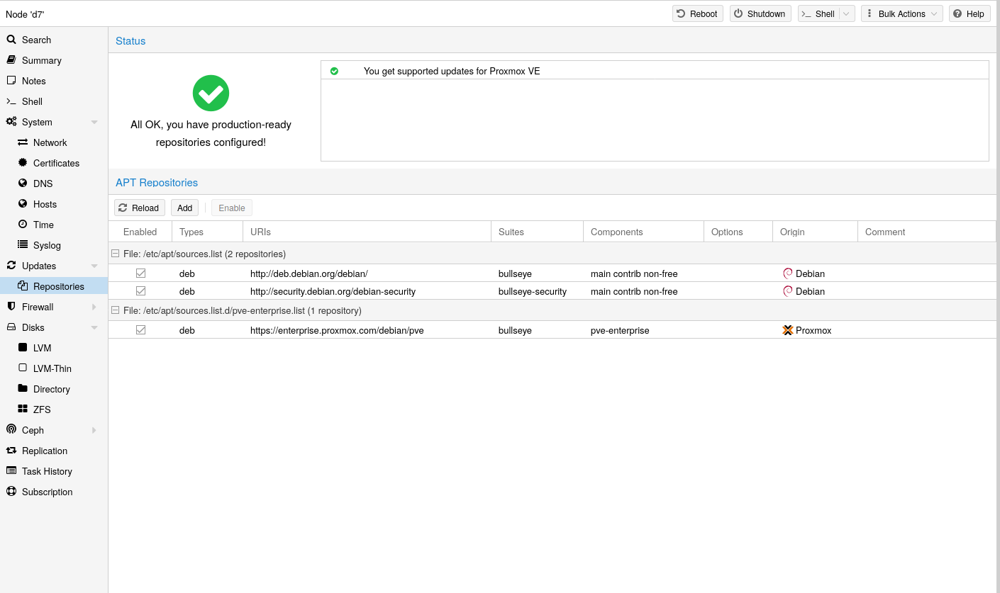](https://pve.proxmox.com/pve-docs/images/screenshot/gui-node-repositories.png)

自 Proxmox VE 7 起，您可以在 Web 界面中检查软件仓库状态。节点摘要面板显示高层级状态概览，而单独的 <em>Repository</em> 面板显示详细状态和所有已配置软件仓库的列表。

还支持基本的软件仓库管理，例如启用或禁用软件仓库。

通过运行 `apt update` 获取软件仓库中的可用软件包。可以直接使用 `apt` 安装更新，也可以通过 GUI（节点 → 更新）安装。

#### 软件仓库格式 <a href="#sysadmin_apt_repo_formats" id="sysadmin_apt_repo_formats"></a>

软件包仓库可以在源列表 <em>/etc/apt/sources.list</em> 以及 <em>/etc/apt/sources.list.d/</em> 中包含的文件中进行配置。

支持两种格式：

**单行**

在单行 `sources.list` 文件中，每行定义一个软件包仓库。空行会被忽略。一行中任意位置的 `#` 字符会将该行剩余部分标记为注释。这是旧式格式。从 Debian 13 Trixie 开始，apt 会对使用这种格式发出警告。您可以使用 `apt
modernize-sources` 命令自动迁移大多数软件仓库。

**deb822**

在多行格式 `repo.sources` 文件中，每个条目由多行键值对组成。一个文件可以通过用空行分隔各组来包含多个条目。这是现代格式。

#### 可用的软件仓库 <a href="#available_repositories" id="available_repositories"></a>

除了需要基础 Debian 软件仓库外，Proxmox VE 还提供三个不同的软件包仓库。

### 3.1.2. Debian 基础软件仓库 <a href="#debian_base_repositories" id="debian_base_repositories"></a>

**文件 `/etc/apt/sources.list.d/debian.sources`**

```text
Types: deb deb-src
URIs: http://deb.debian.org/debian/
Suites: trixie trixie-updates
Components: main non-free-firmware
Signed-By: /usr/share/keyrings/debian-archive-keyring.gpg

Types: deb deb-src
URIs: http://security.debian.org/debian-security/
Suites: trixie-security
Components: main non-free-firmware
Signed-By: /usr/share/keyrings/debian-archive-keyring.gpg
```

### 3.1.3. Proxmox VE 企业版软件仓库 <a href="#sysadmin_enterprise_repo" id="sysadmin_enterprise_repo"></a>

这是推荐的软件仓库，面向所有 Proxmox VE 订阅用户开放。它包含最稳定的软件包，适合生产环境使用。默认启用 `pve-enterprise` 软件仓库：

**文件 `/etc/apt/sources.list.d/pve-enterprise.sources`**

```text
Types: deb
URIs: https://enterprise.proxmox.com/debian/pve
Suites: trixie
Components: pve-enterprise
Signed-By: /usr/share/keyrings/proxmox-archive-keyring.gpg
```

请注意，您需要有效的订阅密钥才能访问 `pve-enterprise` 软件仓库。我们提供不同的支持级别，您可以在 [https://proxmox.com/en/proxmox-virtual-environment/pricing](https://proxmox.com/en/proxmox-virtual-environment/pricing) 找到更多详情。


订阅密钥与宿主机架构绑定。arm64 宿主机需要专用的 arm64 订阅密钥；x86 密钥在其上无效，反之亦然。



您可以通过在文件中相关条目添加一行 `Enabled: no` 来禁用此软件仓库。如果您的宿主机没有订阅密钥，这将防止出现错误消息。在这种情况下，请配置 `pve-no-subscription` 软件仓库。


### 3.1.4. Proxmox VE 无订阅软件仓库 <a href="#sysadmin_no_subscription_repo" id="sysadmin_no_subscription_repo"></a>

顾名思义，访问此软件仓库无需订阅密钥。它可用于测试和非生产环境。不建议在生产服务器上使用它，因为这些软件包并非总是经过同样充分的测试和验证。

我们建议在 `/etc/apt/sources.list.d/proxmox.sources` 中配置此软件仓库。

**文件 `/etc/apt/sources.list.d/proxmox.sources`**

```text
Types: deb
URIs: http://download.proxmox.com/debian/pve
Suites: trixie
Components: pve-no-subscription
Signed-By: /usr/share/keyrings/proxmox-archive-keyring.gpg
```


请记住，除了 Proxmox VE Proxmox 软件仓库之外，您始终还需要基础 Debian 软件仓库。


### 3.1.5. Proxmox VE 测试软件仓库 <a href="#sysadmin_test_repo" id="sysadmin_test_repo"></a>

此软件仓库包含最新的软件包，主要由开发人员用于测试新功能。要配置它，请将以下配置节添加到文件 `/etc/apt/sources.list.d/proxmox.sources`：

**文件 `/etc/apt/sources.list.d/proxmox.sources`**

```text
Types: deb
URIs: http://download.proxmox.com/debian/pve
Suites: trixie
Components: pve-test
Signed-By: /usr/share/keyrings/proxmox-archive-keyring.gpg
```


`pve-test` 软件仓库应（顾名思义）仅用于测试新功能或错误修复。


### 3.1.6. Proxmox VE 调试符号软件仓库 <a href="#sysadmin_dbgsym_repo" id="sysadmin_dbgsym_repo"></a>

调试符号软件包名为 `<package>-dbgsym`，包含与相应二进制软件包匹配的分离调试信息。正常运行不需要它们，但在分析崩溃或挂起时，它们能让 `gdb`、`systemd-coredump` 或 `crash` 等工具生成有用的回溯信息。对于基于 Debian Bookworm 和 Trixie 的 Proxmox VE 版本（及更新版本），这些软件包在一个独立于常规软件仓库的专用软件仓库中提供。

**文件 `/etc/apt/sources.list.d/pve-dbgsym.sources`**

```text
Types: deb
URIs: https://dbgsym.proxmox.com/debian/pve
Suites: trixie
Components: pve-dbgsym
Signed-By: /usr/share/keyrings/proxmox-archive-keyring.gpg
```

启用软件仓库后，安装与要调试的二进制文件相匹配的 `-dbgsym` 软件包。

### 3.1.7. Ceph 软件仓库 <a href="#sysadmin_package_repositories_ceph" id="sysadmin_package_repositories_ceph"></a>

Ceph 相关软件包通过预配置的 Ceph 企业版软件仓库保持最新。预装的软件包支持连接外部 Ceph 集群，并将其 [RBD](../07-storage/README.md#ceph_rados_block_devices) 或 [CephFS](../07-storage/README.md#storage_cephfs) 池添加为存储。您还可以构建 [超融合基础设施 (HCI)](../01-introduction/README.md#chapter_hyper_converged_infrastructure)，方法是在 Proxmox VE 集群之上运行 [Ceph](../08-pveceph/README.md)。

本章信息在以下情况下会有所帮助：

**安装 Ceph 以构建 HCI**

选择一个下文介绍的软件仓库和较新的 Ceph 版本，然后您可以在 [基于 Web 的向导或 CLI 工具](../08-pveceph/README.md#pve_ceph_install_wizard)中选择它们。

**已在运行 HCI，并希望升级到下一个 <em>Ceph</em> 主要版本**

请遵循相关的 [Ceph 升级指南](https://pve.proxmox.com/wiki/Category:Ceph_Upgrade)。

**已在运行 HCI，并希望升级到下一个 <em>Proxmox VE</em> 主要版本**

在 HCI 中，每个 Proxmox VE 主要版本都需要相应的最低 Ceph 主要版本，请遵循相关的 [Proxmox VE 升级指南](https://pve.proxmox.com/wiki/Category:Upgrade)。

**未运行 HCI，但使用外部 Ceph 集群**

要安装用于连接 Ceph 的较新软件包，请应用可用的系统更新，选择下面列出的软件仓库和 Ceph 版本，通过 <em>[Repository](#repository_management)</em> 面板将其添加到您的节点，应用新可用的系统更新，通过运行 `ceph --version` 验证结果，并禁用旧的 Ceph 软件仓库。

#### Proxmox VE 9 中可用的 Ceph 版本 <a href="#ceph_release_table" id="ceph_release_table"></a>

要阅读适用于您 Proxmox VE 版本的最新版管理指南，请确保已安装所有系统更新，并已重新加载此页面。

<table>


<tbody>
<tr>
<td><p></p></td>
<td><p><a href="https://docs.ceph.com/en/tentacle/releases/">预计生命周期结束时间</a></p></td>
<td><p><strong><code>enterprise</code></strong></p></td>
<td><p><strong><code>no-subscription</code></strong></p></td>
<td><p><strong><code>test</code></strong></p></td>
</tr>
<tr>
<td><p><strong><code>ceph-tentacle</code></strong></p></td>
<td><p>2027-11 (v20.2)</p></td>
<td><p>推荐</p></td>
<td><p>可用</p></td>
<td><p>可用</p></td>
</tr>
<tr>
<td><p><strong><code>ceph-squid</code></strong></p></td>
<td><p>2026-09 (v19.2)</p></td>
<td><p>可用</p></td>
<td><p>可用</p></td>
<td><p>可用</p></td>
</tr>
</tbody>
</table>

**适用于 Proxmox VE 9 的 Ceph 软件仓库**

下方 `ceph.sources` 文件的内容作为参考（在 Proxmox VE 9 之前使用的是文件 `ceph.list`）。要进行更改，请按照本子章节开头所述，采用适用于您情况的处理方式。如果您已在 Web UI 中禁用某个软件仓库，并且还想将其从列表中移除，可以手动从文件中删除相应条目。

<strong>`enterprise`</strong>

此软件仓库建议用于生产环境，包含最稳定的软件包版本。如果 Proxmox VE 节点拥有任何级别的有效订阅，即可访问该软件仓库。有关详情和包含的客户支持级别，请访问：

[https://proxmox.com/en/proxmox-virtual-environment/pricing](https://proxmox.com/en/proxmox-virtual-environment/pricing)

**文件 `/etc/apt/sources.list.d/ceph.sources`**

```text
Types: deb
URIs: https://enterprise.proxmox.com/debian/ceph-tentacle
Suites: trixie
Components: enterprise
Signed-By: /usr/share/keyrings/proxmox-archive-keyring.gpg
```

<strong>`no-subscription`</strong>

此软件仓库适用于测试和非生产环境。它可自由访问，无需有效订阅。一段时间后，其软件包版本也会在企业版软件仓库中提供。

**文件 `/etc/apt/sources.list.d/ceph.sources`**

```text
Types: deb
URIs: http://download.proxmox.com/debian/ceph-tentacle
Suites: trixie
Components: no-subscription
Signed-By: /usr/share/keyrings/proxmox-archive-keyring.gpg
```

<strong>`test`</strong>

此存储库包含最新的软件包版本，主要供开发人员用于测试新功能和错误修复。

**文件 `/etc/apt/sources.list.d/ceph.sources`**

```text
Types: deb
URIs: http://download.proxmox.com/debian/ceph-tentacle
Suites: trixie
Components: test
Signed-By: /usr/share/keyrings/proxmox-archive-keyring.gpg
```


Ceph <strong>`test`</strong> 存储库应（顾名思义）仅用于测试新功能或错误修复。


### 3.1.8. Debian 固件存储库 <a href="#sysadmin_debian_firmware_repo" id="sysadmin_debian_firmware_repo"></a>

从 Debian Bookworm（Proxmox VE 8）开始，非自由固件（按 [DFSG](https://www.debian.org/social_contract#guidelines) 的定义）已移至新创建的 Debian 存储库组件 `non-free-firmware`。

自 Proxmox VE 9 起，新安装默认启用此存储库，以确保能够获得 [操作系统早期微码更新](#sysadmin_firmware_cpu)。

您还可以获取额外的 [运行时固件文件](#sysadmin_firmware_runtime_files)，这些文件尚未包含在预装软件包 `pve-firmware` 中。

要能够安装来自此组件的软件包，请运行 `editor /etc/apt/sources.list`，将 `non-free-firmware` 追加到每个 `.debian.org` 存储库行的末尾，然后运行 `apt update`。

如果您从早期版本的 Proxmox VE 升级到 Proxmox VE 9，并且已将软件包存储库现代化为新的 deb822 样式，则需要改为调整 `/etc/apt/sources.list.d/debian.sources`。请运行 `editor
/etc/apt/sources.list.d/debian.sources`，并将 `non-free-firmware` 添加到每个配置节中以 `Components:` 开头的行。


建议将软件包存储库现代化。否则，Debian Trixie 上的 `apt` 会发出警告。您可以运行 `apt modernize-sources` 来完成此操作。


### 3.1.9. SecureApt <a href="#repos_secure_apt" id="repos_secure_apt"></a>

存储库中的 <em>Release</em> 文件使用 GnuPG 签名。APT 使用这些签名来验证所有软件包均来自可信来源。

如果您从官方 ISO 镜像安装 Proxmox VE，用于验证的密钥已经安装。

如果您在 Debian 之上安装 Proxmox VE，请使用以下命令下载并安装密钥：

```text
 # wget https://enterprise.proxmox.com/debian/proxmox-archive-keyring-trixie.gpg -O /usr/share/keyrings/proxmox-archive-keyring.gpg
```


上面的 `wget` 命令会添加适用于基于 Debian Trixie 的 Proxmox 版本的密钥环。安装 `proxmox-archive-keyring` 软件包后，该软件包将管理此文件。届时，随着新 Proxmox 版本的密钥被添加或移除，下面的哈希值可能不再与此文件的哈希值匹配。这是预期行为，`apt` 将确保仅使用可信密钥。<strong>安装 `proxmox-archive-keyring` 后，不建议修改此文件。</strong>


随后使用 `sha512sum` 命令行工具验证校验和：

```text
# sha256sum /usr/share/keyrings/proxmox-archive-keyring.gpg
 136673be77aba35dcce385b28737689ad64fd785a797e57897589aed08db6e45 /usr/share/keyrings/proxmox-archive-keyring.gpg
```

或者使用 `md5sum` 命令行工具：

```text
# md5sum /usr/share/keyrings/proxmox-archive-keyring.gpg
77c8b1166d15ce8350102ab1bca2fcbf /usr/share/keyrings/proxmox-archive-keyring.gpg
```


请确保安装密钥的路径与存储库配置节中的 `Signed-By:` 行相匹配。


## 3.2. 系统软件更新 <a href="#system_software_updates" id="system_software_updates"></a>

Proxmox 定期为所有存储库提供更新。要安装更新，请使用基于 Web 的图形用户界面或以下命令行命令：

```text
# apt update
# apt full-upgrade
```


由于 Proxmox VE 在 Debian 之上采用滚动发布模式，执行 `apt upgrade` 可能会导致软件包仅部分升级或处于损坏状态。这是因为 `apt full-upgrade` 在需要时也可以移除现有软件包以满足依赖关系，而 `apt upgrade` 则不能。


有关偶尔将 Ceph 升级到下一个主要版本的信息，请参阅 [Ceph 存储库](#sysadmin_package_repositories_ceph)。


APT 软件包管理系统非常灵活，并提供了许多功能，有关更多信息，请参阅 `man apt` 或 [\[Hertzog13\]](../21-bibliography/README.md#hertzog13)。



定期更新对于获取最新补丁和安全相关修复至关重要。主要系统升级会在 [Proxmox VE 社区论坛](https://forum.proxmox.com/) 中发布。


## 3.3. 固件更新 <a href="#chapter_firmware_updates" id="chapter_firmware_updates"></a>

在裸机服务器上运行 Proxmox VE 时，应应用本章中的固件更新。是否适合在客户机内配置固件更新（例如使用设备直通时）在很大程度上取决于您的具体设置，因此不在本章讨论范围内。

除了定期软件更新外，固件更新对于可靠、安全的运行也很重要。

在获取和应用固件更新时，建议结合使用可用的选项，以便尽早获取更新，或确保能够获取更新。

固件一词通常在语言上分为微码（用于 CPU）和固件（用于其他设备）。

### 3.3.1. 持久化固件 <a href="#sysadmin_firmware_persistent" id="sysadmin_firmware_persistent"></a>

本节适用于所有设备。更新后的微码通常包含在 BIOS/UEFI 更新中，并存储在主板上，而其他固件则存储在相应设备上。这种持久化方法对 CPU 尤其重要，因为它能够在启动时尽早正常加载更新后的微码。


对于某些更新（例如 BIOS/UEFI 或存储控制器更新），设备配置可能会被重置。请仔细遵循供应商的说明，并备份当前配置。


请向您的供应商确认有哪些可用的更新方法。

- 适用于服务器的便捷更新方法包括 Dell 的 Lifecycle Manager 或 HPE 的 Service Packs。
- 有时也有可用的 Linux 实用工具。例如，适用于 NVIDIA ConnectX 的 [<em>mlxup</em>](https://network.nvidia.com/support/firmware/mlxup-mft/)，或适用于 Broadcom 网卡的 [<em>bnxtnvm</em>/<em>niccli</em>](https://techdocs.broadcom.com/us/en/storage-and-ethernet-connectivity/ethernet-nic-controllers/bcm957xxx/adapters/software-installation/updating-the-firmware/manually-updating-the-adapter-firmware-on-linuxesx.html)。
- [LVFS](https://fwupd.org) 也是一种选择，前提是与 [硬件供应商](https://fwupd.org/lvfs/vendors/) 有合作，并且使用的是 [受支持的硬件](https://fwupd.org/lvfs/devices/)。其技术要求是系统在 2014 年之后制造，并通过 UEFI 启动。

Proxmox VE 随附自己的 `fwupd` 软件包版本，以使用 Proxmox 签名密钥启用安全启动支持。由于在虚拟机监控程序上使用该软件包时观察到问题，此软件包有意取消了对 `udisks2` 软件包的推荐依赖。


如果更新说明要求重启宿主机，请确保可以安全地执行重启。另请参阅 [节点维护](../15-ha-manager/README.md#ha_manager_node_maintenance)。


### 3.3.2. 运行时固件文件 <a href="#sysadmin_firmware_runtime_files" id="sysadmin_firmware_runtime_files"></a>

此方法将固件存储在 Proxmox VE 操作系统上，并在设备的 [持久化固件](#sysadmin_firmware_persistent) 版本较旧时将其传递给设备。网卡和显卡等设备支持此方法，但主板和硬盘等依赖持久化固件的设备不支持。

在 Proxmox VE 中，默认已安装 `pve-firmware` 软件包。因此，通过常规的 [系统更新（APT）](#system_software_updates)，其中包含的常见硬件固件会自动保持最新。

还存在一个额外的 [Debian 固件存储库](#sysadmin_debian_firmware_repo)，但默认未配置。

如果您尝试安装额外的固件软件包但发生冲突，APT 将中止安装。或许可以通过其他方式获取该特定固件。

### 3.3.3. CPU 微码更新 <a href="#sysadmin_firmware_cpu" id="sysadmin_firmware_cpu"></a>


本节所述的 CPU 微码更新特定于 x86 宿主机。arm64 没有等效的操作系统级微码软件包。


微码更新旨在修复已发现的安全漏洞和其他严重的 CPU 缺陷。虽然 CPU 性能可能会受到影响，但与未打补丁、需要内核自身采取缓解措施的微码相比，打补丁后的微码通常仍具有更高的性能。根据 CPU 类型，除非明知故犯地让 CPU 在不安全状态下运行，否则可能无法再达到存在缺陷的出厂状态下的性能水平。

要概览当前 CPU 漏洞及其缓解措施，请运行 `lscpu`。只有当 Proxmox VE 宿主机处于 [最新状态](#system_software_updates)、其版本未处于 [生命周期结束](../20-frequently-asked-questions-2/README.md) 状态，并且自上次内核更新以来至少重启过一次时，才会显示当前已知的实际漏洞。

除了通过 [持久化](#sysadmin_firmware_persistent) BIOS/UEFI 更新来更新微码的推荐方法外，还有一种通过 <strong>操作系统早期微码更新</strong> 的独立方法。它使用方便，在主板供应商不再提供 BIOS/UEFI 更新时也特别有帮助。无论使用哪种方法，应用微码更新都始终需要重启。

#### 设置操作系统早期微码更新 <a href="#set_up_early_os_microcode_updates" id="set_up_early_os_microcode_updates"></a>

要配置由 Linux 内核在启动早期应用的微码更新，您需要：

1. 启用 [Debian 固件存储库](#sysadmin_debian_firmware_repo)
2. 获取最新的可用软件包 `apt update`（或使用 Web 界面，在“节点 → 更新”下）
3. 安装特定于 CPU 供应商的微码软件包：

   - 对于 Intel CPU：`apt install intel-microcode`
   - 对于 AMD CPU：`apt install amd64-microcode`
4. 重启 Proxmox VE 宿主机

今后的任何微码更新也需要重启才能加载。

#### 微码版本 <a href="#microcode_version" id="microcode_version"></a>

要获取当前运行的微码修订版本，以便进行比较或调试：

```text
# grep microcode /proc/cpuinfo | uniq
microcode       : 0xf0
```

一个微码软件包包含适用于许多不同 CPU 的更新。但专门针对您的 CPU 的更新可能并不常有。因此，仅查看软件包上的日期，无法得知该公司实际何时为您的特定 CPU 发布了更新。

如果您安装了新的微码软件包并重启了 Proxmox VE 宿主机，且此新微码比 CPU 内置的版本和主板固件中的版本都更新，您将在系统日志中看到一条显示 "microcode updated early" 的消息。

```text
# dmesg | grep microcode
[    0.000000] microcode: microcode updated early to revision 0xf0, date = 2021-11-12
[    0.896580] microcode: Microcode Update Driver: v2.2.
```

#### 故障排除 <a href="#sysadmin_firmware_troubleshooting" id="sysadmin_firmware_troubleshooting"></a>

出于调试目的，可以按如下方式临时禁用已配置、通常在系统启动时应用的操作系统早期微码更新：

1. 确保宿主机可以 [安全地](../15-ha-manager/README.md#ha_manager_node_maintenance) 重启
2. 重启宿主机以进入 GRUB 菜单（如果菜单被隐藏，请按住 `SHIFT`）
3. 在所需的 Proxmox VE 启动项上按 `E`
4. 转到以 `linux` 开头的行，追加 <strong>`dis_ucode_ldr`</strong>，并用空格分隔
5. 按 `CTRL-X` 启动，此次启动将不应用操作系统早期微码更新

如果怀疑问题与最近的微码更新有关，应考虑降级软件包，而不是移除软件包（`apt purge <intel-microcode|amd64-microcode>`）。否则，即使较新的微码可以正常运行，也可能会加载过旧的 [持久化](#sysadmin_firmware_persistent) 微码。

如果 Debian 存储库中有更早的微码软件包版本，则可以降级，如以下示例所示：

```text
# apt list -a intel-microcode
Listing... Done
intel-microcode/stable-security,now 3.20230808.1~deb12u1 amd64 [installed]
intel-microcode/stable 3.20230512.1 amd64
```

```text
# apt install intel-microcode=3.202305*
...
Selected version '3.20230512.1' (Debian:12.1/stable [amd64]) for 'intel-microcode'
...
dpkg: warning: downgrading intel-microcode from 3.20230808.1~deb12u1 to 3.20230512.1
...
intel-microcode: microcode will be updated at next boot
...
```

请（再次）确保宿主机可以 [安全地](../15-ha-manager/README.md#ha_manager_node_maintenance) 重启。要立即应用微码软件包中可能包含的、适用于您的 CPU 类型的较旧微码，请现在重启。


最好将降级后的软件包锁定一段时间，并在稍后重试较新的版本。即使将来软件包版本相同，系统更新也可能在此期间已修复您遇到的问题。

```text
# apt-mark hold intel-microcode
intel-microcode set on hold.
```

```text
# apt-mark unhold intel-microcode
# apt update
# apt full-upgrade
```


## 3.4. 网络配置 <a href="#sysadmin_network_configuration" id="sysadmin_network_configuration"></a>

Proxmox VE 使用 Linux 网络协议栈。这为在 Proxmox VE 节点上设置网络提供了很大的灵活性。可以通过图形用户界面进行配置，也可以手动编辑包含完整网络配置的文件 `/etc/network/interfaces`。`interfaces(5)` 手册页包含完整的格式说明。所有 Proxmox VE 工具都会尽力保留用户的直接修改，但仍建议优先使用图形用户界面，因为它可以防止您出错。

需要 Linux 网桥接口（通常称为 <em>vmbrX</em>）才能将客户机连接到底层物理网络。可以将其视为一个虚拟交换机，客户机和物理接口都连接到该交换机。本节提供一些网络设置示例，以满足不同用例的需求，例如使用 [<em>绑定</em>](#sysadmin_network_bond) 实现冗余、[<em>VLAN</em>](#sysadmin_network_vlan)，或 [<em>路由</em>](#sysadmin_network_routed) 和 [<em>NAT</em>](#sysadmin_network_masquerading) 设置。

[软件定义网络](../12-pvesdn/README.md) 是 Proxmox VE 集群中更复杂虚拟网络的一种选择。


如果不确定，不建议使用传统的 Debian 工具 `ifup` 和 `ifdown`，因为它们存在一些隐患，例如在 `ifdown vmbrX` 时中断所有客户机流量，但之后在同一网桥上执行 `ifup` 时却不会重新连接这些客户机。


### 3.4.1. 应用网络更改 <a href="#apply_network_changes" id="apply_network_changes"></a>

Proxmox VE 不会将更改直接写入 `/etc/network/interfaces`。相反，我们会写入一个名为 `/etc/network/interfaces.new` 的临时文件，这样您可以一次进行多项相关更改。这还允许您在应用之前确保更改正确，因为错误的网络配置可能会导致节点无法访问。

#### 使用 ifupdown2 实时重新加载网络 <a href="#live_reload_network_with_ifupdown2" id="live_reload_network_with_ifupdown2"></a>

使用推荐的 <em>ifupdown2</em> 软件包（自 Proxmox VE 7.0 起新安装的默认软件包），无需重启即可应用网络配置更改。如果通过图形用户界面更改网络配置，可以单击 <em>应用配置</em> 按钮。这会将更改从暂存的 `interfaces.new` 文件移至 `/etc/network/interfaces` 并实时应用。

如果您直接手动更改了 `/etc/network/interfaces` 文件，可以运行 `ifreload -a` 来应用这些更改


如果您是在 Debian 之上安装的 Proxmox VE，或者是从旧版 Proxmox VE 安装升级到 Proxmox VE 7.0，请确保已安装 <em>ifupdown2</em>：`apt install
ifupdown2`


#### 重启节点以应用 <a href="#reboot_node_to_apply" id="reboot_node_to_apply"></a>

应用新网络配置的另一种方法是重启节点。此时 systemd 服务 `pvenetcommit` 会激活暂存的 `interfaces.new` 文件，然后 `networking` 服务会应用该配置。

### 3.4.2. 命名约定 <a href="#naming_conventions" id="naming_conventions"></a>

我们目前对设备名称采用以下命名约定：

- 以太网设备：`en*`，即 systemd 网络接口名称。自 5.0 版起，新的 Proxmox VE 安装使用此命名方案。
- 以太网设备：`eth[N]`，其中 0 ≤ N（`eth0`、`eth1`、……）。此命名方案用于在 5.0 版发布之前安装的 Proxmox VE 宿主机。升级到 5.0 时，名称保持不变。
- 网桥名称：通常为 `vmbr[N]`，其中 0 ≤ N ≤ 4094（`vmbr0` \- `vmbr4094`），但您可以使用任何以字母开头且长度不超过 10 个字符的字母数字字符串。
- 绑定：`bond[N]`，其中 0 ≤ N（`bond0`、`bond1`、……）
- VLAN：只需在设备名称后添加 VLAN 编号，并用句点分隔（`eno1.50`、`bond1.30`）

这样可以更轻松地调试网络问题，因为设备名称表明了设备类型。

#### Systemd 网络接口名称 <a href="#systemd_network_interface_names" id="systemd_network_interface_names"></a>

Systemd 为网络设备名称定义了带版本的命名方案。该方案对以太网网络设备使用双字符前缀 `en`。后续字符取决于设备驱动程序、设备位置和其他属性。一些可能的模式如下：

- `o<index>[n<phys_port_name>|d<dev_port>]` — 板载设备
- `s<slot>[f<function>][n<phys_port_name>|d<dev_port>]` — 按热插拔 ID 标识的设备
- `[P<domain>]p<bus>s<slot>[f<function>][n<phys_port_name>|d<dev_port>]` — 按总线 ID 标识的设备
- `x<MAC>` — 按 MAC 地址标识的设备

最常见模式的一些示例如下：

- `eno1` — 第一块板载 NIC
- `enp3s0f1` — PCI 总线 3、插槽 0 上 NIC 的功能 1

有关可能的设备名称模式的完整列表，请参阅 [systemd.net-naming-scheme(7) 手册页](https://manpages.debian.org/stable/systemd/systemd.net-naming-scheme.7.en.html)。

新版 systemd 可能会定义新版网络设备命名方案，并默认使用该方案。因此，更新到较新的 systemd 版本（例如在 Proxmox VE 主版本升级期间）可能会更改网络设备名称，并需要调整网络配置。为避免因新版命名方案而导致名称更改，您可以手动固定特定的命名方案版本（见[下文](#network_pin_naming_scheme_version)）。

但是，即使固定了命名方案版本，网络设备名称仍可能因内核或驱动程序更新而更改。为了完全避免特定网络设备的名称更改，您可以使用 link 文件手动覆盖其名称（见[下文](#network_override_device_names)）。

有关网络接口名称的更多信息，请参阅[可预测的网络接口名称](https://systemd.io/PREDICTABLE_INTERFACE_NAMES/)。

#### 固定特定的命名方案版本 <a href="#network_pin_naming_scheme_version" id="network_pin_naming_scheme_version"></a>

您可以通过将 `net.naming-scheme=<version>` 参数添加到[内核命令行](#sysboot_edit_kernel_cmdline)，来固定网络设备命名方案的特定版本。有关命名方案版本的列表，请参阅[systemd.net-naming-scheme(7) 手册页](https://manpages.debian.org/stable/systemd/systemd.net-naming-scheme.7.en.html)。

例如，要固定版本 `v252`（全新安装 Proxmox VE 8.0 时的最新命名方案版本），请添加以下内核命令行参数：

```text
net.naming-scheme=v252
```

另请参阅[本节](#sysboot_edit_kernel_cmdline)中有关编辑内核命令行的内容。您需要重启才能使更改生效。

#### 覆盖网络设备名称 <a href="#network_override_device_names" id="network_override_device_names"></a>

##### 使用 pve-network-interface-pinning 工具 <a href="#using_the_pve_network_interface_pinning_tool" id="using_the_pve_network_interface_pinning_tool"></a>

Proxmox VE 提供了一个用于自动生成 .link 文件的工具，以覆盖网络设备名称。它还会自动替换以下文件中出现的旧接口名称：

- `/etc/network/interfaces`
- `/etc/pve/nodes/<nodename>/host.fw`
- `/etc/pve/sdn/controllers.cfg`
- `/etc/pve/sdn/fabrics.cfg`


由于生成的映射仅在生成它的节点上有效，因此防火墙数据中心配置（`/etc/pve/firewall/cluster.fw`）中包含的接口名称<strong>不会</strong>自动更新。


生成的 link 文件存储在 `/usr/local/lib/systemd/network` 中。对于配置文件，将在同一位置生成一个带有 `.new` 后缀的新文件。这样，您可以使用 diff（或您选择的其他 diff 查看器）检查对配置所做的更改：

```text
diff -y /etc/network/interfaces /etc/network/interfaces.new
```

如果您发现任何有问题的更改，或希望<strong>在重启之前</strong>撤销固定工具所做的更改，只需删除所有 `.new` 文件以及 `/usr/local/lib/systemd/network` 中相应的 link 文件。

以下命令将为所有尚无 .link 文件的物理网络接口生成 .link 文件，并更新选定的 Proxmox VE 配置文件（见上文）。生成的名称将使用默认前缀 `nic`，因此生成的接口名称将是 `nic1`、`nic2`、……

```text
pve-network-interface-pinning generate
```

您可以使用 `--prefix` 标志覆盖默认前缀：

```text
pve-network-interface-pinning generate --prefix myprefix
```

也可以仅固定特定接口：

```text
pve-network-interface-pinning generate --interface enp1s0
```

固定特定接口时，您可以指定该接口应固定到的确切名称：

```text
pve-network-interface-pinning generate --interface enp1s0 --target-name if42
```

要应用 `pve-network-interface-pinning` 对网络配置所做的更改，需要重启节点。

##### 手动创建 .Link 文件 <a href="#manually_creating_link_files" id="manually_creating_link_files"></a>

您可以使用自定义的[systemd.link 文件](https://manpages.debian.org/stable/udev/systemd.link.5.en.html)，手动为特定网络设备分配名称。这会覆盖根据最新网络设备命名方案本应分配的名称。这样，您可以避免因内核更新、驱动程序更新或较新版本的命名方案而导致的命名更改。

自定义 link 文件应放在 `/etc/systemd/network/` 中，并命名为 `<n>-<id>.link`，其中 `n` 是小于 `99` 的优先级，`id` 是某个标识符。link 文件包含两个部分：`[Match]` 确定该文件将应用于哪些接口；`[Link]` 确定应如何配置这些接口，包括其命名。

要为特定网络设备分配名称，您需要在 `[Match]` 部分中提供一种唯一且永久地标识该设备的方法。一种可能的方法是使用 `MACAddress` 选项匹配设备的 MAC 地址，因为 MAC 地址不太可能更改。

`[Match]` 部分还应包含 `Type` 选项，以确保它仅匹配预期的物理接口，而不匹配具有相同 MAC 地址的网桥/绑定/VLAN 接口。在大多数设置中，应将 `Type` 设置为 `ether`，以便仅匹配以太网设备，但某些设置可能需要其他选择。有关更多详细信息，请参阅[systemd.link(5) 手册页](https://manpages.debian.org/stable/udev/systemd.link.5.en.html)。

然后，您可以使用 `Name` 选项在 `[Link]` 部分中分配名称。

link 文件会被复制到 `initramfs`，因此建议在添加、修改或删除 link 文件后刷新 `initramfs`：

```text
# update-initramfs -u -k all
```

例如，要将名称 `enwan0` 分配给 MAC 地址为 `aa:bb:cc:dd:ee:ff` 的以太网设备，请创建文件 `/etc/systemd/network/10-enwan0.link`，内容如下：

```text
[Match]
MACAddress=aa:bb:cc:dd:ee:ff
Type=ether

[Link]
Name=enwan0
```

不要忘记调整 `/etc/network/interfaces` 以使用新名称，并按上述说明刷新您的 `initramfs`。您需要重启节点才能使更改生效。


建议分配以 `en` 或 `eth` 开头的名称，以便 Proxmox VE 将该接口识别为物理网络设备，然后即可通过 GUI 对其进行配置。此外，您应确保该名称将来不会与其他接口名称冲突。一种可能的方法是分配一个与 systemd 用于网络接口的任何名称模式都不匹配的名称（[见上文](#systemd_network_interface_names)），例如上例中的 `enwan0`。


有关 link 文件的更多信息，请参阅[systemd.link(5) 手册页](https://manpages.debian.org/stable/udev/systemd.link.5.en.html)。

### 3.4.3. 选择网络配置 <a href="#choosing_a_network_configuration" id="choosing_a_network_configuration"></a>

根据您当前的网络组织方式和资源，您可以选择桥接、路由或伪装网络设置。

#### 位于私有 LAN 中的 Proxmox VE 服务器，使用外部网关访问互联网 <a href="#proxmox_ve_server_in_a_private_lan_using_an_external_gateway_to_reach_the_internet" id="proxmox_ve_server_in_a_private_lan_using_an_external_gateway_to_reach_the_internet"></a>

在这种情况下，<strong>桥接</strong>模型最合理，这也是新安装 Proxmox VE 时的默认模式。每个客户机系统都将有一个连接到 Proxmox VE 网桥的虚拟接口。其效果类似于将客户机网卡直接连接到 LAN 上的新交换机，而 Proxmox VE 宿主机充当交换机的角色。

#### 托管服务提供商处的 Proxmox VE 服务器，具有供客户机使用的公有 IP 地址范围 <a href="#proxmox_ve_server_at_hosting_provider_with_public_ip_ranges_for_guests" id="proxmox_ve_server_at_hosting_provider_with_public_ip_ranges_for_guests"></a>

对于这种设置，您可以使用<strong>桥接</strong>或<strong>路由</strong>模型，具体取决于您的提供商允许的方式。

#### 托管服务提供商处的 Proxmox VE 服务器，仅有一个公有 IP 地址 <a href="#proxmox_ve_server_at_hosting_provider_with_a_single_public_ip_address" id="proxmox_ve_server_at_hosting_provider_with_a_single_public_ip_address"></a>

在这种情况下，让客户机系统获得出站网络访问的唯一方法是使用<strong>伪装</strong>。对于到客户机的入站网络访问，您需要配置<strong>端口转发</strong>。

为了获得更大的灵活性，您可以配置 VLAN（IEEE 802.1q）和网络绑定（也称为“链路聚合”）。这样可以构建复杂而灵活的虚拟网络。

### 3.4.4. 使用网桥的默认配置 <a href="#default_configuration_using_a_bridge" id="default_configuration_using_a_bridge"></a>

[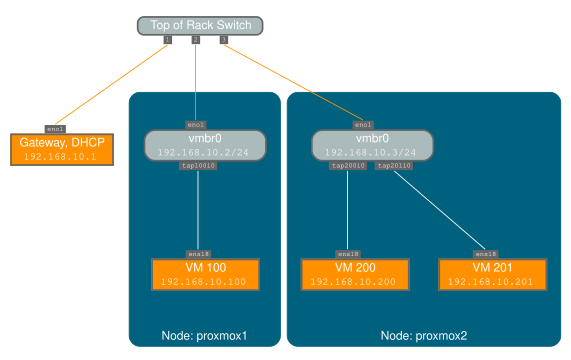](https://pve.proxmox.com/pve-docs/images/default-network-setup-bridge.svg)

网桥就像以软件实现的物理网络交换机。所有虚拟客户机可以共享单个网桥，或者您可以创建多个网桥来分隔网络域。每台宿主机最多可以有 4094 个网桥。

安装程序会创建一个名为 `vmbr0` 的网桥，并将其连接到第一块以太网卡。`/etc/network/interfaces` 中的相应配置可能如下所示：

```text
auto lo
iface lo inet loopback

iface eno1 inet manual

auto vmbr0
iface vmbr0 inet static
        address 192.168.10.2/24
        gateway 192.168.10.1
        bridge-ports eno1
        bridge-stp off
        bridge-fd 0
```

虚拟机的行为就好像它们直接连接到物理网络一样。反过来，网络会将每台虚拟机视为拥有自己的 MAC 地址，即使只有一根网线将所有这些 VM 连接到网络。

### 3.4.5. 路由配置 <a href="#sysadmin_network_routed" id="sysadmin_network_routed"></a>

大多数托管服务提供商不支持上述设置。出于安全原因，一旦他们在单个接口上检测到多个 MAC 地址，就会禁用网络。


一些提供商允许您通过其管理界面注册额外的 MAC 地址。这可以避免该问题，但配置起来可能很繁琐，因为您需要为每台 VM 注册一个 MAC 地址。


您可以通过单个接口“路由”所有流量来避免该问题。这可确保所有网络数据包使用相同的 MAC 地址。

[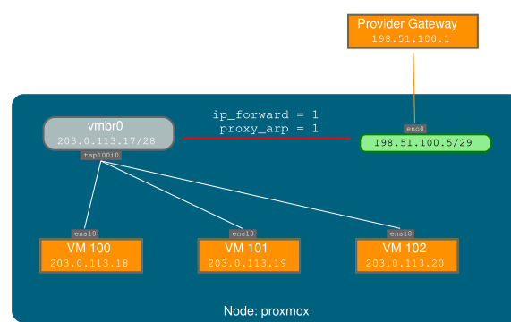](https://pve.proxmox.com/pve-docs/images/default-network-setup-routed.svg)

一个常见场景是，您有一个公有 IP 地址（本例假设为 `198.51.100.5`），以及一个供 VM 使用的额外 IP 地址块（`203.0.113.16/28`）。对于这种情况，我们建议采用以下设置：

```text
auto lo
iface lo inet loopback

auto eno0
iface eno0 inet static
        address  198.51.100.5/29
        gateway  198.51.100.1
        post-up echo 1 > /proc/sys/net/ipv4/ip_forward
        post-up echo 1 > /proc/sys/net/ipv4/conf/eno0/proxy_arp


auto vmbr0
iface vmbr0 inet static
        address  203.0.113.17/28
        bridge-ports none
        bridge-stp off
        bridge-fd 0
```

`vmbr0` 地址 `203.0.113.17` 是 `203.0.113.16/28` 地址块的第一个可用主机地址；该地址块的网络地址 `203.0.113.16` 不能分配给接口。

### 3.4.6. 使用 `iptables` 进行伪装（NAT） <a href="#sysadmin_network_masquerading" id="sysadmin_network_masquerading"></a>

伪装允许仅有私有 IP 地址的客户机通过使用宿主机 IP 地址进行出站通信来访问网络。每个出站数据包都会被 `iptables` 重写，使其看起来源自宿主机，响应也会相应地被重写，以路由到原始发送方。

```text
auto lo
iface lo inet loopback

auto eno1
#real IP address
iface eno1 inet static
        address  198.51.100.5/24
        gateway  198.51.100.1

auto vmbr0
#private sub network
iface vmbr0 inet static
        address  10.10.10.1/24
        bridge-ports none
        bridge-stp off
        bridge-fd 0

        post-up   echo 1 > /proc/sys/net/ipv4/ip_forward
        post-up   iptables -t nat -A POSTROUTING -s '10.10.10.0/24' -o eno1 -j MASQUERADE
        post-down iptables -t nat -D POSTROUTING -s '10.10.10.0/24' -o eno1 -j MASQUERADE
```


在某些启用了防火墙的伪装设置中，出站连接可能需要 conntrack 区域。否则，防火墙可能会阻止出站连接，因为它们会优先使用 VM 网桥的 `POSTROUTING`（而不是 `MASQUERADE`）。


在 `/etc/network/interfaces` 中添加以下行可以解决此问题：

```text
post-up   iptables -t raw -I PREROUTING -i fwbr+ -j CT --zone 1
post-down iptables -t raw -D PREROUTING -i fwbr+ -j CT --zone 1
```

有关此问题的更多信息，请参阅以下链接：

[Netfilter 数据包流](https://commons.wikimedia.org/wiki/File:Netfilter-packet-flow.svg)

[netdev-list 上介绍 conntrack 区域的补丁](https://lwn.net/Articles/370152/)

[一篇通过在 raw 表中使用 TRACE 给出清晰解释的博客文章](https://web.archive.org/web/20220610151210/https://blog.lobraun.de/2019/05/19/prox/)

### 3.4.7. Linux 绑定 <a href="#sysadmin_network_bond" id="sysadmin_network_bond"></a>

绑定（也称为 NIC 组队或链路聚合）是一种将多个 NIC 绑定到单个网络设备的技术。它可以实现不同的目标，例如使网络具备容错能力、提高性能，或同时实现两者。

Fibre Channel 等高速硬件及相关交换硬件可能相当昂贵。通过链路聚合，两个 NIC 可以表现为一个逻辑接口，从而使速度翻倍。这是大多数交换机都支持的 Linux 内核原生功能。如果您的节点有多个以太网端口，您可以通过将网线连接到不同的交换机来分散故障点，并且在出现网络故障时，绑定连接会故障转移到其中一根或另一根网线。

聚合链路可以缩短在线迁移的延迟，并提高 Proxmox VE 集群节点之间的数据复制速度。

绑定有 7 种模式：

- <strong>轮询（balance-rr）：</strong>按顺序通过第一个至最后一个可用的从属网络接口（NIC）传输网络数据包。此模式提供负载均衡和容错能力。
- <strong>主备（active-backup）：</strong>绑定中只有一个 NIC 从接口处于活动状态。当且仅当活动从接口发生故障时，另一个从接口才会变为活动状态。单个逻辑绑定接口的 MAC 地址在外部仅在一个 NIC（端口）上可见，以避免网络交换机中出现混乱。此模式提供容错能力。
- <strong>XOR（balance-xor）：</strong>根据\[（源 MAC 地址与目标 MAC 地址的 XOR 结果）对 NIC 从接口数量取模\]来传输网络数据包。这会为每个目标 MAC 地址选择相同的 NIC 从接口。此模式提供负载均衡和容错能力。
- <strong>广播（broadcast）：</strong>在所有从属网络接口上传输网络数据包。此模式提供容错能力。
- <strong>IEEE 802.3ad 动态链路聚合（802.3ad）（LACP）：</strong>创建具有相同速率和双工设置的聚合组。根据 802.3ad 规范，利用活动聚合器组中的所有从属网络接口。
- <strong>自适应传输负载均衡（balance-tlb）：</strong>Linux 绑定驱动程序模式，无需网络交换机的任何特殊支持。根据各从属网络接口的当前负载（相对于其速度计算）分配传出网络数据包流量。传入流量由当前指定的一个从属网络接口接收。如果此接收从接口发生故障，另一个从接口将接管发生故障的接收从接口的 MAC 地址。
- <strong>自适应负载均衡（balance-alb）：</strong>包括 balance-tlb 和针对 IPV4 流量的接收负载均衡（rlb），无需网络交换机的任何特殊支持。接收负载均衡通过 ARP 协商实现。绑定驱动程序在本地系统发出的 ARP 应答发送途中将其拦截，并将源硬件地址覆盖为单一逻辑绑定接口中某个 NIC 从接口的唯一硬件地址，从而使不同的网络对等端在其网络数据包流量中使用不同的 MAC 地址。

如果您的交换机支持 LACP（IEEE 802.3ad）协议，我们建议使用相应的绑定模式（802.3ad）。否则，通常应使用 active-backup 模式。


当宿主机不知道本地地址时，绑定模式 <em>balance-alb</em> 和 <em>balance-tlb</em> 不适用。当带有客户机的 Linux 网桥与绑定结合使用时，不应使用这些绑定模式。


对于集群网络（Corosync），我们建议为其配置多个网络。Corosync 不需要绑定来实现网络冗余，因为如果某个网络不可用，它可以自行在网络之间切换。已知某些绑定模式会导致 Corosync 出现问题，请参阅 [在绑定上使用 Corosync](../05-pvecm/README.md#pvecm_corosync_over_bonds)。

以下绑定配置可用作分布式/共享存储网络。其优点是您可以获得更高的速度，并且网络将具备容错能力。

**示例：使用具有固定 IP 地址的绑定**

```text
auto lo
iface lo inet loopback

iface eno1 inet manual

iface eno2 inet manual

iface eno3 inet manual

auto bond0
iface bond0 inet static
      bond-slaves eno1 eno2
      address  192.168.1.2/24
      bond-miimon 100
      bond-mode 802.3ad
      bond-xmit-hash-policy layer2+3

auto vmbr0
iface vmbr0 inet static
        address  10.10.10.2/24
        gateway  10.10.10.1
        bridge-ports eno3
        bridge-stp off
        bridge-fd 0
```

[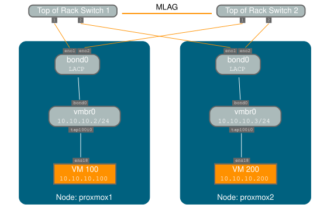](https://pve.proxmox.com/pve-docs/images/default-network-setup-bond.svg)

另一种可能的方法是直接将绑定用作网桥端口。这可用于使客户机网络具备容错能力。

**示例：将绑定用作网桥端口**

```text
auto lo
iface lo inet loopback

iface eno1 inet manual

iface eno2 inet manual

auto bond0
iface bond0 inet manual
      bond-slaves eno1 eno2
      bond-miimon 100
      bond-mode 802.3ad
      bond-xmit-hash-policy layer2+3

auto vmbr0
iface vmbr0 inet static
        address  10.10.10.2/24
        gateway  10.10.10.1
        bridge-ports bond0
        bridge-stp off
        bridge-fd 0
```

### 3.4.8. VLAN 802.1Q <a href="#sysadmin_network_vlan" id="sysadmin_network_vlan"></a>

虚拟局域网（VLAN）是在网络的第二层进行划分和隔离的广播域。因此，一个物理网络中可以有多个（4096 个）网络，且每个网络都独立于其他网络。

每个 VLAN 网络都由一个通常称为 <em>标签</em> 的编号标识。然后对网络数据包进行 <em>标记</em>，以标识它们属于哪个虚拟网络。

#### 客户机网络的 VLAN <a href="#vlan_for_guest_networks" id="vlan_for_guest_networks"></a>

Proxmox VE 开箱即用地支持此配置。您可以在创建 VM 时指定 VLAN 标签。VLAN 标签是客户机网络配置的一部分。网络层支持不同的 VLAN 实现模式，具体取决于网桥配置：

- <strong>Linux 网桥上的 VLAN 感知：</strong>在这种情况下，每个客户机的虚拟网卡都会分配一个 VLAN 标签，Linux 网桥会透明地支持该标签。也可以使用 Trunk 模式，但这需要在客户机中进行配置。
- <strong>Linux 网桥上的“传统”VLAN：</strong>与 VLAN 感知方法不同，此方法不是透明的，并会为每个 VLAN 创建一个 VLAN 设备和关联的网桥。也就是说，例如，在 VLAN 5 上创建客户机将创建 eno1.5 和 vmbr0v5 两个接口，它们会一直保留到系统重启。
- <strong>Open vSwitch VLAN：</strong>此模式使用 OVS VLAN 功能。
- <strong>客户机配置的 VLAN：</strong>VLAN 在客户机内部分配。在这种情况下，配置完全在客户机内部完成，无法从外部进行干预。其好处是可以在单个虚拟 NIC 上使用多个 VLAN。

#### 宿主机上的 VLAN <a href="#vlan_on_the_host" id="vlan_on_the_host"></a>

为允许宿主机与隔离网络通信，可以将 VLAN 标签应用于任何网络设备（NIC、Bond、Bridge）。通常，应在自身与物理 NIC 之间抽象层最少的接口上配置 VLAN。

例如，在默认配置中，您希望将宿主机管理地址放在单独的 VLAN 上。

**示例：通过传统 Linux 网桥将 VLAN 5 用于 Proxmox VE 管理 IP**

```text
auto lo
iface lo inet loopback

iface eno1 inet manual

iface eno1.5 inet manual

auto vmbr0v5
iface vmbr0v5 inet static
        address  10.10.10.2/24
        gateway  10.10.10.1
        bridge-ports eno1.5
        bridge-stp off
        bridge-fd 0

auto vmbr0
iface vmbr0 inet manual
        bridge-ports eno1
        bridge-stp off
        bridge-fd 0
```

**示例：通过 VLAN 感知 Linux 网桥将 VLAN 5 用于 Proxmox VE 管理 IP**

```text
auto lo
iface lo inet loopback

iface eno1 inet manual


auto vmbr0.5
iface vmbr0.5 inet static
        address  10.10.10.2/24
        gateway  10.10.10.1

auto vmbr0
iface vmbr0 inet manual
        bridge-ports eno1
        bridge-stp off
        bridge-fd 0
        bridge-vlan-aware yes
        bridge-vids 2-4094
```

下一个示例采用相同的设置，但使用绑定来使该网络具备故障安全性。

**示例：通过传统 Linux 网桥将 VLAN 5 与 bond0 结合用于 Proxmox VE 管理 IP**

```text
auto lo
iface lo inet loopback

iface eno1 inet manual

iface eno2 inet manual

auto bond0
iface bond0 inet manual
      bond-slaves eno1 eno2
      bond-miimon 100
      bond-mode 802.3ad
      bond-xmit-hash-policy layer2+3

iface bond0.5 inet manual

auto vmbr0v5
iface vmbr0v5 inet static
        address  10.10.10.2/24
        gateway  10.10.10.1
        bridge-ports bond0.5
        bridge-stp off
        bridge-fd 0

auto vmbr0
iface vmbr0 inet manual
        bridge-ports bond0
        bridge-stp off
        bridge-fd 0
```

### 3.4.9. 在节点上禁用 IPv6 <a href="#disabling_ipv6_on_the_node" id="disabling_ipv6_on_the_node"></a>

无论是否部署 IPv6，Proxmox VE 都能在所有环境中正常工作。我们建议将所有设置保留为提供的默认值。

如果您仍需要禁用节点对 IPv6 的支持，请创建适当的 `sysctl.conf (5)` 片段文件并设置正确的 [sysctls](https://www.kernel.org/doc/Documentation/networking/ip-sysctl.txt)，例如添加 `/etc/sysctl.d/disable-ipv6.conf`，内容为：

```text
net.ipv6.conf.all.disable_ipv6 = 1
net.ipv6.conf.default.disable_ipv6 = 1
```

此方法比在 [内核命令行](https://www.kernel.org/doc/Documentation/networking/ipv6.rst) 上禁用 IPv6 模块加载更为可取。

### 3.4.10. 在网桥上禁用 MAC 学习 <a href="#disabling_mac_learning_on_a_bridge" id="disabling_mac_learning_on_a_bridge"></a>

默认情况下，网桥上会启用 MAC 学习，以确保虚拟客户机及其网络的使用体验顺畅。

但在某些环境中，这可能并不理想。从 Proxmox VE 7.3 开始，您可以通过设置‘bridge-disable-mac-learning 1\` configuration on a bridge in \`/etc/network/interfaces’来禁用网桥上的 MAC 学习，例如：

```text
# ...

auto vmbr0
iface vmbr0 inet static
        address  10.10.10.2/24
        gateway  10.10.10.1
        bridge-ports ens18
        bridge-stp off
        bridge-fd 0
        bridge-disable-mac-learning 1
```

启用后，Proxmox VE 会手动将 VM 和容器中配置的 MAC 地址添加到网桥的转发数据库，以确保客户机仍可使用网络——但仅当它们使用自己的实际 MAC 地址时。

## 3.5. 时间同步 <a href="#time_synchronization" id="time_synchronization"></a>

Proxmox VE 集群软件栈本身高度依赖于所有节点的时间都精确同步。如果所有节点的本地时间不同步，Ceph 等其他一些组件也无法正常工作。

可以使用“网络时间协议”（`NTP`）实现节点之间的时间同步。从 Proxmox VE 7 开始，`chrony` 用作默认的 NTP 守护进程，而 Proxmox VE 6 使用 `systemd-timesyncd`。两者都预先配置为使用一组公共服务器。


如果将系统升级到 Proxmox VE 7，建议您手动安装 `chrony`、`ntp` 或 `openntpd`。


### 3.5.1. 使用自定义 NTP 服务器 <a href="#using_custom_ntp_servers" id="using_custom_ntp_servers"></a>

在某些情况下，可能需要使用非默认的 NTP 服务器。例如，如果您的 Proxmox VE 节点由于严格的防火墙规则而无法访问公共互联网，则需要设置本地 NTP 服务器，并告知 NTP 守护进程使用它们。

#### 对于使用 chrony 的系统： <a href="#for_systems_using_chrony" id="for_systems_using_chrony"></a>

在 `chrony` 的配置文件 `/etc/chrony/chrony.conf` 中指定应使用哪些服务器：

```text
server ntp1.example.com iburst
server ntp2.example.com iburst
server ntp3.example.com iburst
```

重启 `chrony`：

```text
# systemctl restart chronyd
```

检查日志，以确认新配置的 NTP 服务器正在被使用：

```text
# journalctl --since -1h -u chrony
```

```text
...
Aug 26 13:00:09 node1 systemd[1]: Started chrony, an NTP client/server.
Aug 26 13:00:15 node1 chronyd[4873]: Selected source 10.0.0.1 (ntp1.example.com)
Aug 26 13:00:15 node1 chronyd[4873]: System clock TAI offset set to 37 seconds
...
```

#### 对于使用 systemd-timesyncd 的系统： <a href="#for_systems_using_systemd_timesyncd" id="for_systems_using_systemd_timesyncd"></a>

在 `systemd-timesyncd` 的配置文件 `/etc/systemd/timesyncd.conf` 中指定应使用哪些服务器：

```text
[Time]
NTP=ntp1.example.com ntp2.example.com ntp3.example.com ntp4.example.com
```

然后，重启同步服务（`systemctl restart
systemd-timesyncd`），并通过检查日志（`journalctl --since -1h -u systemd-timesyncd`）验证新配置的 NTP 服务器是否正在使用：

```text
...
Oct 07 14:58:36 node1 systemd[1]: Stopping Network Time Synchronization...
Oct 07 14:58:36 node1 systemd[1]: Starting Network Time Synchronization...
Oct 07 14:58:36 node1 systemd[1]: Started Network Time Synchronization.
Oct 07 14:58:36 node1 systemd-timesyncd[13514]: Using NTP server 10.0.0.1:123 (ntp1.example.com).
Oct 07 14:58:36 node1 systemd-timesyncd[13514]: interval/delta/delay/jitter/drift 64s/-0.002s/0.020s/0.000s/-31ppm
...
```

## 3.6. 外部指标服务器 <a href="#external_metric_server" id="external_metric_server"></a>

[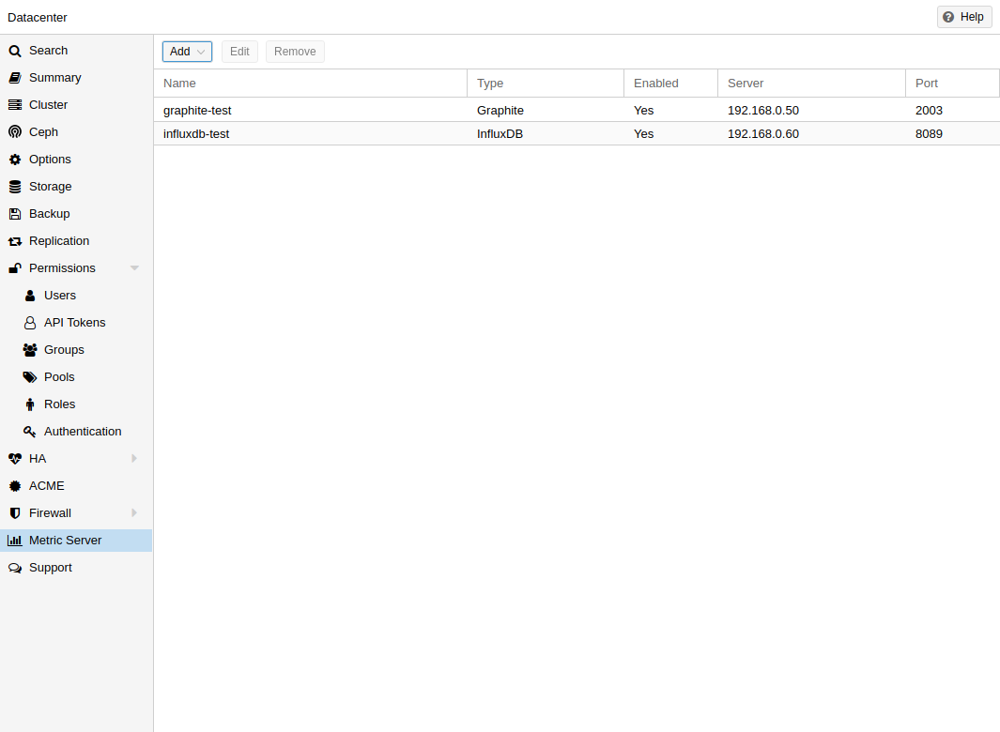](https://pve.proxmox.com/pve-docs/images/screenshot/gui-datacenter-metric-server-list.png)

在 Proxmox VE 中，您可以定义外部指标服务器，这些服务器将定期接收有关宿主机、虚拟客户机和存储的各种统计信息。

目前支持：

- Graphite（参见 [https://graphiteapp.org](https://graphiteapp.org)）
- InfluxDB（参见 [https://www.influxdata.com/time-series-platform/influxdb/](https://www.influxdata.com/time-series-platform/influxdb/)）
- OpenTelemetry（参见 [https://opentelemetry.io/](https://opentelemetry.io/)）

外部指标服务器定义保存在 <em>/etc/pve/status.cfg</em> 中，并可通过 Web 界面编辑。

### 3.6.1. Graphite 服务器配置 <a href="#metric_server_graphite" id="metric_server_graphite"></a>

[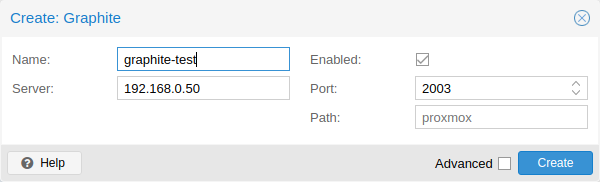](https://pve.proxmox.com/pve-docs/images/screenshot/gui-datacenter-metric-server-graphite.png)

默认端口设置为 <strong>2003</strong>，默认 Graphite 路径为 <strong>proxmox</strong>。

默认情况下，Proxmox VE 通过 UDP 发送数据，因此必须将 Graphite 服务器配置为接受此方式的数据传输。对于不使用标准 <strong>1500</strong> MTU 的环境，可以在此处配置最大传输单元（MTU）。

您还可以将插件配置为使用 TCP。为避免阻塞重要的 `pvestatd` 统计信息收集守护进程，需要设置超时时间，以应对网络问题。

### 3.6.2. InfluxDB 插件配置 <a href="#metric_server_influxdb" id="metric_server_influxdb"></a>

[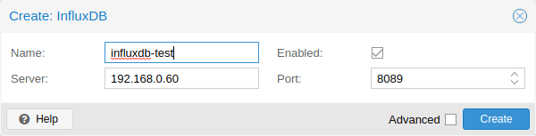](https://pve.proxmox.com/pve-docs/images/screenshot/gui-datacenter-metric-server-influxdb.png)

Proxmox VE 通过 UDP 发送数据，因此必须对 InfluxDB 服务器进行相应配置。如有必要，也可以在此处配置 MTU。

以下是 InfluxDB 的示例配置（在您的 InfluxDB 服务器上）：

```text
[[udp]]
   enabled = true
   bind-address = "0.0.0.0:8089"
   database = "proxmox"
   batch-size = 1000
   batch-timeout = "1s"
```

使用此配置，您的服务器会监听所有 IP 地址的 8089 端口，并将数据写入 <strong>proxmox</strong> 数据库

或者，可以将插件配置为使用 InfluxDB 2.x 的 http(s) API。InfluxDB 1.8.x 中包含了用于此 v2 API 的向前兼容 API 端点。

要使用该 API，请将 <em>influxdbproto</em> 设置为 <em>http</em> 或 <em>https</em>（取决于您的配置）。默认情况下，Proxmox VE 使用组织 <em>proxmox</em> 和存储桶/数据库 <em>proxmox</em>（可分别通过配置 <em>organization</em> 和 <em>bucket</em> 进行设置）。

由于 InfluxDB 的 v2 API 只有在身份验证下才可用，因此您必须生成一个可写入正确存储桶的令牌并进行设置。

在 1.8.x 的 v2 兼容 API 中，您可以使用 <em>user:password</em> 作为令牌（如果需要），并且可以省略 <em>organization</em>，因为该设置在 InfluxDB 1.x 中没有意义。

您还可以通过 <em>timeout</em> 设置 HTTP 超时时间（默认为 1s），并通过 <em>max-body-size</em> 设置最大批处理大小（默认为 25000000 bytes）（此设置对应 InfluxDB 中的同名设置）。

## 3.7. 磁盘健康监控 <a href="#disk_health_monitoring" id="disk_health_monitoring"></a>

虽然建议使用稳健且冗余的存储，但监控本地磁盘的健康状况也非常有帮助。

从 Proxmox VE 4.3 开始，系统会安装并要求使用 smartmontools 软件包 [\[1\]](#note-be97c404-1)。这是一组用于监控和控制本地硬盘 S.M.A.R.T. 系统的工具。

您可以通过执行以下命令获取磁盘状态：

```text
# smartctl -a /dev/sdX
```

其中 /dev/sdX 是您一块本地磁盘的路径。

如果输出显示：

```text
SMART support is: Disabled
```

您可以使用以下命令启用它：

```text
# smartctl -s on /dev/sdX
```

有关如何使用 smartctl 的更多信息，请参阅 `man smartctl`。

默认情况下，smartmontools 守护进程 smartd 处于活动状态并已启用，并扫描与以下内容匹配的任何设备

- `/dev/sd[a-z]`
- `/dev/sd[a-z][a-z]`
- `/dev/hd[a-t]`
- 或 `/dev/nvme[0-99]`

每 30 分钟检查一次错误和警告，如果检测到问题，则向 root 发送电子邮件。

有关如何配置 smartd 的更多信息，请参阅 `man smartd` 和 `man smartd.conf`。

如果您将硬盘与硬件 RAID 控制器结合使用，很可能有相应的工具可监控 RAID 阵列中的磁盘及阵列本身。有关更多信息，请咨询您的 RAID 控制器供应商。

## 3.8. 逻辑卷管理器（LVM） <a href="#chapter_lvm" id="chapter_lvm"></a>

大多数人会直接将 Proxmox VE 安装在本地磁盘上。Proxmox VE 安装光盘提供了多种本地磁盘管理选项，当前的默认设置使用 LVM。安装程序允许您为此类设置选择单块磁盘，并将该磁盘用作<strong>卷</strong><strong>组</strong>（VG）`pve`的物理卷。以下输出来自使用一块小型 8GB 磁盘的测试安装：

```text
# pvs
  PV         VG   Fmt  Attr PSize PFree
  /dev/sda3  pve  lvm2 a--  7.87g 876.00m

# vgs
  VG   #PV #LV #SN Attr   VSize VFree
  pve    1   3   0 wz--n- 7.87g 876.00m
```

安装程序会在此 VG 中分配三个<strong>逻</strong>辑<strong>卷</strong>（LV）：

```text
# lvs
  LV   VG   Attr       LSize   Pool Origin Data%  Meta%
  data pve  twi-a-tz--   4.38g             0.00   0.63
  root pve  -wi-ao----   1.75g
  swap pve  -wi-ao---- 896.00m
```

**root**

格式化为 `ext4`，并包含操作系统。

**swap**

交换分区

**data**

此卷使用 LVM-thin，用于存储 VM 镜像。LVM-thin 更适合此用途，因为它能够高效地支持快照和克隆。

对于 4.1 及更早版本的 Proxmox VE，安装程序会创建一个名为“data”的标准逻辑卷，并将其挂载到 `/var/lib/vz`。

从 4.2 版开始，逻辑卷“data”是一个 LVM-thin 池，用于存储基于块的客户机镜像，而 `/var/lib/vz` 只是根文件系统上的一个目录。

### 3.8.1. 硬件 <a href="#hardware" id="hardware"></a>

对于此类设置，我们强烈建议使用硬件 RAID 控制器（带 BBU）。这可以提高性能、提供冗余，并使磁盘更换更加容易（支持热插拔）。

LVM 本身不需要任何特殊硬件，内存要求也非常低。

### 3.8.2. 引导加载程序 <a href="#bootloader" id="bootloader"></a>

默认情况下，我们会安装两个引导加载程序。第一个分区包含标准的 GRUB 引导加载程序。第二个分区是<strong>E</strong>FI <strong>系</strong>统<strong>分</strong>区（ESP），它使系统能够在 EFI 系统上引导，并从用户空间应用[持久性固件更新](#sysadmin_firmware_persistent)。

### 3.8.3. 创建卷组 <a href="#creating_a_volume_group" id="creating_a_volume_group"></a>

假设我们有一块空磁盘 `/dev/sdb`，并希望在其上创建一个名为“vmdata”的卷组。


请注意，以下命令将销毁 `/dev/sdb` 上的所有现有数据。


首先创建一个分区。

```text
# sgdisk -N 1 /dev/sdb
```

创建一个<strong>物</strong>理<strong>卷</strong>（PV），无需确认，并将 metadatasize 设置为 250K。

```text
# pvcreate --metadatasize 250k -y -ff /dev/sdb1
```

在 `/dev/sdb1` 上创建一个名为“vmdata”的卷组

```text
# vgcreate vmdata /dev/sdb1
```

### 3.8.4. 为 `/var/lib/vz` 创建额外的 LV <a href="#creating_an_extra_lv_for_span_class_monospaced_var_lib_vz_span" id="creating_an_extra_lv_for_span_class_monospaced_var_lib_vz_span"></a>

只需创建一个新的精简 LV 即可轻松完成。

```text
# lvcreate -n <Name> -V <Size[M,G,T]> <VG>/<LVThin_pool>
```

一个实际示例：

```text
# lvcreate -n vz -V 10G pve/data
```

现在必须在 LV 上创建文件系统。

```text
# mkfs.ext4 /dev/pve/vz
```

最后必须将其挂载。


请确保 `/var/lib/vz` 为空。在默认安装中，它并非为空。


要使其始终可访问，请在 `/etc/fstab` 中添加以下行。

```text
# echo '/dev/pve/vz /var/lib/vz ext4 defaults 0 2' >> /etc/fstab
```

### 3.8.5. 调整精简池的大小 <a href="#resizing_the_thin_pool" id="resizing_the_thin_pool"></a>

使用以下命令调整 LV 和元数据池的大小：

```text
# lvresize --size +<size[\M,G,T]> --poolmetadatasize +<size[\M,G]> <VG>/<LVThin_pool>
```


扩展数据池时，也必须扩展元数据池。


### 3.8.6. 创建 LVM-thin 池 <a href="#create_a_lvm_thin_pool" id="create_a_lvm_thin_pool"></a>

精简池必须创建在卷组之上。有关如何创建卷组，请参阅“LVM”一节。

```text
# lvcreate -L 80G -T -n vmstore vmdata
```

## 3.9. Linux 上的 ZFS <a href="#chapter_zfs" id="chapter_zfs"></a>

ZFS 是由 Sun Microsystems 设计的文件系统与逻辑卷管理器的结合体。从 Proxmox VE 3.4 开始，引入了 ZFS 文件系统的原生 Linux 内核移植版本，可作为可选文件系统，也可作为根文件系统的额外选择。无需手动编译 ZFS 模块——所有软件包均已包含。

使用 ZFS，可以在低成本硬件上获得最全面的企业级功能，也可以通过 SSD 缓存甚至纯 SSD 配置来构建高性能系统。ZFS 能以适中的 CPU 和内存负载以及简便的管理，取代价格高昂的硬件 RAID 卡。

**ZFS 的一般优势**

- 通过 Proxmox VE GUI 和 CLI 轻松配置和管理。
- 可靠
- 防止数据损坏
- 文件系统级数据压缩
- 快照
- 写时复制克隆
- 多种 RAID 级别：RAID0、RAID1、RAID10、RAIDZ-1、RAIDZ-2、RAIDZ-3、dRAID、dRAID2、dRAID3
- 可使用 SSD 作为缓存
- 自我修复
- 持续进行完整性检查
- 专为大容量存储而设计
- 通过网络进行异步复制
- 开源
- 加密
- …

### 3.9.1. 硬件 <a href="#hardware_2" id="hardware_2"></a>

ZFS 对内存依赖很大，因此至少需要 8GB 才能开始使用。实践中，应在硬件/预算允许的范围内尽可能多配置内存。为防止数据损坏，我们建议使用高品质的 ECC RAM。

如果使用专用的缓存和/或日志磁盘，则应使用企业级 SSD。这可以显著提高整体性能。


不要在具有自身缓存管理功能的硬件 RAID 控制器之上使用 ZFS。ZFS 需要直接与磁盘通信。使用 HBA 适配器或类似刷写为“IT”模式的 LSI 控制器更合适。


如果您尝试在 VM 内安装 Proxmox VE（嵌套虚拟化），请勿为该 VM 的磁盘使用 `virtio`，因为 ZFS 不支持它们。请改用 IDE 或 SCSI（也适用于 `virtio` SCSI 控制器类型）。

### 3.9.2. 安装为根文件系统 <a href="#installation_as_root_file_system" id="installation_as_root_file_system"></a>

使用 Proxmox VE 安装程序进行安装时，可以选择 ZFS 作为根文件系统。您需要在安装时选择 RAID 类型：

<table>
<tr>
<td>RAID0 <br/></td>
<td>
<p>也称为“条带化”。这种卷的容量是所有磁盘容量之和。但 RAID0 不提供任何冗余，因此单块磁盘发生故障就会导致整个卷不可用。</p>
</td>
</tr>
<tr>
<td>RAID1 <br/></td>
<td>
<p>也称为“镜像”。相同的数据会写入所有磁盘。这种模式至少需要 2 块大小相同的磁盘。最终容量相当于单块磁盘的容量。</p>
</td>
</tr>
<tr>
<td>RAID10 <br/></td>
<td>
<p>RAID0 和 RAID1 的组合。至少需要 4 块磁盘。</p>
</td>
</tr>
<tr>
<td>RAIDZ-1 <br/></td>
<td>
<p>RAID-5 的变体，采用单奇偶校验。至少需要 3 块磁盘。</p>
</td>
</tr>
<tr>
<td>RAIDZ-2 <br/></td>
<td>
<p>RAID-5 的变体，采用双奇偶校验。至少需要 4 块磁盘。</p>
</td>
</tr>
<tr>
<td>RAIDZ-3 <br/></td>
<td>
<p>RAID-5 的变体，采用三奇偶校验。至少需要 5 块磁盘。</p>
</td>
</tr>
</table>

安装程序会自动对磁盘进行分区，创建名为 `rpool` 的 ZFS 池，并将根文件系统安装在 ZFS 子卷 `rpool/ROOT/pve-1` 上。

安装程序还会创建一个名为 `rpool/data` 的子卷，用于存储 VM 镜像。为了能在 Proxmox VE 工具中使用该子卷，安装程序会在 `/etc/pve/storage.cfg` 中创建以下配置条目：

```text
zfspool: local-zfs
        pool rpool/data
        sparse
        content images,rootdir
```

安装后，您可以使用 `zpool` 命令查看 ZFS 池状态：

```text
# zpool status
  pool: rpool
 state: ONLINE
  scan: none requested
config:

        NAME        STATE     READ WRITE CKSUM
        rpool       ONLINE       0     0     0
          mirror-0  ONLINE       0     0     0
            sda2    ONLINE       0     0     0
            sdb2    ONLINE       0     0     0
          mirror-1  ONLINE       0     0     0
            sdc     ONLINE       0     0     0
            sdd     ONLINE       0     0     0

errors: No known data errors
```

`zfs` 命令用于配置和管理 ZFS 文件系统。以下命令列出安装后的所有文件系统：

```text
# zfs list
NAME               USED  AVAIL  REFER  MOUNTPOINT
rpool             4.94G  7.68T    96K  /rpool
rpool/ROOT         702M  7.68T    96K  /rpool/ROOT
rpool/ROOT/pve-1   702M  7.68T   702M  /
rpool/data          96K  7.68T    96K  /rpool/data
rpool/swap        4.25G  7.69T    64K  -
```

### 3.9.3. ZFS RAID 级别注意事项 <a href="#sysadmin_zfs_raid_considerations" id="sysadmin_zfs_raid_considerations"></a>

选择 ZFS 池的布局时，需要考虑几个因素。ZFS 池的基本构建块是虚拟设备，即 `vdev`。池中的所有 vdev 都会被均等使用，数据在它们之间进行条带化（RAID0）。有关 vdev 的更多详细信息，请查看 `zpoolconcepts(7)` 手册页。

#### 性能 <a href="#sysadmin_zfs_raid_performance" id="sysadmin_zfs_raid_performance"></a>

每种 `vdev` 类型都有不同的性能表现。需要关注的两个参数是 IOPS（每秒输入/输出操作次数）以及数据写入或读取的带宽。

写入数据时，就这两个参数而言，<em>mirror</em> vdev（RAID1）的表现大致与单块磁盘相同。读取数据时，性能会随镜像中的磁盘数量线性提升。

一种常见情况是使用 4 块磁盘。将其配置为 2 个镜像 vdev（RAID10）时，在 IOPS 和带宽方面，该池的写入特性将相当于两块独立磁盘。对于读取操作，其表现则相当于 4 块独立磁盘。

任何冗余级别的 <em>RAIDZ</em> 在 IOPS 方面都大致相当于单块磁盘，但具有较高的带宽。带宽大小取决于 RAIDZ vdev 的规模和冗余级别。

<em>dRAID</em> 池的性能应与同等的 <em>RAIDZ</em> 池相当。

对于运行中的 VM，在大多数情况下，IOPS 是更重要的指标。

#### 大小、空间使用情况和冗余 <a href="#sysadmin_zfs_raid_size_space_usage_redundancy" id="sysadmin_zfs_raid_size_space_usage_redundancy"></a>

由 <em>mirror</em> vdev 组成的池虽然具有最佳性能特性，但可用空间仅为所有磁盘容量的 50%。如果一个镜像 vdev 包含超过 2 块磁盘，例如三向镜像，可用空间还会更少。每个镜像至少需要一块健康磁盘，池才能保持正常运行。

由 N 块磁盘组成的 <em>RAIDZ</em> 类型 vdev，其可用空间大致为 N-P，其中 P 为 RAIDZ 级别。RAIDZ 级别表示在不丢失数据的情况下，允许发生故障的任意磁盘数量。一个特例是使用 4 块磁盘的 RAIDZ2 池。在这种情况下，由于可用空间相同，通常最好使用 2 个镜像 vdev，以获得更好的性能。

使用任何 RAIDZ 级别时，另一个重要因素是用作 VM 磁盘的 ZVOL 数据集的行为。对于每个数据块，池都需要奇偶校验数据，其大小至少为池的 `ashift` 值所定义的最小块大小。当 ashift 为 12 时，池的块大小为 4k。ZVOL 的默认块大小为 8k。因此，在 RAIDZ2 中，每写入一个 8k 数据块，都会额外写入两个 4k 奇偶校验块，即 8k \+ 4k \+ 4k \= 16k。当然，这是一种简化说明，实际情况会略有不同，因为此示例未计入元数据、压缩等因素。

检查 ZVOL 的以下属性时，可以观察到这种行为：

- `volsize`
- `refreservation`（如果池未采用精简置备）
- `used`（如果池采用精简置备且不存在快照）

```text
# zfs get volsize,refreservation,used <pool>/vm-<vmid>-disk-X
```

`volsize` 是呈现给 VM 的磁盘大小，而 `refreservation` 显示池中的预留空间，其中包括奇偶校验数据预计所需的空间。如果池采用精简置备，`refreservation` 将设置为 0。观察这种行为的另一种方法是比较 VM 内已使用的磁盘空间与 `used` 属性。请注意，快照会使该值失真。

有几种方法可以减少由此增加的空间占用：

- 增大 `volblocksize`，以提高数据与奇偶校验数据的比例
- 使用 <em>mirror</em> vdev 替代 <em>RAIDZ</em>
- 使用 `ashift=9`（块大小为 512 bytes）

`volblocksize` 属性只能在创建 ZVOL 时设置。其默认值可在存储配置中更改。执行此操作时，需要相应调整客户机；并且根据使用场景，写放大问题可能只是从 ZFS 层转移到了客户机。

创建池时使用 `ashift=9` 可能会导致性能不佳，具体取决于底层磁盘，而且此设置以后无法更改。

镜像 vdev（RAID1、RAID10）对 VM 工作负载具有良好的表现。除非您的环境有特定需求和特性，且 RAIDZ 的性能特性可以接受，否则应使用镜像 vdev。

### 3.9.4. ZFS dRAID <a href="#zfs_draid" id="zfs_draid"></a>

在 ZFS dRAID（去集群化 RAID）中，热备盘也参与 RAID。其备用容量会被预留，并在某块磁盘发生故障时用于重建。根据配置的不同，与 RAIDZ 相比，在磁盘发生故障时这可提供更快的重建速度。更多信息请参阅 OpenZFS 官方文档。[\[2\]](#note-be97c404-2)


dRAID 适用于包含超过 10-15 块磁盘的 dRAID。在大多数使用场景中，磁盘数量较少时，RAIDZ 设置应该更合适。



GUI 要求比最低磁盘数多一块磁盘（即 dRAID1 需要 3 块）。它预期还会添加一块备用磁盘。


- `dRAID1` 或 `dRAID`：至少需要 2 块磁盘，在数据丢失前允许 1 块磁盘发生故障
- `dRAID2`：至少需要 3 块磁盘，在数据丢失前允许 2 块磁盘发生故障
- `dRAID3`：至少需要 4 块磁盘，在数据丢失前允许 3 块磁盘发生故障

更多信息请参阅手册页：

```text
# man zpoolconcepts
```

#### 备用磁盘和数据 <a href="#spares_and_data" id="spares_and_data"></a>

`spares` 的数量告知系统应准备多少块磁盘以应对磁盘故障。默认值为 0 `spares`。没有备用磁盘，重建就不会获得任何速度优势。

`data` 定义冗余组中的设备数量。默认值为 8。但如果 `disks - parity - spares` 等于某个小于 8 的值，则使用较小的数值。一般来说，`data` 设备数量越少，IOPS 越高、压缩率越好、重同步速度越快，但定义较少的数据设备会减少池的可用存储容量。

### 3.9.5. 引导加载程序 <a href="#bootloader_2" id="bootloader_2"></a>

Proxmox VE 使用 [`proxmox-boot-tool`](#sysboot_proxmox_boot_tool) 管理引导加载程序配置。有关详细信息，请参阅 [Proxmox VE 宿主机引导加载程序](#sysboot) 一章。

### 3.9.6. ZFS 管理 <a href="#zfs_administration" id="zfs_administration"></a>

本节提供一些常见任务的使用示例。ZFS 本身功能非常强大，并提供了许多选项。管理 ZFS 的主要命令是 `zfs` 和 `zpool`。这两个命令都配有详尽的手册页，可以使用以下命令阅读：

```text
# man zpool
# man zfs
```

#### 创建新的 zpool <a href="#sysadmin_zfs_create_new_zpool" id="sysadmin_zfs_create_new_zpool"></a>

要创建新池，至少需要一块磁盘。`ashift` 的扇区大小（2 的 `ashift` 次幂）应与底层磁盘的扇区大小相同或更大。

```text
# zpool create -f -o ashift=12 <pool> <device>
```


池名称必须遵循以下规则：

- 以字母（a-z 或 A-Z）开头
- 只能包含字母数字、`-`、`_`、`.`、`:` 或 \` \`（空格）字符
- <strong>不得</strong>以 `mirror`、`raidz`、`draid` 或 `spare` 之一开头
- 不得为 `log`


要启用压缩（请参阅 [ZFS 中的压缩](#zfs_compression) 一节）：

```text
# zfs set compression=lz4 <pool>
```

#### 使用 RAID-0 创建新池 <a href="#sysadmin_zfs_create_new_zpool_raid0" id="sysadmin_zfs_create_new_zpool_raid0"></a>

最少 1 块磁盘

```text
# zpool create -f -o ashift=12 <pool> <device1> <device2>
```

#### 使用 RAID-1 创建新池 <a href="#sysadmin_zfs_create_new_zpool_raid1" id="sysadmin_zfs_create_new_zpool_raid1"></a>

最少 2 块磁盘

```text
# zpool create -f -o ashift=12 <pool> mirror <device1> <device2>
```

#### 使用 RAID-10 创建新池 <a href="#sysadmin_zfs_create_new_zpool_raid10" id="sysadmin_zfs_create_new_zpool_raid10"></a>

最少 4 块磁盘

```text
# zpool create -f -o ashift=12 <pool> mirror <device1> <device2> mirror <device3> <device4>
```

#### 使用 RAIDZ-1 创建新池 <a href="#sysadmin_zfs_create_new_zpool_raidz1" id="sysadmin_zfs_create_new_zpool_raidz1"></a>

最少 3 块磁盘

```text
# zpool create -f -o ashift=12 <pool> raidz1 <device1> <device2> <device3>
```

#### 使用 RAIDZ-2 创建新池 <a href="#create_a_new_pool_with_raidz_2" id="create_a_new_pool_with_raidz_2"></a>

最少 4 块磁盘

```text
# zpool create -f -o ashift=12 <pool> raidz2 <device1> <device2> <device3> <device4>
```

请阅读 [ZFS RAID 级别注意事项](#sysadmin_zfs_raid_considerations) 一节，以便在设置池之前对 IOPS 和带宽预期进行粗略估算，尤其是在希望使用 RAID-Z 模式时。

#### 扩展 RAIDZ-N <a href="#sysadmin_zfs_extend_raidz" id="sysadmin_zfs_extend_raidz"></a>


此功能仅适用于 Proxmox VE 9（ZFS 2.3.3）及更高版本。


假设你有一个现有的 `<pool>`，其中包含一个 RAIDZ-N `<raidzN-M>` vdev，则可以使用以下语法添加新的物理磁盘 `<device>`：

```text
zpool attach <pool> <raidzN-M> <device>
```

你可以通过运行 `zpool status <pool>` 验证总体是否成功，并通过运行 `zpool list <pool> -v` 获取所有已连接磁盘的详细输出。要检查池的新容量，请运行 `zfs list <pool>`。

#### 创建带有缓存（L2ARC）的新池 <a href="#sysadmin_zfs_create_new_zpool_with_cache" id="sysadmin_zfs_create_new_zpool_with_cache"></a>

可以使用专用设备或分区作为二级缓存来提高性能。此类缓存设备尤其有助于读取大多为静态的数据时的随机读取工作负载。由于它充当实际存储与内存中的 ARC 之间的附加缓存层，因此在因内存限制而必须缩减 ARC 时，它也能提供帮助。

**创建带有磁盘缓存的 ZFS 池**

```text
# zpool create -f -o ashift=12 <pool> <device> cache <cache-device>
```

这里只使用了一个 `<device>` 和一个 `<cache-device>`，但可以使用更多设备，如 [创建 RAID 池](#sysadmin_zfs_create_new_zpool_raid0) 中所示。

请注意，缓存设备没有镜像或 RAID 模式，它们都只是简单累加。

如果任何缓存设备在读取时产生错误，ZFS 会透明地将该请求转到底层存储层。

#### 创建带有日志（ZIL）的新池 <a href="#sysadmin_zfs_create_new_zpool_with_log" id="sysadmin_zfs_create_new_zpool_with_log"></a>

可以使用专用驱动器或分区作为 ZFS 意图日志（ZIL），它主要用于提供安全的同步事务，因此常用于数据库或其他更频繁发出 `fsync` 操作的程序等性能关键路径。

池默认用作 ZIL 位置。将 ZIL I/O 负载转移到独立设备有助于降低事务延迟，同时减轻主池负担，从而提高整体性能。

对于直接或通过分区用作日志设备的磁盘，建议：

- 使用具有断电保护功能的快速 SSD，因为这类设备的提交延迟要低得多。
- 为分区（或整个设备）至少分配几 GB，但使用超过已安装内存一半的容量不会带来任何实际优势。

**创建带有独立日志设备的 ZFS 池**

```text
# zpool create -f -o ashift=12 <pool> <device> log <log-device>
```

在上面的示例中，使用了一个 `<device>` 和一个 `<log-device>`，但你也可以将其与其他 RAID 变体结合使用，如 [创建 RAID 池](#sysadmin_zfs_create_new_zpool_raid0) 一节所述。

你还可以将日志设备镜像到多个设备，这主要用于确保单个日志设备发生故障时性能不会立即下降。

如果所有日志设备都发生故障，则会再次使用 ZFS 主池本身，直到更换日志设备。

#### 向现有池添加缓存和日志 <a href="#sysadmin_zfs_add_cache_and_log_dev" id="sysadmin_zfs_add_cache_and_log_dev"></a>

如果你的池没有缓存和日志，仍然可以随时添加两者，或只添加其中之一。

例如，假设你有一块不错的、具有断电保护功能的企业级 SSD，希望用它来提高池的整体性能。

由于日志设备的最大大小应约为已安装物理内存大小的一半，这意味着 ZIL 很可能只占用 SSD 中相对较小的一部分，剩余空间可以用作缓存。

首先，你必须使用 `parted` 或 `gdisk` 在 SSD 上创建两个 GPT 分区。

然后即可将它们添加到池中：

**将独立日志设备和二级缓存都添加到现有池**

```text
# zpool add -f <pool> log <device-part1> cache <device-part2>
```

只需将 `<pool>`、`<device-part1>` 和 `<device-part2>` 替换为池名称以及两个指向分区的 `/dev/disk/by-id/` 路径。

你也可以分别添加 ZIL 和缓存。

**向现有 ZFS 池添加日志设备**

```text
# zpool add <pool> log <log-device>
```

#### 更换故障设备 <a href="#sysadmin_zfs_change_failed_dev" id="sysadmin_zfs_change_failed_dev"></a>

```text
# zpool replace -f <pool> <old-device> <new-device>
```

**更换故障的可引导设备**

根据 Proxmox VE 的安装方式，它可能使用 `systemd-boot`，或通过 `proxmox-boot-tool` [\[3\]](#note-be97c404-3) 使用 GRUB，也可能直接使用 GRUB 作为引导加载程序（请参阅 [宿主机引导加载程序](#sysboot)）。你可以通过运行以下命令进行检查：

```text
# proxmox-boot-tool status
```

复制分区表、重新生成 GUID 和替换 ZFS 分区的最初步骤相同。要使系统能够从新磁盘引导，需要根据所使用的引导加载程序执行不同的步骤。

```text
# sgdisk <healthy bootable device> -R <new device>
# sgdisk -G <new device>
# zpool replace -f <pool> <old zfs partition> <new zfs partition>
```


使用 `zpool status -v` 命令监视新磁盘的重同步进程进度。


**使用 `proxmox-boot-tool`：**

```text
# proxmox-boot-tool format <new disk's ESP>
# proxmox-boot-tool init <new disk's ESP> [grub]
```


`ESP` 表示 EFI 系统分区。自 5.4 版起，使用 Proxmox VE 安装程序时，该分区会在可引导磁盘上设置为第 2 号分区。有关详细信息，请参阅 [设置用作同步 ESP 的新分区](#sysboot_proxmox_boot_setup)。



务必将 <em>grub</em> 作为模式传递给 `proxmox-boot-tool init`，如果 `proxmox-boot-tool status` 表明当前磁盘使用 GRUB，尤其是在启用了安全启动时！


**直接使用 GRUB：**

```text
# grub-install <new disk>
```


只有使用 Proxmox VE 6.3 或更早版本安装且尚未手动迁移为使用 `proxmox-boot-tool` 的系统才直接使用 GRUB。


### 3.9.7. 配置电子邮件通知 <a href="#configure_e_mail_notification" id="configure_e_mail_notification"></a>

ZFS 附带一个事件守护进程 `ZED`，用于监视 ZFS 内核模块生成的事件。该守护进程还可以针对池错误等 ZFS 事件发送电子邮件。较新的 ZFS 软件包将该守护进程放在独立的 `zfs-zed` 软件包中，在 Proxmox VE 中默认应已安装该软件包。

可以使用你喜欢的编辑器通过文件 `/etc/zfs/zed.d/zed.rc` 配置该守护进程。电子邮件通知所需的设置为 `ZED_EMAIL_ADDR`，其默认值为 `root`。

```text
ZED_EMAIL_ADDR="root"
```

请注意，Proxmox VE 会将发送到 `root` 的邮件转发到为 root 用户配置的电子邮件地址。

### 3.9.8. 限制 ZFS 内存使用量 <a href="#sysadmin_zfs_limit_memory_usage" id="sysadmin_zfs_limit_memory_usage"></a>

默认情况下，ZFS 使用宿主机内存的 <em>10 %</em>，上限为 `16 GiB`，用于自适应替换缓存（<strong>A</strong>daptive <strong>R</strong>eplacement <strong>C</strong>ache，ARC）。安装期间会将此值写入 `/etc/modprobe.d/zfs.conf`。有关 ZFS 内核模块参数的更多信息，请参阅手册 `man 4 zfs`。

在 Proxmox VE 8.1 之前，安装期间不会设置 ARC 使用上限，而是采用 ZFS 的默认值：从 ZFS 2.3.0 开始为 62.5%，更早版本为 50%。对于早于 Proxmox VE 8.1 的现有安装，必须手动执行下述步骤才能降低使用上限。

为 ARC 分配足够的内存对于 I/O 性能至关重要，因此请谨慎缩减。一般经验法则是至少分配 `2 GiB Base + 1
GiB/TiB-Storage`。例如，如果池有 `8 TiB` 的可用存储空间，则应为 ARC 使用 `10 GiB` 的内存。

ZFS 还会强制执行最小值 `64 MiB`。

通过直接写入 `zfs_arc_max` 模块参数，可以更改本次启动的 ARC 使用上限（重启后此更改会再次重置）：

```text
 echo "$[10 * 1024*1024*1024]" >/sys/module/zfs/parameters/zfs_arc_max
```

要<strong>永久更改</strong> ARC 限制，请将以下行添加到 `/etc/modprobe.d/zfs.conf`（如果已存在，则进行修改）：

```text
options zfs zfs_arc_max=8589934592
```

此示例设置将使用量限制为 8 GiB（<em>8 \* 230</em>）。


如果所需的 `zfs_arc_max` 值小于或等于 `zfs_arc_min`（默认为系统内存的 1/32），则会忽略 `zfs_arc_max`，除非同时将 `zfs_arc_min` 设为不超过 `zfs_arc_max - 1`。


```text
echo "$[8 * 1024*1024*1024 - 1]" >/sys/module/zfs/parameters/zfs_arc_min
echo "$[8 * 1024*1024*1024]" >/sys/module/zfs/parameters/zfs_arc_max
```

此示例设置将总内存超过 256 GiB 的系统上的使用量（临时）限制为 8 GiB（<em>8 \* 230</em>）；在这类系统上，仅设置 `zfs_arc_max` 不会生效。


如果根文件系统是 ZFS，则每次此值更改后都必须更新 initramfs：

```text
# update-initramfs -u -k all
```

你<strong>必须重启</strong>才能激活这些更改。


### 3.9.9. ZFS 上的 SWAP <a href="#zfs_swap" id="zfs_swap"></a>

在 zvol 上创建的交换空间可能会引发一些问题，例如阻塞服务器或产生较高的 I/O 负载，这些问题通常在开始向外部存储进行备份时出现。

我们强烈建议使用足够的内存，以便通常不会遇到内存不足的情况。如果需要或想要添加交换空间，最好在物理磁盘上创建一个分区并将其用作交换设备。可以在安装程序的高级选项中为此留出一些空闲空间。此外，还可以降低“swappiness”值。对于服务器，10 是一个合适的值：

```text
# sysctl -w vm.swappiness=10
```

要使 swappiness 设置持久生效，请使用所选编辑器创建新文件 `/etc/sysctl.d/99-swappiness.conf`，并添加以下行：

```text
vm.swappiness = 10
```

<table>
<caption>表 1. Linux 内核 <code>swappiness</code> 参数值</caption>


<thead>
<tr>
<th>值</th>
<th>策略</th>
</tr>
</thead>
<tbody>
<tr>
<td><p>vm.swappiness = 0</p></td>
<td><p>内核仅会为避免<em>内存不足</em>情况而进行交换</p></td>
</tr>
<tr>
<td><p>vm.swappiness = 1</p></td>
<td><p>在不完全禁用交换的情况下，将交换量降至最低。</p></td>
</tr>
<tr>
<td><p>vm.swappiness = 10</p></td>
<td><p>当系统具有足够内存时，有时会建议使用此值来提高性能。</p></td>
</tr>
<tr>
<td><p>vm.swappiness = 60</p></td>
<td><p>默认值。</p></td>
</tr>
<tr>
<td><p>vm.swappiness = 100</p></td>
<td><p>内核会积极地进行交换。</p></td>
</tr>
</tbody>
</table>

### 3.9.10. 加密的 ZFS 数据集 <a href="#zfs_encryption" id="zfs_encryption"></a>


Proxmox VE 中的原生 ZFS 加密是实验性功能。已知的限制和问题包括加密数据集的复制 [\[4\]](#note-be97c404-4)，以及使用快照或 ZVOL 时的校验和错误。[\[5\]](#note-be97c404-5)


ZFS on Linux 0.8.0 版本引入了对数据集原生加密的支持。从早期 ZFS on Linux 版本升级后，可以为每个池启用加密功能：

```text
# zpool get feature@encryption tank
NAME  PROPERTY            VALUE            SOURCE
tank  feature@encryption  disabled         local

# zpool set feature@encryption=enabled

# zpool get feature@encryption tank
NAME  PROPERTY            VALUE            SOURCE
tank  feature@encryption  enabled         local
```


目前不支持使用 GRUB 从包含加密数据集的池启动，并且对启动时自动解锁加密数据集的支持也很有限。不支持加密的旧版 ZFS 将无法解密存储的数据。



建议在启动后手动解锁存储数据集，或者编写自定义单元，将启动时解锁所需的密钥材料传递给 `zfs load-key`。



在为生产数据启用加密之前，请建立并测试备份流程。如果相关的密钥材料/密码短语/密钥文件丢失，将无法再访问加密数据。


创建数据集/zvol 时需要设置加密，默认情况下，子数据集将继承加密设置。例如，要创建加密数据集 `tank/encrypted_data` 并在 Proxmox VE 中将其配置为存储，请运行以下命令：

```text
# zfs create -o encryption=on -o keyformat=passphrase tank/encrypted_data
Enter passphrase:
Re-enter passphrase:

# pvesm add zfspool encrypted_zfs -pool tank/encrypted_data
```

在此存储上创建的所有客户机卷/磁盘都将使用父数据集的共享密钥材料进行加密。

要实际使用该存储，需要加载相关的密钥材料并挂载数据集。可以通过以下命令一步完成：

```text
# zfs mount -l tank/encrypted_data
Enter passphrase for 'tank/encrypted_data':
```

也可以在创建时设置 `keylocation` 和 `keyformat` 属性，或对现有数据集使用 `zfs change-key` 设置这些属性，从而使用（随机）密钥文件，而不是提示输入密码短语：

```text
# dd if=/dev/urandom of=/path/to/keyfile bs=32 count=1

# zfs change-key -o keyformat=raw -o keylocation=file:///path/to/keyfile tank/encrypted_data
```


使用密钥文件时，需要特别注意保护密钥文件，防止未经授权的访问或意外丢失。没有密钥文件，就无法访问明文数据！


在加密数据集下创建的客户机卷，其 `encryptionroot` 属性也会相应设置。每个 encryptionroot 只需加载一次密钥材料，其下的所有加密数据集便都可以使用。

有关更多详情和高级用法，请参阅 `encryptionroot`、`encryption`、`keylocation`、`keyformat` 和 `keystatus` 属性，`zfs load-key`、`zfs unload-key` 和 `zfs
change-key` 命令，以及 `Encryption` 一节（位于 `man zfs` 中）。

### 3.9.11. ZFS 中的压缩 <a href="#zfs_compression" id="zfs_compression"></a>

在数据集上启用压缩后，ZFS 会尝试在写入前压缩所有<strong>新</strong>数据块，并在读取时将其解压缩。已有数据不会被追溯压缩。

可以使用以下命令启用压缩：

```text
# zfs set compression=<algorithm> <dataset>
```

我们建议使用 `lz4` 算法，因为它带来的 CPU 开销非常小。还可以使用 `lzjb` 和 `gzip-N` 等其他算法，其中 `N` 是从 `1`（最快）到 `9`（最佳压缩比）的整数。根据算法和数据的可压缩程度，启用压缩甚至可以提高 I/O 性能。

可以随时使用以下命令禁用压缩：

```text
# zfs set compression=off <dataset>
```

同样，此更改只会影响新数据块。

### 3.9.12. ZFS 特殊设备 <a href="#sysadmin_zfs_special_device" id="sysadmin_zfs_special_device"></a>

自 0.8.0 版起，ZFS 支持`special`设备。池中的`special`设备用于存储元数据、去重表，以及可选的小文件块。

对于由低速机械硬盘组成且元数据变更频繁的池，`special`设备可以提高其速度。例如，涉及创建、更新或删除大量文件的工作负载将受益于`special`设备。还可以将 ZFS 数据集配置为把整个小文件存储在`special`设备上，从而进一步提高性能。`special`设备应使用高速 SSD。


`special`设备的冗余级别应与池一致，因为`special`设备是整个池的单点故障。



向池添加`special`设备的操作无法撤销！


**创建带有`special`设备和 RAID-1 的池：**

```text
# zpool create -f -o ashift=12 <pool> mirror <device1> <device2> special mirror <device3> <device4>
```

**向具有 RAID-1 的现有池添加`special`设备：**

```text
# zpool add <pool> special mirror <device1> <device2>
```

ZFS 数据集公开 `special_small_blocks=<size>` 属性。`size` 可以设为 `0`，以禁止将小文件块存储在`special`设备上；也可以设为 `512B` 到 `1M` 范围内 2 的幂。设置该属性后，小于 `size` 的新文件块将分配到`special`设备上。


如果 `special_small_blocks` 的值大于或等于数据集的 `recordsize`（默认值为 `128K`），则<strong>所有</strong>数据都将写入`special`设备，因此请务必小心！


在池上设置 `special_small_blocks` 属性将更改所有子 ZFS 数据集的该属性默认值（例如，池中的所有容器都将启用小文件块存储）。

**在整个池中为所有小于 4K 块的文件启用小文件块存储：**

```text
# zfs set special_small_blocks=4K <pool>
```

**为单个数据集启用小文件块存储：**

```text
# zfs set special_small_blocks=4K <pool>/<filesystem>
```

**为单个数据集禁用小型文件块存储：**

```text
# zfs set special_small_blocks=0 <pool>/<filesystem>
```

### 3.9.13. ZFS 池功能 <a href="#sysadmin_zfs_features" id="sysadmin_zfs_features"></a>

ZFS 磁盘格式的更改仅在主版本变更时进行，并通过<strong>功能</strong>来指定。所有功能以及总体机制均在 `zpool-features(5)` 手册页中有详细说明。

由于启用新功能可能导致旧版 ZFS 无法导入池，因此需要管理员主动在池上运行 `zpool upgrade` 来完成此操作（请参阅 `zpool-upgrade(8)` 手册页）。

除非需要使用其中某项新功能，否则启用它们没有任何好处。

事实上，启用新功能有一些缺点：

- 对于根文件系统位于 ZFS 上且仍使用 GRUB 启动的系统，如果 rpool 上激活了新功能，由于 GRUB 中的 ZFS 实现不兼容，系统将无法启动。
- 使用仍附带旧 ZFS 模块的旧内核启动时，系统将无法导入任何已升级的池。
- 同样，也无法通过启动旧版 Proxmox VE ISO 来修复无法启动的系统。


如果系统仍使用 GRUB 启动，请<strong>不要</strong>升级 rpool，否则系统将无法启动。这包括 Proxmox VE 5.4 之前安装的系统，以及使用传统 BIOS 启动的系统（请参阅[如何确定引导加载程序](#sysboot_determine_bootloader_used)）。


**为 ZFS 池启用新功能：**

```text
# zpool upgrade <pool>
```

## 3.10. BTRFS <a href="#chapter_btrfs" id="chapter_btrfs"></a>


BTRFS 集成目前在 Proxmox VE 中属于<strong>技术预览</strong>。


BTRFS 是一种现代的写时复制文件系统，由 Linux 内核原生支持，实现了快照、内置 RAID 以及通过数据和元数据校验和进行自我修复等功能。从 Proxmox VE 7.0 开始，BTRFS 被引入为根文件系统的可选项。

**BTRFS 的一般优势**

- 主系统设置与基于传统 ext4 的设置几乎相同
- 快照
- 文件系统级数据压缩
- 写时复制克隆
- RAID0、RAID1 和 RAID10
- 防止数据损坏
- 自我修复
- 由 Linux 内核原生支持

**注意事项**

- RAID 级别 5/6 仍处于实验阶段且存在危险，请参阅[BTRFS 状态](https://btrfs.readthedocs.io/en/latest/Status.html)

### 3.10.1. 安装为根文件系统 <a href="#installation_as_root_file_system_2" id="installation_as_root_file_system_2"></a>

使用 Proxmox VE 安装程序安装时，可以为根文件系统选择 BTRFS。需要在安装时选择 RAID 类型：

<table>
<tr>
<td>RAID0 <br/></td>
<td>
<p>也称为“条带化”。这种卷的容量是所有磁盘容量之和。但 RAID0 不提供任何冗余，因此单块磁盘发生故障就会导致整个卷不可用。</p>
</td>
</tr>
<tr>
<td>RAID1 <br/></td>
<td>
<p>也称为“镜像”。相同的数据会写入所有磁盘。这种模式至少需要 2 块大小相同的磁盘。最终容量相当于单块磁盘的容量。</p>
</td>
</tr>
<tr>
<td>RAID10 <br/></td>
<td>
<p>RAID0 和 RAID1 的组合。至少需要 4 块磁盘。</p>
</td>
</tr>
</table>

安装程序会自动对磁盘进行分区，并在 `/var/lib/pve/local-btrfs` 处创建一个额外的子卷。为了与 Proxmox VE 工具配合使用，安装程序会在 `/etc/pve/storage.cfg` 中创建以下配置条目：

```text
dir: local
        path /var/lib/vz
        content iso,vztmpl,backup
        disable

btrfs: local-btrfs
        path /var/lib/pve/local-btrfs
        content iso,vztmpl,backup,images,rootdir
```

这会显式禁用默认的 `local` 存储，转而使用位于额外子卷上的 BTRFS 专用存储条目。

`btrfs` 命令用于配置和管理 BTRFS 文件系统。安装后，以下命令会列出所有额外的子卷：

```text
# btrfs subvolume list /
ID 256 gen 6 top level 5 path var/lib/pve/local-btrfs
```

### 3.10.2. BTRFS 管理 <a href="#btrfs_administration" id="btrfs_administration"></a>

本节提供一些常见任务的用法示例。

#### 创建 BTRFS 文件系统 <a href="#creating_a_btrfs_file_system" id="creating_a_btrfs_file_system"></a>

创建 BTRFS 文件系统时使用 `mkfs.btrfs`。`-d` 和 `-m` 参数分别用于设置元数据和数据的配置模式。使用可选的 `-L` 参数可以设置标签。

通常支持以下模式：`single`、`raid0`、`raid1`、`raid10`。

在单个磁盘 `/dev/sdb` 上创建标签为 `My-Storage` 的 BTRFS 文件系统：

```text
 # mkfs.btrfs -m single -d single -L My-Storage /dev/sdb
```

或者在两个分区 `/dev/sdb1` 和 `/dev/sdc1` 上创建 RAID1：

```text
 # mkfs.btrfs -m raid1 -d raid1 -L My-Storage /dev/sdb1 /dev/sdc1
```

#### 挂载 BTRFS 文件系统 <a href="#mounting_a_btrfs_file_system" id="mounting_a_btrfs_file_system"></a>

随后可以手动挂载新文件系统，例如：

```text
 # mkdir /my-storage
 # mount /dev/sdb /my-storage
```

与其他挂载点一样，也可以将 BTRFS 添加到 `/etc/fstab` 中，使其在启动时自动挂载。建议避免使用块设备路径，而应使用 `UUID` 值，该值由 `mkfs.btrfs` 命令输出，尤其是在 BTRFS 配置包含多块磁盘时。

例如：

**文件 `/etc/fstab`**

```text
# ... other mount points left out for brevity

# using the UUID from the mkfs.btrfs output is highly recommended
UUID=e2c0c3ff-2114-4f54-b767-3a203e49f6f3 /my-storage btrfs defaults 0 0
```


如果不再知道 UUID，可以使用 `blkid` 工具列出块设备的所有属性。


之后，可以执行以下命令触发首次挂载：

```text
mount /my-storage
```

下次重新启动后，系统将在启动时自动完成此操作。

#### 将 BTRFS 文件系统添加到 Proxmox VE <a href="#adding_a_btrfs_file_system_to_proxmox_ve" id="adding_a_btrfs_file_system_to_proxmox_ve"></a>

可以通过 Web 界面或使用 CLI 将现有 BTRFS 文件系统添加到 Proxmox VE，例如：

```text
pvesm add btrfs my-storage --path /my-storage
```

#### 创建子卷 <a href="#creating_a_subvolume" id="creating_a_subvolume"></a>

创建子卷会将其链接到 BTRFS 文件系统中的一个路径，并在该路径中显示为普通目录。

```text
# btrfs subvolume create /some/path
```

之后，`/some/path` 的行为将与普通目录一样。

#### 删除子卷 <a href="#deleting_a_subvolume" id="deleting_a_subvolume"></a>

与通过 `rmdir` 删除的目录不同，子卷无需为空即可通过 `btrfs` 命令删除。

```text
# btrfs subvolume delete /some/path
```

#### 创建子卷的快照 <a href="#creating_a_snapshot_of_a_subvolume" id="creating_a_snapshot_of_a_subvolume"></a>

BTRFS 实际上并不区分快照和普通子卷，因此创建快照也可以看作创建子卷的任意副本。按照惯例，Proxmox VE 在创建客户机磁盘或子卷的快照时会使用只读标志，但之后也可以更改此标志。

```text
# btrfs subvolume snapshot -r /some/path /a/new/path
```

这会在 `/some/path` 上的 `/a/new/path` 处创建子卷的只读“克隆”。今后对 `/some/path` 的任何修改都会使被修改的数据在修改前先行复制。

如果省略只读（`-r`）选项，两个子卷都将可写。

#### 启用压缩 <a href="#enabling_compression" id="enabling_compression"></a>

默认情况下，BTRFS 不压缩数据。要启用压缩，可以添加 `compress` 挂载选项。请注意，已经写入的数据不会在事后被压缩。

默认情况下，rootfs 将在 `/etc/fstab` 中列出，如下所示：

```text
UUID=<uuid of your root file system> / btrfs defaults 0 1
```

只需将 `compress=zstd`、`compress=lzo` 或 `compress=zlib` 附加到上面的 `defaults` 中，如下所示：

```text
UUID=<uuid of your root file system> / btrfs defaults,compress=zstd 0 1
```

此更改将在重新启动后生效。

#### 检查空间使用情况 <a href="#checking_space_usage" id="checking_space_usage"></a>

对于某些 BTRFS 配置，经典的 `df` 工具可能会输出令人困惑的值。要获得更准确的估计，请使用 `btrfs filesystem usage /PATH` 命令，例如：

```text
# btrfs fi usage /my-storage
```

## 3.11. Proxmox 节点管理 <a href="#proxmox_node_management" id="proxmox_node_management"></a>

Proxmox VE 节点管理工具（`pvenode`）允许你控制节点特定的设置和资源。

目前，`pvenode` 允许你设置节点描述、对节点上的客户机执行各种批量操作、查看节点的任务历史记录，以及管理节点的 SSL 证书；这些证书由 `pveproxy` 用于 API 和 Web GUI。

### 3.11.1. 网络唤醒（Wake-on-LAN） <a href="#wake_on_lan" id="wake_on_lan"></a>

Wake-on-LAN（WoL）允许你通过发送魔术包来唤醒网络中处于睡眠状态的计算机。至少有一个 NIC 必须支持此功能，并且需要在计算机的固件（BIOS/UEFI）配置中启用相应选项。选项名称可能从<em>启用 Wake-on-Lan</em>到<em>通过 PCIE 设备开机</em>不等；如果不确定，请查阅主板厂商手册。可以运行以下命令，使用 `ethtool` 检查 `<interface>` 的 WoL 配置：

```text
ethtool <interface> | grep Wake-on
```

`pvenode` 允许你通过 WoL 唤醒集群中处于睡眠状态的成员，命令为：

```text
pvenode wakeonlan <node>
```

这会在 UDP 端口 9 上广播 WoL 魔术包，其中包含 `<node>` 的 MAC 地址，该地址从 `wakeonlan` 属性获取。可以使用以下命令设置节点特定的 `wakeonlan` 属性：

```text
pvenode config set -wakeonlan XX:XX:XX:XX:XX:XX
```

发送 WoL 数据包的接口由默认路由确定。可以通过以下命令设置 `bind-interface` 来覆盖该接口：

```text
pvenode config set -wakeonlan XX:XX:XX:XX:XX:XX,bind-interface=<iface-name>
```

发送 WoL 数据包时使用的广播地址（默认为 `255.255.255.255`）也可以通过以下命令显式设置 `broadcast-address` 来更改：

```text
pvenode config set -wakeonlan XX:XX:XX:XX:XX:XX,broadcast-address=<broadcast-address>
```

### 3.11.2. 任务历史记录 <a href="#task_history" id="task_history"></a>

排查服务器问题（例如备份作业失败）时，查看先前运行任务的日志通常会很有帮助。在 Proxmox VE 中，可以通过 `pvenode task` 命令访问节点的任务历史记录。

可以使用 `list` 子命令获取节点已完成任务的筛选列表。例如，要获取与 VM <em>100</em> 相关且以错误结束的任务列表，命令如下：

```text
pvenode task list --errors --vmid 100
```

随后可以使用任务的 UPID 打印其日志：

```text
pvenode task log UPID:pve1:00010D94:001CA6EA:6124E1B9:vzdump:100:root@pam:
```

### 3.11.3. 客户机批量电源管理 <a href="#bulk_guest_power_management" id="bulk_guest_power_management"></a>

如果拥有许多虚拟机/容器，可以通过 `startall` 和 `stopall` 子命令（属于 `pvenode`）批量启动和停止客户机。默认情况下，`pvenode startall` 仅启动已设置为开机自动启动的虚拟机/容器（参见 [虚拟机的自动启动和关闭](../10-virtual-machines/README.md#qm_startup_and_shutdown)），不过可以使用 `--force` 标志覆盖此行为。这两个命令还都有 `--vms` 选项，可将停止/启动的客户机限制为指定的 VMID。

例如，要启动 VM <em>100</em>、<em>101</em> 和 <em>102</em>，无论它们是否设置了 `onboot`，都可以使用：

```text
pvenode startall --vms 100,101,102 --force
```

要停止这些客户机（以及可能正在运行的任何其他客户机），请使用以下命令：

```text
pvenode stopall
```


stopall 命令首先尝试执行正常关闭，然后等待，直到所有客户机均成功关闭，或可覆盖的超时时间（默认为 3 分钟）到期。此后，如果 force-stop 参数未显式设置为 0（false），则所有仍在运行的虚拟客户机都会被强制停止。


### 3.11.4. 首个客户机启动延迟 <a href="#first_guest_boot_delay" id="first_guest_boot_delay"></a>

如果 VM/容器依赖启动缓慢的外部资源（例如 NFS 服务器），还可以按节点设置一段延迟，即 Proxmox VE 启动后与第一台配置为自动启动的 VM/容器启动前的间隔（参见[虚拟机的自动启动和关闭](../10-virtual-machines/README.md#qm_startup_and_shutdown)）。

可通过以下设置实现（其中 `10` 表示以秒为单位的延迟）：

```text
pvenode config set --startall-onboot-delay 10
```

### 3.11.5. 客户机批量迁移 <a href="#bulk_guest_migration" id="bulk_guest_migration"></a>

如果升级时需要将所有客户机从一个节点迁移到另一个节点，`pvenode` 还提供用于批量迁移的 `migrateall` 子命令。默认情况下，此命令会将系统上的每个客户机迁移到目标节点，但也可以设置为仅迁移一组客户机。

例如，要将 VM <em>100</em>、<em>101</em> 和 <em>102</em> 迁移到节点 <em>pve2</em>，并启用本地磁盘的在线迁移，可以运行：

```text
pvenode migrateall pve2 --vms 100,101,102 --with-local-disks
```

### 3.11.6. 内存气球的 RAM 使用率目标 <a href="#ballooning-target" id="ballooning-target"></a>

[自动内存分配](../10-virtual-machines/README.md#qm_ballooning)的目标百分比默认为 80%。可以通过设置 `ballooning-target` 属性，按节点自定义此目标。例如，要将目标改为宿主机内存使用率达到 90%：

```text
pvenode config set --ballooning-target 90
```

## 3.12. 证书管理 <a href="#sysadmin_certificate_management" id="sysadmin_certificate_management"></a>

### 3.12.1. 集群内部通信证书 <a href="#certificates_for_intra_cluster_communication" id="certificates_for_intra_cluster_communication"></a>

每个 Proxmox VE 集群默认都会创建自己的（自签名）证书颁发机构（CA），并为每个节点生成一个由上述 CA 签名的证书。这些证书用于与集群的 `pveproxy` 服务进行加密通信，以及在使用 SPICE 时用于 Shell/Console 功能。

CA 证书和密钥存储在[Proxmox 集群文件系统（pmxcfs）](../06-pmxcfs/README.md)中。

为了将集群 CA 分发到管理员工作站并避免浏览器警告，请通过带外方式从任意集群节点复制 `/etc/pve/pve-root-ca.pem`（例如通过 `scp`，或通过现有 SSH 会话读取该文件），然后将其导入操作系统或浏览器的信任库。没有可用于下载该文件的 API 或 Web 界面端点。

### 3.12.2. API 和 Web GUI 证书 <a href="#sysadmin_certs_api_gui" id="sysadmin_certs_api_gui"></a>

REST API 和 Web GUI 由在每个节点上运行的 `pveproxy` 服务提供。

对于 `pveproxy` 使用的证书，有以下选项：

1. 默认使用 `/etc/pve/nodes/NODENAME/pve-ssl.pem` 中节点特定的证书。此证书由集群 CA 签名，因此不会自动受到浏览器和操作系统的信任。
2. 使用外部提供的证书（例如由商业 CA 签名的证书）。
3. 使用 ACME（Let’s Encrypt）获取可自动续期的受信任证书，此功能也已集成到 Proxmox VE API 和 Web 界面中。

对于选项 2 和 3，使用文件 `/etc/pve/local/pveproxy-ssl.pem`（以及 `/etc/pve/local/pveproxy-ssl.key`，后者必须没有密码保护）。


请记住，`/etc/pve/local` 是指向 `/etc/pve/nodes/NODENAME` 的节点特定符号链接。


证书通过 Proxmox VE 节点管理命令进行管理（参见 `pvenode(1)` 手册页）。


不要替换或手动修改 `/etc/pve/local/pve-ssl.pem` 和 `/etc/pve/local/pve-ssl.key` 中自动生成的节点证书文件，也不要替换或手动修改 `/etc/pve/pve-root-ca.pem` 和 `/etc/pve/priv/pve-root-ca.key` 中的集群 CA 文件。


### 3.12.3. 上传自定义证书 <a href="#sysadmin_certs_upload_custom" id="sysadmin_certs_upload_custom"></a>

如果已有要用于 Proxmox VE 节点的证书，可以直接通过 Web 界面上传该证书。

[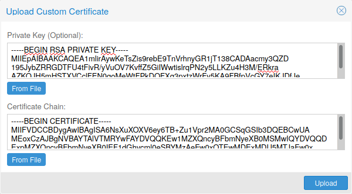](https://pve.proxmox.com/pve-docs/images/screenshot/gui-node-certs-upload-custom.png)

请注意，如果提供证书密钥文件，该文件不得受密码保护。

### 3.12.4. 通过 Let’s Encrypt（ACME）获取受信任证书 <a href="#sysadmin_certs_get_trusted_acme_cert" id="sysadmin_certs_get_trusted_acme_cert"></a>

Proxmox VE 包含对 <strong>A</strong>utomatic <strong>C</strong>ertificate <strong>M</strong>anagement <strong>E</strong>nvironment <strong>ACME</strong> 协议的实现，允许 Proxmox VE 管理员使用 Let’s Encrypt 等 ACME 提供商，轻松设置现代操作系统和 Web 浏览器开箱即接受并信任的 TLS 证书。

目前实现的两个 ACME 端点是 [Let’s Encrypt (LE)](https://letsencrypt.org) 生产环境及其预发布环境。我们的 ACME 客户端支持使用内置 Web 服务器验证 `http-01` 挑战，并支持使用 DNS 插件验证 `dns-01` 挑战；该 DNS 插件支持 [acme.sh](https://acme.sh) 所支持的所有 DNS API 端点。

#### ACME 账户 <a href="#sysadmin_certs_acme_account" id="sysadmin_certs_acme_account"></a>

[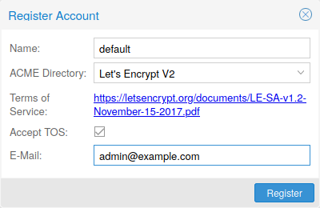](https://pve.proxmox.com/pve-docs/images/screenshot/gui-datacenter-acme-register-account.png)

需要为每个集群在要使用的端点处注册一个 ACME 账户。该账户使用的电子邮件地址将作为 ACME 端点发送续期到期或类似通知的联系地址。

可以通过 Web 界面 `Datacenter -> ACME` 或使用 `pvenode` 命令行工具注册和停用 ACME 账户。

```text
 pvenode acme account register account-name mail@example.com
```


由于[速率限制](https://letsencrypt.org/docs/rate-limits/)，进行实验或首次使用 ACME 时，应使用 LE `staging`。


#### ACME 插件 <a href="#sysadmin_certs_acme_plugins" id="sysadmin_certs_acme_plugins"></a>

ACME 插件的作用是自动验证您以及由您管理的 Proxmox VE 集群确实是域名的所有者。这是自动证书管理的基础。

ACME 协议规定了不同类型的挑战，例如 `http-01`：由 Web 服务器提供具有特定内容的文件，以证明其控制某个域名。有时由于技术限制，或者由于记录的地址无法从公共互联网访问，这种方法并不可行。在这些情况下可以使用 `dns-01` 挑战。该挑战通过在域名的区域中创建特定 DNS 记录来完成。

[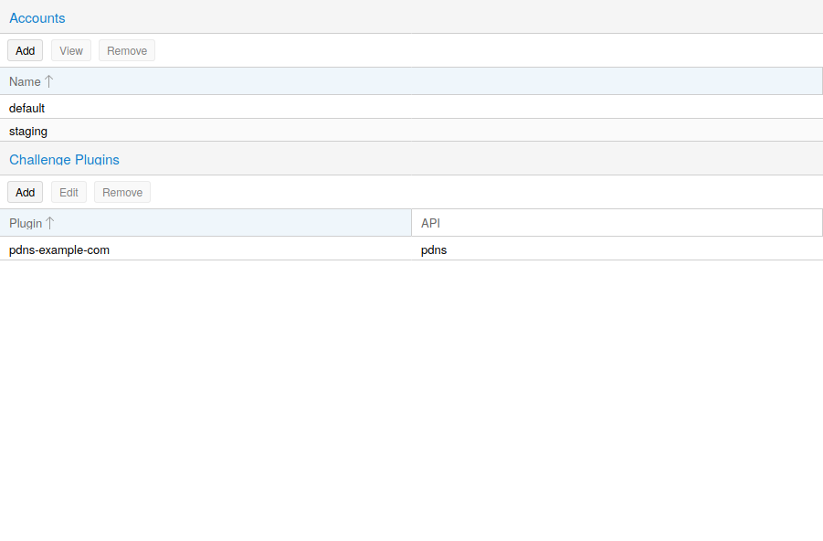](https://pve.proxmox.com/pve-docs/images/screenshot/gui-datacenter-acme-overview.png)

Proxmox VE 开箱即支持这两种挑战类型，可以在 Web 界面的 `Datacenter -> ACME` 下配置插件，也可以使用 `pvenode acme plugin add` 命令进行配置。

ACME 插件配置存储在 `/etc/pve/priv/acme/plugins.cfg` 中。插件对集群中的所有节点均可用。

#### 节点域名 <a href="#node_domains" id="node_domains"></a>

每个域名都是节点特定的。可以在 `Node -> Certificates` 下添加新域名条目或管理现有域名条目，也可以使用 `pvenode config` 命令。

[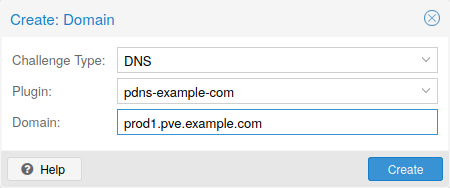](https://pve.proxmox.com/pve-docs/images/screenshot/gui-node-certs-add-domain.png)

为节点配置所需域名并确保选择了所需的 ACME 账户后，即可通过 Web 界面订购新证书。成功后，界面将在 10 秒后重新加载。

续期将[自动](#sysadmin_certs_acme_automatic_renewal)进行。

### 3.12.5. ACME HTTP 挑战插件 <a href="#sysadmin_certs_acme_http_challenge" id="sysadmin_certs_acme_http_challenge"></a>

始终存在一个隐式配置的 `standalone` 插件，用于通过在端口 80 上启动的内置 Web 服务器验证 `http-01` 挑战。


名称 `standalone` 表示它可以自行提供验证，无需任何第三方服务。因此，此插件也适用于集群节点。


将其用于 Let’s Encrypt 的 ACME 证书管理需要满足一些前提条件。

- 必须接受 Let’s Encrypt 的服务条款（ToS）才能注册账户。
- 节点的<strong>端口 80</strong>必须能够从互联网访问。
- 端口 80 上<strong>不得</strong>有其他监听器。
- 请求的（子）域名需要解析到节点的公网 IP。

### 3.12.6. ACME DNS API 挑战插件 <a href="#sysadmin_certs_acme_dns_challenge" id="sysadmin_certs_acme_dns_challenge"></a>

对于无法或不希望通过 `http-01` 方法进行外部访问验证的系统，可以使用 `dns-01` 验证方法。此验证方法要求 DNS 服务器允许通过 API 配置 `TXT` 记录。

#### 配置用于验证的 ACME DNS API <a href="#sysadmin_certs_acme_dns_api_config" id="sysadmin_certs_acme_dns_api_config"></a>

Proxmox VE 复用了为 `acme.sh` [\[6\]](#note-be97c404-6) 项目开发的 DNS 插件，有关特定 API 的配置详情，请参阅其文档。

配置使用 DNS API 的新插件，最简单的方法是使用 Web 界面（`Datacenter -> ACME`）。

[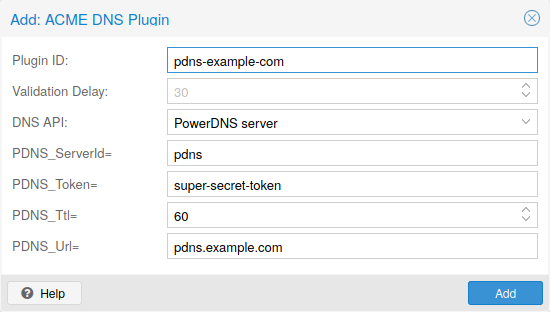](https://pve.proxmox.com/pve-docs/images/screenshot/gui-datacenter-acme-add-dns-plugin.png)

选择 `DNS` 作为挑战类型。然后可以选择 API 提供商，并输入通过其 API 访问账户所需的凭据数据。验证延迟决定从设置 DNS 记录到提示 ACME 提供商验证该记录之间的秒数，因为提供商通常需要一些时间才能在其基础设施中传播该记录。


有关获取提供商 API 凭据的更详细信息，请参阅 acme.sh [如何使用 DNS API](https://github.com/acmesh-official/acme.sh/wiki/dnsapi#how-to-use-dns-api) Wiki。


由于 DNS 提供商和 API 端点众多，Proxmox VE 会自动为某些提供商生成凭据表单。对于其他提供商，您会看到一个较大的文本区域，只需将所有凭据 `KEY`\=`VALUE` 对复制到其中即可。

#### 通过 CNAME 别名进行 DNS 验证 <a href="#dns_validation_through_cname_alias" id="dns_validation_through_cname_alias"></a>

如果主要/实际 DNS 不支持通过 API 置备，可使用特殊的 `alias` 模式在其他域/DNS 服务器上处理验证。手动设置永久 `CNAME` 记录，将 `_acme-challenge.domain1.example` 指向 `_acme-challenge.domain2.example`，并将 `alias` 属性（位于 Proxmox VE 节点配置文件中相应的 `acmedomainX` 键上）设为 `domain2.example`，以允许 `domain2.example` 的 DNS 服务器验证 `domain1.example` 的所有质询。

#### 插件组合 <a href="#combination_of_plugins" id="combination_of_plugins"></a>

如果节点可通过多个具有不同要求或 DNS 置备能力的域名访问，则可以组合 `http-01` 和 `dns-01` 验证。通过为每个域名指定不同的插件实例，也可以混用来自多个提供商或实例的 DNS API。


通过多个域名访问同一服务会增加复杂性，应尽可能避免。


### 3.12.7. ACME 证书的自动续期 <a href="#sysadmin_certs_acme_automatic_renewal" id="sysadmin_certs_acme_automatic_renewal"></a>

如果节点已成功配置为由 ACME 提供的证书（通过 pvenode 或 GUI），证书将由 `pve-daily-update.service` 自动续期。目前，如果证书已经过期，或将在未来 30 天内过期，就会尝试续期。


如果使用颁发短期证书的自定义目录，建议禁用 `pve-daily-update.timer` 单元的随机延迟，以避免重启后错过证书续期。


### 3.12.8. `pvenode` 的 ACME 示例 <a href="#acme_examples_with_span_class_monospaced_pvenode_span" id="acme_examples_with_span_class_monospaced_pvenode_span"></a>

#### 示例：使用 Let’s Encrypt 证书的 `pvenode` 调用示例 <a href="#example_sample_span_class_monospaced_pvenode_span_invocation_for_using_let_8217_s_encrypt_certificates" id="example_sample_span_class_monospaced_pvenode_span_invocation_for_using_let_8217_s_encrypt_certificates"></a>

```text
root@proxmox:~# pvenode acme account register default mail@example.invalid
Directory endpoints:
0) Let's Encrypt V2 (https://acme-v02.api.letsencrypt.org/directory)
1) Let's Encrypt V2 Staging (https://acme-staging-v02.api.letsencrypt.org/directory)
2) Custom
Enter selection: 1

Terms of Service: https://letsencrypt.org/documents/LE-SA-v1.2-November-15-2017.pdf
Do you agree to the above terms? [y|N]y
...
Task OK
root@proxmox:~# pvenode config set --acme domains=example.invalid
root@proxmox:~# pvenode acme cert order
Loading ACME account details
Placing ACME order
...
Status is 'valid'!

All domains validated!
...
Downloading certificate
Setting pveproxy certificate and key
Restarting pveproxy
Task OK
```

#### 示例：设置 OVH API 以验证域名 <a href="#example_setting_up_the_ovh_api_for_validating_a_domain" id="example_setting_up_the_ovh_api_for_validating_a_domain"></a>


无论使用哪种插件，账户注册步骤都相同，此处不再重复。



需要根据 OVH API 文档从 OVH 获取 `OVH_AK` 和 `OVH_AS`


首先，需要获取所有信息，以便您和 Proxmox VE 能够访问 API。

```text
root@proxmox:~# cat /path/to/api-token
OVH_AK=XXXXXXXXXXXXXXXX
OVH_AS=YYYYYYYYYYYYYYYYYYYYYYYYYYYYYYYY
root@proxmox:~# source /path/to/api-token
root@proxmox:~# curl -XPOST -H"X-Ovh-Application: $OVH_AK" -H "Content-type: application/json" \
https://eu.api.ovh.com/1.0/auth/credential  -d '{
  "accessRules": [
    {"method": "GET","path": "/auth/time"},
    {"method": "GET","path": "/domain"},
    {"method": "GET","path": "/domain/zone/*"},
    {"method": "GET","path": "/domain/zone/*/record"},
    {"method": "POST","path": "/domain/zone/*/record"},
    {"method": "POST","path": "/domain/zone/*/refresh"},
    {"method": "PUT","path": "/domain/zone/*/record/"},
    {"method": "DELETE","path": "/domain/zone/*/record/*"}
]
}'
{"consumerKey":"ZZZZZZZZZZZZZZZZZZZZZZZZZZZZZZZZ","state":"pendingValidation","validationUrl":"https://eu.api.ovh.com/auth/?credentialToken=AAAAAAAAAAAAAAAAAAAAAAAAAAAAAAAAAAAAAAAAAAAAAAAAAAAAAAAAAAAAAAAA"}

(open validation URL and follow instructions to link Application Key with account/Consumer Key)

root@proxmox:~# echo "OVH_CK=ZZZZZZZZZZZZZZZZZZZZZZZZZZZZZZZZ" >> /path/to/api-token
```

现在可以设置 ACME 插件：

```text
root@proxmox:~# pvenode acme plugin add dns example_plugin --api ovh --data /path/to/api_token
root@proxmox:~# pvenode acme plugin config example_plugin
┌────────┬──────────────────────────────────────────┐
│ key    │ value                                    │
╞════════╪══════════════════════════════════════════╡
│ api    │ ovh                                      │
├────────┼──────────────────────────────────────────┤
│ data   │ OVH_AK=XXXXXXXXXXXXXXXX                  │
│        │ OVH_AS=YYYYYYYYYYYYYYYYYYYYYYYYYYYYYYYY  │
│        │ OVH_CK=ZZZZZZZZZZZZZZZZZZZZZZZZZZZZZZZZ  │
├────────┼──────────────────────────────────────────┤
│ digest │ 867fcf556363ca1bea866863093fcab83edf47a1 │
├────────┼──────────────────────────────────────────┤
│ plugin │ example_plugin                           │
├────────┼──────────────────────────────────────────┤
│ type   │ dns                                      │
└────────┴──────────────────────────────────────────┘
```

最后，可以配置要为其获取证书的域名，并为该域名提交证书订单：

```text
root@proxmox:~# pvenode config set -acmedomain0 example.proxmox.com,plugin=example_plugin
root@proxmox:~# pvenode acme cert order
Loading ACME account details
Placing ACME order
Order URL: https://acme-staging-v02.api.letsencrypt.org/acme/order/11111111/22222222

Getting authorization details from 'https://acme-staging-v02.api.letsencrypt.org/acme/authz-v3/33333333'
The validation for example.proxmox.com is pending!
[Wed Apr 22 09:25:30 CEST 2020] Using OVH endpoint: ovh-eu
[Wed Apr 22 09:25:30 CEST 2020] Checking authentication
[Wed Apr 22 09:25:30 CEST 2020] Consumer key is ok.
[Wed Apr 22 09:25:31 CEST 2020] Adding record
[Wed Apr 22 09:25:32 CEST 2020] Added, sleep 10 seconds.
Add TXT record: _acme-challenge.example.proxmox.com
Triggering validation
Sleeping for 5 seconds
Status is 'valid'!
[Wed Apr 22 09:25:48 CEST 2020] Using OVH endpoint: ovh-eu
[Wed Apr 22 09:25:48 CEST 2020] Checking authentication
[Wed Apr 22 09:25:48 CEST 2020] Consumer key is ok.
Remove TXT record: _acme-challenge.example.proxmox.com

All domains validated!

Creating CSR
Checking order status
Order is ready, finalizing order
valid!

Downloading certificate
Setting pveproxy certificate and key
Restarting pveproxy
Task OK
```

#### 示例：从 `staging` 切换到常规 ACME 目录 <a href="#sysadmin_certs_acme_switch_from_staging" id="sysadmin_certs_acme_switch_from_staging"></a>

不支持更改账户的 ACME 目录，但由于 Proxmox VE 支持多个账户，您可以直接创建一个新账户，并将生产（受信任的）ACME 目录作为端点。您也可以停用暂存账户，然后重新创建它。

**示例：将 `default` ACME 账户从 `staging` 更改为 directory，使用 `pvenode`**

```text
root@proxmox:~# pvenode acme account deactivate default
Renaming account file from '/etc/pve/priv/acme/default' to '/etc/pve/priv/acme/_deactivated_default_4'
Task OK

root@proxmox:~# pvenode acme account register default example@proxmox.com
Directory endpoints:
0) Let's Encrypt V2 (https://acme-v02.api.letsencrypt.org/directory)
1) Let's Encrypt V2 Staging (https://acme-staging-v02.api.letsencrypt.org/directory)
2) Custom
Enter selection: 0

Terms of Service: https://letsencrypt.org/documents/LE-SA-v1.2-November-15-2017.pdf
Do you agree to the above terms? [y|N]y
...
Task OK
```

## 3.13. 宿主机引导加载程序 <a href="#sysboot" id="sysboot"></a>

Proxmox VE 目前会根据安装程序中选择的磁盘设置，使用两种引导加载程序中的一种。

对于以 ZFS 作为根文件系统安装的 EFI 系统，除非启用了 Secure Boot，否则使用 `systemd-boot`。所有其他部署都使用标准的 GRUB 引导加载程序（这通常也适用于在 Debian 之上安装的系统）。

### 3.13.1. 安装程序使用的分区方案 <a href="#sysboot_installer_part_scheme" id="sysboot_installer_part_scheme"></a>

Proxmox VE 安装程序会在所有选定用于安装的磁盘上创建 3 个分区。

创建的分区如下：

- 一个 1 MB 的 BIOS 引导分区（gdisk 类型 EF02）
- 一个 512 MB 的 EFI 系统分区（ESP，gdisk 类型 EF00）
- 第三个分区，其大小由设置的 `hdsize` 参数决定，或者使用所选存储类型的剩余空间

使用 ZFS 作为根文件系统的系统，通过存储在 512 MB EFI 系统分区上的内核和 initrd 镜像引导。对于传统 BIOS 系统以及启用了 Secure Boot 的 EFI 系统，使用 GRUB；对于未启用 Secure Boot 的 EFI 系统，使用 `systemd-boot`。两者都会安装并配置为指向 ESP。

在所有使用 GRUB 引导的系统上，BIOS 模式的 GRUB（`--target i386-pc`）会安装到所有选定磁盘的 BIOS 引导分区中 [\[7\]](#note-be97c404-7)。


这适用于 x86 宿主机。在 arm64 上，Proxmox VE 仅通过 UEFI 引导，因此没有 BIOS 引导分区，也没有 `i386-pc` GRUB 目标；GRUB 会以 EFI 模式安装，并改用 `arm64-efi` 目标。


### 3.13.2. 使用 `proxmox-boot-tool` 同步 ESP 的内容 <a href="#sysboot_proxmox_boot_tool" id="sysboot_proxmox_boot_tool"></a>

`proxmox-boot-tool` 是一个实用程序，用于保持 EFI 系统分区的内容配置正确并同步。它将特定的内核版本复制到所有 ESP，并配置相应的引导加载程序，以便从采用 `vfat` 格式的 ESP 引导。在 ZFS 作为根文件系统的情况下，这意味着您可以在根池上使用所有可选功能，而不必局限于 GRUB 中 ZFS 实现也支持的功能子集，也不必创建一个独立的小型引导池 [\[8\]](#note-be97c404-8)。

在具有冗余的设置中，安装程序会为所有磁盘划分一个 ESP。这可以确保即使第一个引导设备发生故障，或者 BIOS 只能从特定磁盘引导，系统仍能启动。

在常规运行期间，ESP 不会保持挂载状态。这有助于防止系统崩溃时采用 `vfat` 格式的 ESP 发生文件系统损坏，也无需在主引导设备发生故障时手动调整 `/etc/fstab`。

`proxmox-boot-tool` 负责以下任务：

- 格式化并设置新分区
- 将新的内核镜像和 initrd 镜像复制并配置到所有列出的 ESP
- 在内核升级和其他维护任务期间同步配置
- 管理需要同步的内核版本列表
- 配置引导加载程序以引导特定内核版本（固定）

您可以通过运行以下命令查看当前配置的 ESP 及其状态：

```text
# proxmox-boot-tool status
```

#### 设置新分区以用作同步的 ESP <a href="#sysboot_proxmox_boot_setup" id="sysboot_proxmox_boot_setup"></a>

要将分区格式化并初始化为同步的 ESP，例如在替换 rpool 中出现故障的 vdev 后，或在转换早于同步机制的现有系统时，可以使用 `proxmox-boot-tool`（来自 `proxmox-kernel-helper`）。


`format` 命令会格式化 `<partition>`，请务必传入正确的设备/分区！


例如，要将空分区 `/dev/sda2` 格式化为 ESP，请运行以下命令：

```text
# proxmox-boot-tool format /dev/sda2
```

要设置位于 `/dev/sda2` 上现有的未挂载 ESP，将其纳入 Proxmox VE 的内核更新同步机制，请使用以下命令：

```text
# proxmox-boot-tool init /dev/sda2
```

或

```text
# proxmox-boot-tool init /dev/sda2 grub
```

以强制使用 GRUB 而不是 `systemd-boot` 进行初始化，例如用于支持 Secure Boot。

之后，`/etc/kernel/proxmox-boot-uuids` 中应新增一行，其中包含新添加分区的 UUID。`init` 命令还会自动触发对所有已配置 ESP 的刷新。

#### 更新所有 ESP 上的配置 <a href="#sysboot_proxmox_boot_refresh" id="sysboot_proxmox_boot_refresh"></a>

要复制并配置所有可引导的内核，并保持 `/etc/kernel/proxmox-boot-uuids` 中列出的所有 ESP 同步，您只需运行：

```text
# proxmox-boot-tool refresh
```

（这相当于运行 `update-grub`，适用于以 `ext4` 或 `xfs` 为根文件系统的系统）。

如果您更改了内核命令行，或者希望同步所有内核和 initrd，则需要执行此操作。


`update-initramfs` 和 `apt`（必要时）都会自动触发刷新。


**由 `proxmox-boot-tool` 处理的内核版本**

默认配置以下内核版本：

- 当前正在运行的内核
- 软件包更新时新安装的版本
- 已安装内核中最新的两个版本
- 倒数第二个内核系列的最新版本（例如 5.0、5.3），如适用
- 任何手动选择的内核

**手动保持内核可引导**

如果您希望将某个内核和 initrd 镜像添加到可引导内核列表中，请使用 `proxmox-boot-tool kernel add`。

例如，运行以下命令，将 ABI 版本为 `5.0.15-1-pve` 的内核添加到需要保持安装并同步到所有 ESP 的内核列表中：

```text
# proxmox-boot-tool kernel add 5.0.15-1-pve
```

`proxmox-boot-tool kernel list` 将列出当前选择用于引导的所有内核版本：

```text
# proxmox-boot-tool kernel list
Manually selected kernels:
5.0.15-1-pve

Automatically selected kernels:
5.0.12-1-pve
4.15.18-18-pve
```

运行 `proxmox-boot-tool kernel remove` 可从手动选择的内核列表中移除一个内核，例如：

```text
# proxmox-boot-tool kernel remove 5.0.15-1-pve
```


在上述手动添加或移除内核之后，必须运行 `proxmox-boot-tool refresh` 来更新所有 EFI 系统分区（ESP）。


### 3.13.3. 确定使用的引导加载程序 <a href="#sysboot_determine_bootloader_used" id="sysboot_determine_bootloader_used"></a>

[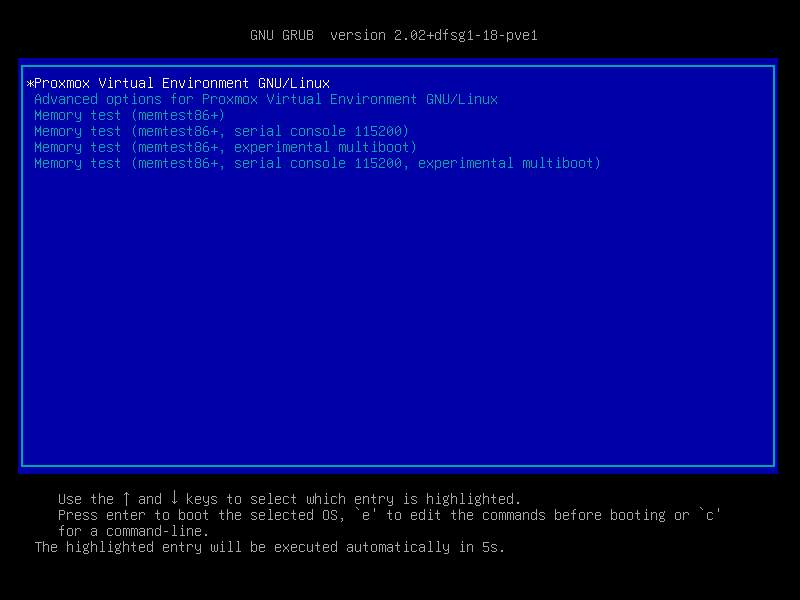](https://pve.proxmox.com/pve-docs/images/screenshot/boot-grub.png)

确定使用哪种引导加载程序的最简单、最可靠方法，是观察 Proxmox VE 节点的引导过程。

您会看到 GRUB 的蓝色方框，或者白底黑字的简洁 `systemd-boot` 界面。

[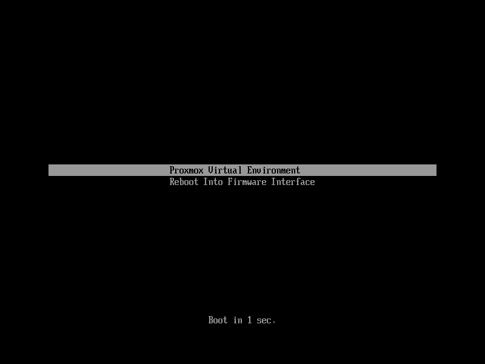](https://pve.proxmox.com/pve-docs/images/screenshot/boot-systemdboot.png)

从正在运行的系统确定引导加载程序可能并非 100% 准确。最安全的方法是运行以下命令：

```text
# efibootmgr -v
```

如果返回的消息表明不支持 EFI 变量，则说明 GRUB 以 BIOS/传统模式运行。

如果输出中包含类似下面的一行，则说明 GRUB 以 UEFI 模式运行。

```text
Boot0005* proxmox       [...] File(\EFI\proxmox\grubx64.efi)
```

如果活动引导项指向 `\EFI\proxmox\shimx64.efi`，如下例所示，则说明 GRUB 以启用了 Secure Boot 的 UEFI 模式运行。

```text
Boot0005* proxmox       [...] File(\EFI\proxmox\shimx64.efi)
```

如果输出中包含类似下面的一行，则说明使用的是 `systemd-boot`。

```text
Boot0006* Linux Boot Manager    [...] File(\EFI\systemd\systemd-bootx64.efi)
```


上述文件名适用于 x86 宿主机。在 arm64 上，等效的二进制文件名为 `grubaa64.efi`、`shimaa64.efi` 和 `systemd-bootaa64.efi`。


通过运行：

```text
# proxmox-boot-tool status
```

您可以确定是否配置了 `proxmox-boot-tool`，这可以很好地指示系统的引导方式。

### 3.13.4. GRUB <a href="#sysboot_grub" id="sysboot_grub"></a>

多年来，GRUB 一直是引导 Linux 系统事实上的标准，并且具有相当完善的文档 [\[9\]](#note-be97c404-9)。

#### 配置 <a href="#configuration" id="configuration"></a>

对 GRUB 配置的更改通过默认文件 `/etc/default/grub` 或 `/etc/default/grub.d` 中的配置片段完成。更改配置后，运行以下命令重新生成配置文件：[\[10\]](#note-be97c404-10)

```text
# update-grub
```

### 3.13.5. Systemd-boot <a href="#sysboot_systemd_boot" id="sysboot_systemd_boot"></a>

`systemd-boot` 是一个轻量级 EFI 引导加载程序。它直接从其安装所在的 EFI 系统分区（ESP）读取内核和 initrd 镜像。直接从 ESP 加载内核的主要优势是无需重新实现用于访问存储的驱动程序。在 Proxmox VE 中，使用 [`proxmox-boot-tool`](#sysboot_proxmox_boot_tool) 来保持 ESP 上的配置同步。

#### 配置 <a href="#sysboot_systemd_boot_config" id="sysboot_systemd_boot_config"></a>

`systemd-boot` 通过 EFI 系统分区（ESP）根目录中的文件 `loader/loader.conf` 进行配置。详情请参阅 `loader.conf(5)` 手册页。

每个引导项都单独存放在目录 `loader/entries/` 下的一个文件中

示例 entry.conf 如下所示（`/` 指 ESP 的根目录）：

```text
title    Proxmox
version  5.0.15-1-pve
options   root=ZFS=rpool/ROOT/pve-1 boot=zfs
linux    /EFI/proxmox/5.0.15-1-pve/vmlinuz-5.0.15-1-pve
initrd   /EFI/proxmox/5.0.15-1-pve/initrd.img-5.0.15-1-pve
```

### 3.13.6. 编辑内核命令行 <a href="#sysboot_edit_kernel_cmdline" id="sysboot_edit_kernel_cmdline"></a>

您可以在以下位置修改内核命令行，具体取决于所使用的引导加载程序：

**GRUB**

内核命令行需要写入变量 `GRUB_CMDLINE_LINUX_DEFAULT`，该变量位于文件 `/etc/default/grub` 中。运行 `update-grub` 会将其内容附加到所有 `linux` 条目，这些条目位于 `/boot/grub/grub.cfg` 中。

**Systemd-boot**

内核命令行需要作为一行写入 `/etc/kernel/cmdline`。要应用更改，请运行 `proxmox-boot-tool refresh`，它会将其设置为 `option` 行，并应用于 `loader/entries/proxmox-*.conf` 中的所有配置文件。

完整的内核参数列表可在 <em>https://www.kernel.org/doc/html/v\<YOUR-KERNEL-VERSION\>/admin-guide/kernel-parameters.html</em> 找到。将 \<YOUR-KERNEL-VERSION\> 替换为主版本号.次版本号，例如，对于基于 6.5 版本的内核，URL 为：[https://www.kernel.org/doc/html/v6.5/admin-guide/kernel-parameters.html](https://www.kernel.org/doc/html/v6.5/admin-guide/kernel-parameters.html)

您可以通过查看 Web 界面（<em>节点 → 概要</em>）或运行以下命令来查找您的内核版本

```text
# uname -r
```

使用输出开头的两个数字。

### 3.13.7. 覆盖下次引导的内核版本 <a href="#sysboot_kernel_pin" id="sysboot_kernel_pin"></a>

要选择当前并非默认内核的内核，您可以：

- 使用在引导过程开始时显示的引导加载程序菜单
- 使用 `proxmox-boot-tool` 通过 `pin` 将系统固定到某个内核版本，可以仅固定一次，也可以永久固定（直到重置固定设置）。

这应该有助于您规避较新内核版本与硬件之间的不兼容问题。


应尽快移除此类固定设置，以便最新内核的所有当前安全补丁也能应用于系统。


例如：要永久选择版本 `5.15.30-1-pve` 用于引导，您需要运行：

```text
# proxmox-boot-tool kernel pin 5.15.30-1-pve
```


固定功能适用于所有 Proxmox VE 系统，而不仅限于使用 `proxmox-boot-tool` 同步 ESP 内容的系统；如果您的系统不使用 `proxmox-boot-tool` 进行同步，也可以跳过最后的 `proxmox-boot-tool refresh` 调用。


您还可以设置某个内核版本仅在下次系统引导时使用。例如，这可用于测试更新后的内核是否已解决最初导致您使用 `pin` 固定某个版本的问题：

```text
# proxmox-boot-tool kernel pin 5.15.30-1-pve --next-boot
```

要移除任何固定版本配置，请使用 `unpin` 子命令：

```text
# proxmox-boot-tool kernel unpin
```

虽然 `unpin` 也有 `--next-boot` 选项，但它用于清除通过 `--next-boot` 设置的固定版本。由于系统在引导时已经会自动执行此操作，因此手动调用它并没有多大用处。

设置或清除固定版本后，还需要通过运行 `refresh` 子命令来同步 ESP 上的内容和配置。


如果以交互方式调用该工具，系统会提示您为 `proxmox-boot-tool` 管理的系统自动执行此操作。


```text
# proxmox-boot-tool refresh
```

### 3.13.8. Secure Boot <a href="#sysboot_secure_boot" id="sysboot_secure_boot"></a>

从 Proxmox VE 8.1 开始，通过签名软件包以及与 `proxmox-boot-tool` 的集成，开箱即用地支持 Secure Boot。

要使 Secure Boot 正常工作，需要以下软件包。您可以使用 ‘proxmox-secure-boot-support’ 元软件包一次性安装它们。

- `shim-signed`（由 Microsoft 签名的 shim 引导加载程序）
- `shim-helpers-amd64-signed`（回退引导加载程序和 MOKManager，由 Proxmox 签名）
- `grub-efi-amd64-signed`（GRUB EFI 引导加载程序，由 Proxmox 签名）
- `proxmox-kernel-6.X.Y-Z-pve-signed`（由 Proxmox 签名的内核镜像）


`shim-helpers-amd64-signed` 和 `grub-efi-amd64-signed` 软件包名称适用于 x86 宿主机。在 arm64 上，对应的软件包为 `shim-helpers-arm64-signed` 和 `grub-efi-arm64-signed`。


开箱即用仅支持 GRUB 作为引导加载程序，因为其他引导加载程序目前不符合安全启动代码签名的条件。

Proxmox VE 的任何全新安装都会自动包含上述所有软件包。

有关安全启动的工作原理以及如何自定义设置的更多详细信息，请参阅[我们的 Wiki](https://pve.proxmox.com/wiki/Secure_Boot_Setup)。

#### 将现有安装切换到安全启动 <a href="#switching_an_existing_installation_to_secure_boot" id="switching_an_existing_installation_to_secure_boot"></a>


如果操作不正确，在某些情况下可能会导致安装无法启动。如果可用，重新安装宿主机将自动设置安全启动，无需任何额外交互。<strong>请确保您拥有 Proxmox VE 宿主机的可用且经过充分测试的备份！</strong>


现有 UEFI 安装可以根据需要切换到安全启动，而无需从头重新安装 Proxmox VE。

首先，确保您的整个系统均为最新状态。接下来，安装 `proxmox-secure-boot-support`。GRUB 会自动创建所需的 EFI 启动项，以便通过默认 shim 启动。

**systemd-boot**

如果 `systemd-boot` 用作引导加载程序（请参阅[确定使用的引导加载程序](#sysboot_determine_bootloader_used)），则需要进行一些额外设置。仅当 Proxmox VE 以 ZFS-on-root 方式安装时才是这种情况。

要检查后者，请运行：

```text
# findmnt /
```

如果宿主机确实使用 ZFS 作为根文件系统，则 `FSTYPE` 列应包含 `zfs`：

```text
TARGET SOURCE           FSTYPE OPTIONS
/      rpool/ROOT/pve-1 zfs    rw,relatime,xattr,noacl,casesensitive
```

接下来，必须找到合适的候选 ESP（EFI 系统分区）。可以使用 `lsblk` 命令完成此操作，方法如下：

```text
# lsblk -o +FSTYPE
```

输出应类似于：

```text
NAME   MAJ:MIN RM  SIZE RO TYPE MOUNTPOINTS FSTYPE
sda      8:0    0   32G  0 disk
├─sda1   8:1    0 1007K  0 part
├─sda2   8:2    0  512M  0 part             vfat
└─sda3   8:3    0 31.5G  0 part             zfs_member
sdb      8:16   0   32G  0 disk
├─sdb1   8:17   0 1007K  0 part
├─sdb2   8:18   0  512M  0 part             vfat
└─sdb3   8:19   0 31.5G  0 part             zfs_member
```

在这种情况下，目标分区为 `sda2` 和 `sdb2`。可以通过其 512M 的大小以及 `FSTYPE` 为 `vfat` 来识别它们；本例中的安装采用 ZFS RAID-1。

必须使用 `proxmox-boot-tool` 正确设置这些分区，以便通过 GRUB 启动。此命令（以 `sda2` 为例）必须针对每个 ESP 分别运行：

```text
# proxmox-boot-tool init /dev/sda2 grub
```

之后，您可以通过运行以下命令检查设置是否正确：

```text
# efibootmgr -v
```

此列表应包含一个类似以下内容的条目：

```text
[..]
Boot0009* proxmox       HD(2,GPT,..,0x800,0x100000)/File(\EFI\proxmox\shimx64.efi)
[..]
```


旧的 `systemd-boot` 引导加载程序将保留，但会优先使用 GRUB。这样，如果出于任何原因无法在安全启动模式下使用 GRUB 启动，仍可在关闭安全启动的情况下使用 `systemd-boot` 启动系统。


现在可以重新启动宿主机，并在 UEFI 固件设置实用程序中启用安全启动。

重新启动后，UEFI 固件启动菜单中应出现一个名为 `proxmox` 的新条目供选择，该条目使用预签名的 EFI shim 启动。

如果出于任何原因在 UEFI 启动菜单中找不到 `proxmox` 条目，可以尝试手动添加（如果固件支持），方法是将文件 `\EFI\proxmox\shimx64.efi` 添加为自定义启动项。


已知某些 UEFI 固件会在重新启动时丢弃 `proxmox` 启动选项。如果 `proxmox` 启动项指向磁盘上的 GRUB 安装，而该磁盘本身不是启动选项，就可能发生这种情况。如果可能，请尝试在 UEFI 固件设置实用程序中将该磁盘添加为启动选项，然后再次运行 `proxmox-boot-tool`。



要注册自定义密钥，请参阅相关的[安全启动 Wiki 页面](https://pve.proxmox.com/wiki/Secure_Boot_Setup#Setup_instructions_for_db_key_variant)。


#### 在安全启动中使用 DKMS/第三方模块 <a href="#using_dkms_third_party_modules_with_secure_boot" id="using_dkms_third_party_modules_with_secure_boot"></a>

在启用安全启动的系统上，内核将拒绝加载未经可信密钥签名的模块。内核软件包随附的默认模块集使用嵌入内核镜像中的临时密钥签名，该密钥受该特定版本内核镜像信任。

要加载其他模块（例如使用 DKMS 构建或手动构建的模块），需要使用安全启动堆栈信任的密钥对其进行签名。实现此目的最简单的方法是将其作为机器所有者密钥（`MOK`）通过 `mokutil` 进行注册。

`dkms` 工具会自动在 `/var/lib/dkms/mok.key` 和 `/var/lib/dkms/mok.pub` 中生成密钥对和证书，并使用其对所构建和安装的内核模块进行签名。

您可以使用以下命令查看证书内容：

```text
# openssl x509 -in /var/lib/dkms/mok.pub -noout -text
```

并使用以下命令将其注册到您的系统中：

```text
# mokutil --import /var/lib/dkms/mok.pub
input password:
input password again:
```

`mokutil` 命令会两次要求输入（临时）密码，在下一步操作中还需要再输入一次此密码！重新启动系统后，应自动启动到 `MOKManager` EFI 二进制文件，您可以在其中验证密钥/证书，并使用通过 `mokutil` 开始注册时所选择的密码确认注册。之后，内核应允许加载使用 DKMS 构建的模块（这些模块使用已注册的 `MOK` 签名）。如果需要，`MOK` 还可用于签名自定义 EFI 二进制文件和内核镜像。

相同的过程也可用于不受 DKMS 管理的自定义/第三方模块，但在这种情况下，需要手动完成密钥/证书生成和签名步骤。

## 3.14. 内核同页合并（KSM） <a href="#kernel_samepage_merging" id="kernel_samepage_merging"></a>

内核同页合并（KSM）是 Linux 内核提供的一项可选内存去重功能，在 Proxmox VE 中默认启用。KSM 通过扫描一定范围的物理内存页以查找相同内容，并识别映射到这些物理页的虚拟页来工作。如果发现相同的页，则会重新映射相应的虚拟页，使它们全部指向同一个物理页，并释放旧页。虚拟页会被标记为“写时复制”，因此对它们的任何写入都会写入新的内存区域，同时保持共享物理页不变。

### 3.14.1. KSM 的影响 <a href="#implications_of_ksm" id="implications_of_ksm"></a>

KSM 可以优化虚拟化环境中的内存使用，因为运行相似操作系统或工作负载的多个 VM 可能会共享大量相同的内存页。

然而，虽然 KSM 可以减少内存使用，但它也会带来一些安全风险，因为它可能使 VM 面临侧信道攻击。研究表明，通过利用 KSM 的某些特性，可以借助同一宿主机上的第二个 VM 推断有关正在运行的 VM 的信息。

因此，如果您使用 Proxmox VE 提供托管服务，则应考虑禁用 KSM，以便为用户提供额外的安全保障。此外，您还应查看所在国家/地区的法规，因为禁用 KSM 可能是法律要求。

### 3.14.2. 禁用 KSM <a href="#disabling_ksm" id="disabling_ksm"></a>

可以在节点上或按 VM 分别禁用 KSM。

**在节点上禁用 KSM**

要查看节点上是否已激活 KSM，可以检查以下命令的输出：

```text
# systemctl status ksmtuned
```

如果已激活，可以使用以下命令立即禁用它：

```text
# systemctl disable --now ksmtuned
```

最后，要取消合并当前所有已合并的页，请运行：

```text
# echo 2 > /sys/kernel/mm/ksm/run
```

**为特定 VM 禁用 KSM**

`allow-ksm` VM 配置选项控制是否允许对指定 VM 进行内存页合并。该选项默认为 true，可以使用以下命令禁用：

```text
# qm set <vmid> --allow-ksm 0
```

## 注释

### 注释 1 <a href="#note-be97c404-1" id="note-be97c404-1"></a>

smartmontools 主页 [https://www.smartmontools.org](https://www.smartmontools.org)

### 注释 2 <a href="#note-be97c404-2" id="note-be97c404-2"></a>

OpenZFS dRAID [https://openzfs.github.io/openzfs-docs/Basic%20Concepts/dRAID%20Howto.html](https://openzfs.github.io/openzfs-docs/Basic%20Concepts/dRAID%20Howto.html)

### 注释 3 <a href="#note-be97c404-3" id="note-be97c404-3"></a>

使用 Proxmox VE 6.4 或更高版本安装的系统，以及使用 Proxmox VE 5.4 或更高版本安装的 EFI 系统

### 注释 4 <a href="#note-be97c404-4" id="note-be97c404-4"></a>

[https://bugzilla.proxmox.com/show\_bug.cgi?id\=2350](https://bugzilla.proxmox.com/show_bug.cgi?id=2350)

### 注释 5 <a href="#note-be97c404-5" id="note-be97c404-5"></a>

[https://github.com/openzfs/zfs/issues/11688](https://github.com/openzfs/zfs/issues/11688)

### 注释 6 <a href="#note-be97c404-6" id="note-be97c404-6"></a>

acme.sh [https://github.com/acmesh-official/acme.sh](https://github.com/acmesh-official/acme.sh)

### 注释 7 <a href="#note-be97c404-7" id="note-be97c404-7"></a>

这包括所有根文件系统位于 `ext4` 或 `xfs` 上的安装，以及非 EFI 系统上根文件系统位于 ZFS 上的安装

### 注释 8 <a href="#note-be97c404-8" id="note-be97c404-8"></a>

使用 GRUB 从根 ZFS 引导 [https://openzfs.github.io/openzfs-docs/Getting%20Started/Debian/Debian%20Bookworm%20Root%20on%20ZFS.html](https://openzfs.github.io/openzfs-docs/Getting%20Started/Debian/Debian%20Bookworm%20Root%20on%20ZFS.html)

### 注释 9 <a href="#note-be97c404-9" id="note-be97c404-9"></a>

GRUB 手册 [https://www.gnu.org/software/grub/manual/grub/grub.html](https://www.gnu.org/software/grub/manual/grub/grub.html)

### 注释 10 <a href="#note-be97c404-10" id="note-be97c404-10"></a>

对于使用 `proxmox-boot-tool` 的系统，`proxmox-boot-tool
refresh` 将在 `update-grub` 时被调用。

---

来源：[Proxmox VE 官方文档](https://pve.proxmox.com/pve-docs/pve-admin-guide.html) · 版本 9.2.13 · 非官方中文翻译。
