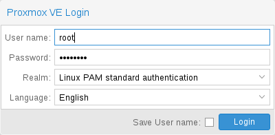

# 4.2. Login 

When you connect to the server, you will first see the login window. Proxmox VE supports various authentication backends (*Realm*), and you can select the language here. The GUI is translated to more than 20 languages.


You can save the user name on the client side by selecting the checkbox at the bottom. This saves some typing when you login next time.


---

来源：[Proxmox VE 官方文档](https://pve.proxmox.com/pve-docs/pve-admin-guide.html) · 版本 9.2.13 · 非官方中文翻译。
