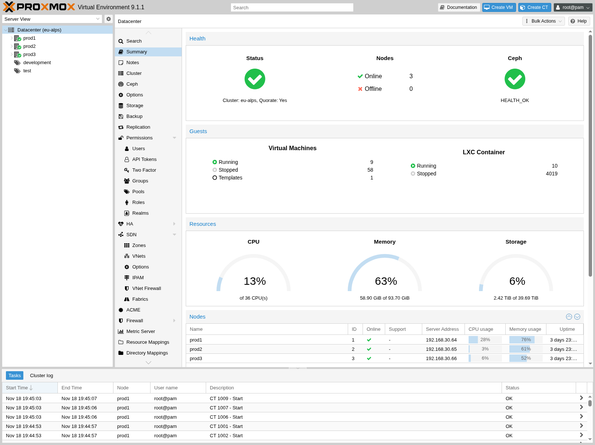
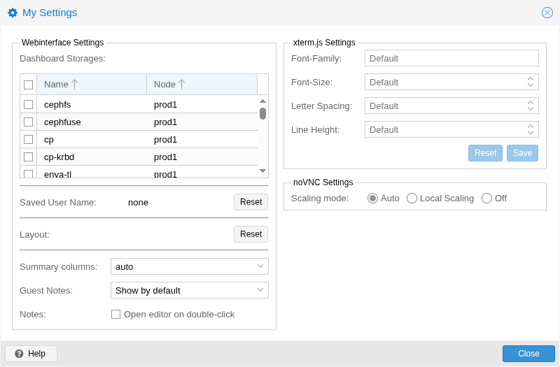

# 4.3. GUI Overview 

Proxmox VE 用户界面由四个区域组成。

<table>
<tr>
<td>Header  
</td>
<td>

位于顶部。显示状态信息，并包含用于最重要操作的按钮。

</td>
</tr>
<tr>
<td>Resource Tree  
</td>
<td>

位于左侧。可在其中选择特定对象的导航树。

</td>
</tr>
<tr>
<td>Content Panel  
</td>
<td>

中央区域。所选对象在此处显示配置选项和状态。

</td>
</tr>
<tr>
<td>Log Panel  
</td>
<td>

位于底部。显示最近任务的日志条目。您可以双击这些日志条目以获取更多详细信息，或中止正在运行的任务。

</td>
</tr>
</table>


您可以缩小或扩大资源树和日志面板，或完全隐藏日志面板。当您在小尺寸显示器上工作并希望有更多空间查看其他内容时，这会很有帮助。


## 4.3.1. Header 

在左上方，您首先看到的是 Proxmox 徽标。其旁边是当前运行的 Proxmox VE 版本。在旁边的搜索栏中，您可以搜索特定对象（VM、容器、节点、…）。这有时比在资源树中选择对象更快。

标题栏右侧包含四个按钮：

<table>
<tr>
<td>Documentation  
</td>
<td>

打开一个显示参考文档的新浏览器窗口。

</td>
</tr>
<tr>
<td>Create VM  
</td>
<td>

打开虚拟机创建向导。

</td>
</tr>
<tr>
<td>Create CT  
</td>
<td>

打开容器创建向导。

</td>
</tr>
<tr>
<td>User Menu  
</td>
<td>

显示您当前登录用户的身份，单击它会打开一个包含用户特定选项的菜单。

在用户菜单中，您会找到<em>我的设置</em>对话框，其中提供本地 UI 设置。其下方是<em>TFA</em>（双因素身份验证）和<em>密码</em>自助服务的快捷方式。您还可以找到更改<em>语言</em>和<em>颜色主题</em>的选项。最后，菜单底部是<em>注销</em>选项。

</td>
</tr>
</table>

## 4.3.2. My Settings 

*我的设置*窗口允许您设置本地存储的设置。其中包括*仪表板存储*，可用于启用或禁用特定存储，以决定其是否计入数据中心摘要中显示的总量。如果未选中任何存储，则总量为所有存储之和，与启用每一个存储相同。

在仪表板设置下方，您可以找到已保存的用户名以及清除该用户名的按钮，还有一个将 GUI 中每种布局重置为默认值的按钮。

右侧是*xterm.js 设置*。其中包含以下选项：

<table>
<tr>
<td>Font-Family  
</td>
<td>

xterm.js 中使用的字体（例如 Arial）。

</td>
</tr>
<tr>
<td>Font-Size  
</td>
<td>

首选使用的字号。

</td>
</tr>
<tr>
<td>Letter Spacing  
</td>
<td>

增大或减小文本中字母之间的间距。

</td>
</tr>
<tr>
<td>Line Height  
</td>
<td>

指定一行的绝对高度。

</td>
</tr>
</table>

## 4.3.3. Resource Tree 

这是主导航树。在树的顶部，你可以选择一些预定义视图，这些视图会改变下方树的结构。默认视图是 **服务器视图**，它显示以下对象类型：

<table>
<tr>
<td>Datacenter  
</td>
<td>

包含集群范围的设置（与所有节点相关）。

</td>
</tr>
<tr>
<td>Node  
</td>
<td>

表示集群中运行客户机的宿主机。

</td>
</tr>
<tr>
<td>Guest  
</td>
<td>

虚拟机、容器和模板。

</td>
</tr>
<tr>
<td>Storage  
</td>
<td>

数据存储。

</td>
</tr>
<tr>
<td>Pool  
</td>
<td>

可以使用池对客户机进行分组，以简化管理。

</td>
</tr>
</table>

可用的视图类型如下：

<table>
<tr>
<td>Server View  
</td>
<td>

显示所有类型的对象，并按节点分组。

</td>
</tr>
<tr>
<td>Folder View  
</td>
<td>

显示所有类型的对象，并按对象类型分组。

</td>
</tr>
<tr>
<td>Pool View  
</td>
<td>

显示虚拟机和容器，并按池分组。

</td>
</tr>
<tr>
<td>Tag View  
</td>
<td>

显示虚拟机和容器，并按标签分组。

</td>
</tr>
</table>

## 4.3.4. Log Panel 

日志面板的主要用途是向你显示集群中当前正在发生的事情。创建新虚拟机等操作会在后台执行，我们将这种后台作业称为 *任务*。

此类任务的任何输出都会保存到单独的日志文件中。只需双击任务日志条目即可查看该日志。也可以在那里中止正在运行的任务。

请注意，这里会显示所有集群节点上最近的任务。因此，你可以实时看到其他人何时正在另一个集群节点上工作。


我们会从日志面板中移除较早且已完成的任务，以缩短该列表。不过，你仍然可以在节点面板的 *任务历史* 中找到这些任务。


一些运行时间较短的操作只会将日志发送给所有集群成员。你可以在 *集群日志* 面板中查看这些消息。

---

来源：[Proxmox VE 官方文档](https://pve.proxmox.com/pve-docs/pve-admin-guide.html) · 版本 9.2.13 · 非官方中文翻译。
