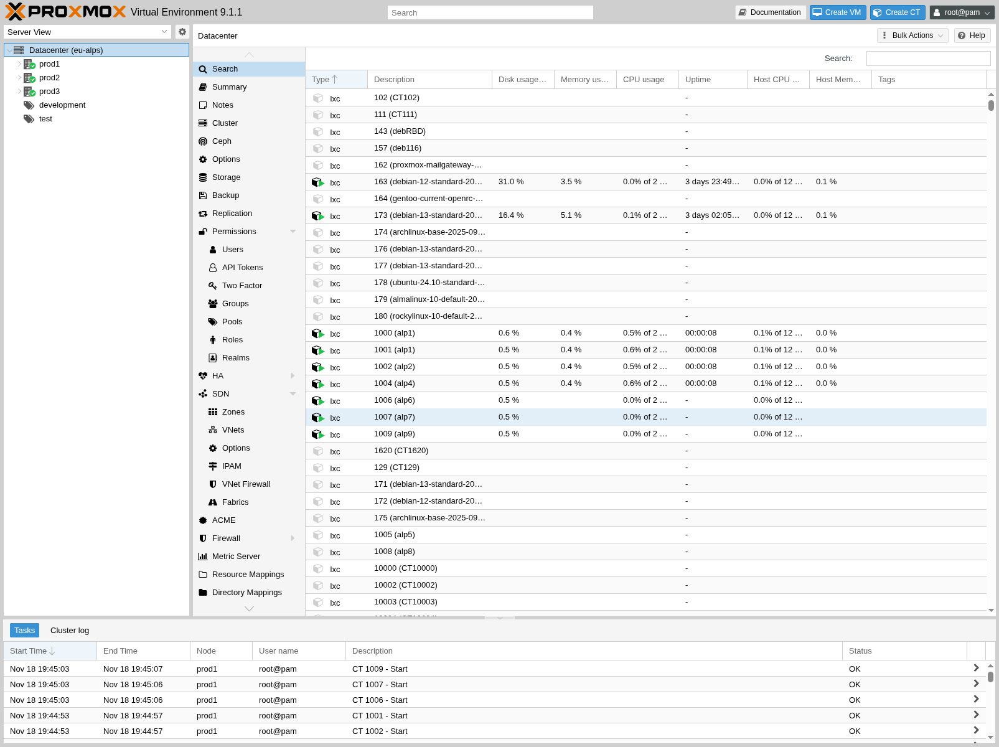
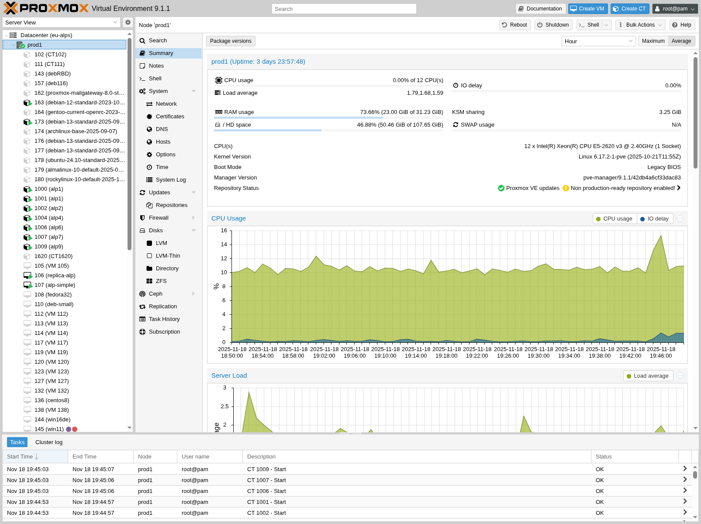
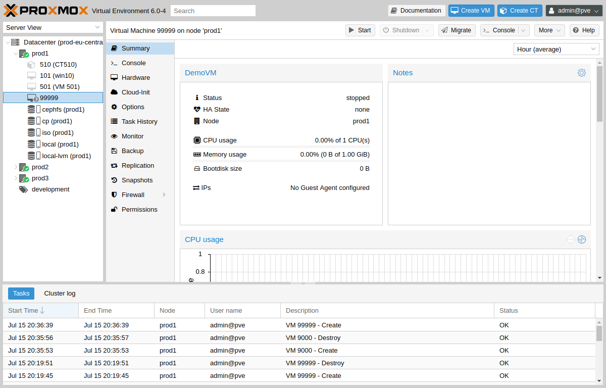
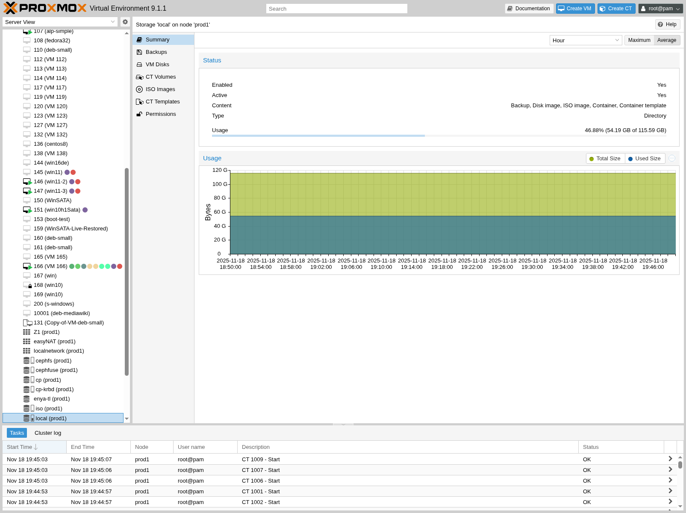
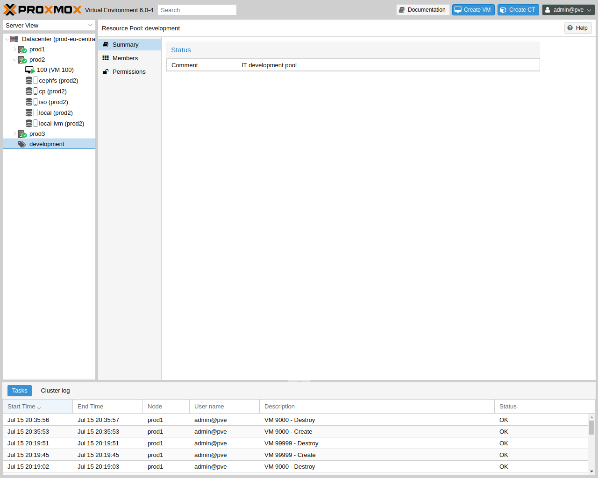

# 4.4. Content Panels 

当你从资源树中选择一个项目时，相应对象会在内容面板中显示配置和状态信息。以下各节简要介绍此功能。更多详细信息，请参阅参考文档中的相应章节。

## 4.4.1. Datacenter 

在数据中心级别，你可以访问集群范围的设置和信息。

- **Search:** perform a cluster-wide search for nodes, VMs, containers, storage devices, and pools.
- **Summary:** gives a brief overview of the cluster’s health and resource usage.
- **Cluster:** provides the functionality and information necessary to create or join a cluster.
- **Options:** view and manage cluster-wide default settings.
- **Storage:** provides an interface for managing cluster storage.
- **Backup:** schedule backup jobs. This operates cluster wide, so it doesn’t matter where the VMs/containers are on your cluster when scheduling.
- **Replication:** view and manage replication jobs.
- **Permissions:** manage user, group, and API token permissions, and LDAP, MS-AD and Two-Factor authentication.
- **HA:** manage Proxmox VE High Availability.
- **ACME:** set up ACME (Let’s Encrypt) certificates for server nodes.
- **Firewall:** configure and make templates for the Proxmox Firewall cluster wide.
- **Metric Server:** define external metric servers for Proxmox VE.
- **Notifications:** configurate notification behavior and targets for Proxmox VE.
- **Support:** display information about your support subscription.

## 4.4.2. Nodes 

可以在此级别单独管理集群中的节点。

顶部标题栏提供了一些实用按钮，例如 *重启*、*关机*、*Shell*、*批量操作*和 *帮助*。*Shell* 提供 *noVNC*、*SPICE* 和 *xterm.js* 选项。*批量操作* 提供 *批量启动*、*批量关机* 和 *批量迁移* 选项。

- **Search:** search a node for VMs, containers, storage devices, and pools.
- **Summary:** display a brief overview of the node’s resource usage.
- **Notes:** write custom comments in [Markdown syntax](../28-markdown-primer/01-markdown-basics.md).
- **Shell:** access to a shell interface for the node.
- **System:** configure network, DNS and time settings, and access the syslog.
- **Updates:** upgrade the system and see the available new packages.
- **Firewall:** manage the Proxmox Firewall for a specific node.
- **Disks:** get an overview of the attached disks, and manage how they are used.
- **Ceph:** is only used if you have installed a Ceph server on your host. In this case, you can manage your Ceph cluster and see the status of it here.
- **Replication:** view and manage replication jobs.
- **Task History:** see a list of past tasks.
- **Subscription:** upload a subscription key, and generate a system report for use in support cases.

## 4.4.3. Guests 

客户机有两种不同的类型，且均可转换为模板。其中一种是基于内核的虚拟机（KVM），另一种是 Linux 容器（LXC）。它们的导航方式基本相同，只有部分选项不同。

要访问各种客户机管理接口，请从左侧菜单中选择一个虚拟机或容器。

标题栏包含电源管理、迁移、控制台访问及类型、克隆、HA 和帮助等项目的命令。其中一些按钮包含下拉菜单，例如，*关机* 还包含其他电源选项，而 *控制台* 包含不同的控制台类型：*SPICE*、*noVNC* 和 *xterm.js*。

右侧面板包含与左侧菜单中所选项目对应的接口。

可用的接口如下。

- **Summary:** provides a brief overview of the VM’s activity and a `Notes` field for [Markdown syntax](../28-markdown-primer/01-markdown-basics.md) comments.
- **Console:** access to an interactive console for the VM/container.
- **(KVM)Hardware:** define the hardware available to the KVM VM.
- **(LXC)Resources:** define the system resources available to the LXC.
- **(LXC)Network:** configure a container’s network settings.
- **(LXC)DNS:** configure a container’s DNS settings.
- **Options:** manage guest options.
- **Task History:** view all previous tasks related to the selected guest.
- **(KVM) Monitor:** an interactive communication interface to the KVM process.
- **Backup:** create and restore system backups.
- **Replication:** view and manage the replication jobs for the selected guest.
- **Snapshots:** create and restore VM snapshots.
- **Firewall:** configure the firewall on the VM level.
- **Permissions:** manage permissions for the selected guest.

## 4.4.4. Storage 

与客户机接口一样，存储接口由左侧用于特定存储元素的菜单和右侧用于管理这些元素的接口组成。

此视图采用由两个分区组成的拆分视图。左侧是存储选项，右侧显示所选选项的内容。

- **Summary:** shows important information about the storage, such as the type, usage, and content which it stores.
- **Content:** a menu item for each content type which the storage stores, for example, Backups, ISO Images, CT Templates.
- **Permissions:** manage permissions for the storage.

## 4.4.5. Pools 

同样，池视图也包含两个分区：左侧的菜单，以及右侧与每个菜单项对应的接口。

- **Summary:** shows a description of the pool.
- **Members:** display and manage pool members (guests and storage).
- **Permissions:** manage the permissions for the pool.

---

来源：[Proxmox VE 官方文档](https://pve.proxmox.com/pve-docs/pve-admin-guide.html) · 版本 9.2.13 · 非官方中文翻译。
