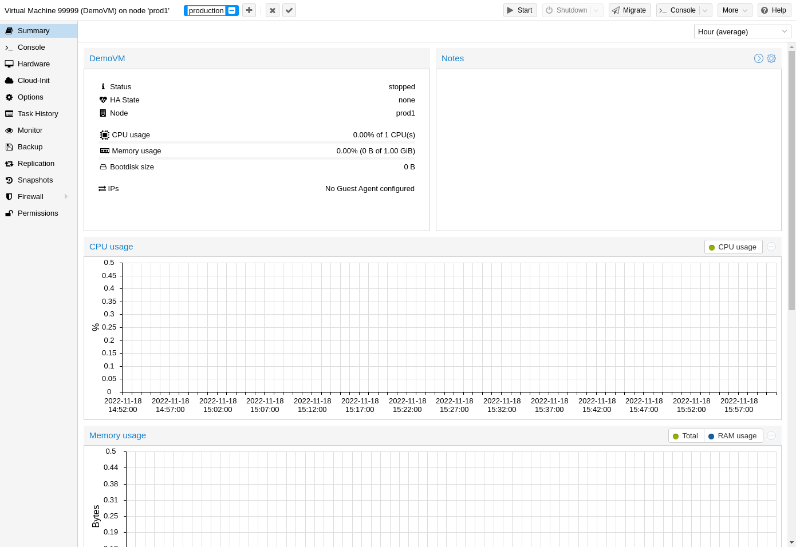
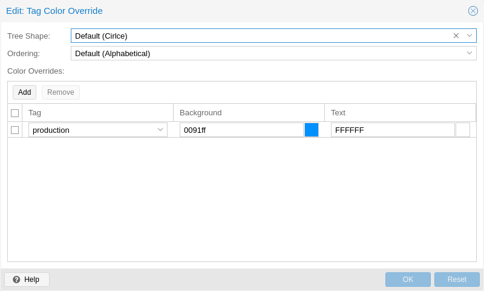
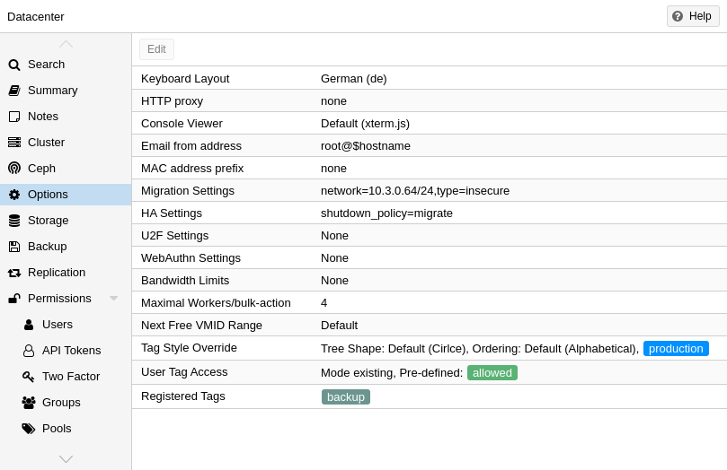

# 4.5. 标签 <a href="#gui_tags" id="gui_tags"></a>

[](https://pve.proxmox.com/pve-docs/images/screenshot/gui-qemu-summary-tags-edit.png)

出于组织管理的目的，可以为客户机设置 `tags`。目前，它们仅用于向用户提供信息。标签在 Web 界面的两个位置显示：在 `Resource Tree` 中，以及选中客户机时的状态行中。

点击客户机状态行中的 `pencil` 图标，即可添加、编辑和移除标签。按 `+` 按钮可添加多个标签，按 `-` 按钮可将其移除。要保存或取消更改，可分别使用 `✓` 和 `x` 按钮。

也可以通过 CLI 设置标签，多个标签之间用分号分隔。例如：

```text
# qm set ID --tags 'myfirsttag;mysecondtag'
```

## 4.5.1. 样式配置 <a href="#style_configuration" id="style_configuration"></a>

[](https://pve.proxmox.com/pve-docs/images/screenshot/gui-datacenter-tag-style.png)

默认情况下，标签颜色通过确定性方式根据其文本生成。可以自定义颜色、在资源树中的形状和大小写敏感性，以及标签的排序方式。可在 Web 界面的 *数据中心 → 选项 → 标签样式覆盖* 下进行配置。也可以通过 CLI 完成。例如：

```text
# pvesh set /cluster/options --tag-style color-map=example:000000:FFFFFF
```

将标签 `example` 的背景颜色设置为黑色（#000000），文本颜色设置为白色（#FFFFFF）。

## 4.5.2. 权限 <a href="#permissions" id="permissions"></a>

[](https://pve.proxmox.com/pve-docs/images/screenshot/gui-datacenter-options.png)

默认情况下，具有 `VM.Config.Options` 权限（在客户机 `/vms/ID` 上）的用户可以设置任意标签（参见 [权限管理](../14-user-management/07-pveum-permission-management.md)）。如果希望限制此行为，可以在 *数据中心 → 选项 → 用户标签访问* 下设置适当的权限：

- `free`：用户在设置标签时不受限制（默认）
- `list`：用户可以根据预定义的标签列表设置标签
- `existing`：与 list 类似，但用户还可以使用已存在的标签
- `none`：用户不能使用标签

同样也可以通过 CLI 完成此操作。

请注意，具有 `Sys.Modify` 权限（在 `/` 上）的用户始终可以设置或删除任意标签，不受此处设置的影响。此外，还有一个可配置的 `registered tags` 列表，只有具有 `Sys.Modify` 权限（在 `/` 上）的用户才能添加和移除其中的标签。可以在 *数据中心 → 选项 → 已注册标签* 下或通过 CLI 编辑已注册标签列表。

有关确切选项以及如何在 CLI 中调用它们的更多详细信息，请参见[数据中心配置](../24-configuration-files-2/02-datacenter-configuration-file.md)。

---

来源：[Proxmox VE 官方文档](https://pve.proxmox.com/pve-docs/pve-admin-guide.html) · 版本 9.2.13 · 非官方中文翻译。
