# 4\. 图形用户界面 <a href="#chapter_gui" id="chapter_gui"></a>

Proxmox VE 简单易用。无需安装单独的管理工具，一切均可通过 Web 浏览器完成（建议使用最新版本的 Firefox 或 Google Chrome）。内置 HTML5 控制台用于访问客户机控制台。作为替代方案，也可以使用[SPICE](https://www.spice-space.org/)。

由于我们使用 Proxmox 集群文件系统（pmxcfs），您可以连接到任何节点来管理整个集群。每个节点都可以管理整个集群，无需专用的管理节点。

您可以使用任何现代浏览器访问基于 Web 的管理界面。当 Proxmox VE 检测到您从移动设备连接时，会将您重定向到更简洁的触控式用户界面。

可通过 [https://youripaddress:8006](https://youripaddress:8006) 访问 Web 界面（默认登录名为：<em>root</em>，密码在安装过程中指定）。

## 4.1. 功能 <a href="#features" id="features"></a>

- Proxmox VE 集群的无缝集成与管理
- 使用 AJAX 技术动态更新资源
- 通过 SSL 加密（https）安全访问所有虚拟机和容器
- 快速的搜索驱动界面，可处理数百个、甚至可能数千个 VM
- 安全的 HTML5 控制台或 SPICE
- 针对所有对象（VM、存储、节点等）的基于角色的权限管理
- 支持多种身份验证来源（例如本地、MS ADS、LDAP、…）
- 双因素身份验证（OATH、Yubikey）
- 基于 ExtJS 7.x JavaScript 框架

## 4.2. 登录 <a href="#login" id="login"></a>

[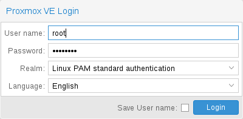](https://pve.proxmox.com/pve-docs/images/screenshot/gui-login-window.png)

连接到服务器时，您首先会看到登录窗口。Proxmox VE 支持多种身份验证后端（<em>Realm</em>），并且您可以在此处选择语言。GUI 已翻译成 20 多种语言。


通过选中底部的复选框，您可以在客户端保存用户名。这样下次登录时可以减少一些输入。


## 4.3. GUI 概述 <a href="#gui_overview" id="gui_overview"></a>

[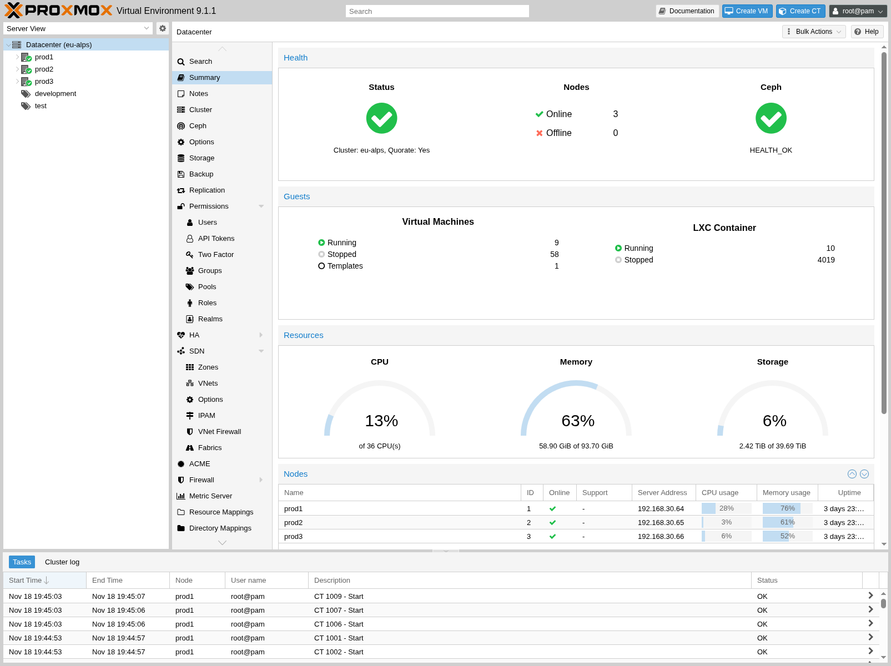](https://pve.proxmox.com/pve-docs/images/screenshot/gui-datacenter-summary.png)

Proxmox VE 用户界面由四个区域组成。

<table>
<tr>
<td>标题栏 <br/></td>
<td>
<p>位于顶部。显示状态信息，并包含用于最重要操作的按钮。</p>
</td>
</tr>
<tr>
<td>资源树 <br/></td>
<td>
<p>位于左侧。可在其中选择特定对象的导航树。</p>
</td>
</tr>
<tr>
<td>内容面板 <br/></td>
<td>
<p>中央区域。所选对象在此处显示配置选项和状态。</p>
</td>
</tr>
<tr>
<td>日志面板 <br/></td>
<td>
<p>位于底部。显示最近任务的日志条目。您可以双击这些日志条目以获取更多详细信息，或中止正在运行的任务。</p>
</td>
</tr>
</table>


您可以缩小或扩大资源树和日志面板，或完全隐藏日志面板。当您在小尺寸显示器上工作并希望有更多空间查看其他内容时，这会很有帮助。


### 4.3.1. 标题栏 <a href="#header" id="header"></a>

在左上方，您首先看到的是 Proxmox 徽标。其旁边是当前运行的 Proxmox VE 版本。在旁边的搜索栏中，您可以搜索特定对象（VM、容器、节点、…）。这有时比在资源树中选择对象更快。

标题栏右侧包含四个按钮：

<table>
<tr>
<td>文档 <br/></td>
<td>
<p>打开一个显示参考文档的新浏览器窗口。</p>
</td>
</tr>
<tr>
<td>创建 VM <br/></td>
<td>
<p>打开虚拟机创建向导。</p>
</td>
</tr>
<tr>
<td>创建 CT <br/></td>
<td>
<p>打开容器创建向导。</p>
</td>
</tr>
<tr>
<td>用户菜单 <br/></td>
<td>
<p>显示您当前登录用户的身份，单击它会打开一个包含用户特定选项的菜单。</p>
<div>
<p>在用户菜单中，您会找到<em>我的设置</em>对话框，其中提供本地 UI 设置。其下方是<em>TFA</em>（双因素身份验证）和<em>密码</em>自助服务的快捷方式。您还可以找到更改<em>语言</em>和<em>颜色主题</em>的选项。最后，菜单底部是<em>注销</em>选项。</p>
</div>
</td>
</tr>
</table>

### 4.3.2. 我的设置 <a href="#gui_my_settings" id="gui_my_settings"></a>

[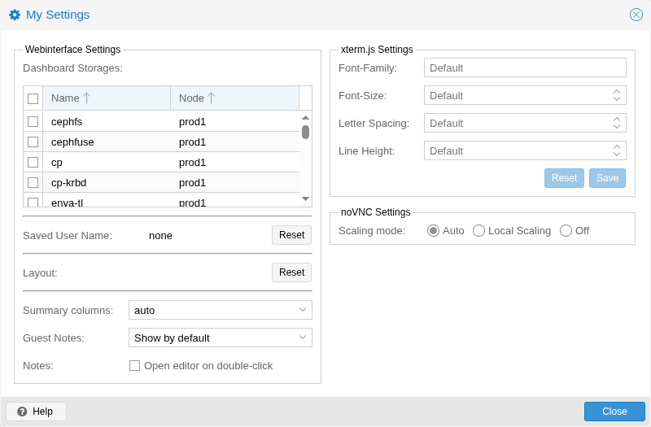](https://pve.proxmox.com/pve-docs/images/screenshot/gui-my-settings.png)

<em>我的设置</em>窗口允许您设置本地存储的设置。其中包括<em>仪表板存储</em>，可用于启用或禁用特定存储，以决定其是否计入数据中心摘要中显示的总量。如果未选中任何存储，则总量为所有存储之和，与启用每一个存储相同。

在仪表板设置下方，您可以找到已保存的用户名以及清除该用户名的按钮，还有一个将 GUI 中每种布局重置为默认值的按钮。

右侧是<em>xterm.js 设置</em>。其中包含以下选项：

<table>
<tr>
<td>字体系列 <br/></td>
<td>
<p>xterm.js 中使用的字体（例如 Arial）。</p>
</td>
</tr>
<tr>
<td>字号 <br/></td>
<td>
<p>首选使用的字号。</p>
</td>
</tr>
<tr>
<td>字母间距 <br/></td>
<td>
<p>增大或减小文本中字母之间的间距。</p>
</td>
</tr>
<tr>
<td>行高 <br/></td>
<td>
<p>指定一行的绝对高度。</p>
</td>
</tr>
</table>

### 4.3.3. 资源树 <a href="#resource_tree" id="resource_tree"></a>

这是主导航树。在树的顶部，你可以选择一些预定义视图，这些视图会改变下方树的结构。默认视图是 <strong>服务器视图</strong>，它显示以下对象类型：

<table>
<tr>
<td>数据中心 <br/></td>
<td>
<p>包含集群范围的设置（与所有节点相关）。</p>
</td>
</tr>
<tr>
<td>节点 <br/></td>
<td>
<p>表示集群中运行客户机的宿主机。</p>
</td>
</tr>
<tr>
<td>客户机 <br/></td>
<td>
<p>虚拟机、容器和模板。</p>
</td>
</tr>
<tr>
<td>存储 <br/></td>
<td>
<p>数据存储。</p>
</td>
</tr>
<tr>
<td>池 <br/></td>
<td>
<p>可以使用池对客户机进行分组，以简化管理。</p>
</td>
</tr>
</table>

可用的视图类型如下：

<table>
<tr>
<td>服务器视图 <br/></td>
<td>
<p>显示所有类型的对象，并按节点分组。</p>
</td>
</tr>
<tr>
<td>文件夹视图 <br/></td>
<td>
<p>显示所有类型的对象，并按对象类型分组。</p>
</td>
</tr>
<tr>
<td>池视图 <br/></td>
<td>
<p>显示虚拟机和容器，并按池分组。</p>
</td>
</tr>
<tr>
<td>标签视图 <br/></td>
<td>
<p>显示虚拟机和容器，并按标签分组。</p>
</td>
</tr>
</table>

### 4.3.4. 日志面板 <a href="#log_panel" id="log_panel"></a>

日志面板的主要用途是向你显示集群中当前正在发生的事情。创建新虚拟机等操作会在后台执行，我们将这种后台作业称为 <em>任务</em>。

此类任务的任何输出都会保存到单独的日志文件中。只需双击任务日志条目即可查看该日志。也可以在那里中止正在运行的任务。

请注意，这里会显示所有集群节点上最近的任务。因此，你可以实时看到其他人何时正在另一个集群节点上工作。


我们会从日志面板中移除较早且已完成的任务，以缩短该列表。不过，你仍然可以在节点面板的 <em>任务历史</em> 中找到这些任务。


一些运行时间较短的操作只会将日志发送给所有集群成员。你可以在 <em>集群日志</em> 面板中查看这些消息。

## 4.4. 内容面板 <a href="#content_panels" id="content_panels"></a>

当你从资源树中选择一个项目时，相应对象会在内容面板中显示配置和状态信息。以下各节简要介绍此功能。更多详细信息，请参阅参考文档中的相应章节。

### 4.4.1. 数据中心 <a href="#datacenter" id="datacenter"></a>

[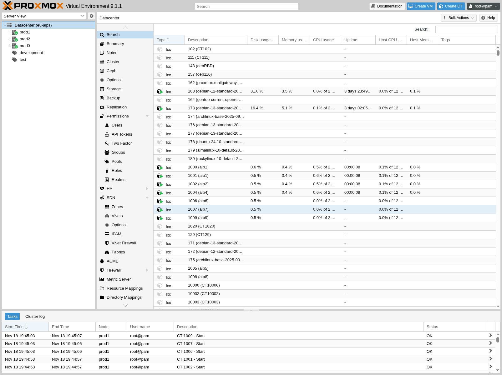](https://pve.proxmox.com/pve-docs/images/screenshot/gui-datacenter-search.png)

在数据中心级别，你可以访问集群范围的设置和信息。

- <strong>搜索：</strong> 在整个集群范围内搜索节点、虚拟机、容器、存储设备和池。
- <strong>摘要：</strong> 简要概述集群的运行状况和资源使用情况。
- <strong>集群：</strong> 提供创建或加入集群所需的功能和信息。
- <strong>选项：</strong> 查看和管理集群范围的默认设置。
- <strong>存储：</strong> 提供用于管理集群存储的接口。
- <strong>备份：</strong> 安排备份任务。此功能在整个集群范围内运行，因此在安排备份任务时，无需考虑虚拟机/容器位于集群中的哪个位置。
- <strong>复制：</strong> 查看和管理复制作业。
- <strong>权限：</strong> 管理用户、组和 API 令牌的权限，以及 LDAP、MS-AD 和双因素认证。
- <strong>HA：</strong> 管理 Proxmox VE 高可用性。
- <strong>ACME：</strong> 为服务器节点设置 ACME（Let’s Encrypt）证书。
- <strong>防火墙：</strong> 在整个集群范围内配置 Proxmox Firewall 并制作模板。
- <strong>指标服务器：</strong> 为 Proxmox VE 定义外部指标服务器。
- <strong>通知：</strong> 配置 Proxmox VE 的通知行为和通知目标。
- <strong>支持：</strong> 显示有关你的支持订阅的信息。

### 4.4.2. 节点 <a href="#nodes" id="nodes"></a>

[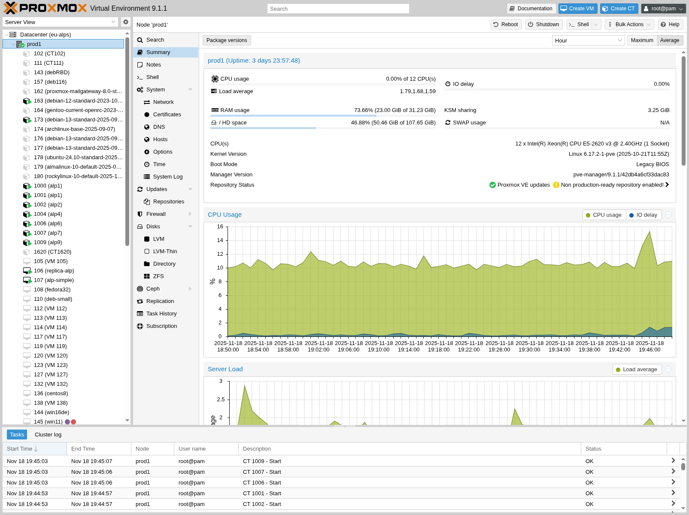](https://pve.proxmox.com/pve-docs/images/screenshot/gui-node-summary.png)

可以在此级别单独管理集群中的节点。

顶部标题栏提供了一些实用按钮，例如 <em>重启</em>、<em>关机</em>、<em>Shell</em>、<em>批量操作</em>和 <em>帮助</em>。<em>Shell</em> 提供 <em>noVNC</em>、<em>SPICE</em> 和 <em>xterm.js</em> 选项。<em>批量操作</em> 提供 <em>批量启动</em>、<em>批量关机</em> 和 <em>批量迁移</em> 选项。

- <strong>搜索：</strong> 在节点中搜索虚拟机、容器、存储设备和池。
- <strong>摘要：</strong> 简要显示节点资源使用情况的概览。
- <strong>备注：</strong> 使用 [Markdown 语法](../28-markdown-primer/README.md#markdown_basics) 编写自定义注释。
- <strong>Shell：</strong> 访问节点的 Shell 接口。
- <strong>系统：</strong> 配置网络、DNS 和时间设置，并访问 syslog。
- <strong>更新：</strong> 升级系统并查看可用的新软件包。
- <strong>防火墙：</strong> 管理特定节点的 Proxmox Firewall。
- <strong>磁盘：</strong> 概览已连接的磁盘，并管理它们的使用方式。
- <strong>Ceph：</strong> 仅在宿主机上安装了 Ceph 服务器时使用。在这种情况下，你可以在此处管理 Ceph 集群并查看其状态。
- <strong>复制：</strong> 查看和管理复制作业。
- <strong>任务历史：</strong> 查看以往任务的列表。
- <strong>订阅：</strong> 上传订阅密钥，并生成供支持案例使用的系统报告。

### 4.4.3. 客户机 <a href="#guests" id="guests"></a>

[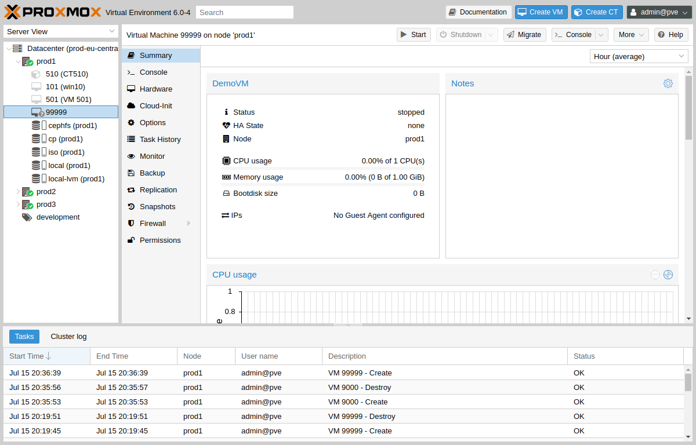](https://pve.proxmox.com/pve-docs/images/screenshot/gui-qemu-summary.png)

客户机有两种不同的类型，且均可转换为模板。其中一种是基于内核的虚拟机（KVM），另一种是 Linux 容器（LXC）。它们的导航方式基本相同，只有部分选项不同。

要访问各种客户机管理接口，请从左侧菜单中选择一个虚拟机或容器。

标题栏包含电源管理、迁移、控制台访问及类型、克隆、HA 和帮助等项目的命令。其中一些按钮包含下拉菜单，例如，<em>关机</em> 还包含其他电源选项，而 <em>控制台</em> 包含不同的控制台类型：<em>SPICE</em>、<em>noVNC</em> 和 <em>xterm.js</em>。

右侧面板包含与左侧菜单中所选项目对应的接口。

可用的接口如下。

- <strong>概要：</strong> 简要概述虚拟机的活动，并提供 `Notes` 字段，用于 [Markdown 语法](../28-markdown-primer/README.md#markdown_basics) 注释。
- <strong>控制台：</strong> 访问虚拟机/容器的交互式控制台。
- <strong>(KVM) 硬件：</strong> 定义 KVM 虚拟机可用的硬件。
- <strong>(LXC) 资源：</strong> 定义 LXC 可用的系统资源。
- <strong>(LXC) 网络：</strong> 配置容器的网络设置。
- <strong>(LXC) DNS：</strong> 配置容器的 DNS 设置。
- <strong>选项：</strong> 管理客户机选项。
- <strong>任务历史：</strong> 查看与所选客户机相关的所有以往任务。
- <strong>(KVM) 监视器：</strong> 与 KVM 进程进行交互式通信的接口。
- <strong>备份：</strong> 创建和恢复系统备份。
- <strong>复制：</strong> 查看和管理所选客户机的复制作业。
- <strong>快照：</strong> 创建和恢复虚拟机快照。
- <strong>防火墙：</strong> 在虚拟机级别配置防火墙。
- <strong>权限：</strong> 管理所选客户机的权限。

### 4.4.4. 存储 <a href="#storage" id="storage"></a>

[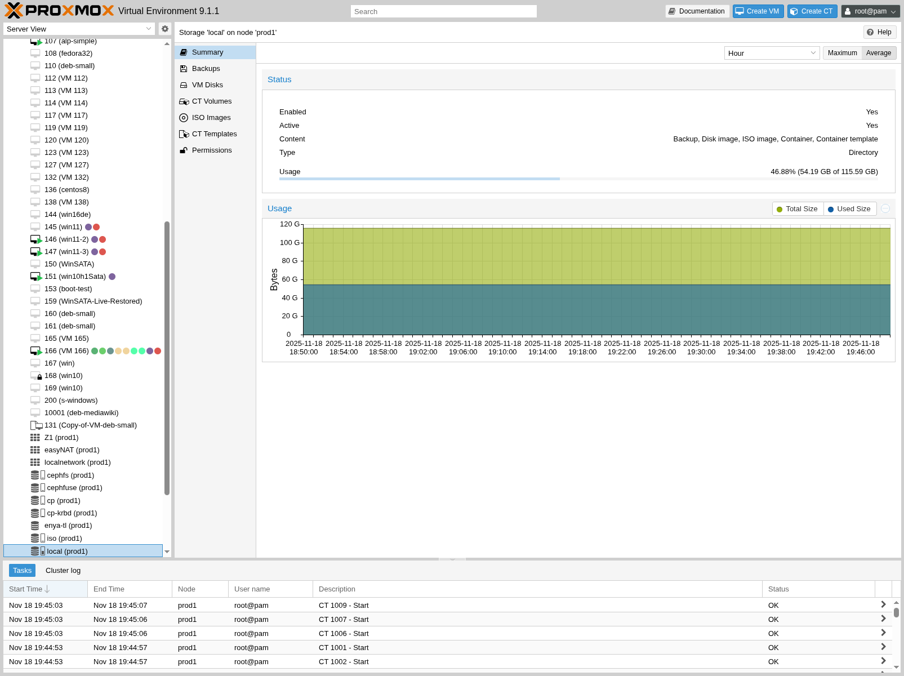](https://pve.proxmox.com/pve-docs/images/screenshot/gui-storage-summary-local.png)

与客户机接口一样，存储接口由左侧用于特定存储元素的菜单和右侧用于管理这些元素的接口组成。

此视图采用由两个分区组成的拆分视图。左侧是存储选项，右侧显示所选选项的内容。

- <strong>摘要：</strong> 显示有关存储的重要信息，例如其类型、使用情况以及其中存储的内容。
- <strong>内容：</strong> 存储所保存的每种内容类型各有一个菜单项，例如备份、ISO 镜像、CT 模板。
- <strong>权限：</strong> 管理存储的权限。

### 4.4.5. 池 <a href="#pools" id="pools"></a>

[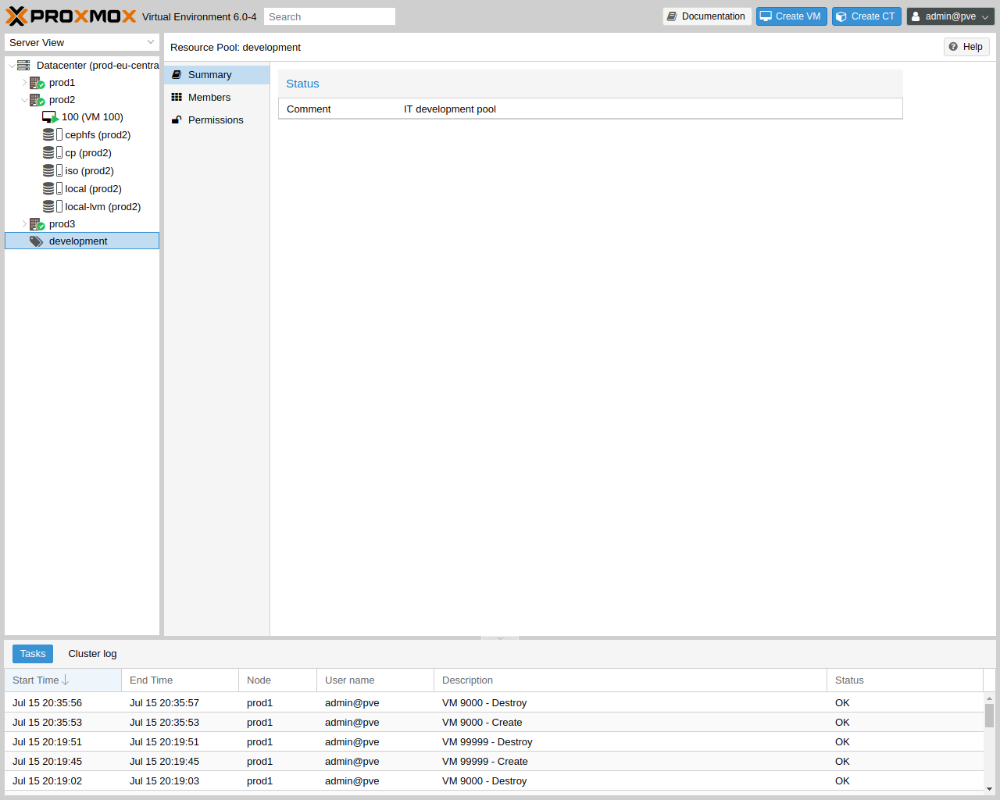](https://pve.proxmox.com/pve-docs/images/screenshot/gui-pool-summary-development.png)

同样，池视图也包含两个分区：左侧的菜单，以及右侧与每个菜单项对应的接口。

- <strong>摘要：</strong> 显示池的描述。
- <strong>成员：</strong> 显示和管理池成员（客户机和存储）。
- <strong>权限：</strong> 管理池的权限。

## 4.5. 标签 <a href="#gui_tags" id="gui_tags"></a>

[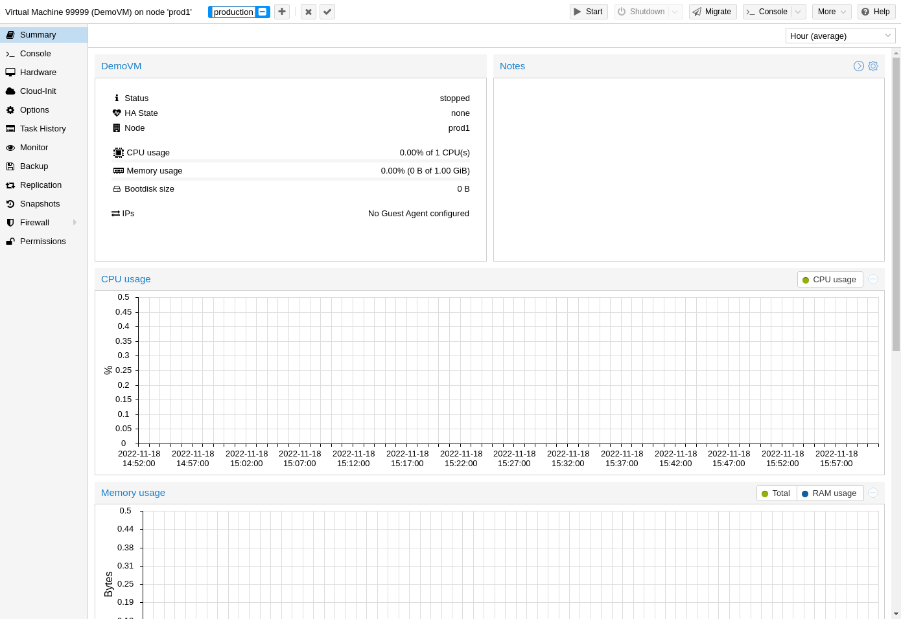](https://pve.proxmox.com/pve-docs/images/screenshot/gui-qemu-summary-tags-edit.png)

出于组织管理的目的，可以为客户机设置 `tags`。目前，它们仅用于向用户提供信息。标签在 Web 界面的两个位置显示：在 `Resource Tree` 中，以及选中客户机时的状态行中。

点击客户机状态行中的 `pencil` 图标，即可添加、编辑和移除标签。按 `+` 按钮可添加多个标签，按 `-` 按钮可将其移除。要保存或取消更改，可分别使用 `✓` 和 `x` 按钮。

也可以通过 CLI 设置标签，多个标签之间用分号分隔。例如：

```text
# qm set ID --tags 'myfirsttag;mysecondtag'
```

### 4.5.1. 样式配置 <a href="#style_configuration" id="style_configuration"></a>

[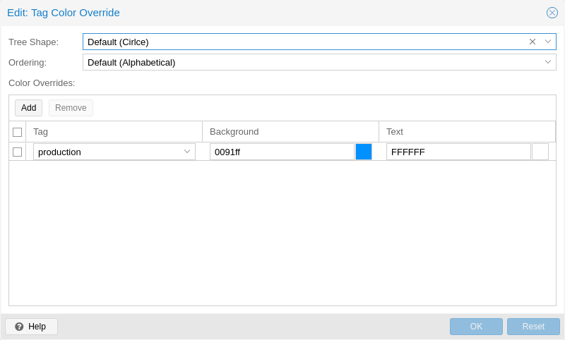](https://pve.proxmox.com/pve-docs/images/screenshot/gui-datacenter-tag-style.png)

默认情况下，标签颜色通过确定性方式根据其文本生成。可以自定义颜色、在资源树中的形状和大小写敏感性，以及标签的排序方式。可在 Web 界面的 <em>数据中心 → 选项 → 标签样式覆盖</em> 下进行配置。也可以通过 CLI 完成。例如：

```text
# pvesh set /cluster/options --tag-style color-map=example:000000:FFFFFF
```

将标签 `example` 的背景颜色设置为黑色（#000000），文本颜色设置为白色（#FFFFFF）。

### 4.5.2. 权限 <a href="#permissions" id="permissions"></a>

[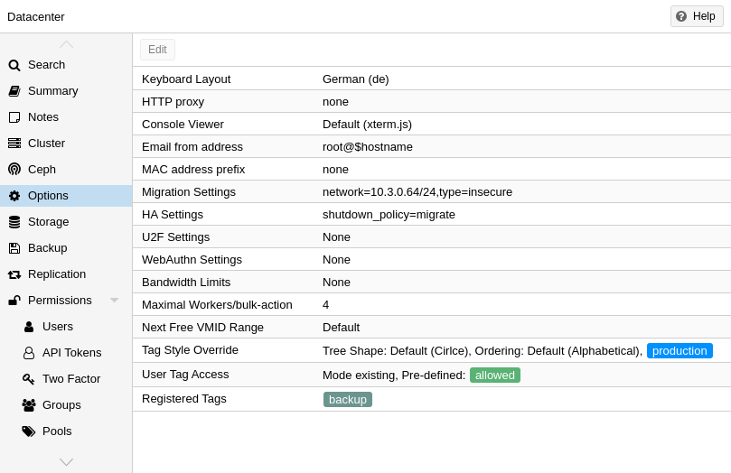](https://pve.proxmox.com/pve-docs/images/screenshot/gui-datacenter-options.png)

默认情况下，具有 `VM.Config.Options` 权限（在客户机 `/vms/ID` 上）的用户可以设置任意标签（参见 [权限管理](../14-user-management/README.md#pveum_permission_management)）。如果希望限制此行为，可以在 <em>数据中心 → 选项 → 用户标签访问</em> 下设置适当的权限：

- `free`：用户在设置标签时不受限制（默认）
- `list`：用户可以根据预定义的标签列表设置标签
- `existing`：与 list 类似，但用户还可以使用已存在的标签
- `none`：用户不能使用标签

同样也可以通过 CLI 完成此操作。

请注意，具有 `Sys.Modify` 权限（在 `/` 上）的用户始终可以设置或删除任意标签，不受此处设置的影响。此外，还有一个可配置的 `registered tags` 列表，只有具有 `Sys.Modify` 权限（在 `/` 上）的用户才能添加和移除其中的标签。可以在 <em>数据中心 → 选项 → 已注册标签</em> 下或通过 CLI 编辑已注册标签列表。

有关确切选项以及如何在 CLI 中调用它们的更多详细信息，请参见[数据中心配置](../24-configuration-files-2/README.md#datacenter_configuration_file)。

## 4.6. 同意横幅 <a href="#gui_consent_banner" id="gui_consent_banner"></a>

可在 <em>数据中心 → 选项 → 同意文本</em> 中配置登录前必须接受的自定义同意横幅。如果没有内容，则不会显示同意横幅。该文本将以 base64 字符串形式存储在 `/etc/pve/datacenter.cfg` 配置文件中。

---

来源：[Proxmox VE 官方文档](https://pve.proxmox.com/pve-docs/pve-admin-guide.html) · 版本 9.2.13 · 非官方中文翻译。
