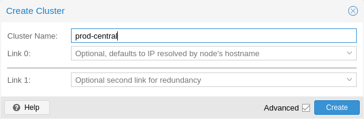

# 5.3. 创建集群 <a href="#pvecm_create_cluster" id="pvecm_create_cluster"></a>

您可以在控制台上（通过 `ssh` 登录）创建集群，也可以通过 Proxmox VE Web 界面（*数据中心 → 集群*）使用 API 创建集群。


为集群使用唯一名称。此名称以后无法更改。集群名称遵循与节点名称相同的规则。


## 5.3.1. 通过 Web GUI 创建 <a href="#pvecm_cluster_create_via_gui" id="pvecm_cluster_create_via_gui"></a>

[](https://pve.proxmox.com/pve-docs/images/screenshot/gui-cluster-create.png)

在 *数据中心 → 集群* 下，点击 **创建集群**。输入集群名称，并从下拉列表中选择一个网络连接，用作主集群网络（Link 0）。默认使用通过节点主机名解析得到的 IP。

从 Proxmox VE 6.2 开始，最多可以向集群添加 8 条备用链路。要添加冗余链路，请点击 *添加* 按钮，并在相应字段中选择链路编号和 IP 地址。在 Proxmox VE 6.2 之前的版本中，要添加第二条链路作为备用，可以选中 *高级* 复选框，然后选择其他网络接口（Link 1，另请参见[Corosync 冗余](09-pvecm-redundancy.md)）。


确保为集群通信选择的网络不用于任何高流量用途，例如网络存储或在线迁移。虽然集群网络本身产生的数据量很小，但它对延迟非常敏感。请查看完整的[集群网络要求](08-pvecm-cluster-network.md#pvecm_cluster_network_requirements)。


## 5.3.2. 通过命令行创建 <a href="#pvecm_cluster_create_via_cli" id="pvecm_cluster_create_via_cli"></a>

通过 `ssh` 登录第一个 Proxmox VE 节点，然后运行以下命令：

```text
 hp1# pvecm create CLUSTERNAME
```

要检查新集群的状态，请使用：

```text
 hp1# pvecm status
```

## 5.3.3. 同一网络中的多个集群 <a href="#_multiple_clusters_in_the_same_network" id="_multiple_clusters_in_the_same_network"></a>

可以在同一物理或逻辑网络中创建多个集群。在这种情况下，每个集群必须具有唯一名称，以避免集群通信栈中可能发生的冲突。此外，这还能使集群清晰可辨，从而有助于避免人为混淆。

虽然 corosync 集群的带宽要求相对较低，但数据包延迟和每秒数据包数（PPS）速率是限制因素。同一网络中的不同集群可能会相互竞争这些资源，因此对于较大的集群，使用独立的物理网络基础设施可能仍然有意义。

---

来源：[Proxmox VE 官方文档](https://pve.proxmox.com/pve-docs/pve-admin-guide.html) · 版本 9.2.13 · 非官方中文翻译。
