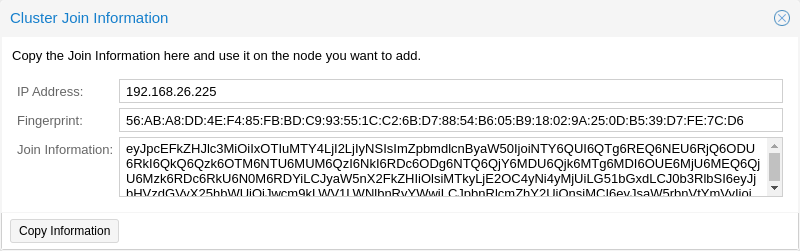
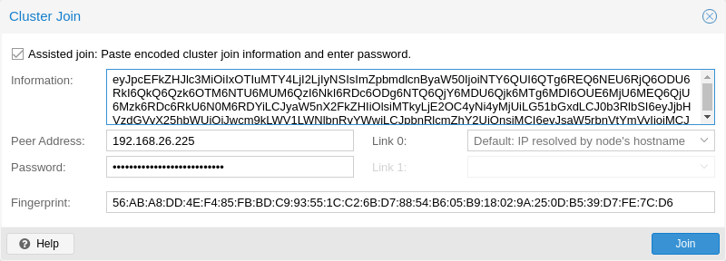

# 5.4. Adding Nodes to the Cluster <a href="#pvecm_join_node_to_cluster" id="pvecm_join_node_to_cluster"></a>


All existing configuration in `/etc/pve` is overwritten when joining a cluster. In particular, a joining node cannot hold any guests, since guest IDs could otherwise conflict, and the node will inherit the cluster’s storage configuration. To join a node with existing guest, as a workaround, you can create a backup of each guest (using `vzdump`) and restore it under a different ID after joining. If the node’s storage layout differs, you will need to re-add the node’s storages, and adapt each storage’s node restriction to reflect on which nodes the storage is actually available.


## 5.4.1. Join Node to Cluster via GUI <a href="#_join_node_to_cluster_via_gui" id="_join_node_to_cluster_via_gui"></a>

[](https://pve.proxmox.com/pve-docs/images/screenshot/gui-cluster-join-information.png)

Log in to the web interface on an existing cluster node. Under *Datacenter → Cluster*, click the **Join Information** button at the top. Then, click on the button **Copy Information**. Alternatively, copy the string from the *Information* field manually.

[](https://pve.proxmox.com/pve-docs/images/screenshot/gui-cluster-join.png)

Next, log in to the web interface on the node you want to add. Under *Datacenter → Cluster*, click on **Join Cluster**. Fill in the *Information* field with the *Join Information* text you copied earlier. Most settings required for joining the cluster will be filled out automatically. For security reasons, the cluster password has to be entered manually.


To enter all required data manually, you can disable the *Assisted Join* checkbox.


After clicking the **Join** button, the cluster join process will start immediately. After the node has joined the cluster, its current node certificate will be replaced by one signed from the cluster certificate authority (CA). This means that the current session will stop working after a few seconds. You then might need to force-reload the web interface and log in again with the cluster credentials.

Now your node should be visible under *Datacenter → Cluster*.

## 5.4.2. Join Node to Cluster via Command Line <a href="#_join_node_to_cluster_via_command_line" id="_join_node_to_cluster_via_command_line"></a>

Log in to the node you want to join into an existing cluster via `ssh`.

```text
 # pvecm add IP-ADDRESS-CLUSTER
```

For `IP-ADDRESS-CLUSTER`, use the IP or hostname of an existing cluster node. An IP address is recommended (see [Link Address Types](08-pvecm-cluster-network.md#pvecm_corosync_addresses)).

By default, `pvecm add` authenticates against the existing cluster node’s API, prompting for that node’s `root@pam` password and verifying its SHA-256 certificate fingerprint. SSH password authentication is not required for this default flow, so administrators may keep `PasswordAuthentication no` set in `sshd_config`.

Pass `--use_ssh` to fall back to the legacy SSH-based join, which uses `ssh-copy-id` to merge the existing cluster’s root key onto the new node. That flow does require root SSH login (with password or key) on the existing node.

To check the state of the cluster use:

```text
 # pvecm status
```

**Cluster status after adding 4 nodes**

```text
 # pvecm status
Cluster information
~~~~~~~~~~~~~~~~~~~
Name:             prod-central
Config Version:   3
Transport:        knet
Secure auth:      on

Quorum information
~~~~~~~~~~~~~~~~~~
Date:             Tue Sep 14 11:06:47 2021
Quorum provider:  corosync_votequorum
Nodes:            4
Node ID:          0x00000001
Ring ID:          1.1a8
Quorate:          Yes

Votequorum information
~~~~~~~~~~~~~~~~~~~~~~
Expected votes:   4
Highest expected: 4
Total votes:      4
Quorum:           3
Flags:            Quorate

Membership information
~~~~~~~~~~~~~~~~~~~~~~
    Nodeid      Votes Name
0x00000001          1 192.168.15.91
0x00000002          1 192.168.15.92 (local)
0x00000003          1 192.168.15.93
0x00000004          1 192.168.15.94
```

If you only want a list of all nodes, use:

```text
 # pvecm nodes
```

**List nodes in a cluster**

```text
 # pvecm nodes

Membership information
~~~~~~~~~~~~~~~~~~~~~~
    Nodeid      Votes Name
         1          1 hp1
         2          1 hp2 (local)
         3          1 hp3
         4          1 hp4
```

## 5.4.3. Adding Nodes with Separated Cluster Network <a href="#pvecm_adding_nodes_with_separated_cluster_network" id="pvecm_adding_nodes_with_separated_cluster_network"></a>

When adding a node to a cluster with a separated cluster network, you need to use the *link0* parameter to set the nodes address on that network:

Generator: GNU source-highlight by Lorenzo Bettini http://www.lorenzobettini.it http://www.gnu.org/software/src-highlite

```text
# pvecm add IP-ADDRESS-CLUSTER --link0 LOCAL-IP-ADDRESS-LINK0
```

If you want to use the built-in [redundancy](09-pvecm-redundancy.md#pvecm_redundancy) of the Kronosnet transport layer, also use the *link1* parameter.

Using the GUI, you can select the correct interface from the corresponding *Link X* fields in the **Cluster Join** dialog.

---

来源：[Proxmox VE 官方文档](https://pve.proxmox.com/pve-docs/pve-admin-guide.html) · 版本 9.2.13 · 非官方中文翻译。
