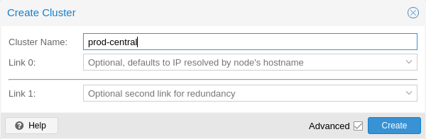
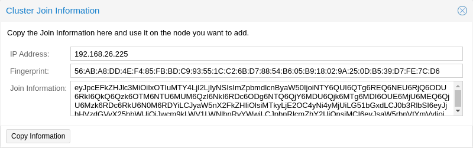
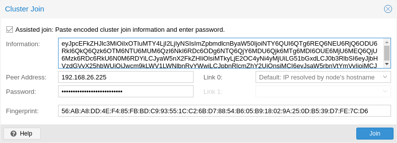

# 5\. 集群管理器 <a href="#chapter_pvecm" id="chapter_pvecm"></a>

Proxmox VE 集群管理器 `pvecm` 是一个用于创建物理服务器组的工具。这样的组称为<strong>集群</strong>。我们使用 [Corosync Cluster Engine](http://www.corosync.org) 实现可靠的组通信。集群中的节点数量没有明确限制。在实践中，实际可支持的节点数量可能受宿主机和网络性能限制。目前（2021 年），已有报告称，使用高端企业级硬件的集群在生产环境中运行了超过 50 个节点。

`pvecm` 可用于创建新集群、将节点加入集群、离开集群、获取状态信息以及执行各种其他集群相关任务。<strong>P</strong>rox<strong>m</strong>o<strong>x</strong> <strong>C</strong>luster <strong>F</strong>ile <strong>S</strong>ystem（“pmxcfs”）用于以透明方式将集群配置分发到所有集群节点。

将节点组成集群具有以下优点：

- 集中式、基于 Web 的管理
- 多主集群：每个节点都可以执行所有管理任务
- 使用 `pmxcfs`（一种数据库驱动的文件系统）存储配置文件，并通过 `corosync` 在所有节点上实时复制
- 在物理宿主机之间轻松迁移虚拟机和容器
- 快速部署
- 集群范围的服务，如防火墙和 HA

## 5.1. 要求 <a href="#pvecm_cluster_requirements" id="pvecm_cluster_requirements"></a>

- 所有节点必须能够通过 UDP 端口 5405-5412 相互连接，corosync 才能正常工作。
- 日期和时间必须保持同步。
- 节点之间需要通过 TCP 端口 22 建立 SSH 隧道。
- 如果您对高可用性感兴趣，则至少需要三个节点才能实现可靠的仲裁。所有节点应使用相同的版本。

  
  对于较小的双节点集群，可以使用 [QDevice](#corosync_external_vote_support) 提供第三票。
  
- 我们建议为集群流量使用专用的物理 NIC。

  
  Proxmox VE 集群通信使用 Corosync 协议。它需要稳定的低延迟，但不需要很大的带宽。在大多数情况下，专用的 1 Gbit NIC 就足够了。这有助于避免其他服务耗尽所有可用带宽的情况，而这又会增加 Corosync 数据包的延迟。
  
- 为集群流量添加额外链路可在专用网络发生故障时提供冗余。

  
  Corosync 最多支持 8 条链路。
  

  
  为确保可靠的 Corosync 冗余，必须在不同的物理网络上至少再配置一条链路。这样，当专用网络发生故障时，Corosync 仍能保持集群通信。
  

  
  由 bond 支持的单一链路在某些故障场景下可能会出现问题，请参见[通过 Bond 使用 Corosync](#pvecm_corosync_over_bonds)。
  
- 添加节点时需要集群节点的 root 密码。
- 仅当节点使用同一供应商的 CPU 时，才支持虚拟机在线迁移。在其他情况下也可能可行，但无法保证。

## 5.2. 准备节点 <a href="#preparing_nodes" id="preparing_nodes"></a>

首先，在所有节点上安装 Proxmox VE。确保每个节点在安装时都使用最终的主机名和 IP 配置。创建集群后，无法更改主机名和 IP。

虽然在 `/etc/hosts` 中引用所有节点名称及其 IP（或通过其他方式使其名称可解析）很常见，但集群运行并不需要这样做。不过，这样做可能很有用，因为随后可以使用更容易记住的节点名称，通过 SSH 从一个节点连接到另一个节点（另请参见[链路地址类型](#pvecm_corosync_addresses)）。请注意，我们始终建议在集群配置中通过节点的 IP 地址来引用节点。

## 5.3. 创建集群 <a href="#pvecm_create_cluster" id="pvecm_create_cluster"></a>

您可以在控制台上（通过 `ssh` 登录）创建集群，也可以通过 Proxmox VE Web 界面（<em>数据中心 → 集群</em>）使用 API 创建集群。


为集群使用唯一名称。此名称以后无法更改。集群名称遵循与节点名称相同的规则。


### 5.3.1. 通过 Web GUI 创建 <a href="#pvecm_cluster_create_via_gui" id="pvecm_cluster_create_via_gui"></a>

[](https://pve.proxmox.com/pve-docs/images/screenshot/gui-cluster-create.png)

在 <em>数据中心 → 集群</em> 下，点击 <strong>创建集群</strong>。输入集群名称，并从下拉列表中选择一个网络连接，用作主集群网络（Link 0）。默认使用通过节点主机名解析得到的 IP。

从 Proxmox VE 6.2 开始，最多可以向集群添加 8 条备用链路。要添加冗余链路，请点击 <em>添加</em> 按钮，并在相应字段中选择链路编号和 IP 地址。在 Proxmox VE 6.2 之前的版本中，要添加第二条链路作为备用，可以选中 <em>高级</em> 复选框，然后选择其他网络接口（Link 1，另请参见[Corosync 冗余](#pvecm_redundancy)）。


确保为集群通信选择的网络不用于任何高流量用途，例如网络存储或在线迁移。虽然集群网络本身产生的数据量很小，但它对延迟非常敏感。请查看完整的[集群网络要求](#pvecm_cluster_network_requirements)。


### 5.3.2. 通过命令行创建 <a href="#pvecm_cluster_create_via_cli" id="pvecm_cluster_create_via_cli"></a>

通过 `ssh` 登录第一个 Proxmox VE 节点，然后运行以下命令：

```text
 hp1# pvecm create CLUSTERNAME
```

要检查新集群的状态，请使用：

```text
 hp1# pvecm status
```

### 5.3.3. 同一网络中的多个集群 <a href="#multiple_clusters_in_the_same_network" id="multiple_clusters_in_the_same_network"></a>

可以在同一物理或逻辑网络中创建多个集群。在这种情况下，每个集群必须具有唯一名称，以避免集群通信栈中可能发生的冲突。此外，这还能使集群清晰可辨，从而有助于避免人为混淆。

虽然 corosync 集群的带宽要求相对较低，但数据包延迟和每秒数据包数（PPS）速率是限制因素。同一网络中的不同集群可能会相互竞争这些资源，因此对于较大的集群，使用独立的物理网络基础设施可能仍然有意义。

## 5.4. 向集群添加节点 <a href="#pvecm_join_node_to_cluster" id="pvecm_join_node_to_cluster"></a>


加入集群时，`/etc/pve` 中的所有现有配置都会被覆盖。特别是，加入的节点不能包含任何客户机，否则客户机 ID 可能会冲突，并且该节点将继承集群的存储配置。作为变通方法，要加入包含现有客户机的节点，可以为每个客户机创建备份（使用 `vzdump`），并在加入后以不同的 ID 恢复。如果节点的存储布局不同，则需要重新添加该节点的存储，并调整每个存储的节点限制，以反映该存储实际在哪些节点上可用。


### 5.4.1. 通过 GUI 将节点加入集群 <a href="#join_node_to_cluster_via_gui" id="join_node_to_cluster_via_gui"></a>

[](https://pve.proxmox.com/pve-docs/images/screenshot/gui-cluster-join-information.png)

登录现有集群节点的 Web 界面。在 <em>数据中心 → 集群</em> 下，点击顶部的 <strong>加入信息</strong> 按钮。然后，点击 <strong>复制信息</strong> 按钮。或者，手动复制 <em>信息</em> 字段中的字符串。

[](https://pve.proxmox.com/pve-docs/images/screenshot/gui-cluster-join.png)

接下来，登录要添加的节点的 Web 界面。在 <em>数据中心 → 集群</em> 下，点击 <strong>加入集群</strong>。在 <em>信息</em> 字段中填入之前复制的 <em>加入信息</em> 文本。加入集群所需的大多数设置都会自动填写。出于安全原因，必须手动输入集群密码。


要手动输入所有必需数据，可以取消选中 <em>辅助加入</em> 复选框。


点击 <strong>加入</strong> 按钮后，集群加入过程将立即开始。节点加入集群后，其当前节点证书将被替换为由集群证书颁发机构（CA）签发的证书。这意味着当前会话将在几秒后停止工作。随后，您可能需要强制重新加载 Web 界面，并使用集群凭据重新登录。

现在，您的节点应显示在 <em>数据中心 → 集群</em> 下。

### 5.4.2. 通过命令行将节点加入集群 <a href="#join_node_to_cluster_via_command_line" id="join_node_to_cluster_via_command_line"></a>

通过 `ssh` 登录要加入现有集群的节点。

```text
 # pvecm add IP-ADDRESS-CLUSTER
```

对于 `IP-ADDRESS-CLUSTER`，请使用现有集群节点的 IP 或主机名。建议使用 IP 地址（参见[链路地址类型](#pvecm_corosync_addresses)）。

默认情况下，`pvecm add` 会使用现有集群节点的 API 进行身份验证，提示输入该节点的 `root@pam` 密码，并验证其 SHA-256 证书指纹。此默认流程不需要 SSH 密码身份验证，因此管理员可以保留 `PasswordAuthentication no` 设置（位于 `sshd_config` 中）。

传递 `--use_ssh` 可回退到传统的基于 SSH 的加入方式，该方式使用 `ssh-copy-id` 将现有集群的 root 密钥合并到新节点。该流程确实需要在现有节点上进行 root SSH 登录（使用密码或密钥）。

要检查集群的状态，请使用：

```text
 # pvecm status
```

**添加 4 个节点后的集群状态**

```text
 # pvecm status
Cluster information
~~~~~~~~~~~~~~~~~~~
Name:             prod-central
Config Version:   3
Transport:        knet
Secure auth:      on

Quorum information
~~~~~~~~~~~~~~~~~~
Date:             Tue Sep 14 11:06:47 2021
Quorum provider:  corosync_votequorum
Nodes:            4
Node ID:          0x00000001
Ring ID:          1.1a8
Quorate:          Yes

Votequorum information
~~~~~~~~~~~~~~~~~~~~~~
Expected votes:   4
Highest expected: 4
Total votes:      4
Quorum:           3
Flags:            Quorate

Membership information
~~~~~~~~~~~~~~~~~~~~~~
    Nodeid      Votes Name
0x00000001          1 192.168.15.91
0x00000002          1 192.168.15.92 (local)
0x00000003          1 192.168.15.93
0x00000004          1 192.168.15.94
```

如果您只需要所有节点的列表，请使用：

```text
 # pvecm nodes
```

**列出集群中的节点**

```text
 # pvecm nodes

Membership information
~~~~~~~~~~~~~~~~~~~~~~
    Nodeid      Votes Name
         1          1 hp1
         2          1 hp2 (local)
         3          1 hp3
         4          1 hp4
```

### 5.4.3. 使用独立集群网络添加节点 <a href="#pvecm_adding_nodes_with_separated_cluster_network" id="pvecm_adding_nodes_with_separated_cluster_network"></a>

向使用独立集群网络的集群添加节点时，需要使用 <em>link0</em> 参数设置节点在该网络上的地址：

```text
# pvecm add IP-ADDRESS-CLUSTER --link0 LOCAL-IP-ADDRESS-LINK0
```

如果要使用 Kronosnet 传输层内置的[冗余](#pvecm_redundancy)，还需使用 <em>link1</em> 参数。

使用 GUI 时，可以从相应的 <em>Link X</em> 字段中选择正确的接口，这些字段位于 <strong>集群加入</strong> 对话框中。

## 5.5. 移除集群节点 <a href="#pvecm_remove_node" id="pvecm_remove_node"></a>


在继续操作之前，请仔细阅读该过程，因为它可能不符合您的意图或需求。


以下步骤介绍如何从一个同时也是 [Ceph](../08-pveceph/README.md) 集群成员的集群中移除节点。如果节点上未安装 Ceph，则可以直接忽略其中提及 Ceph 的步骤。


如果配置中包含 QDevice，则需要先按照常见问题中[此处](#adding_deleting_nodes_after_qdevice_setup)的说明将其移除，然后再移除集群节点。


### 5.5.1. 前提条件 <a href="#prerequisites" id="prerequisites"></a>

- 将所有虚拟机和容器迁离该节点。
- 备份待删除节点上的所有本地数据。
- 确保待删除的节点不再属于任何复制任务。

  
  如果在移除节点本身之前，未能从该节点移除复制任务，复制任务将变得无法移除。请注意，当已配置复制的 VM 迁移时，复制会自动切换方向。因此，将已配置复制的 VM 从待删除的节点迁出，会自动建立指向该节点的复制任务。
  
- 确保剩余的 Ceph 集群具有足够的存储空间，并且 OSD 正在运行（即 `up` 和 `in`）。销毁任何 OSD，尤其是节点上的最后一个 OSD，都会触发 Ceph 数据重新平衡。

  
  确保仍有足够数量带有 OSD 的节点可用，以满足为 Ceph 池配置的 `size/min_size` 参数。如果可用节点少于 `size`（默认值：3）个，数据冗余程度将会降低。如果可用节点少于 `min_size`（默认值：2）个，池的 I/O 将被阻塞，直到有足够的副本可用。如果受影响的客户机的 I/O 被阻塞，它们可能会崩溃。
  
- 确保 Ceph 集群中仍有足够的[监视器](../08-pveceph/README.md#pve_ceph_monitors)、[管理器](../08-pveceph/README.md#pve_ceph_manager)可用，并且在使用 CephFS 时，仍有足够的[元数据服务器](../08-pveceph/README.md#pveceph_fs_mds)可用。

### 5.5.2. 移除集群节点 <a href="#remove_the_cluster_node" id="remove_the_cluster_node"></a>

在从集群中移除节点之前，必须确保该节点不再是 Ceph 集群的一部分，并且其上不再驻留任何 Ceph 资源或服务。

在以下示例中，将从 Ceph 集群和 Proxmox VE corosync 集群中同时移除集群节点 `node4`。

```text
node4# pvecm nodes

Membership information
~~~~~~~~~~~~~~~~~~~~~~
    Nodeid      Votes Name
         1          1 node1
         2          1 node2
         3          1 node3
         4          1 node4 (local)
```

1. 首先从 Ceph 集群中移除该节点，这包括多个步骤：

   1. 首先，逐一[销毁](../08-pveceph/README.md#pve_ceph_osd_destroy)待删除节点上剩余的 Ceph OSD。
   2. 等待 [CEPH 状态](../08-pveceph/README.md#pve_ceph_mon_and_ts)再次恢复到 `HEALTH_OK`。
   3. 如果存在剩余的 [Ceph 元数据服务器](../08-pveceph/README.md#pveceph_fs_mds)，请通过 <em>Ceph → CephFS</em> 处的 Web 界面将其销毁，或者运行：

      ```text
      node4# pveceph mds destroy node4
      ```
   4. [销毁剩余的 Ceph 监视器。](../08-pveceph/README.md#pveceph_destroy_mon)
   5. [销毁剩余的 Ceph 管理器。](../08-pveceph/README.md#pveceph_destroy_mgr)
   6. 最后，从 CRUSH 层次结构中移除现在已清空的 Ceph 桶（待移除的 Proxmox VE 节点）。

      ```text
      node4# ceph osd crush remove node4
      ```
2. 现在，关闭 `node4` 的电源，并确保它不会以当前配置在此网络中再次开机。

   
   如上所述，在移除<strong>之前</strong>将节点关机至关重要，并且必须确保它<strong>不会</strong>以当前配置（在现有集群网络中）再次开机。如果按原样将节点开机，集群可能会损坏，并且可能难以恢复到正常运行的状态。
   
3. 登录剩余的任一集群节点，然后从集群中移除节点 `node4`。

   ```text
   node1# pvecm delnode node4
   ```

   
   您可能会收到一条错误消息，内容为 `could not kill node (error = cs_err_not_exist)`。这并不表示节点删除实际失败，而是表示 Corosync 尝试终止离线节点时失败。因此，可以安全地忽略该消息。
   
4. 验证节点已成功从集群中移除

   ```text
   node1# pvecm nodes

   Membership information
   ~~~~~~~~~~~~~~~~~~~~~~
       Nodeid      Votes Name
            1          1 node1 (local)
            2          1 node2
            3          1 node3
   ```

### 5.5.3. 节点移除后的清理步骤 <a href="#cleanup_steps_after_node_removal" id="cleanup_steps_after_node_removal"></a>

- 被移除节点的配置文件仍位于集群文件系统中的 <em>/etc/pve/nodes/node4</em> 下。恢复您仍需要的所有配置，然后删除该目录。
- 被移除节点的 SSH 指纹仍将位于其他节点上的 <em>known\_hosts</em> 文件中。如果使用相同 IP 或主机名重新加入节点后收到 SSH 错误，请在重新添加的节点上运行一次 `pvecm
    updatecerts`，以在整个集群范围内更新其指纹。
- 现有的[高可用性规则](../15-ha-manager/README.md#ha_manager_rules)仍将引用已删除的节点，因此请从所有现有规则中移除该节点。
- 被移除节点的公钥仍会列在 <em>/etc/pve/priv/authorized\_keys</em> 中，如果不再需要，应将其删除。

**重新加入同一节点：**

如果希望同一台服务器再次加入同一集群，必须：

- 在服务器上重新安装 Proxmox VE，
- 然后[将该节点重新加入集群](#pvecm_join_node_to_cluster)

## 5.6. 在不重新安装的情况下分离节点 <a href="#pvecm_separate_node_without_reinstall" id="pvecm_separate_node_without_reinstall"></a>


这<strong>不是</strong>推荐的方法，请谨慎操作。如果不确定，请使用前一种方法。


您也可以在不从头重新安装的情况下，将节点从集群中分离出来。但是，从集群中移除节点后，它仍然可以访问任何共享存储。必须在开始从集群中移除节点之前解决此问题。Proxmox VE 集群不能与另一个集群共享完全相同的存储，因为存储锁定无法跨集群边界工作。此外，这还可能导致 VMID 冲突。

建议创建一个新存储，只有要分离的节点才有权访问该存储。例如，这可以是您的 NFS 上的新导出，也可以是新的 Ceph 池。重要的是，完全相同的存储不能被多个集群访问。设置此存储后，将该节点上的所有数据和 VM 都移动到此存储中。然后，您就可以将节点从集群中分离出来了。


如果配置中包含 QDevice，则需要先按照常见问题中[此处](#adding_deleting_nodes_after_qdevice_setup)的说明将其移除，然后再移除集群节点。



确保所有共享资源都已彻底分离！否则将遇到冲突和问题。


首先，停止节点上的 corosync 和 pve-cluster 服务：

```text
systemctl stop pve-cluster
systemctl stop corosync
```

再次以本地模式启动集群文件系统：

```text
pmxcfs -l
```

删除 corosync 配置文件：

```text
rm /etc/pve/corosync.conf
rm -r /etc/corosync/*
```

现在可以再次将文件系统作为普通服务启动：

```text
killall pmxcfs
systemctl start pve-cluster
```

该节点现已与集群分离。您可以在集群的任一剩余节点上使用以下命令将其删除：

```text
pvecm delnode oldnode
```

如果命令因剩余节点失去仲裁而失败，可以将预期票数设置为 1 作为变通方法：

```text
pvecm expected 1
```

然后重复执行 <em>pvecm delnode</em> 命令。

现在切换回已分离的节点，并删除其上所有剩余的集群文件。这样可以确保该节点能够再次加入另一个集群而不会出现问题。

```text
rm /var/lib/corosync/*
```

由于其他节点的配置文件仍位于集群文件系统中，您可能也希望清理这些文件。在绝对确定节点名称正确无误后，只需从 <em>/etc/pve/nodes/NODENAME</em> 中递归删除整个目录即可。


该节点的 SSH 密钥仍将保留在 <em>authorized\_key</em> 文件中。这意味着各节点仍可以使用公钥身份验证相互连接。您应通过从 <em>/etc/pve/priv/authorized\_keys</em> 文件中删除相应密钥来解决此问题。


## 5.7. 仲裁 <a href="#quorum" id="quorum"></a>

Proxmox VE 使用基于仲裁的技术，在所有集群节点之间提供一致的状态。

仲裁是分布式事务为获准在分布式系统中执行操作而必须获得的最低票数。

<em>仲裁（分布式计算）</em>  
——摘自维基百科

如果发生网络分区，状态更改要求大多数节点在线。如果集群失去仲裁，将切换到只读模式。


默认情况下，Proxmox VE 为每个节点分配一票。


## 5.8. 集群网络 <a href="#pvecm_cluster_network" id="pvecm_cluster_network"></a>

集群网络是集群的核心。通过它发送的所有消息都必须按照各自的顺序可靠地传递到所有节点。在 Proxmox VE 中，这部分由 corosync 完成，它是一种高性能、低开销的高可用性开发工具包的实现。它服务于我们的去中心化配置文件系统（`pmxcfs`）。

### 5.8.1. 网络要求 <a href="#pvecm_cluster_network_requirements" id="pvecm_cluster_network_requirements"></a>

Proxmox VE 集群栈要求所有节点之间具有延迟低于 5 毫秒的可靠网络（LAN 性能），才能稳定运行。虽然在节点数量较少的配置中，延迟较高的网络<em>可能</em>也能正常工作，但这并无保证；当节点超过三个且延迟高于约 10 ms 时，能正常工作的可能性就相当低。

该网络不应被其他成员大量使用，因为虽然 corosync 不会占用太多带宽，但它对延迟抖动很敏感；理想情况下，corosync 应在物理隔离的独立网络中运行。尤其不要让 corosync 和存储共用网络（除非在[冗余](#pvecm_redundancy)配置中将其作为可能的低优先级后备方案）。

在建立集群之前，检查网络是否适合此用途是一种良好做法。为确保节点能够在集群网络上相互连接，可以使用 `ping` 工具测试它们之间的连通性。

如果启用了 Proxmox VE 防火墙，将自动生成 corosync 的 ACCEPT 规则，无需手动操作。


Corosync 在 3.0 版之前使用组播（该版本随 Proxmox VE 6.0 引入）。新版本依赖 [Kronosnet](https://kronosnet.org/) 进行集群通信，而目前它仅支持常规 UDP 单播。



您仍然可以通过将传输方式设置为 `udp` 或 `udpu`，在 [corosync.conf](#pvecm_edit_corosync_conf) 中启用组播或传统单播，但请注意，这将禁用所有加密和冗余支持。因此不建议这样做。


### 5.8.2. 在绑定接口上运行 Corosync <a href="#pvecm_corosync_over_bonds" id="pvecm_corosync_over_bonds"></a>

#### 建议 <a href="#recommendations" id="recommendations"></a>

我们建议为主要 Corosync 链路至少使用一个专用物理 NIC，请参阅[要求](#pvecm_cluster_requirements)。[绑定](../03-system-administration/README.md#sysadmin_network_bond)可用作附加链路，以提高冗余性。<strong>每当将绑定用于 Corosync 流量时</strong>，都适用以下注意事项：

- 在某些故障场景中，绑定模式 <strong>active-backup</strong> 可能无法提供预期的冗余，详情请见下文。
- 我们<strong>不建议</strong>将绑定模式 <strong>balance-rr</strong>、<strong>balance-xor</strong>、<strong>balance-tlb</strong> 或 <strong>balance-alb</strong> 用于 Corosync 流量。已知它们在某些故障场景中会引发问题，详情请见下文。
- <strong>IEEE 802.3ad (LACP)</strong>：如果将 LACP 绑定用于 corosync 流量，我们强烈建议设置 `bond-lacp-rate fast`，并且 <strong>Proxmox VE</strong> 节点和<strong>交换机</strong>两端都要设置！使用默认设置 `bond-lacp-rate slow` 时，已知此模式在某些故障场景中会引发问题，详情请见下文。

#### 背景 <a href="#background" id="background"></a>

在某些故障场景中，使用 [绑定](../03-system-administration/README.md#sysadmin_network_bond) 作为 Corosync 链路可能会引发问题。考虑这样一种故障场景：绑定中的一个接口发生故障并停止传输数据包，但其链路状态仍为 up，并且没有其他可用的 Corosync 链路。在这种情况下，某些绑定模式可能导致非对称连接状态，使集群节点只能与不同的其他节点子集通信。受影响的是提供负载均衡的绑定模式，因为这些模式可能仍会尝试通过故障接口发送一部分数据包。在非对称连接的情况下，Corosync 可能无法在集群中形成稳定的仲裁。如果这种状态持续存在且启用了 HA，即使绑定没有任何问题的节点也可能自我隔离。在最坏的情况下，整个集群都可能自我隔离。

在上述故障场景中，绑定模式 <strong>active-backup</strong> <strong>不会</strong>导致非对称连接。但是，发生接口故障的绑定可能无法切换到备份链路。该节点可能会与集群失去连接，并在启用 HA 时自我隔离。

在上述故障场景中，绑定模式 <strong>balance-rr</strong>、<strong>balance-xor</strong>、<strong>balance\_tlb</strong> 或 <strong>balance-alb</strong> 可能导致非对称连接，如果启用了 HA，这可能会导致意外隔离。

绑定模式 <strong>IEEE 802.3ad (LACP)</strong> 在上述故障场景中可能导致非对称连接，但能从此状态恢复，因为绑定的两端（Proxmox VE 节点和交换机）在绑定接口连续未收到三个 LACPDU 时，都可以停止使用该接口。不过，默认设置下每 30 秒才发送一次 LACPDU，导致故障切换时间达到 90 秒。此时间过长，因为带有 HA 资源的节点在约一分钟没有稳定仲裁后就会自行隔离。如果使用 LACP 绑定传输 corosync 流量，建议设置 `bond-lacp-rate fast`，且在 <strong>Proxmox VE</strong> 节点和 <strong>交换机</strong> 上都设置！在一端设置此选项会要求另一端每秒发送一个 LACPDU。两端都设置此选项可将上述场景中的故障切换时间缩短为 3 秒，从而避免隔离。

### 5.8.3. 独立集群网络 <a href="#separate_cluster_network" id="separate_cluster_network"></a>

创建集群时不指定任何参数，corosync 集群网络通常会与 Web 界面和虚拟机的网络共用。根据您的设置，甚至存储流量也可能通过同一网络发送。建议更改这种情况，因为 corosync 是对时间要求严格的实时应用程序。

#### 设置新网络 <a href="#setting_up_a_new_network" id="setting_up_a_new_network"></a>

首先，您必须设置一个新的网络接口。该接口应位于物理上独立的网络中。请确保您的网络符合[集群网络要求](#pvecm_cluster_network_requirements)。

#### 在创建集群时分离 <a href="#separate_on_cluster_creation" id="separate_on_cluster_creation"></a>

这可以通过 <em>linkX</em> 参数实现，该参数属于用于创建新集群的 <em>pvecm create</em> 命令。

如果您已额外设置了一个网卡，并为其配置了静态地址 10.10.10.1/25，且希望通过此接口发送和接收所有集群通信，请执行：

```text
pvecm create test --link0 10.10.10.1
```

要检查一切是否正常工作，请执行：

```text
systemctl status corosync
```

然后，按照上述说明[添加使用独立集群网络的节点](#pvecm_adding_nodes_with_separated_cluster_network)。

#### 创建集群后分离 <a href="#pvecm_separate_cluster_net_after_creation" id="pvecm_separate_cluster_net_after_creation"></a>

如果您已经创建了集群，并希望在不重建整个集群的情况下将其通信切换到另一个网络，可以执行此操作。此更改可能导致集群短暂失去仲裁，因为各节点必须重启 corosync，并逐一在新网络上启动。

首先，请查看如何[编辑 corosync.conf 文件](#pvecm_edit_corosync_conf)。然后打开该文件，您应该会看到类似以下内容：

```text
logging {
  debug: off
  to_syslog: yes
}

nodelist {

  node {
    name: due
    nodeid: 2
    quorum_votes: 1
    ring0_addr: due
  }

  node {
    name: tre
    nodeid: 3
    quorum_votes: 1
    ring0_addr: tre
  }

  node {
    name: uno
    nodeid: 1
    quorum_votes: 1
    ring0_addr: uno
  }

}

quorum {
  provider: corosync_votequorum
}

totem {
  cluster_name: testcluster
  config_version: 3
  ip_version: ipv4-6
  secauth: on
  version: 2
  interface {
    linknumber: 0
  }

}
```


`ringX_addr` 实际上指定的是一个 corosync <strong>链路地址</strong>。“ring”这一名称是旧版 corosync 的遗留，为保持向后兼容而保留。


首先要做的是在节点条目中添加 <em>name</em> 属性（如果尚未看到它们）。这些属性<strong>必须</strong>与节点名称匹配。

然后，将所有节点的 <em>ring0\_addr</em> 属性中的地址全部替换为新地址。此处可以直接使用 IP 地址或主机名。如果使用主机名，请确保所有节点都能解析它们（另请参阅[链路地址类型](#pvecm_corosync_addresses)）。

在此示例中，我们要将集群通信切换到 10.10.10.0/25 网络，因此分别更改每个节点的 <em>ring0\_addr</em>。


完全相同的过程也可用于更改其他 <em>ringX\_addr</em> 值。但是，我们建议每次只更改一个链路地址，这样在出现问题时更容易恢复。


增加 <em>config\_version</em> 属性后，新配置文件应如下所示：

```text
logging {
  debug: off
  to_syslog: yes
}

nodelist {

  node {
    name: due
    nodeid: 2
    quorum_votes: 1
    ring0_addr: 10.10.10.2
  }

  node {
    name: tre
    nodeid: 3
    quorum_votes: 1
    ring0_addr: 10.10.10.3
  }

  node {
    name: uno
    nodeid: 1
    quorum_votes: 1
    ring0_addr: 10.10.10.1
  }

}

quorum {
  provider: corosync_votequorum
}

totem {
  cluster_name: testcluster
  config_version: 4
  ip_version: ipv4-6
  secauth: on
  version: 2
  interface {
    linknumber: 0
  }

}
```

然后，最后检查所有更改的信息是否正确，确认后保存，并再次按照[编辑 corosync.conf 文件](#pvecm_edit_corosync_conf)一节的说明使其生效。

这些更改将实时应用，因此并非必须重启 corosync。如果您还更改了其他设置，或发现 corosync 报告问题，可以选择触发重启。

在单个节点上执行：

```text
systemctl restart corosync
```

现在检查一切是否正常：

```text
systemctl status corosync
```

如果 corosync 重新开始工作，也请在所有其他节点上重启它。随后，这些节点将在新网络上逐一加入集群成员关系。

### 5.8.4. Corosync 地址 <a href="#pvecm_corosync_addresses" id="pvecm_corosync_addresses"></a>

corosync 链路地址（为保持向后兼容，使用 <em>ringX\_addr</em> 在 `corosync.conf` 中表示）可通过两种方式指定：

- <strong>IPv4/v6 地址</strong>可直接使用。建议使用这种方式，因为此类地址是静态的，通常不会被随意更改。
- <strong>主机名</strong>将通过 `getaddrinfo` 解析，这意味着默认情况下，如果 IPv6 地址可用，将优先使用它们（另请参阅 `man gai.conf`）。将现有集群升级到 IPv6 时，尤其要记住这一点。


应谨慎使用主机名，因为无需改动 corosync 或其所在节点，就可以更改主机名解析到的地址；这可能导致在更改地址时未考虑其对 corosync 的影响。


如果倾向使用主机名，建议为 corosync 专门使用一个独立的静态主机名。此外，请确保集群中的每个节点都能正确解析所有主机名。

自 Proxmox VE 5.1 起，虽然仍支持主机名，但会在输入时解析主机名，并且仅将解析得到的 IP 保存到配置中。

在较早版本中加入集群的节点，很可能仍在 `corosync.conf` 中使用未解析的主机名。如上所述，将其替换为 IP 或独立主机名可能是个不错的主意。

## 5.9. Corosync 冗余 <a href="#pvecm_redundancy" id="pvecm_redundancy"></a>

Corosync 默认通过其集成的 Kronosnet 层支持冗余网络（旧版 udp/udpu 传输不支持此功能）。要启用该功能，可以通过 <em>--linkX</em> 参数（属于 `pvecm`）、在 GUI 中设置为 <strong>Link 1</strong>（创建集群或添加新节点时），或者通过指定多个 <em>ringX\_addr</em>（位于 `corosync.conf` 中）来指定多个链路地址。


为提供有效的故障切换，每条链路都应使用独立的物理网络连接。


以下示例假设每个集群节点都配置了一个 10.10.10.0/25 中的静态地址和一个 10.20.20.0/25 中的静态地址。

链路根据优先级设置使用。您可以在对应的接口小节中设置 <em>knet\_link\_priority</em> 来配置此优先级（该小节位于 `corosync.conf`），或者，最好在创建集群时使用 <em>priority</em> 参数，并通过 `pvecm` 执行创建操作：

```text
 # pvecm create CLUSTERNAME --link0 10.10.10.1,priority=15 --link1 10.20.20.1,priority=20
```

这将使 <em>link1</em> 被优先使用，因为它的优先级更高。

如果未手动配置优先级（或两条链路的优先级相同），链路将按其编号顺序使用，编号越小，优先级越高。

即使所有链路都正常工作，也只有优先级最高的链路会承载 corosync 流量。链路优先级不能混合，这意味着优先级不同的链路将无法相互通信。

由于除非所有更高优先级的链路都发生故障，否则较低优先级的链路不会承载流量，因此，将用于其他任务（虚拟机、存储等）的网络指定为低优先级链路是一种有用的策略。在最坏的情况下，延迟较高或较为拥塞的连接可能也比完全没有连接要好。

### 5.9.1. 向现有集群添加冗余链路 <a href="#adding_redundant_links_to_an_existing_cluster" id="adding_redundant_links_to_an_existing_cluster"></a>

要向运行中的配置添加新链路，首先请查看如何[编辑 corosync.conf 文件](#pvecm_edit_corosync_conf)。

然后，将新的 <em>ringX\_addr</em> 添加到 `nodelist` 小节中的每个节点。确保所有添加该条目的节点都使用相同的 <em>X</em>，并且该编号在每个节点内都是唯一的。

最后，按下图添加新的 <em>interface</em> 至 `totem` 节，将 <em>X</em> 替换为上面选择的链路编号。

假设您添加了一条编号为 1 的链路，新配置文件可能如下所示：

```text
logging {
  debug: off
  to_syslog: yes
}

nodelist {

  node {
    name: due
    nodeid: 2
    quorum_votes: 1
    ring0_addr: 10.10.10.2
    ring1_addr: 10.20.20.2
  }

  node {
    name: tre
    nodeid: 3
    quorum_votes: 1
    ring0_addr: 10.10.10.3
    ring1_addr: 10.20.20.3
  }

  node {
    name: uno
    nodeid: 1
    quorum_votes: 1
    ring0_addr: 10.10.10.1
    ring1_addr: 10.20.20.1
  }

}

quorum {
  provider: corosync_votequorum
}

totem {
  cluster_name: testcluster
  config_version: 4
  ip_version: ipv4-6
  secauth: on
  version: 2
  interface {
    linknumber: 0
  }
  interface {
    linknumber: 1
  }
}
```

按照[编辑 corosync.conf 文件](#pvecm_edit_corosync_conf)的最后步骤操作后，新链路即会启用。应该无需重启。您可以使用以下命令检查 corosync 是否已加载新链路：

```text
journalctl -b -u corosync
```

最好在其中一个节点上暂时断开旧链路来测试新链路，并确保其状态在断开期间仍保持在线：

```text
pvecm status
```

如果您看到集群状态正常，则表示新链路正在使用中。

## 5.10. SSH 在 Proxmox VE 集群中的作用 <a href="#role_of_ssh_in_proxmox_ve_clusters" id="role_of_ssh_in_proxmox_ve_clusters"></a>

Proxmox VE 将 SSH 隧道用于多种功能。

- 代理控制台/shell 会话（节点和客户机）

  在连接到节点 A 的情况下使用节点 B 的 shell 时，会连接到节点 A 上的终端代理，该代理再通过非交互式 SSH 隧道连接到节点 B 上的登录 shell。
- 在 <em>secure</em> 模式下迁移虚拟机和 CT 的内存及本地存储。

  迁移期间，会在源节点和目标节点之间建立一条或多条 SSH 隧道，用于交换迁移信息以及传输内存和磁盘内容。
- 存储复制

### 5.10.1. SSH 设置 <a href="#ssh_setup" id="ssh_setup"></a>

在 Proxmox VE 系统上，会对 SSH 配置/设置进行以下更改：

- `root` 用户的 SSH 客户端配置会被设置为优先使用 `AES` 而非 `ChaCha20`
- `root` 用户的 `authorized_keys` 文件会链接到 `/etc/pve/priv/authorized_keys`，从而合并集群内的所有授权密钥
- `sshd` 被配置为允许使用密码以 root 身份登录


较早的系统还可能将 `/etc/ssh/ssh_known_hosts` 设置为指向 `/etc/pve/priv/known_hosts` 的符号链接，其中包含所有节点主机密钥的合并版本。此机制已在 `pve-cluster <<INSERT VERSION>>` 中被显式主机密钥固定取代；如果该符号链接仍然存在，可以通过运行 `pvecm updatecerts --unmerge-known-hosts` 将其解除配置。


### 5.10.2. 自动执行 `.bashrc` 及类似文件带来的隐患 <a href="#pitfalls_due_to_automatic_execution_of_span_class_monospaced_bashrc_span_and_siblings" id="pitfalls_due_to_automatic_execution_of_span_class_monospaced_bashrc_span_and_siblings"></a>

如果您有自定义的 `.bashrc`，或由所配置 shell 在登录时执行的其他类似文件，那么一旦会话成功建立，`ssh` 就会自动运行该文件。这可能会导致一些意外行为，因为在上述任何操作中，这些命令都可能以 root 权限执行。这可能产生有问题的副作用！

为避免此类问题，建议在 `/root/.bashrc` 中添加检查，以确保会话是交互式的，并且只有在此情况下才运行 `.bashrc` 命令。

您可以将以下代码片段添加到 `.bashrc` 文件的开头：

```text
# Early exit if not running interactively to avoid side-effects!
case $- in
    *i*) ;;
      *) return;;
esac
```

## 5.11. Corosync 外部投票支持 <a href="#corosync_external_vote_support" id="corosync_external_vote_support"></a>

本节介绍在 Proxmox VE 集群中部署外部投票器的一种方法。配置后，集群可以承受更多节点故障，同时不破坏集群通信的安全属性。

要实现这一点，需要两个服务：

- 一个在每个 Proxmox VE 节点上运行的 QDevice 守护进程
- 一个在独立服务器上运行的外部投票守护进程

因此，即使在较小的部署中（例如 2\+1 个节点），也可以实现更高的可用性。

### 5.11.1. QDevice 技术概述 <a href="#qdevice_technical_overview" id="qdevice_technical_overview"></a>

Corosync 仲裁设备（QDevice）是在每个集群节点上运行的守护进程。它根据在外部运行的第三方仲裁器的决定，为集群的仲裁子系统提供配置数量的选票。其主要用途是使集群能够承受比标准仲裁规则所允许的更多的节点故障。这是安全的，因为外部设备可以看到所有节点，因此可以只选择一组节点并将选票投给该组。只有在该组节点获得第三方选票后能够（再次）达到仲裁时，才会这样做。

目前，仅支持将 <em>QDevice Net</em> 用作第三方仲裁器。这个守护进程会在能够通过网络访问某个集群分区的成员时，向该分区提供选票。它在任何时候都只会向集群的一个分区投票。它旨在支持多个集群，几乎无需配置，也无需维护状态。新集群会得到动态处理，并且运行 QDevice 的宿主机上不需要配置文件。

对外部宿主机的唯一要求是，它需要能够通过网络访问集群，并且有可用的 corosync-qnetd 软件包。我们为基于 Debian 的宿主机提供软件包，其他 Linux 发行版也应能通过各自的软件包管理器获得相应软件包。


与 corosync 本身不同，QDevice 通过 TCP/IP 连接到集群。该守护进程也可以在集群的 LAN 之外运行，并且不受 corosync 的低延迟要求限制。


### 5.11.2. 支持的配置 <a href="#supported_setups" id="supported_setups"></a>

对于节点数为偶数的集群，我们支持使用 QDevice；如果双节点集群需要提供更高的可用性，我们也建议使用 QDevice。对于节点数为奇数的集群，我们目前不鼓励使用 QDevice。原因在于 QDevice 为每种集群类型提供的票数不同。节点数为偶数的集群会获得额外的一票，这只会提高可用性，因为如果 QDevice 本身发生故障，您的处境与完全没有 QDevice 时相同。

另一方面，对于节点数为奇数的集群，QDevice 提供 <em>(N-1)</em> 票——其中 <em>N</em> 对应集群节点数。这种不同的行为是合理的；如果它只有额外的一票，集群可能会陷入脑裂。该算法允许除一个节点之外的所有节点（自然也包括 QDevice 本身）发生故障。然而，这有两个缺点：

- 如果 QNet 守护进程本身发生故障，则不能再有任何其他节点发生故障，否则集群会立即失去仲裁。例如，在一个有 15 个节点的集群中，可以有 7 个节点发生故障，之后集群才会失去仲裁。但是，如果此处配置了 QDevice 且其本身发生故障，则 15 个节点中<strong>任何一个节点</strong>都不得发生故障。在这种情况下，QDevice 几乎相当于单点故障。
- 起初，除一个节点和 QDevice 之外的所有节点都可能发生故障，这听起来很有前景，但这可能导致 HA 服务大规模恢复，从而使仅剩的单个节点过载。此外，如果只有 <em>((N-1)/2)</em> 个或更少的节点保持在线，Ceph 服务器将停止提供服务。

如果您了解这些缺点和影响，可以自行决定是否要在节点数为奇数的集群配置中使用该技术。

### 5.11.3. QDevice-Net 设置 <a href="#qdevice_net_setup" id="qdevice_net_setup"></a>

我们建议以非特权用户身份运行任何为 corosync-qdevice 提供投票的守护进程。Proxmox VE 和 Debian 提供的软件包已按此方式配置。守护进程与集群之间的流量必须加密，以确保 QDevice 安全地集成到 Proxmox VE 中。

首先，在您的外部服务器上安装 <em>corosync-qnetd</em> 软件包

```text
external# apt install corosync-qnetd
```

并在所有集群节点上安装 <em>corosync-qdevice</em> 软件包

```text
pve# apt install corosync-qdevice
```

完成此操作后，确保集群中的所有节点都在线。

现在，您可以在其中一个 Proxmox VE 节点上运行以下命令来设置 QDevice：

```text
pve# pvecm qdevice setup <QDEVICE-IP>
```

集群的 SSH 密钥将自动复制到 QDevice。


请确保在外部服务器上为 root 用户设置基于密钥的访问，或者在设置阶段暂时允许 root 用户使用密码登录。如果在此阶段收到 <em>Host key verification failed.</em> 之类的错误，运行 `pvecm updatecerts` 可能会解决该问题。


所有步骤成功完成后，您将看到“Done”。您可以使用以下命令验证 QDevice 是否已设置：

```text
pve# pvecm status

...

Votequorum information
~~~~~~~~~~~~~~~~~~~~~
Expected votes:   3
Highest expected: 3
Total votes:      3
Quorum:           2
Flags:            Quorate Qdevice

Membership information
~~~~~~~~~~~~~~~~~~~~~~
    Nodeid      Votes    Qdevice Name
    0x00000001      1    A,V,NMW 192.168.22.180 (local)
    0x00000002      1    A,V,NMW 192.168.22.181
    0x00000000      1            Qdevice
```

#### QDevice 状态标志 <a href="#pvecm_qdevice_status_flags" id="pvecm_qdevice_status_flags"></a>

如上所示，QDevice 的状态输出通常包含三列：

- `A` / `NA`：存活或未存活。表示与外部 `corosync-qnetd` 守护进程的通信是否正常。
- `V` / `NV`：QDevice 是否会为该节点投票。在脑裂情况下，节点之间的 corosync 连接已中断，但它们仍都能与外部 `corosync-qnetd` 守护进程通信，此时只有一个节点会获得投票。
- `MW` / `NMW`：Master 获胜（`MV`）或否（`NMW`）。默认为 `NMW`，请参阅 [\[1\]](#note-7182dd2c-1)。
- `NR`：QDevice 未注册。


如果您的 QDevice 被列为 `Not Alive`（在上面的输出中为 `NA`），请确保可以通过 TCP/IP 访问外部服务器的端口 `5403`（qnetd 服务器的默认端口）！


### 5.11.4. 常见问题 <a href="#frequently_asked_questions" id="frequently_asked_questions"></a>

#### 打破平局 <a href="#tie_breaking" id="tie_breaking"></a>

在出现平局时，如果两个大小相同的集群分区彼此不可见，但都能看到 QDevice，则 QDevice 会选择节点 ID 最低的分区，并向其提供一票。可以使用配置选项 `tie_breaker` 调整此行为（更多信息请参阅 `man corosync-qdevice`），并且需要在所有节点上重启 `corosync-qdevice.service`。

#### 可能的负面影响 <a href="#possible_negative_implications" id="possible_negative_implications"></a>

对于节点数为偶数的集群，使用 QDevice 不会产生负面影响。如果它无法正常工作，则与完全没有 QDevice 相同。

#### 设置 QDevice 后添加/删除节点 <a href="#adding_deleting_nodes_after_qdevice_setup" id="adding_deleting_nodes_after_qdevice_setup"></a>

如果您想在配置了 QDevice 的集群中添加新节点或删除现有节点，需要先移除 QDevice。之后，您可以正常添加或删除节点。一旦集群再次具有偶数个节点，您就可以按照前面的说明重新设置 QDevice。

#### 移除 QDevice <a href="#removing_the_qdevice" id="removing_the_qdevice"></a>

如果您使用官方 `pvecm` 工具添加了 QDevice，可以通过运行以下命令将其移除：

```text
pve# pvecm qdevice remove
```

## 5.12. Corosync 配置 <a href="#corosync_configuration" id="corosync_configuration"></a>

`/etc/pve/corosync.conf` 文件在 Proxmox VE 集群中起着核心作用。它控制集群成员关系及其网络。有关更多信息，请查看 corosync.conf 手册页：

```text
man corosync.conf
```

对于节点成员关系，您应始终使用 Proxmox VE 提供的 `pvecm` 工具。对于其他更改，您可能需要手动编辑配置文件。以下是一些执行此操作的最佳实践建议。

### 5.12.1. 编辑 corosync.conf <a href="#pvecm_edit_corosync_conf" id="pvecm_edit_corosync_conf"></a>

编辑 corosync.conf 文件并不总是很简单直接。每个集群节点上都有两个该文件，一个位于 `/etc/pve/corosync.conf`，另一个位于 `/etc/corosync/corosync.conf`。编辑集群文件系统中的文件会将更改传播到本地文件，但反之则不会。

文件一旦发生更改，配置就会自动更新。这意味着，可在正在运行的 corosync 中集成的更改会立即生效。因此，您应始终先创建一个副本并编辑该副本，以避免在编辑过程中保存文件时触发意外更改。

```text
cp /etc/pve/corosync.conf /etc/pve/corosync.conf.new
```

然后，使用您喜欢的编辑器打开配置文件，例如每个 Proxmox VE 节点上都预装的 `nano` 或 `vim.tiny`。


配置更改后，务必递增 <em>config\_version</em> 编号；省略此操作可能会导致问题。


完成必要的更改后，再创建一份当前工作配置文件的副本。如果新配置无法应用或引发其他问题，此副本可用作备份。

```text
cp /etc/pve/corosync.conf /etc/pve/corosync.conf.bak
```

然后，用新配置文件替换旧配置文件：

```text
mv /etc/pve/corosync.conf.new /etc/pve/corosync.conf
```

您可以使用以下命令检查更改是否可以自动应用：

```text
systemctl status corosync
journalctl -b -u corosync
```

如果更改无法自动应用，您可能需要通过以下命令重启 corosync 服务：

```text
systemctl restart corosync
```

出现错误时，请查看下面的故障排除部分。

### 5.12.2. 更改令牌系数 <a href="#pvecm_changing_token_coefficient" id="pvecm_changing_token_coefficient"></a>

可以在 `totem` 节（位于 `/etc/pve/corosync.conf` 中）配置令牌系数。如果未显式设置令牌系数，则默认为 650 毫秒。从 Proxmox VE 9.2 开始，新集群会在 `/etc/pve/corosync.conf` 中显式设置较低的令牌系数 125 毫秒。这可缩短节点故障后重新建立集群成员关系所需的时间。

corosync 使用令牌系数，根据集群规模计算多个超时时间[\[2\]](#note-7182dd2c-2)，其中最重要的是令牌超时和共识超时。corosync 实现了令牌传递协议。令牌超时指定节点等待令牌多长时间后会声明令牌丢失[\[3\]](#note-7182dd2c-3)。共识超时[\[4\]](#note-7182dd2c-4)指定节点就新的集群成员关系达成共识的等待时间。令牌超时与共识超时之和，定义了节点离线后重新建立新集群成员关系所需的最短时间。

将令牌超时与共识超时之和保持在 30 秒以下，可缩短节点故障后重新建立新集群成员关系所需的时间。启用 HA 时，尤其重要的是将此时间保持在 45 秒以下，以确保在 60 秒的[看门狗超时](../15-ha-manager/README.md#ha_manager_crm)到期之前形成新的集群成员关系，否则会触发节点隔离。建议在此 45 秒限制以下留出安全余量，以免短暂的时间波动使集群超过看门狗阈值。如下面所述，降低令牌和共识超时的推荐机制是降低令牌系数。

您可以使用以下命令检查当前的令牌超时和共识超时（以毫秒为单位）：

```text
corosync-cmapctl | grep -Ew 'runtime.config.totem.token|runtime.config.totem.consensus'
```

例如：

```text
runtime.config.totem.consensus (u32) = 5940
runtime.config.totem.token (u32) = 4950
```

这两个值之和（示例中为 10.89 秒）定义了节点离线后重新建立新集群成员关系所需的最短时间。降低令牌系数是

- 如果该值超过 30 秒，建议进行的一项优化，
- 如果超过 40 秒，则建议这样做，
- 如果超过 45 秒，则强烈建议这样做。

要降低令牌系数，首先请确保您的设置符合[网络要求](#pvecm_cluster_network_requirements)，尤其是在延迟方面。然后：

- 如果 `token_coefficient` 尚未在 corosync.conf 中显式设为 125 毫秒，[编辑 corosync.conf](#pvecm_edit_corosync_conf) 并将 `token_coefficient: 125` 添加至 `totem` 节。不要忘记 [增大 `config_version`](#pvecm_edit_corosync_conf)。
- 否则，如果 125 毫秒仍不足以将超时时间保持在上述限制内，请选择一个 `token_coefficient`，使令牌超时与共识超时之和最多为 45 秒。默认情况下，corosync 按以下公式计算令牌超时和共识超时（以毫秒为单位）：

  ```text
  token = 3000 + (number_of_nodes - 2) * token_coefficient
  consensus = 1.2 * token
  ```

  [编辑 corosync.conf](#pvecm_edit_corosync_conf)，并设置适当的 `token_coefficient` 选项（位于 `totem` 节）。不要忘记 [增大 `config_version`](#pvecm_edit_corosync_conf)。请全面测试设置的稳定性！

调整 `token_coefficient`（位于 `corosync.conf` 中）后，较新的 corosync 版本会自动为集群采用新值。对于低于 `3.1.10-pve1` 的 corosync 版本，需要在所有节点上重启 corosync 才能使更改生效。

### 5.12.3. 故障排除 <a href="#troubleshooting" id="troubleshooting"></a>

#### 问题：<em>quorum.expected\_votes 必须进行配置</em> <a href="#issue_em_quorum_expected_votes_must_be_configured_em" id="issue_em_quorum_expected_votes_must_be_configured_em"></a>

当 corosync 启动失败并且您在系统日志中收到以下消息时：

```text
[...]
corosync[1647]:  [QUORUM] Quorum provider: corosync_votequorum failed to initialize.
corosync[1647]:  [SERV  ] Service engine 'corosync_quorum' failed to load for reason
    'configuration error: nodelist or quorum.expected_votes must be configured!'
[...]
```

这意味着配置中为 corosync <em>ringX\_addr</em> 设置的主机名无法解析。

#### 无仲裁时写入配置 <a href="#write_configuration_when_not_quorate" id="write_configuration_when_not_quorate"></a>

如果您需要在无仲裁的节点上更改 <em>/etc/pve/corosync.conf</em>，并且了解自己在做什么，请使用：

```text
pvecm expected 1
```

这会将预期票数设置为 1，并使集群达到仲裁。然后，您可以修复配置，或将其恢复为最后一个可用的备份。

如果 corosync 已无法启动，仅这样做还不够。在这种情况下，最好编辑 <em>/etc/corosync/corosync.conf</em> 中 corosync 配置的本地副本，以便 corosync 能够再次启动。确保所有节点上的此配置内容相同，以避免脑裂。

### 5.12.4. Corosync 配置术语表 <a href="#pvecm_corosync_conf_glossary" id="pvecm_corosync_conf_glossary"></a>

**ringX\_addr**

此项为节点之间 Kronosnet 连接的不同链路地址命名。

## 5.13. 集群冷启动 <a href="#cluster_cold_start" id="cluster_cold_start"></a>

显然，当所有节点都离线时，集群不具备仲裁。这是断电后的常见情况。


使用不间断电源（“UPS”，也称为“电池备份”）来避免这种状态始终是个好主意，尤其是在您需要 HA 时。


节点启动时，`pve-guests` 服务会启动并等待仲裁。达到仲裁后，它会启动所有设置了 `onboot` 标志的客户机。

当您开启节点时，或在断电后恢复供电时，某些节点很可能会比其他节点启动得更快。请注意，客户机的启动会延迟，直到达到仲裁要求为止。

## 5.14. 客户机 VMID 自动选择 <a href="#pvecm_next_id_range" id="pvecm_next_id_range"></a>

创建新客户机时，Web 界面会自动向后端请求一个空闲的 VMID。默认搜索范围为 `100` 到 `1000000`（低于由模式定义强制规定的最大允许 VMID）。

有时，管理员希望在一个单独的范围内分配新的 VMID，例如，以便轻松地将临时 VM 与手动选择 VMID 的 VM 区分开来。有时，只是希望提供长度固定的 VMID；例如，将下限设置为 `100000` 就能为此提供更大的空间。

为适应这种用例，可以通过 `datacenter.cfg` 配置文件设置下限、上限或同时设置两者；该文件可在 Web 界面的 <em>数据中心</em> → <em>选项</em> 下编辑。


该范围仅用于 next-id API 调用，因此它不是硬性限制。


## 5.15. 客户机迁移 <a href="#guest_migration" id="guest_migration"></a>

将虚拟客户机迁移到其他节点是集群中一项有用的功能。可以通过一些设置来控制此类迁移的行为。可以通过配置文件 `datacenter.cfg` 完成此操作，也可以通过 API 或命令行参数针对特定迁移进行设置。

客户机处于在线还是离线状态，以及是否具有本地资源（如本地磁盘），都会有所不同。

有关虚拟机迁移的详细信息，请参阅 [QEMU/KVM 迁移一章](../10-virtual-machines/README.md#qm_migration)。

有关容器迁移的详细信息，请参阅 [容器迁移一章](../11-pct/README.md#pct_migration)。

### 5.15.1. 迁移类型 <a href="#migration_type" id="migration_type"></a>

迁移类型定义迁移数据应通过加密（`secure`）通道还是未加密（`insecure`）通道发送。将迁移类型设置为 `insecure` 意味着虚拟客户机的 RAM 内容也将以未加密方式传输，这可能导致客户机内部的关键数据（例如密码或加密密钥）泄露。

因此，如果您无法完全控制网络，并且不能保证没有人在网络上窃听，我们强烈建议使用安全通道。


存储迁移不遵循此设置。目前，它始终通过安全通道发送存储内容。


加密需要大量计算能力，因此通常会将此设置更改为 `insecure` 以获得更好的性能。对现代系统的影响较小，因为它们在硬件中实现了 AES 加密。在传输速率可达到 10 Gbps 或更高的快速网络中，性能影响尤为明显。

### 5.15.2. 迁移网络 <a href="#pvecm_migration_network" id="pvecm_migration_network"></a>

默认情况下，Proxmox VE 使用集群通信所在的网络发送迁移流量。这并非最佳选择，因为敏感的集群流量可能受到干扰，而且该网络可能无法提供节点上可用的最佳带宽。

设置迁移网络参数允许对所有迁移流量使用专用网络。除了内存流量外，这也会影响离线迁移的存储流量。

迁移网络使用 CIDR 表示法进行设置。这样做的优点是您不必为每个节点设置单独的 IP 地址。Proxmox VE 可以根据以 CIDR 形式指定的网络，确定目标节点上的实际地址。要启用此功能，所指定的网络必须确保每个节点在相应网络中恰好有一个 IP。

#### 示例 <a href="#example" id="example"></a>

假设我们有一个三节点部署，使用三个独立的网络。一个用于与互联网进行公共通信，一个用于集群通信，还有一个速度非常快的网络，我们希望将其用作迁移专用网络。

这种部署的网络配置可能如下所示：

```text
iface eno1 inet manual

# public network
auto vmbr0
iface vmbr0 inet static
    address 192.X.Y.57/24
    gateway 192.X.Y.1
    bridge-ports eno1
    bridge-stp off
    bridge-fd 0

# cluster network
auto eno2
iface eno2 inet static
    address  10.1.1.1/24

# fast network
auto eno3
iface eno3 inet static
    address  10.1.2.1/24
```

在这里，我们将使用网络 10.1.2.0/24 作为迁移网络。对于单次迁移，可以使用命令行工具的 `migration_network` 参数来完成此操作：

```text
# qm migrate 106 tre --online --migration_network 10.1.2.0/24
```

要将其配置为集群中所有迁移的默认网络，请通过 `migration` 属性在 `/etc/pve/datacenter.cfg` 文件中进行设置：

```text
# use dedicated migration network
migration: secure,network=10.1.2.0/24
```


在 `/etc/pve/datacenter.cfg` 中设置迁移网络时，必须始终同时设置迁移类型。


## 注释

### 注释 1 <a href="#note-7182dd2c-1" id="note-7182dd2c-1"></a>

`votequorum_qdevice_master_wins` 手册页 [https://manpages.debian.org/stable/libvotequorum-dev/votequorum\_qdevice\_master\_wins.3.en.html](https://manpages.debian.org/stable/libvotequorum-dev/votequorum_qdevice_master_wins.3.en.html)

### 注释 2 <a href="#note-7182dd2c-2" id="note-7182dd2c-2"></a>

`token_coefficient`（见 corosync 手册页）[https://manpages.debian.org/stable/corosync/corosync.conf.5.en.html#token\_coefficient](https://manpages.debian.org/stable/corosync/corosync.conf.5.en.html#token_coefficient)

### 注释 3 <a href="#note-7182dd2c-3" id="note-7182dd2c-3"></a>

`token`（见 corosync 手册页）[https://manpages.debian.org/stable/corosync/corosync.conf.5.en.html#token](https://manpages.debian.org/stable/corosync/corosync.conf.5.en.html#token)

### 注释 4 <a href="#note-7182dd2c-4" id="note-7182dd2c-4"></a>

`consensus`（见 corosync 手册页）[https://manpages.debian.org/stable/corosync/corosync.conf.5.en.html#consensus](https://manpages.debian.org/stable/corosync/corosync.conf.5.en.html#consensus)

---

来源：[Proxmox VE 官方文档](https://pve.proxmox.com/pve-docs/pve-admin-guide.html) · 版本 9.2.13 · 非官方中文翻译。
