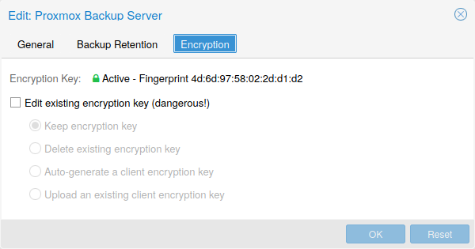

# 7.8. Proxmox Backup Server <a href="#storage_pbs" id="storage_pbs"></a>

存储池类型：`pbs`

该后端允许将 [Proxmox Backup Server](https://www.proxmox.com/en/products/proxmox-backup-server/overview) 像其他存储一样直接集成到 Proxmox VE 中。

Proxmox Backup 存储可通过 Proxmox VE API、CLI 或 Web 界面直接添加。

## 7.8.1. Configuration <a href="#_configuration_5" id="_configuration_5"></a>

该后端支持除 shared 标志以外的所有通用存储属性，shared 标志始终处于设置状态。此外，还提供以下 Proxmox Backup Server 特有属性：

**server**

服务器 IP 或 DNS 名称。必需。

**port**

使用此端口代替默认端口（即 `8007`）。可选。

**username**

Proxmox Backup Server 存储的用户名。必需。


不要忘记在用户名中添加领域。例如，`root@pam` 或 `archiver@pbs`。


**password**

用户密码。该值将保存在 `/etc/pve/priv/storage/<STORAGE-ID>.pw` 下的文件中，并且仅允许 root 用户访问。必需。

**datastore**

要使用的 Proxmox Backup Server 数据存储的 ID。必需。

**fingerprint**

Proxmox Backup Server API TLS 证书的指纹。可以在服务器仪表板中获取，也可以使用 `proxmox-backup-manager cert info` 命令获取。对于自签名证书，或宿主机不信任服务器 CA 的任何其他证书，此项为必需。

**encryption-key**

用于从客户端加密备份数据的密钥。目前仅支持不受密码保护的密钥（不使用密钥派生函数（kdf））。密钥将保存在 `/etc/pve/priv/storage/<STORAGE-ID>.enc` 下的文件中，并且仅允许 root 用户访问。使用特殊值 `autogen` 可通过 `proxmox-backup-client key create --kdf none <path>` 自动生成新密钥。可选。

**master-pubkey**

用于在备份任务中加密备份加密密钥的 RSA 公钥。该密钥将保存在 `/etc/pve/priv/storage/<STORAGE-ID>.master.pem` 下的文件中，并且仅允许 root 用户访问。备份加密密钥的加密副本将附加到每个备份中，并存储在 Proxmox Backup Server 实例上，以用于恢复。可选，需要 `encryption-key`。

**配置示例（`/etc/pve/storage.cfg`）**

```text
pbs: backup
        datastore main
        server enya.proxmox.com
        content backup
        fingerprint 09:54:ef:..snip..:88:af:47:fe:4c:3b:cf:8b:26:88:0b:4e:3c:b2
        prune-backups keep-all=1
        username archiver@pbs
        encryption-key a9:ee:c8:02:13:..snip..:2d:53:2c:98
        master-pubkey 1
```

## 7.8.2. Storage Features <a href="#_storage_features_4" id="_storage_features_4"></a>

Proxmox Backup Server 仅支持备份，备份可以基于块级或文件级。Proxmox VE 对虚拟机使用块级备份，对容器使用文件级备份。

<table>
<caption>表 7. 后端 <code>pbs</code> 的存储功能</caption>


<thead>
<tr>
<th>内容类型</th>
<th>镜像格式</th>
<th>共享</th>
<th>快照</th>
<th>克隆</th>
</tr>
</thead>
<tbody>
<tr>
<td><p>backup</p></td>
<td><p>n/a</p></td>
<td><p>是</p></td>
<td><p>n/a</p></td>
<td><p>n/a</p></td>
</tr>
</tbody>
</table>

## 7.8.3. Encryption <a href="#storage_pbs_encryption" id="storage_pbs_encryption"></a>

[](https://pve.proxmox.com/pve-docs/images/screenshot/storage-pbs-encryption-with-key.png)

可以选择配置使用 GCM 模式的 AES-256 客户端加密。可以通过 Web 界面配置加密，也可以在 CLI 上使用 `encryption-key` 选项进行配置（见上文）。密钥将保存在 `/etc/pve/priv/storage/<STORAGE-ID>.enc` 文件中，该文件仅 root 用户可访问。


没有密钥，备份将无法访问。因此，您应妥善管理密钥，并将其存放在与所备份内容分开的位置。例如，可能会发生这样的情况：您使用存储在某个系统上的密钥备份了整个系统。如果该系统随后因任何原因无法访问并需要恢复，则将无法进行恢复，因为加密密钥会随故障系统一起丢失。


建议您妥善保管密钥，同时确保其易于获取，以便快速进行灾难恢复。因此，最佳存放位置是密码管理器，在那里可以立即找回密钥。作为备用措施，还应将密钥保存到 USB 闪存盘，并将其存放在安全的位置。这样，密钥不依赖于任何系统，同时在紧急情况下仍易于恢复。最后，为应对最坏情况，还应考虑将密钥的纸质副本锁在安全的地方。`paperkey` 子命令可用于创建密钥的 QR 编码版本。以下命令将 `paperkey` 命令的输出发送到文本文件，以便于打印。

```text
# proxmox-backup-client key paperkey /etc/pve/priv/storage/<STORAGE-ID>.enc --output-format text > qrkey.txt
```

此外，还可以使用单个 RSA 主密钥对进行密钥恢复：将所有执行加密备份的客户端配置为使用同一个主公钥，之后所有加密备份都将包含所用 AES 加密密钥的 RSA 加密副本。即使客户端系统不再可用，相应的主私钥也可用于恢复 AES 密钥并解密备份。


主密钥对适用与普通加密密钥相同的安全保管规则。没有私钥副本就无法恢复！`paperkey` 命令支持生成主私钥的纸质副本，以便存放在安全的物理位置。


由于加密在客户端进行管理，您可以在服务器上对未加密备份和加密备份使用同一个数据存储，即使这些备份使用不同的密钥加密也是如此。但是，使用不同密钥的备份之间无法进行重复数据删除，因此通常最好创建单独的数据存储。


如果加密没有带来益处，例如在可信网络中本地运行服务器时，请不要使用加密。从未加密备份中恢复总是更容易。


## 7.8.4. Example: Add Storage over CLI <a href="#_example_add_storage_over_cli" id="_example_add_storage_over_cli"></a>

可以通过以下命令获取可用的 Proxmox Backup Server 数据存储列表：

```text
# pvesm scan pbs <server> <username> [--password <string>] [--fingerprint <string>]
```

然后，可以通过以下命令将其中一个数据存储作为存储添加到整个 Proxmox VE 集群：

```text
# pvesm add pbs <id> --server <server> --datastore <datastore> --username <username> --fingerprint 00:B4:... --password
```

---

来源：[Proxmox VE 官方文档](https://pve.proxmox.com/pve-docs/pve-admin-guide.html) · 版本 9.2.13 · 非官方中文翻译。
