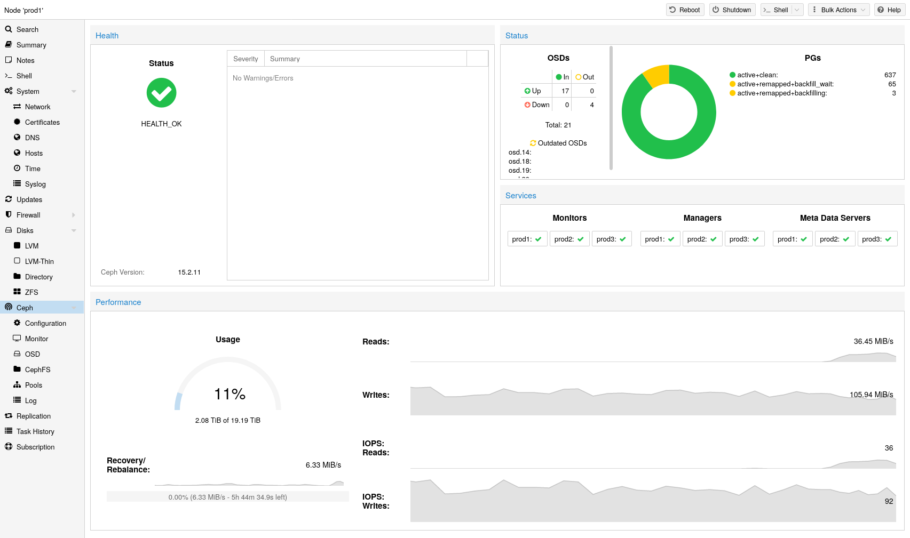

# 8.1. 简介 

Proxmox VE 将计算和存储系统统一起来，也就是说，您可以在集群内的相同物理节点上同时进行计算（处理虚拟机和容器）和复制存储。传统的计算与存储资源孤岛可以整合为单个超融合设备。独立的存储网络（SAN）以及通过网络附加存储（NAS）进行的连接将不复存在。通过集成开源软件定义存储平台 Ceph，Proxmox VE 能够直接在虚拟机管理程序节点上运行和管理 Ceph 存储。

Ceph 是一种分布式对象存储和文件系统，旨在提供卓越的性能、可靠性和可扩展性。

**在 Proxmox VE 上使用 Ceph 具有以下一些优势：**

- 通过 CLI 和 GUI 轻松设置和管理
- 精简置备
- 快照支持
- 自我修复
- 可扩展至 EB 级别
- 提供块、文件系统和对象存储
- 设置具有不同性能和冗余特性的池
- 数据会被复制，从而具备容错能力
- 可在通用硬件上运行
- 无需硬件 RAID 控制器
- 开源

对于中小型部署，可以直接在 Proxmox VE 集群节点上安装 Ceph 服务器，以使用 RADOS 块设备（RBD）或 CephFS（请参阅 [Ceph RADOS 块设备（RBD）](../07-storage/14-ceph-rados-block-devices.md)）。现代硬件拥有强大的 CPU 性能和充足的 RAM，因此可以在同一节点上运行存储服务和虚拟客户机。

为简化管理，Proxmox VE 提供原生集成功能，可在 Proxmox VE 节点上安装和管理 [Ceph](http://ceph.com) 服务，您可以使用内置 Web 界面，也可以使用 *pveceph* 命令行工具。

---

来源：[Proxmox VE 官方文档](https://pve.proxmox.com/pve-docs/pve-admin-guide.html) · 版本 9.2.13 · 非官方中文翻译。
