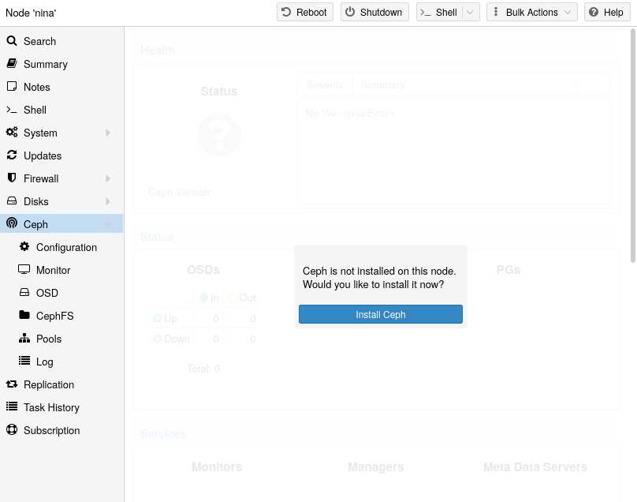
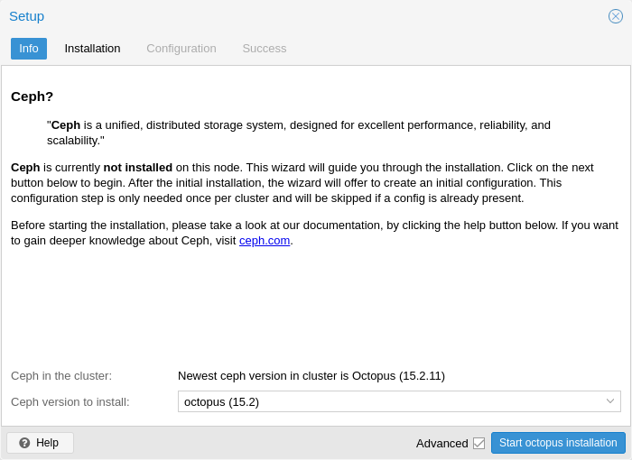
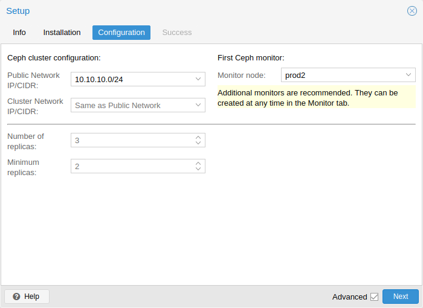

# 8.4. Initial Ceph Installation & Configuration <a href="#pve_ceph_install_wizard" id="pve_ceph_install_wizard"></a>

## 8.4.1. Using the Web-based Wizard <a href="#_using_the_web_based_wizard" id="_using_the_web_based_wizard"></a>

[](https://pve.proxmox.com/pve-docs/images/screenshot/gui-node-ceph-install.png)

With Proxmox VE you have the benefit of an easy to use installation wizard for Ceph. Click on one of your cluster nodes and navigate to the Ceph section in the menu tree. If Ceph is not already installed, you will see a prompt offering to do so.

The wizard is divided into multiple sections, where each needs to finish successfully, in order to use Ceph.

First you need to choose which Ceph version you want to install. Prefer the one from your other nodes, or the newest if this is the first node you install Ceph.

After starting the installation, the wizard will download and install all the required packages from Proxmox VE’s Ceph repository.

[](https://pve.proxmox.com/pve-docs/images/screenshot/gui-node-ceph-install-wizard-step0.png)

After finishing the installation step, you will need to create a configuration. This step is only needed once per cluster, as this configuration is distributed automatically to all remaining cluster members through Proxmox VE’s clustered [configuration file system (pmxcfs)](../06-pmxcfs/README.md#chapter_pmxcfs).

The configuration step includes the following settings:

<a id="pve_ceph_wizard_networks"></a>


- **Public Network:** This network will be used for public storage communication (e.g., for virtual machines using a Ceph RBD backed disk, or a CephFS mount), and communication between the different Ceph services. This setting is required.   
   Separating your Ceph traffic from the Proxmox VE cluster communication (corosync), and possibly the front-facing (public) networks of your virtual guests, is highly recommended. Otherwise, Ceph’s high-bandwidth IO-traffic could cause interference with other low-latency dependent services.
- **Cluster Network:** Specify to separate the [OSD](07-pve-ceph-osds.md#pve_ceph_osds) replication and heartbeat traffic as well. This setting is optional.   
   Using a physically separated network is recommended, as it will relieve the Ceph public and the virtual guests network, while also providing a significant Ceph performance improvements.   
   The Ceph cluster network can be configured and moved to another physically separated network at a later time.

[](https://pve.proxmox.com/pve-docs/images/screenshot/gui-node-ceph-install-wizard-step2.png)

You have two more options which are considered advanced and therefore should only be changed if you know what you are doing.

- **Number of replicas**: Defines how often an object is replicated.
- **Minimum replicas**: Defines the minimum number of required replicas for I/O to be marked as complete.

Additionally, you need to choose your first monitor node. This step is required.

That’s it. You should now see a success page as the last step, with further instructions on how to proceed. Your system is now ready to start using Ceph. To get started, you will need to create some additional [monitors](05-pve-ceph-monitors.md#pve_ceph_monitors), [OSDs](07-pve-ceph-osds.md#pve_ceph_osds) and at least one [pool](09-pve-ceph-pools.md#pve_ceph_pools).

The rest of this chapter will guide you through getting the most out of your Proxmox VE based Ceph setup. This includes the aforementioned tips and more, such as [CephFS](13-pveceph-fs.md#pveceph_fs), which is a helpful addition to your new Ceph cluster.

## 8.4.2. CLI Installation of Ceph Packages <a href="#pve_ceph_install" id="pve_ceph_install"></a>

Alternatively to the recommended Proxmox VE Ceph installation wizard available in the web interface, you can use the following CLI command on each node:

Generator: GNU source-highlight by Lorenzo Bettini http://www.lorenzobettini.it http://www.gnu.org/software/src-highlite

```text
pveceph install
```

This sets up an `apt` package repository in `/etc/apt/sources.list.d/ceph.sources` and installs the required software.

## 8.4.3. Initial Ceph configuration via CLI <a href="#_initial_ceph_configuration_via_cli" id="_initial_ceph_configuration_via_cli"></a>

Use the Proxmox VE Ceph installation wizard (recommended) or run the following command on one node:

Generator: GNU source-highlight by Lorenzo Bettini http://www.lorenzobettini.it http://www.gnu.org/software/src-highlite

```text
pveceph init --network 10.10.10.0/24
```

This creates an initial configuration at `/etc/pve/ceph.conf` with a dedicated network for Ceph. This file is automatically distributed to all Proxmox VE nodes, using [pmxcfs](../06-pmxcfs/README.md#chapter_pmxcfs). The command also creates a symbolic link at `/etc/ceph/ceph.conf`, which points to that file. Thus, you can simply run Ceph commands without the need to specify a configuration file.

---

来源：[Proxmox VE 官方文档](https://pve.proxmox.com/pve-docs/pve-admin-guide.html) · 版本 9.2.13 · 非官方中文翻译。
