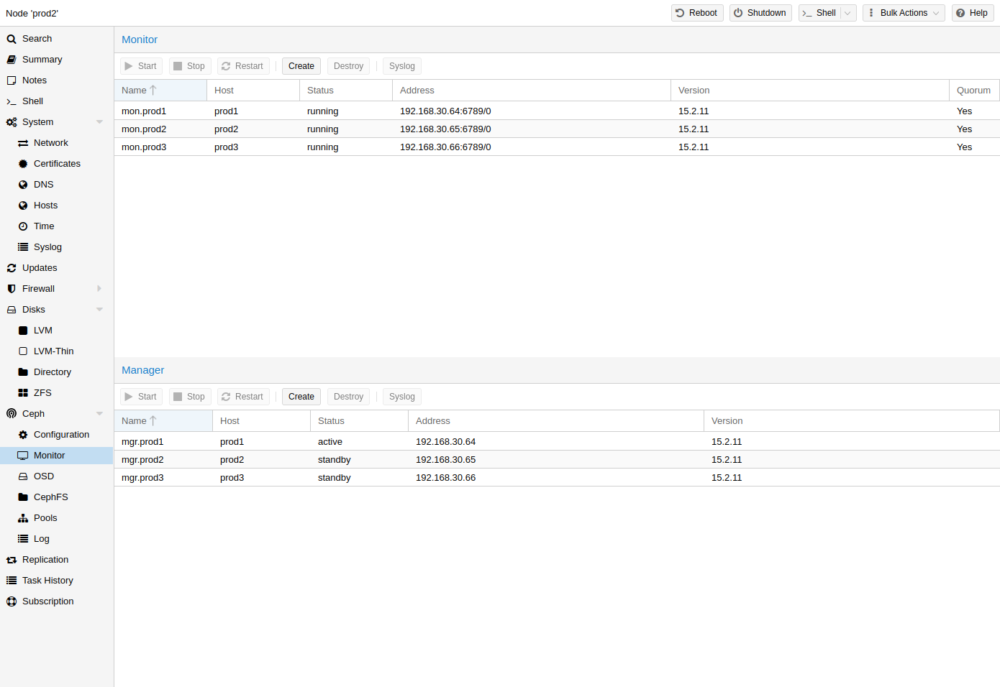

# 8.5. Ceph Monitor <a href="#pve_ceph_monitors" id="pve_ceph_monitors"></a>

[](https://pve.proxmox.com/pve-docs/images/screenshot/gui-ceph-monitor.png)

Ceph 监视器（MON）[\[1\]](#note-382f5df6-1) 维护集群映射的主副本。为实现高可用性，您至少需要 3 个监视器。如果您使用了安装向导，则已经安装了一个监视器。只要您的集群规模属于中小型，就不需要超过 3 个监视器。只有真正大型的集群才需要更多监视器。

## 8.5.1. Create Monitors <a href="#pveceph_create_mon" id="pveceph_create_mon"></a>

在要放置监视器的每个节点上（建议三个监视器），通过 GUI 中的 *Ceph → Monitor* 选项卡创建一个监视器，或运行：

```text
pveceph mon create
```

## 8.5.2. Destroy Monitors <a href="#pveceph_destroy_mon" id="pveceph_destroy_mon"></a>

要通过 GUI 移除 Ceph 监视器，请先在树视图中选择一个节点，然后转到 **Ceph → Monitor** 面板。选择 MON，然后单击 **Destroy** 按钮。

要通过 CLI 移除 Ceph 监视器，请先连接到正在运行 MON 的节点。然后执行以下命令：

```text
pveceph mon destroy
```


仲裁至少需要三个监视器。


## 注释

### 注释 1 <a href="#note-382f5df6-1" id="note-382f5df6-1"></a>

Ceph 监视器 [https://docs.ceph.com/en/tentacle/rados/configuration/mon-config-ref/](https://docs.ceph.com/en/tentacle/rados/configuration/mon-config-ref/)

---

来源：[Proxmox VE 官方文档](https://pve.proxmox.com/pve-docs/pve-admin-guide.html) · 版本 9.2.13 · 非官方中文翻译。
