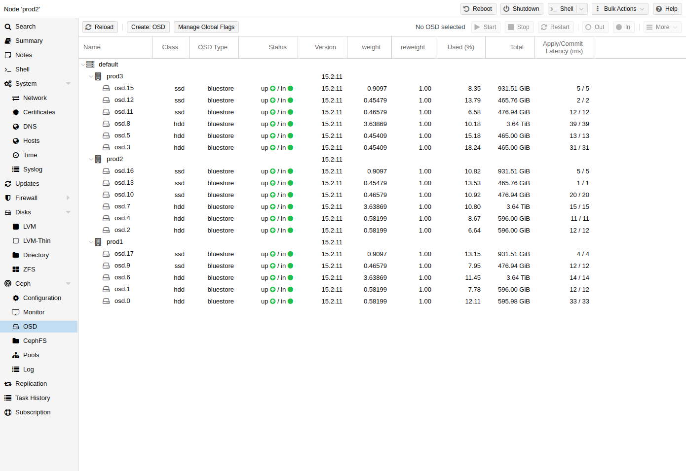

# 8.7. Ceph OSDs <a href="#pve_ceph_osds" id="pve_ceph_osds"></a>

[](https://pve.proxmox.com/pve-docs/images/screenshot/gui-ceph-osd-status.png)

Ceph 对象存储守护进程（**O**bject **S**torage **D**aemons）通过网络为 Ceph 存储对象。建议每块物理磁盘使用一个 OSD。

## 8.7.1. Create OSDs <a href="#pve_ceph_osd_create" id="pve_ceph_osd_create"></a>

您可以通过 Proxmox VE Web 界面或 CLI 使用 `pveceph` 创建 OSD。例如：

```text
pveceph osd create /dev/sd[X]
```


我们建议 Ceph 集群至少包含三个节点和至少 12 个 OSD，并在各节点之间均匀分布。


如果磁盘此前已被使用（例如用于 ZFS 或作为 OSD），您需要先清除所有相关使用痕迹。要删除分区表、引导扇区和任何其他 OSD 残留，可以使用以下命令：

```text
ceph-volume lvm zap /dev/sd[X] --destroy
```


上述命令将销毁磁盘上的所有数据！


**Ceph Bluestore**

从 Ceph Kraken 版本开始，引入了一种名为 Bluestore [\[1\]](#note-1ca5c74f-1) 的新 Ceph OSD 存储类型。自 Ceph Luminous 起，创建 OSD 时默认使用此类型。

```text
pveceph osd create /dev/sd[X]
```

**Block.db 和 block.wal**

如果您想为 OSD 使用单独的 DB/WAL 设备，可以通过 *-db\_dev* 和 *-wal\_dev* 选项指定。如果未单独指定 WAL，则会将其与 DB 放在一起。

```text
pveceph osd create /dev/sd[X] -db_dev /dev/sd[Y] -wal_dev /dev/sd[Z]
```

您可以分别通过 *-db\_size* 和 *-wal\_size* 参数直接指定它们的大小。如果未给出这些参数，将按顺序使用以下值：

- bluestore\_block\_{db,wal}\_size，来自 Ceph 配置……

  - … database, section *osd*
  - … database, section *global*
  - … file, section *osd*
  - … file, section *global*
- OSD 大小的 10%（DB）/1%（WAL）


DB 存储 BlueStore 的内部元数据，WAL 是 BlueStore 的内部日志或预写式日志。建议使用高速 SSD 或 NVRAM 以获得更好的性能。


**Ceph Filestore**

在 Ceph Luminous 之前，Filestore 是 Ceph OSD 的默认存储类型。从 Ceph Nautilus 开始，Proxmox VE 不再支持使用 *pveceph* 创建此类 OSD。如果您仍想创建 filestore OSD，请直接使用 *ceph-volume*。

```text
ceph-volume lvm create --filestore --data /dev/sd[X] --journal /dev/sd[Y]
```

## 8.7.2. Destroy OSDs <a href="#pve_ceph_osd_destroy" id="pve_ceph_osd_destroy"></a>

如果 OSD 或其磁盘出现问题，请先尝试对其进行 [故障排除](15-pve-ceph-mon-and-ts.md)，以确定是否需要 [更换](14-ceph-maintenance.md#pve_ceph_osd_replace)。

要销毁 OSD，请转到 *\<Node\> → Ceph → OSD* 面板，或在 OSD 所在节点上使用上述 CLI 命令。

1. 确保集群有足够的空间来应对 OSD 的移除。在 *Ceph → OSD* 面板中，如果待销毁的 OSD 仍处于 `up` 和 `in` 状态（`AVAIL` 为非零值），请确保所有 OSD 的 `Used (%)` 值都远低于 `nearfull_ratio`，后者的默认值为 `85%`。

   这样可以降低即将进行的重新均衡所带来的风险，重新均衡可能导致 OSD 写满，从而阻塞 Ceph 池上的 I/O。

   使用以下命令可在 CLI 上获取相同的信息：

   ```text
   ceph osd df tree
   ```
2. 如果待销毁的 OSD 尚未处于 `out` 状态，请选择该 OSD，然后单击 **Out**。这会将其排除在数据分布之外，并启动重新均衡。

   以下命令可执行相同操作：

   ```text
   ceph osd out <id>
   ```
3. 如果条件允许，请等待 Ceph 完成重新均衡，以始终保有足够的副本。OSD 将会变空；清空后，它会显示 *0 PGs*。
4. 单击 **Stop**。如果目前尚无法安全停止，将会出现警告，此时应单击 **Cancel**。稍等片刻后再试。

   以下命令可用于检查停止 OSD 是否安全，并用于停止 OSD：

   ```text
   ceph osd ok-to-stop <id>
   pveceph stop --service osd.<id>
   ```
5. 最后：

   要从 Ceph 中移除 OSD 并删除所有磁盘数据，请先单击 **More → Destroy**。启用清理选项，以清除分区表和其他结构。这样便可以立即在 Proxmox VE 中重新使用该磁盘。然后，单击 **Remove**。

   用于销毁 OSD 的 CLI 命令是：

   ```text
   pveceph osd destroy <id> [--cleanup]
   ```

## 注释

### 注释 1 <a href="#note-1ca5c74f-1" id="note-1ca5c74f-1"></a>

Ceph Bluestore [https://ceph.com/community/new-luminous-bluestore/](https://ceph.com/community/new-luminous-bluestore/)

---

来源：[Proxmox VE 官方文档](https://pve.proxmox.com/pve-docs/pve-admin-guide.html) · 版本 9.2.13 · 非官方中文翻译。
