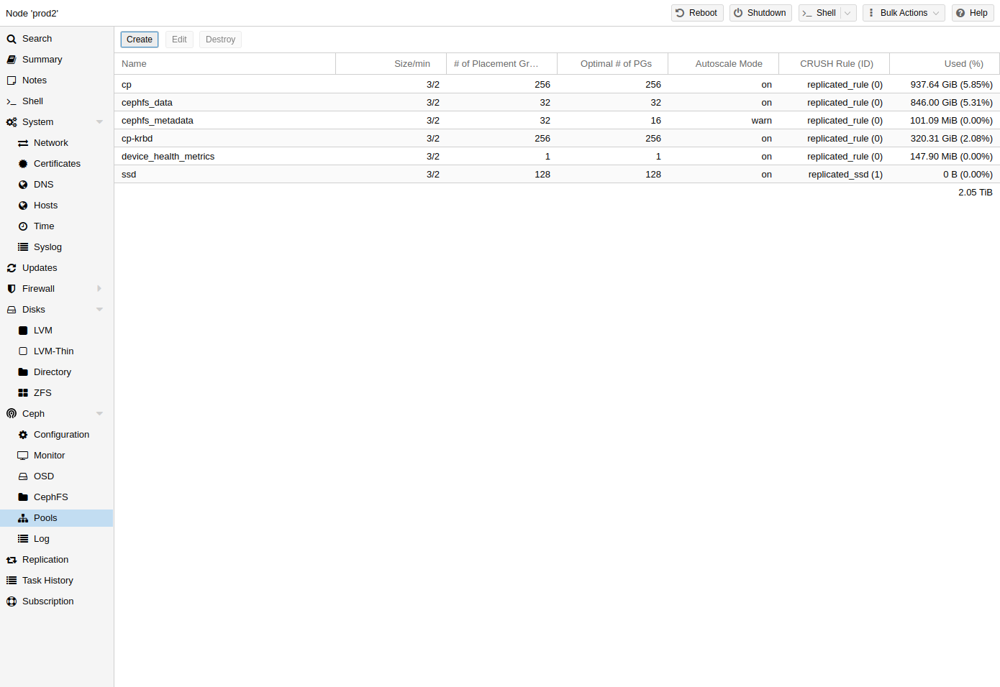
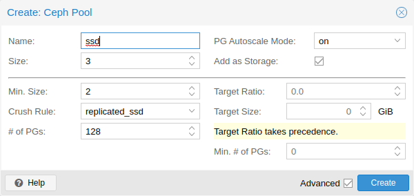

# 8.9. Ceph Pools <a href="#pve_ceph_pools" id="pve_ceph_pools"></a>

[](https://pve.proxmox.com/pve-docs/images/screenshot/gui-ceph-pools.png)

池是用于存储对象的逻辑组。它包含一组对象，称为 **P**lacement **G**roups（`PG`，`pg_num`）。

## 8.9.1. Create and Edit Pools <a href="#_create_and_edit_pools" id="_create_and_edit_pools"></a>

您可以通过命令行或任何 Proxmox VE 宿主机的 Web 界面，在 **Ceph → Pools** 下创建和编辑池。

当未给出任何选项时，我们会默认设置 **128 PGs**、**3 个副本的 size** 和 **2 个副本的 min\_size**，以确保任何 OSD 发生故障时都不会造成数据丢失。


**不要将 min\_size 设置为 1**。对于 min\_size 为 1 的副本池，当对象只有 1 个副本时仍允许对其执行 I/O，这可能导致数据丢失、PG 不完整或无法找到对象。


建议您启用 PG-Autoscaler，或根据您的部署计算 PG 数量。您可以在线找到相关公式和 PG 计算器 [\[1\]](#note-91ded4b9-1)。从 Ceph Nautilus 起，您可以在完成设置后更改 PG [\[placement\_groups\]](#_footnote_placement_groups) 的数量。

PG 自动缩放器 [\[autoscaler\]](#_footnote_autoscaler) 可以在后台自动调整池的 PG 数量。设置 `Target Size` 或 `Target Ratio` 高级参数有助于 PG-Autoscaler 做出更好的决策。

**通过 CLI 创建池的示例**

```text
pveceph pool create <pool-name> --add_storages
```


如果您还想自动为池定义存储，请在 Web 界面中保持选中“Add as Storage”复选框，或在创建池时使用命令行选项 *--add\_storages*。


### Pool Options <a href="#_pool_options" id="_pool_options"></a>

[](https://pve.proxmox.com/pve-docs/images/screenshot/gui-ceph-pool-create.png)

以下选项可在创建池时使用，其中部分选项也可在编辑池时使用。

**名称**

池的名称。该名称必须唯一，且之后无法更改。

**大小**

每个对象的副本数。Ceph 始终尝试为对象保留此数量的副本。默认值：`3`。

**PG 自动缩放模式**

池的自动 PG 缩放模式   
[\[自动缩放器\]](#_footnote_autoscaler)  
。如果设置为 `warn`，当池的 PG 数量不是最佳值时，会生成警告消息。默认值：`warn`。

**添加为存储**

使用新池配置 VM 或容器存储。默认值：`true`（仅在创建时可见）。

**高级选项**

**最小大小**

每个对象的最小副本数。如果 PG 的副本数少于此值，Ceph 将拒绝该池上的 I/O。默认值：`2`。

**CRUSH 规则**

用于映射集群中对象放置位置的规则。这些规则定义数据在集群中的放置方式。有关基于设备的规则的信息，请参阅 [Ceph CRUSH 和设备类别](10-pve-ceph-device-classes.md)。

**PG 数量**

池在初始时应具有的归置组   
[\[placement\_groups\]](#_footnote_placement_groups)  
 数量。默认值：`128`。

**目标比例**

池中预期数据所占的比例。PG 自动缩放器会结合其他已设置的比例来使用此比例。如果两者均已设置，则此设置优先于 `target size`。

**目标大小**

池中预期数据的估计量。PG 自动缩放器使用此大小来估计最佳 PG 数量。

**最小 PG 数量**

归置组的最小数量。此设置用于微调该池 PG 数量的下限。PG 自动缩放器不会将 PG 合并到低于此阈值。

有关 Ceph 池处理的更多信息，请参阅 Ceph 池操作 [\[4\]](#note-91ded4b9-4)手册。

## 8.9.2. Erasure Coded Pools <a href="#pve_ceph_ec_pools" id="pve_ceph_ec_pools"></a>

纠删码（EC）是一种“前向纠错”编码，可在发生一定量的数据丢失时恢复数据。与副本池相比，纠删码池可以提供更多可用空间，但代价是性能下降。

相比之下：在传统的副本池中，会存储数据的多个副本（`size`）；而在纠删码池中，数据会被拆分为 `k` 个数据块，并附加 `m` 个编码（校验）块。如果数据块丢失，可以使用这些编码块重建数据。

编码块数量 `m` 决定了在不丢失任何数据的情况下可以容忍丢失多少个 OSD。存储的对象总数为 `k + m`。

### Creating EC Pools <a href="#_creating_ec_pools" id="_creating_ec_pools"></a>

可以使用 `pveceph` 命令行工具创建纠删码（EC）池。规划 EC 池时，必须考虑其工作方式与副本池不同这一事实。

The default `min_size` of an EC pool depends on the `m` parameter. If `m = 1`, the `min_size` of the EC pool will be `k`. The `min_size` will be `k + 1` if `m > 1`. The Ceph documentation recommends a conservative `min_size` of `k + 2`
[\[5\]](#note-91ded4b9-5).

如果可用 OSD 少于 `min_size` 个，则对该池的所有 I/O 都将被阻塞，直到再次有足够的 OSD 可用。


规划纠删码池时，请留意 `min_size`，因为它决定了需要有多少个 OSD 可用。否则，I/O 将被阻塞。


例如，一个 `k = 2`、`m = 1` 的 EC 池将具有 `size = 3`、`min_size = 2`，并且在一个 OSD 发生故障时仍可继续运行。如果该池配置为 `k = 2`、`m = 2`，则将为 `size = 4` 和 `min_size = 3`，并且在一个 OSD 丢失时仍可继续运行。

要创建新的 EC 池，请运行以下命令：

```text
pveceph pool create <pool-name> --erasure-coding k=2,m=1
```

可选参数为 `failure-domain` 和 `device-class`。如果需要更改池所使用的任何 EC 配置文件设置，则必须使用新的配置文件创建一个新池。

这将创建一个新的 EC 池，以及用于存储 RBD omap 和其他元数据所需的副本池。最终会有一个 `<pool name>-data` 池和一个 `<pool name>-metadata` 池。默认行为还会创建匹配的存储配置。如果不需要此行为，可以通过提供 `--add_storages 0` 参数将其禁用。手动配置存储时，请记住必须设置 `data-pool` 参数。只有这样，EC 池才会用于存储数据对象。例如：


可选参数 `--size`、`--min_size` 和 `--crush_rule` 将用于副本元数据池，而不会用于纠删码数据池。如果需要更改数据池的 `min_size`，可以稍后再进行更改。无法在纠删码池上更改 `size` 和 `crush_rule` 参数。


如果需要进一步自定义 EC 配置文件，可以直接使用 Ceph 工具创建该配置文件 [\[6\]](#note-91ded4b9-6)，并通过 `profile` 参数指定要使用的配置文件。

例如：

```text
pveceph pool create <pool-name> --erasure-coding profile=<profile-name>
```

### FastEC (`allow_ec_optimizations`) <a href="#_fastec_span_class_monospaced_allow_ec_optimizations_span" id="_fastec_span_class_monospaced_allow_ec_optimizations_span"></a>

Ceph Tentacle 引入了一种名为 FastEC 的新纠删码 I/O 路径，可通过 `allow_ec_optimizations` 标志按池启用。FastEC 为 EC 池增加了部分读取和部分写入功能，显著提升了小块随机 I/O 的性能，而这是虚拟机磁盘 I/O 的主要访问模式。上游建议将其用于由 RBD 和 CephFS 支持的存储 [\[7\]](#note-91ded4b9-7)。

FastEC 有四项要求，由 Ceph 监视器强制执行：

- 池必须是纠删码池；
- 集群必须处于 `require_osd_release` tentacle 或更高版本；
- 纠删码配置文件必须使用支持优化 EC 路径的插件和技术组合：

  <table>


  <thead>
  <tr>
  <th>插件</th>
  <th>技术</th>
  <th>FastEC</th>
  </tr>
  </thead>
  <tbody>
  <tr>
  <td><p><code>isa</code></p></td>
  <td><p><code>reed_sol_van</code></p></td>
  <td><p>是</p></td>
  </tr>
  <tr>
  <td><p><code>isa</code></p></td>
  <td><p><code>cauchy</code></p></td>
  <td><p>否</p></td>
  </tr>
  <tr>
  <td><p><code>jerasure</code></p></td>
  <td><p><code>reed_sol_van</code></p></td>
  <td><p>是</p></td>
  </tr>
  <tr>
  <td><p><code>jerasure</code></p></td>
  <td><p>所有其他</p></td>
  <td><p>否</p></td>
  </tr>
  <tr>
  <td><p><code>lrc</code></p></td>
  <td><p>（任意）</p></td>
  <td><p>否</p></td>
  </tr>
  <tr>
  <td><p><code>shec</code></p></td>
  <td><p>（任意）</p></td>
  <td><p>否</p></td>
  </tr>
  <tr>
  <td><p><code>clay</code></p></td>
  <td><p>（任意）</p></td>
  <td><p>否</p></td>
  </tr>
  </tbody>
  </table>
- 池的条带单元必须是 4096 字节的倍数。默认条带单元满足此要求，因此，只有纠删码配置文件中使用了自定义 `stripe_unit` 的池才需要关注这一点。

如果任何前提条件未满足，`ceph osd pool set <pool>-data allow_ec_optimizations 1` 都会失败并给出描述性错误信息，不会静默降级。

`pveceph` 在创建 EC 配置文件时不会显式设置插件或技术，两者均取自监视器的 `osd_pool_default_erasure_code_profile` 选项（在 Squid 和 Tentacle 上默认均为 `reed_sol_van`）。因此，除非运维人员覆盖了此设置，否则默认即可满足技术要求。可使用以下命令验证：

```text
ceph config get mon osd_pool_default_erasure_code_profile
```

如果输出显示的技术不是 `reed_sol_van`，请更新集群范围的默认设置，或者显式创建一个兼容的配置文件，并在创建池时通过 `profile` 属性传入该配置文件（见上文）。

使用以下命令检查集群版本：

```text
ceph osd dump | grep require_osd_release
```

如果此处报告的版本低于 `tentacle`，请在所有 OSD 完成升级后运行 `ceph osd require-osd-release tentacle`。


`allow_ec_optimizations` 是一个单向开关。在池上启用后，Ceph 监视器会拒绝再次清除该标志，因此回滚需要清空并重新创建池。请仅在测试池上验证 FastEC 适用于您的工作负载后再启用它。


#### Enabling FastEC on a pool <a href="#_enabling_fastec_on_a_pool" id="_enabling_fastec_on_a_pool"></a>

FastEC 通过 `ceph` 命令行按池启用。它既可以设置在新池上，也可以设置在现有（已有数据）的池上。不会发生数据迁移或重新编码，仅会更改池元数据。

要在池上启用 FastEC，请对数据池（通常命名为 `<pool-name>-data`）运行以下命令：

```text
ceph osd pool set <pool-name>-data allow_ec_optimizations 1
```

使用以下命令验证结果：

```text
ceph osd pool get <pool-name>-data allow_ec_optimizations
```

同一命令还会报告任何 EC 池的当前状态，这在审计集群时非常有用。

在已有数据的池上设置该标志时，请注意以下事项：

- **Primary re-election.** FastEC marks data shards 1 through k-1 as non-primary, so PGs whose primary was on one of those shards will re-peer. This is a normal peering event and causes a brief I/O pause per affected PG.
- **Scrub interaction.** Re-peering cancels any in-flight scrub on affected PGs. Those PGs will need to be re-scrubbed after peering completes.

### Adding EC Pools as Storage <a href="#_adding_ec_pools_as_storage" id="_adding_ec_pools_as_storage"></a>

您可以将现有的 EC 池作为存储添加到 Proxmox VE。其操作方式与添加 `RBD` 池相同，但需要额外的 `data-pool` 选项。

```text
pvesm add rbd <storage-name> --pool <replicated-pool> --data-pool <ec-pool>
```


对于不受本地 Proxmox VE 集群管理的任何外部 Ceph 集群，请不要忘记添加 `keyring` 和 `monhost` 选项。


## 8.9.3. Destroy Pools <a href="#_destroy_pools" id="_destroy_pools"></a>

要通过 GUI 销毁池，请在树状视图中选择一个节点，然后转到 **Ceph → Pools** 面板。选择要销毁的池，然后点击 **Destroy** 按钮。要确认销毁该池，您需要输入池名称。

运行以下命令销毁池。指定 *-remove\_storages* 以同时删除关联的存储。

```text
pveceph pool destroy <name>
```


池删除会在后台运行，并且可能需要一些时间。在此过程中，您会注意到集群中的数据使用量逐渐减少。


## 8.9.4. PG Autoscaler <a href="#_pg_autoscaler" id="_pg_autoscaler"></a>

PG 自动缩放器使集群能够考虑每个池中存储的（预期）数据量，并自动选择合适的 pg\_num 值。该功能自 Ceph Nautilus 起可用。

您可能需要先激活 PG 自动缩放器模块，调整才能生效。

```text
ceph mgr module enable pg_autoscaler
```

自动缩放器按池进行配置，具有以下模式：

<table>
<tr>
<td>warn <br/>
</td>
<td>
<p>如果建议的 <code>pg_num</code> 值与当前值相差过大，将发出健康警告。</p>
</td>
</tr>
<tr>
<td>on <br/>
</td>
<td>
<p><code>pg_num</code> 会自动调整，无需任何手动干预。</p>
</td>
</tr>
<tr>
<td>off <br/>
</td>
<td>
<p>不会自动调整 <code>pg_num</code>，并且即使 PG 数量不是最佳值，也不会发出警告。</p>
</td>
</tr>
</table>

可以使用 `target_size`、`target_size_ratio` 和 `pg_num_min` 选项调整缩放因子，以便满足未来的数据存储需求。


默认情况下，如果池的 PG 数量偏差达到 3 倍，自动缩放器就会考虑对其进行调整。这将导致数据放置发生显著变化，并可能给集群带来高负载。


您可以在 Ceph 博客中找到对 PG 自动缩放器更深入的介绍——[Nautilus 新功能：PG 合并和自动调优](https://ceph.io/rados/new-in-nautilus-pg-merging-and-autotuning/)。

## 注释

### 注释 1 <a href="#note-91ded4b9-1" id="note-91ded4b9-1"></a>

PG 计算器 [https://web.archive.org/web/20210301111112/http://ceph.com/pgcalc/](https://web.archive.org/web/20210301111112/http://ceph.com/pgcalc/)

### 注释 placement\_groups <a href="#_footnote_placement_groups" id="_footnote_placement_groups"></a>

归置组 [https://docs.ceph.com/en/tentacle/rados/operations/placement-groups/](https://docs.ceph.com/en/tentacle/rados/operations/placement-groups/)

### 注释 autoscaler <a href="#_footnote_autoscaler" id="_footnote_autoscaler"></a>

自动缩放 [https://docs.ceph.com/en/tentacle/rados/operations/placement-groups/#automated-scaling](https://docs.ceph.com/en/tentacle/rados/operations/placement-groups/#automated-scaling)

### 注释 4 <a href="#note-91ded4b9-4" id="note-91ded4b9-4"></a>

Ceph 池操作 [https://docs.ceph.com/en/tentacle/rados/operations/pools/](https://docs.ceph.com/en/tentacle/rados/operations/pools/)

### 注释 5 <a href="#note-91ded4b9-5" id="note-91ded4b9-5"></a>

Ceph Erasure Coded Pool Recovery [https://docs.ceph.com/en/tentacle/rados/operations/erasure-code/#erasure-coded-pool-recovery](https://docs.ceph.com/en/tentacle/rados/operations/erasure-code/#erasure-coded-pool-recovery)

### 注释 6 <a href="#note-91ded4b9-6" id="note-91ded4b9-6"></a>

Ceph 纠删码配置文件 [https://docs.ceph.com/en/tentacle/rados/operations/erasure-code/#erasure-code-profiles](https://docs.ceph.com/en/tentacle/rados/operations/erasure-code/#erasure-code-profiles)

### 注释 7 <a href="#note-91ded4b9-7" id="note-91ded4b9-7"></a>

Ceph 纠删码 [https://docs.ceph.com/en/tentacle/rados/operations/erasure-code/](https://docs.ceph.com/en/tentacle/rados/operations/erasure-code/)

---

来源：[Proxmox VE 官方文档](https://pve.proxmox.com/pve-docs/pve-admin-guide.html) · 版本 9.2.13 · 非官方中文翻译。
