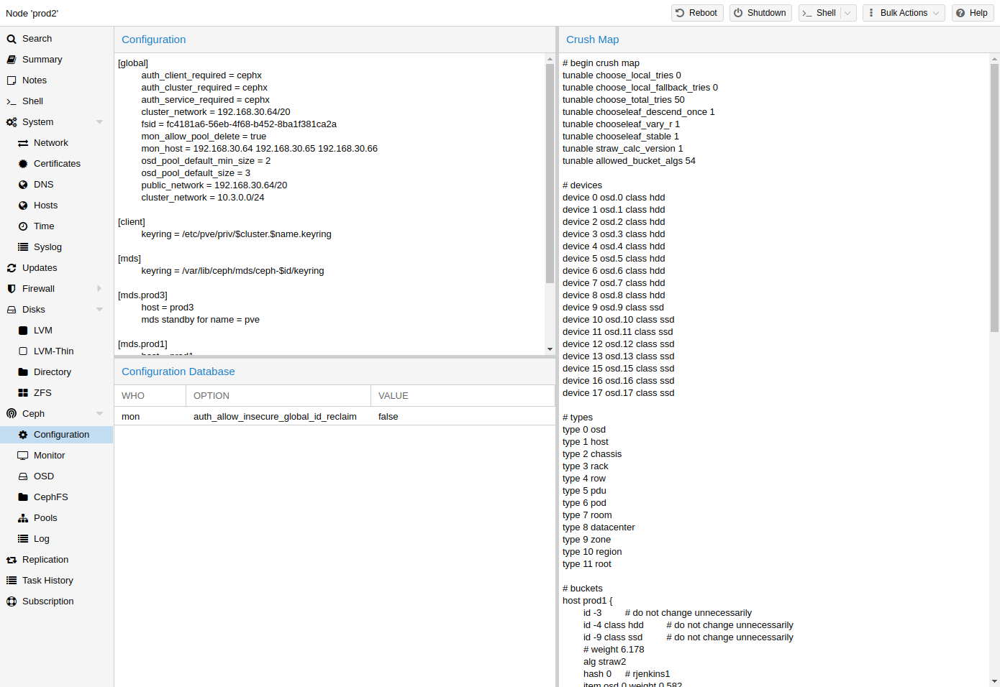

# 8.10. Ceph CRUSH 与设备类别 <a href="#pve_ceph_device_classes" id="pve_ceph_device_classes"></a>

[](https://pve.proxmox.com/pve-docs/images/screenshot/gui-ceph-config.png)

[\[1\]](#note-882796c1-1)（**C**ontrolled **R**eplication **U**nder **S**calable **H**ashing）算法是 Ceph 的基础。

CRUSH 用于计算数据的存储位置和读取位置。其优势在于不需要中央索引服务。CRUSH 使用由 OSD、桶（设备位置）和池规则集（数据复制）组成的映射来工作。


更多信息请参阅 Ceph 文档中的 CRUSH map 一节 [\[2\]](#note-882796c1-2)。


可以更改此映射，以反映不同的复制层次结构。在保持所需分布的同时，可以将对象副本分隔开（例如，按故障域分隔）。

一种常见配置是为不同的 Ceph 池使用不同类别的磁盘。为此，Ceph 从 Luminous 开始引入了设备类别，以满足轻松生成规则集的需求。

可以在 *ceph osd tree* 的输出中查看设备类别。这些类别各自代表一个根桶，可以使用以下命令查看。

```text
ceph osd crush tree --show-shadow
```

上述命令的示例输出：

```text
ID  CLASS WEIGHT  TYPE NAME
-16  nvme 2.18307 root default~nvme
-13  nvme 0.72769     host sumi1~nvme
 12  nvme 0.72769         osd.12
-14  nvme 0.72769     host sumi2~nvme
 13  nvme 0.72769         osd.13
-15  nvme 0.72769     host sumi3~nvme
 14  nvme 0.72769         osd.14
 -1       7.70544 root default
 -3       2.56848     host sumi1
 12  nvme 0.72769         osd.12
 -5       2.56848     host sumi2
 13  nvme 0.72769         osd.13
 -7       2.56848     host sumi3
 14  nvme 0.72769         osd.14
```

要指示池仅在特定设备类别上分布对象，首先需要为该设备类别创建一个规则集：

```text
ceph osd crush rule create-replicated <rule-name> <root> <failure-domain> <class>
```

<table>


<tbody>
<tr>
<td><p>&lt;rule-name&gt;</p></td>
<td><p>规则名称，用于与池关联（可在 GUI 和 CLI 中看到）</p></td>
</tr>
<tr>
<td><p>&lt;root&gt;</p></td>
<td><p>应属于哪个 CRUSH 根（默认 Ceph 根为 "default"）</p></td>
</tr>
<tr>
<td><p>&lt;failure-domain&gt;</p></td>
<td><p>对象应在哪个故障域中分布（通常为 host）</p></td>
</tr>
<tr>
<td><p>&lt;class&gt;</p></td>
<td><p>要使用的 OSD 后备存储类型（例如 nvme、ssd、hdd）</p></td>
</tr>
</tbody>
</table>

规则加入 CRUSH map 后，即可指示池使用该规则集。

```text
ceph osd pool set <pool-name> crush_rule <rule-name>
```


如果池中已包含对象，则必须相应地移动这些对象。根据您的设置，这可能会对集群性能产生很大影响。作为替代方案，您可以创建一个新池并单独移动磁盘。



使用 PG 自动缩放器时，集群中的所有池都必须使用相同类型的 CRUSH 规则，要么全部指定设备类别，要么全部不指定。否则，自动缩放器将跳过受影响的池，其 `pg_num` 也不会得到调整。


## 注释

### 注释 1 <a href="#note-882796c1-1" id="note-882796c1-1"></a>

[https://ceph.com/assets/pdfs/weil-crush-sc06.pdf](https://ceph.com/assets/pdfs/weil-crush-sc06.pdf)

### 注释 2 <a href="#note-882796c1-2" id="note-882796c1-2"></a>

CRUSH map [https://docs.ceph.com/en/tentacle/rados/operations/crush-map/](https://docs.ceph.com/en/tentacle/rados/operations/crush-map/)

---

来源：[Proxmox VE 官方文档](https://pve.proxmox.com/pve-docs/pve-admin-guide.html) · 版本 9.2.13 · 非官方中文翻译。
