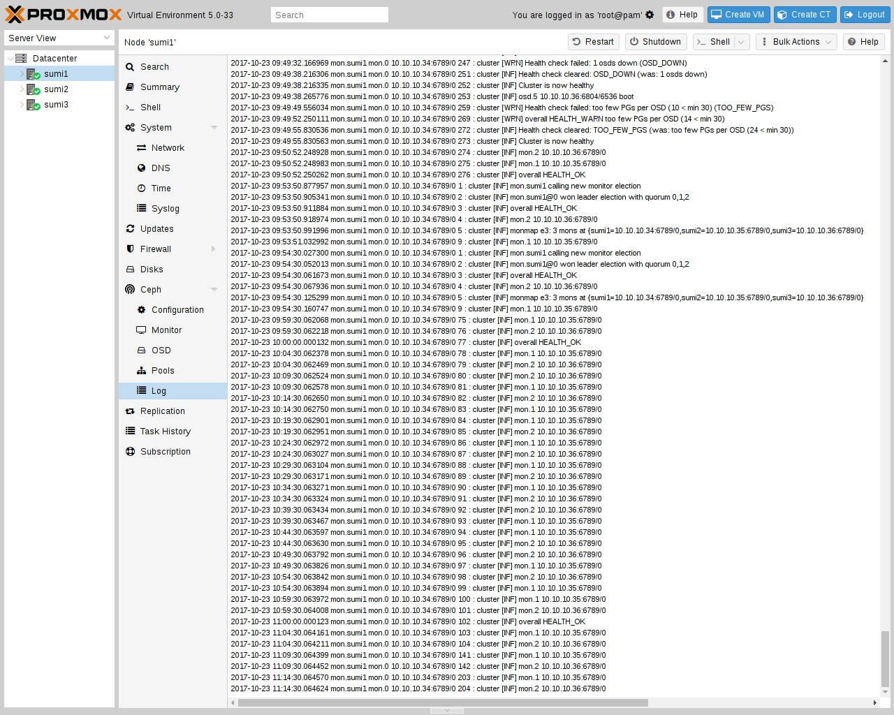

# 8.12. Ceph Client 

Add an [RBD storage](../07-storage/14-ceph-rados-block-devices.md#ceph_rados_block_devices) in the web interface to use a Ceph pool for virtual machine and container disks. For an external cluster, follow the [authentication instructions](../07-storage/14-ceph-rados-block-devices.md#storage_rbd_auth) to configure a dedicated Ceph user and its keyring.

---

来源：[Proxmox VE 官方文档](https://pve.proxmox.com/pve-docs/pve-admin-guide.html) · 版本 9.2.13 · 非官方中文翻译。
