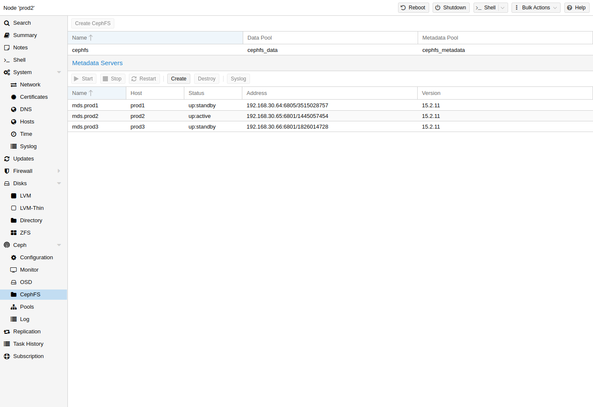

# 8.13. CephFS <a href="#pveceph_fs" id="pveceph_fs"></a>

Ceph 还提供一种文件系统，它运行在与 RADOS 块设备相同的对象存储之上。**元**数**据**服**务**器（`MDS`）用于将 RADOS 支持的对象映射为文件和目录，使 Ceph 能够提供符合 POSIX 标准、支持复制的文件系统。这使您可以轻松配置集群化、高可用性的共享文件系统。Ceph 的元数据服务器可确保文件均匀分布在整个 Ceph 集群中。因此，即使在高负载情况下，也不会使单台宿主机不堪重负，而传统共享文件系统方案（例如 `NFS`）可能会存在这一问题。

[](https://pve.proxmox.com/pve-docs/images/screenshot/gui-node-ceph-cephfs-panel.png)

Proxmox VE 既支持创建超融合 CephFS，也支持使用现有的 [CephFS 作为存储](../07-storage/15-storage-cephfs.md) 来保存备份、ISO 文件和容器模板。

## 8.13.1. 元数据服务器（MDS） <a href="#pveceph_fs_mds" id="pveceph_fs_mds"></a>

CephFS 需要至少配置并运行一个元数据服务器才能正常工作。您可以通过 Proxmox VE Web GUI 的 `Node
-> CephFS` 面板创建 MDS，也可以使用以下命令从命令行创建：

```text
pveceph mds create
```

可以在集群中创建多个元数据服务器，但在默认设置下，同一时间只能有一个处于活动状态。如果某个 MDS 或其节点无响应（或崩溃），另一个 `standby` MDS 将被提升为 `active`。您可以在创建时使用 *hotstandby* 参数选项，加快活动 MDS 与备用 MDS 之间的交接；如果已经创建了 MDS，也可以设置/添加：

```text
mds standby replay = true
```

在 `/etc/pve/ceph.conf` 中相应的 MDS 部分。启用此选项后，指定的 MDS 将保持 `warm` 状态并轮询活动 MDS，以便在出现任何问题时更快接管。


这种主动轮询会给您的系统和活动 `MDS` 带来额外的性能开销。


**多个活动 MDS**

自 Luminous（12.2.x）起，您可以同时运行多个活动元数据服务器，但通常只有在并行运行大量客户端时才有用。否则，`MDS` 很少会成为系统瓶颈。如果要进行此设置，请参阅 Ceph 文档。[\[1\]](#note-88da87b0-1)

## 8.13.2. 创建 CephFS <a href="#pveceph_fs_create" id="pveceph_fs_create"></a>

借助 Proxmox VE 对 CephFS 的集成，您可以轻松通过 Web 界面、CLI 或外部 API 接口创建 CephFS。要实现这一点，需要满足一些先决条件：

**成功设置 CephFS 的先决条件：**

- [安装 Ceph 软件包](04-pve-ceph-install-wizard.md#pve_ceph_install)——如果之前已经安装过，您可能需要在已更新到最新状态的系统上重新运行，以确保安装所有与 CephFS 相关的软件包。
- [设置监视器](05-pve-ceph-monitors.md)
- [设置您的 OSD](05-pve-ceph-monitors.md)
- [设置至少一个 MDS](#pveceph_fs_mds)

完成上述步骤后，您只需通过 Web GUI 的 `Node -> CephFS` 面板或命令行工具 `pveceph` 即可创建 CephFS，例如：

```text
pveceph fs create --pg_num 128 --add-storage
```

这会创建名为 *cephfs* 的 CephFS，使用名为 *cephfs\_data*、具有 *128* 个归置组的数据池，以及名为 *cephfs\_metadata*、归置组数量为数据池四分之一（`32`）的元数据池。请查看 [Proxmox VE 管理的 Ceph 池章节](09-pve-ceph-pools.md) 或访问 Ceph 文档，了解适合您设置的归置组数量（`pg_num`）的更多信息   
[\[placement\_groups\]](09-pve-ceph-pools.md#footnote_placement_groups)  
。此外，*--add-storage* 参数会在 CephFS 成功创建后将其添加至 Proxmox VE 存储配置。

## 8.13.3. 销毁 CephFS <a href="#destroy_cephfs" id="destroy_cephfs"></a>


销毁 CephFS 将使其中的所有数据无法使用。此操作无法撤销！


要彻底且妥善地移除 CephFS，需要执行以下步骤：

- 断开所有非 Proxmox VE 客户端的连接（例如，在客户机中卸载 CephFS）。
- 禁用所有相关的 CephFS Proxmox VE 存储条目（以防止其被自动挂载）。
- 从客户机中移除要销毁的 CephFS 上所有已使用的资源（例如 ISO）。
- 在所有集群节点上使用以下命令手动卸载 CephFS 存储：

  ```text
  umount /mnt/pve/<STORAGE-NAME>
  ```

  其中，`<STORAGE-NAME>` 是您的 Proxmox VE 中 CephFS 存储的名称。
- 现在，通过停止或销毁这些元数据服务器，确保没有元数据服务器（`MDS`）在为该 CephFS 运行。这可以通过 Web 界面或命令行界面完成；对于后者，您需要执行以下命令：

  ```text
  pveceph stop --service mds.NAME
  ```

  以停止它们，或者

  ```text
  pveceph mds destroy NAME
  ```

  以销毁它们。

  请注意，当活动 `MDS` 停止或被移除时，备用服务器会自动提升为活动状态，因此最好先停止所有备用服务器。
- 现在，您可以使用以下命令销毁 CephFS：

  ```text
  pveceph fs destroy NAME --remove-storages --remove-pools
  ```

  这还会自动销毁底层 Ceph 池，并从 pve 配置中移除这些存储。

完成这些步骤后，CephFS 应该已被完全移除；如果您还有其他 CephFS 实例，可以重新启动已停止的元数据服务器，让它们充当备用服务器。

## 注释

### 注释 1 <a href="#note-88da87b0-1" id="note-88da87b0-1"></a>

配置多个活动 MDS 守护进程 [https://docs.ceph.com/en/tentacle/cephfs/multimds/](https://docs.ceph.com/en/tentacle/cephfs/multimds/)

---

来源：[Proxmox VE 官方文档](https://pve.proxmox.com/pve-docs/pve-admin-guide.html) · 版本 9.2.13 · 非官方中文翻译。
