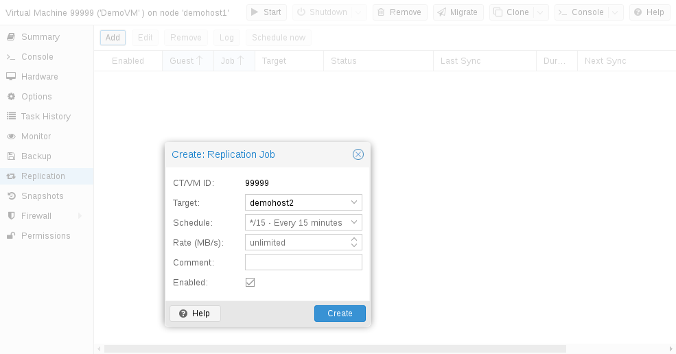

# 9.4. 管理作业 

您可以使用 Web GUI 轻松创建、修改和删除复制作业。此外，还可以使用命令行界面（CLI）工具 `pvesr` 完成这些操作。

在 Web GUI 中，可以在所有级别（数据中心、节点、虚拟客户机）找到复制面板。它们的区别在于显示哪些作业：全部作业、节点特定作业或客户机特定作业。

添加新作业时，需要指定客户机（如果尚未选择）以及目标节点。复制 [计划](02-pvesr-schedule-time-format.md) 可以设置，以替代默认值 `all
15 minutes`。可以对复制作业施加速率限制。速率限制有助于将存储负载保持在可接受的范围。

复制作业由集群范围内唯一的 ID 标识。此 ID 由 VMID 和作业编号组成。只有使用 CLI 工具时才必须手动指定此 ID。

---

来源：[Proxmox VE 官方文档](https://pve.proxmox.com/pve-docs/pve-admin-guide.html) · 版本 9.2.13 · 非官方中文翻译。
