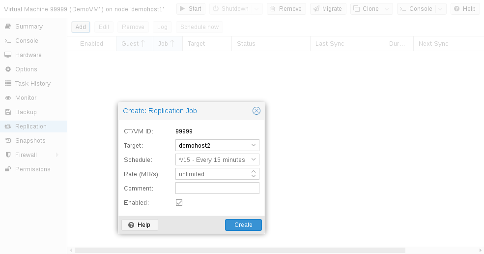

# 9\. 存储复制 <a href="#chapter_pvesr" id="chapter_pvesr"></a>

`pvesr` 命令行工具用于管理 Proxmox VE 存储复制框架。存储复制为使用本地存储的客户机提供冗余，并缩短迁移时间。

它会将客户机卷复制到另一个节点，因此无需使用共享存储即可使所有数据可用。复制使用快照来最大限度地减少通过网络发送的流量。因此，在初始完全同步之后，仅增量发送新数据。如果节点发生故障，客户机数据仍可在副本所在节点上使用。

复制会按可配置的时间间隔自动进行。最短复制间隔为一分钟，最长间隔为每周一次。用于指定这些间隔的格式是 `systemd` 日历事件的子集，请参阅 [计划格式](#pvesr_schedule_time_format) 一节：

可以将一台客户机复制到多个目标节点，但不能向同一目标节点复制两次。

可以限制每次复制的带宽，以避免存储或服务器过载。

如果客户机迁移到的节点已经是其复制目标，则只需传输自上次复制以来的更改（所谓的 `deltas`）。这可显著缩短所需时间。如果将客户机迁移到复制目标节点，复制方向会自动切换。

例如：VM100 当前位于 `nodeA`，并复制到 `nodeB`。您将其迁移到 `nodeB`，因此现在它会自动从 `nodeB` 复制回 `nodeA`。

如果迁移到的节点不是客户机的复制目标，则必须传输整个磁盘数据。迁移后，复制作业会继续将此客户机复制到配置的节点。


高可用性可以与存储复制结合使用，但在上次同步时间与节点故障时间之间可能会丢失一些数据。


## 9.1. 支持的存储类型 <a href="#supported_storage_types" id="supported_storage_types"></a>

<table>
<caption>表 16. 存储类型</caption>


<thead>
<tr>
<th>描述</th>
<th>插件类型</th>
<th>快照</th>
<th>稳定</th>
</tr>
</thead>
<tbody>
<tr>
<td><p>ZFS（本地）</p></td>
<td><p>zfspool</p></td>
<td><p>是</p></td>
<td><p>是</p></td>
</tr>
</tbody>
</table>

## 9.2. 计划格式 <a href="#pvesr_schedule_time_format" id="pvesr_schedule_time_format"></a>

复制使用 [日历事件](../25-calendar-events/README.md#chapter_calendar_events) 来配置计划。

## 9.3. 错误处理 <a href="#error_handling" id="error_handling"></a>

如果复制作业遇到问题，它会进入错误状态。在此状态下，配置的复制间隔会暂时暂停。系统会每隔 30 分钟重试失败的复制。一旦成功，原来的计划就会重新激活。

### 9.3.1. 可能的问题 <a href="#possible_issues" id="possible_issues"></a>

以下列出了一些最常见的问题。根据您的部署情况，可能还有其他原因。

- 网络未正常工作。
- 复制目标存储上没有剩余可用空间。
- 目标节点上无法使用具有相同存储 ID 的存储。


您始终可以使用复制日志来找出问题的原因。


### 9.3.2. 发生错误时迁移客户机 <a href="#migrating_a_guest_in_case_of_error" id="migrating_a_guest_in_case_of_error"></a>

发生严重错误时，虚拟客户机可能会卡在故障节点上。此时需要手动将其重新迁移到正常工作的节点。

### 9.3.3. 示例 <a href="#example_2" id="example_2"></a>

假设您有两个客户机（VM 100 和 CT 200）运行在节点 A 上，并复制到节点 B。节点 A 发生故障且无法重新上线。现在，您必须手动将客户机迁移到节点 B。

- 通过 ssh 连接到节点 B，或通过 Web UI 打开其 Shell
- 检查集群是否具有仲裁

  ```text
  # pvecm status
  ```
- 如果没有仲裁，我们强烈建议先解决此问题，使节点恢复可操作状态。仅当目前无法做到这一点时，才可使用以下命令在当前节点上强制达到仲裁：

  ```text
  # pvecm expected 1
  ```


设置 `expected votes` 后，务必避免任何影响集群的更改（例如添加/移除节点、存储、虚拟客户机）。仅使用它来让关键客户机恢复运行，或解决仲裁问题本身。


- 将两个客户机配置文件从原节点 A 移动到节点 B：

  ```text
  # mv /etc/pve/nodes/A/qemu-server/100.conf /etc/pve/nodes/B/qemu-server/100.conf
  # mv /etc/pve/nodes/A/lxc/200.conf /etc/pve/nodes/B/lxc/200.conf
  ```
- 现在可以重新启动这些客户机：

  ```text
  # qm start 100
  # pct start 200
  ```

请记得将 VMID 和节点名称替换为各自的值。

## 9.4. 管理作业 <a href="#managing_jobs" id="managing_jobs"></a>

[](https://pve.proxmox.com/pve-docs/images/screenshot/gui-qemu-add-replication-job.png)

您可以使用 Web GUI 轻松创建、修改和删除复制作业。此外，还可以使用命令行界面（CLI）工具 `pvesr` 完成这些操作。

在 Web GUI 中，可以在所有级别（数据中心、节点、虚拟客户机）找到复制面板。它们的区别在于显示哪些作业：全部作业、节点特定作业或客户机特定作业。

添加新作业时，需要指定客户机（如果尚未选择）以及目标节点。复制 [计划](#pvesr_schedule_time_format) 可以设置，以替代默认值 `all
15 minutes`。可以对复制作业施加速率限制。速率限制有助于将存储负载保持在可接受的范围。

复制作业由集群范围内唯一的 ID 标识。此 ID 由 VMID 和作业编号组成。只有使用 CLI 工具时才必须手动指定此 ID。

## 9.5. 网络 <a href="#network" id="network"></a>

默认情况下，复制流量与客户机迁移流量使用同一网络。如果未设置迁移网络，则复制流量会转而默认使用管理网络。

要为复制流量使用不同的网络，请配置 `Replication Network`（在 Web 界面的 `Datacenter -> Options ->
Replication Settings` 下），或设置 `replication` 属性（位于 `datacenter.cfg` 文件中）：

```text
# use dedicated replication network
replication: secure,network=10.1.2.0/24
```

## 9.6. 命令行界面示例 <a href="#command_line_interface_examples" id="command_line_interface_examples"></a>

为 ID 为 100 的客户机创建一个每 5 分钟运行一次、带宽限制为 10 Mbps（兆字节每秒）的复制作业。

```text
# pvesr create-local-job 100-0 pve1 --schedule "*/5" --rate 10
```

禁用 ID 为 `100-0` 的活动作业。

```text
# pvesr disable 100-0
```

启用 ID 为 `100-0` 的已停用作业。

```text
# pvesr enable 100-0
```

将 ID 为 `100-0` 的作业的计划间隔更改为每小时一次。

```text
# pvesr update 100-0 --schedule '*/00'
```

---

来源：[Proxmox VE 官方文档](https://pve.proxmox.com/pve-docs/pve-admin-guide.html) · 版本 9.2.13 · 非官方中文翻译。
