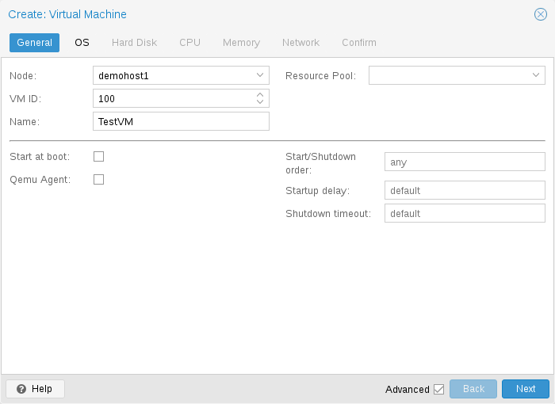
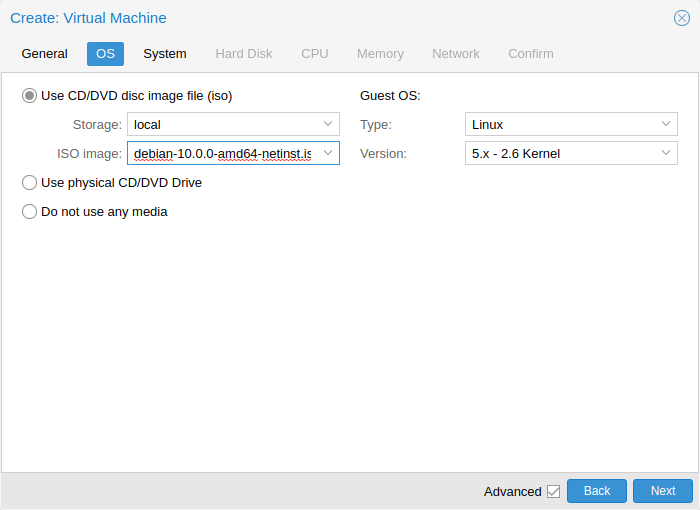
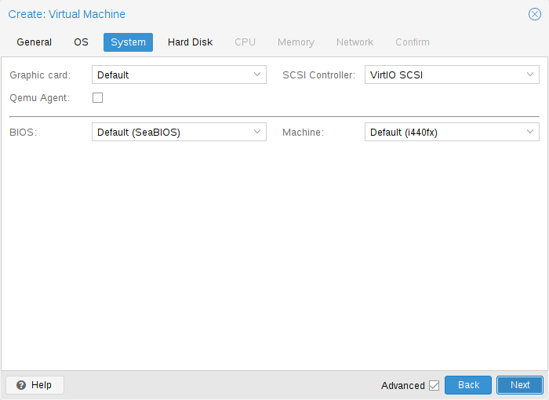
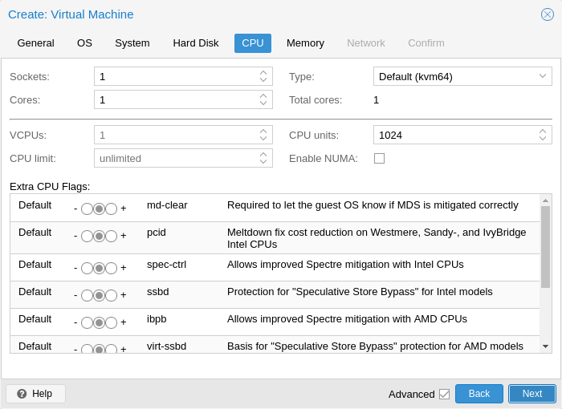
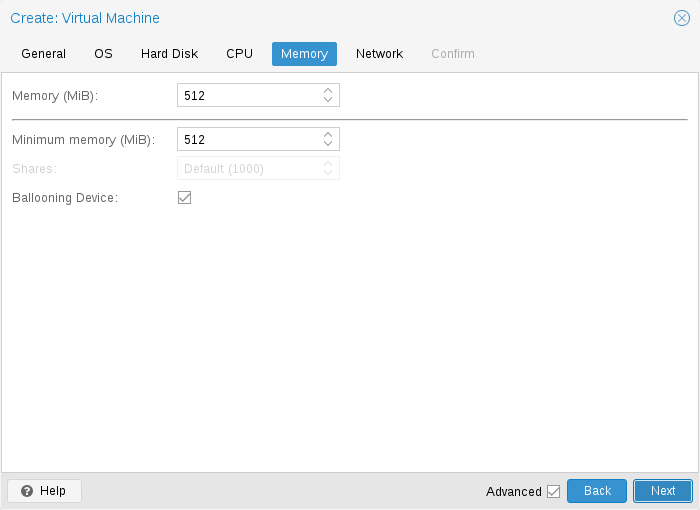
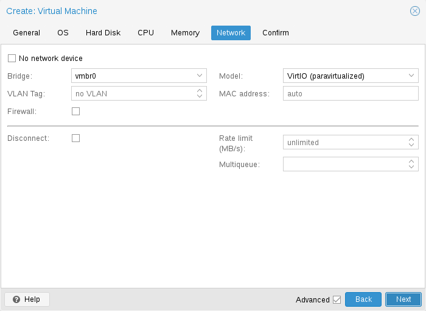
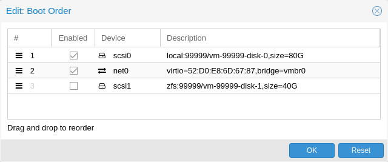
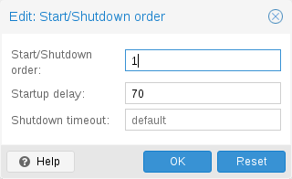

# 10.2. Virtual Machines Settings <a href="#qm_virtual_machines_settings" id="qm_virtual_machines_settings"></a>

Generally speaking Proxmox VE tries to choose sane defaults for virtual machines (VM). Make sure you understand the meaning of the settings you change, as it could incur a performance slowdown, or putting your data at risk.

## 10.2.1. General Settings <a href="#qm_general_settings" id="qm_general_settings"></a>

[](https://pve.proxmox.com/pve-docs/images/screenshot/gui-create-vm-general.png)

General settings of a VM include

- the **Node** : the physical server on which the VM will run
- the **VM ID**: a unique number in this Proxmox VE installation used to identify your VM
- **Name**: a free form text string you can use to describe the VM
- **Resource Pool**: a logical group of VMs

## 10.2.2. OS Settings <a href="#qm_os_settings" id="qm_os_settings"></a>

[](https://pve.proxmox.com/pve-docs/images/screenshot/gui-create-vm-os.png)

When creating a virtual machine (VM), setting the proper Operating System(OS) allows Proxmox VE to optimize some low level parameters. For instance Windows OS expect the BIOS clock to use the local time, while Unix based OS expect the BIOS clock to have the UTC time.

## 10.2.3. System Settings <a href="#qm_system_settings" id="qm_system_settings"></a>

On VM creation you can change some basic system components of the new VM. You can specify which [display type](#qm_display) you want to use.

[](https://pve.proxmox.com/pve-docs/images/screenshot/gui-create-vm-system.png)

Additionally, the [SCSI controller](#qm_hard_disk) can be changed. If you plan to install the QEMU Guest Agent, or if your selected ISO image already ships and installs it automatically, you may want to tick the *QEMU Agent* box, which lets Proxmox VE know that it can use its features to show some more information, and complete some actions (for example, shutdown or snapshots) more intelligently.

Proxmox VE allows to boot VMs with different firmware and machine types, namely [SeaBIOS and OVMF](#qm_bios_and_uefi). In most cases you want to switch from the default SeaBIOS to OVMF only if you plan to use [PCIe passthrough](09-qm-pci-passthrough.md#qm_pci_passthrough). On arm64 hosts OVMF is the default and only option, as SeaBIOS is x86-only.

### Machine Type <a href="#qm_machine_type" id="qm_machine_type"></a>

A VM’s *Machine Type* defines the hardware layout of the VM’s virtual motherboard. You can choose between the default [Intel 440FX](https://en.wikipedia.org/wiki/Intel_440FX) or the [Q35](https://ark.intel.com/content/www/us/en/ark/products/31918/intel-82q35-graphics-and-memory-controller.html) chipset, which also provides a virtual PCIe bus, and thus may be desired if you want to pass through PCIe hardware. Additionally, you can select a [vIOMMU](09-qm-pci-passthrough.md#qm_pci_viommu) implementation.


The Intel 440FX and Q35 chipsets are specific to x86 guests. On arm64 hosts, virtual machines use the `virt` machine type, which models a generic, UEFI-based ARM machine.


#### Machine Version <a href="#_machine_version" id="_machine_version"></a>

Each machine type is versioned in QEMU and a given QEMU binary supports many machine versions. New versions might bring support for new features, fixes or general improvements. However, they also change properties of the virtual hardware. To avoid sudden changes from the guest’s perspective and ensure compatibility of the VM state, live-migration and snapshots with RAM will keep using the same machine version in the new QEMU instance.

For Windows guests, the machine version is pinned during creation, because Windows is sensitive to changes in the virtual hardware \- even between cold boots. For example, the enumeration of network devices might be different with different machine versions. Other OSes like Linux can usually deal with such changes just fine. For those, the *Latest* machine version is used by default. This means that after a fresh start, the newest machine version supported by the QEMU binary is used (e.g. the newest machine version QEMU 8.1 supports is version 8.1 for each machine type).

The machine version is also used as a safeguard when implementing new features or fixes that would change the hardware layout to ensure backward compatibility. For operations on a running VM, such as live migrations, the running machine version is saved to ensure that the VM can be recovered exactly as it was, not only from a QEMU virtualization perspective, but also in terms of how Proxmox VE will create the QEMU virtual machine instance.

**PVE Machine Revision**

Sometimes Proxmox VE needs to make changes to the hardware layout or modify options without waiting for a new QEMU release. For this, Proxmox VE has added an extra downstream revision in the form of `+pveX`. In these revisions, `X` is 0 for each new QEMU machine version and is omitted in this case, e.g. machine version `pc-q35-9.2` would be the same as machine version `pc-q35-9.2+pve0`.

If Proxmox VE wants to change the hardware layout or a default option, the revision is incremented and used for newly created guests or on reboot for VMs that always use the latest machine version.

#### QEMU Machine Version Deprecation <a href="#_qemu_machine_version_deprecation" id="_qemu_machine_version_deprecation"></a>

Starting with QEMU 10.1, machine versions are removed from upstream QEMU after 6 years. In Proxmox VE, major releases happen approximately every 2 years, so a major Proxmox VE release will support machine versions from approximately two previous major Proxmox VE releases.

Before upgrading to a new major Proxmox VE release, you should update VM configurations to avoid all machine versions that will be dropped during the next major Proxmox VE release. This ensures that the guests can still be used throughout that release. See the section [Update to a Newer Machine Version](#qm_machine_update).

The removal policy is not yet in effect for Proxmox VE 8, so the baseline for supported machine versions is 2.4. The last QEMU binary version released for Proxmox VE 9 is expected to be QEMU 11.2. This QEMU binary will remove support for machine versions older than 6.0, so 6.0 is the baseline for the Proxmox VE 9 release life cycle. The baseline is expected to increase by 2 major versions for each major Proxmox VE release, for example 8.0 for Proxmox VE 10\.

#### Update to a Newer Machine Version <a href="#qm_machine_update" id="qm_machine_update"></a>

If you see a deprecation warning, you should change the machine version to a newer one. Be sure to have a working backup first and be prepared for changes to how the guest sees hardware. In some scenarios, re-installing certain drivers might be required. You should also check for snapshots with RAM that were taken with these machine versions (i.e. the `runningmachine` configuration entry). Unfortunately, there is no way to change the machine version of a snapshot, so you’d need to load the snapshot to salvage any data from it.

## 10.2.4. Hard Disk <a href="#qm_hard_disk" id="qm_hard_disk"></a>

### Bus/Controller <a href="#qm_hard_disk_bus" id="qm_hard_disk_bus"></a>

QEMU can emulate a number of storage controllers:


It is highly recommended to use the **VirtIO SCSI** or **VirtIO Block** controller for performance reasons and because they are better maintained.


- the **IDE** controller, has a design which goes back to the 1984 PC/AT disk controller. Even if this controller has been superseded by recent designs, each and every OS you can think of has support for it, making it a great choice if you want to run an OS released before 2003\. You can connect up to 4 devices on this controller.
- the **SATA** (Serial ATA) controller, dating from 2003, has a more modern design, allowing higher throughput and a greater number of devices to be connected. You can connect up to 6 devices on this controller.
- the **SCSI** controller, designed in 1985, is commonly found on server grade hardware, and can connect up to 14 storage devices. Proxmox VE emulates by default a LSI 53C895A controller.

  A SCSI controller of type *VirtIO SCSI single* and enabling the [IO Thread](#qm_hard_disk_iothread) setting for the attached disks is recommended if you aim for performance. This is the default for newly created Linux VMs since Proxmox VE 7.3. Each disk will have its own *VirtIO SCSI* controller, and QEMU will handle the disks IO in a dedicated thread. Linux distributions have support for this controller since 2012, and FreeBSD since 2014\. For Windows OSes, you need to provide an extra ISO containing the drivers during the installation.
- The **VirtIO Block** controller, often just called VirtIO or virtio-blk, is an older type of paravirtualized controller. It has been superseded by the VirtIO SCSI Controller, in terms of features.

### Image Format <a href="#qm_hard_disk_formats" id="qm_hard_disk_formats"></a>

On each controller you attach a number of emulated hard disks, which are backed by a file or a block device residing in the configured storage. The choice of a storage type will determine the format of the hard disk image. Storages which present block devices (LVM, ZFS, Ceph) will require the **raw disk image format**, whereas files based storages (like Ext4, XFS, NFS, or CIFS) will let you to choose either the **raw disk image format** or the **QEMU image format**.

- the **QEMU image format** is a copy on write format which allows snapshots, and thin provisioning of the disk image.
- the **raw disk image** is a bit-to-bit image of a hard disk, similar to what you would get when executing the `dd` command on a block device in Linux. This format does not support thin provisioning or snapshots by itself, requiring cooperation from the storage layer for these tasks. It may, however, be up to 10% faster than the **QEMU image format**.   
  \[See this benchmark for details [https://events.static.linuxfound.org/sites/events/files/slides/CloudOpen2013\_Khoa\_Huynh\_v3.pdf](https://events.static.linuxfound.org/sites/events/files/slides/CloudOpen2013_Khoa_Huynh_v3.pdf)\]
- the **VMware image format** only makes sense if you intend to import/export the disk image to other hypervisors.

### Cache Mode <a href="#qm_hard_disk_cache" id="qm_hard_disk_cache"></a>

Setting the **Cache** mode of the hard drive will impact how the host system will notify the guest systems of block write completions. The **No cache** default means that the guest system will be notified that a write is complete when each block reaches the physical storage write queue, ignoring the host page cache. This provides a good balance between safety and speed.

If you want the Proxmox VE backup manager to skip a disk when doing a backup of a VM, you can set the **No backup** option on that disk.

If you want the Proxmox VE storage replication mechanism to skip a disk when starting a replication job, you can set the **Skip replication** option on that disk. As of Proxmox VE 5.0, replication requires the disk images to be on a storage of type `zfspool`, so adding a disk image to other storages when the VM has replication configured requires to skip replication for this disk image.

### Trim/Discard <a href="#qm_hard_disk_discard" id="qm_hard_disk_discard"></a>

If your storage supports *thin provisioning* (see the storage chapter in the Proxmox VE guide), you can activate the **Discard** option on a drive. With **Discard** set and a *TRIM*-enabled guest OS   
\[TRIM, UNMAP, and discard [https://en.wikipedia.org/wiki/Trim\_%28computing%29](https://en.wikipedia.org/wiki/Trim_%28computing%29)\]  
, when the VM’s filesystem marks blocks as unused after deleting files, the controller will relay this information to the storage, which will then shrink the disk image accordingly. For the guest to be able to issue *TRIM* commands, you must enable the **Discard** option on the drive. Some guest operating systems may also require the **SSD Emulation** flag to be set. Note that **Discard** on **VirtIO Block** drives is only supported on guests using Linux Kernel 5.0 or higher.

If you would like a drive to be presented to the guest as a solid-state drive rather than a rotational hard disk, you can set the **SSD emulation** option on that drive. There is no requirement that the underlying storage actually be backed by SSDs; this feature can be used with physical media of any type. Note that **SSD emulation** is not supported on **VirtIO Block** drives.

### IO Thread <a href="#qm_hard_disk_iothread" id="qm_hard_disk_iothread"></a>

The **IO thread** option can only be used when using a disk with one of the following bus/device controllers:

- **SCSI**, if the emulated SCSI controller type is **VirtIO SCSI single**, or
- **VirtIO Block**

With **IO thread** enabled, QEMU creates one I/O thread per storage controller rather than handling all I/O in the main event loop or vCPU threads. One benefit is better work distribution and utilization of the underlying storage. Another benefit is reduced latency (hangs) in the guest for very I/O-intensive host workloads, since neither the main thread nor a vCPU thread can be blocked by disk I/O.

## 10.2.5. CPU <a href="#qm_cpu" id="qm_cpu"></a>

[](https://pve.proxmox.com/pve-docs/images/screenshot/gui-create-vm-cpu.png)

A **CPU socket** is a physical slot on a PC motherboard where you can plug a CPU. This CPU can then contain one or many **cores**, which are independent processing units. Whether you have a single CPU socket with 4 cores, or two CPU sockets with two cores is mostly irrelevant from a performance point of view. However some software licenses depend on the number of sockets a machine has, in that case it makes sense to set the number of sockets to what the license allows you.

Increasing the number of virtual CPUs (cores and sockets) will usually provide a performance improvement though that is heavily dependent on the use of the VM. Multi-threaded applications will of course benefit from a large number of virtual CPUs, as for each virtual cpu you add, QEMU will create a new thread of execution on the host system. If you’re not sure about the workload of your VM, it is usually a safe bet to set the number of **Total cores** to 2\.


It is perfectly safe if the *overall* number of cores of all your VMs is greater than the number of cores on the server (for example, 4 VMs each with 4 cores (\= total 16\) on a machine with only 8 cores). In that case the host system will balance the QEMU execution threads between your server cores, just like if you were running a standard multi-threaded application. However, Proxmox VE will prevent you from starting VMs with more virtual CPU cores than physically available, as this will only bring the performance down due to the cost of context switches.


### Resource Limits <a href="#qm_cpu_resource_limits" id="qm_cpu_resource_limits"></a>

**cpulimit**

In addition to the number of virtual cores, the total available “Host CPU Time” for the VM can be set with the **cpulimit** option. It is a floating point value representing CPU time in percent, so `1.0` is equal to `100%`, `2.5` to `250%` and so on. If a single process would fully use one single core it would have `100%` CPU Time usage. If a VM with four cores utilizes all its cores fully it would theoretically use `400%`. In reality the usage may be even a bit higher as QEMU can have additional threads for VM peripherals besides the vCPU core ones.

This setting can be useful when a VM should have multiple vCPUs because it is running some processes in parallel, but the VM as a whole should not be able to run all vCPUs at 100% at the same time.

For example, suppose you have a virtual machine that would benefit from having 8 virtual CPUs, but you don’t want the VM to be able to max out all 8 cores running at full load \- because that would overload the server and leave other virtual machines and containers with too little CPU time. To solve this, you could set **cpulimit** to `4.0` (\=400%). This means that if the VM fully utilizes all 8 virtual CPUs by running 8 processes simultaneously, each vCPU will receive a maximum of 50% CPU time from the physical cores. However, if the VM workload only fully utilizes 4 virtual CPUs, it could still receive up to 100% CPU time from a physical core, for a total of 400%.


VMs can, depending on their configuration, use additional threads, such as for networking or IO operations but also live migration. Thus a VM can show up to use more CPU time than just its virtual CPUs could use. To ensure that a VM never uses more CPU time than vCPUs assigned, set the **cpulimit** to the same value as the total core count.


**cpuunits**

With the **cpuunits** option, nowadays often called CPU shares or CPU weight, you can control how much CPU time a VM gets compared to other running VMs. It is a relative weight which defaults to `100` (or `1024` if the host uses legacy cgroup v1). If you increase this for a VM it will be prioritized by the scheduler in comparison to other VMs with lower weight.

For example, if VM 100 has set the default `100` and VM 200 was changed to `200`, the latter VM 200 would receive twice the CPU bandwidth than the first VM 100\.

For more information see `man systemd.resource-control`, here `CPUQuota` corresponds to `cpulimit` and `CPUWeight` to our `cpuunits` setting. Visit its Notes section for references and implementation details.

**affinity**

With the **affinity** option, you can specify the physical CPU cores that are used to run the VM’s vCPUs. Peripheral VM processes, such as those for I/O, are not affected by this setting. Note that the **CPU affinity is not a security feature**.

Forcing a CPU **affinity** can make sense in certain cases but is accompanied by an increase in complexity and maintenance effort. For example, if you want to add more VMs later or migrate VMs to nodes with fewer CPU cores. It can also easily lead to asynchronous and therefore limited system performance if some CPUs are fully utilized while others are almost idle.

The **affinity** is set through the `taskset` CLI tool. It accepts the host CPU numbers (see `lscpu`) in the `List Format` from `man cpuset`. This ASCII decimal list can contain numbers but also number ranges. For example, the **affinity** `0-1,8-11` (expanded `0, 1, 8, 9, 10, 11`) would allow the VM to run on only these six specific host cores.

### CPU Type <a href="#_cpu_type" id="_cpu_type"></a>

QEMU can emulate a number different of **CPU types** from 486 to the latest Xeon processors. Each new processor generation adds new features, like hardware assisted 3d rendering, random number generation, memory protection, etc. Also, a current generation can be upgraded through [microcode update](../03-system-administration/03-chapter-firmware-updates.md#chapter_firmware_updates) with bug or security fixes.

Usually you should select for your VM a processor type which closely matches the CPU of the host system, as it means that the host CPU features (also called *CPU flags* ) will be available in your VMs. If you want an exact match, you can set the CPU type to **host** in which case the VM will have exactly the same CPU flags as your host system.

This has a downside though. If you want to do a live migration of VMs between different hosts, your VM might end up on a new system with a different CPU type or a different microcode version. If the CPU flags passed to the guest are missing, the QEMU process will stop. To remedy this QEMU has also its own virtual CPU types, that Proxmox VE uses by default.

The backend default is *kvm64* which works on essentially all x86\_64 host CPUs and the UI default when creating a new VM is *x86-64-v2-AES*, which requires a host CPU starting from Westmere for Intel or at least a fourth generation Opteron for AMD.


The *kvm64* and *x86-64-v\** CPU models described here are x86-only. On arm64 hosts, guests use ARM CPU models: *host* to expose the physical CPU (recommended on the supported hardware), or a generic model such as *max*, together with the `virt` machine type.


In short:

If you don’t care about live migration or have a homogeneous cluster where all nodes have the same CPU and same microcode version, set the CPU type to host, as in theory this will give your guests maximum performance.

If you care about live migration and security, and you have only Intel CPUs or only AMD CPUs, choose the lowest generation CPU model of your cluster.

If you care about live migration without security, or have mixed Intel/AMD cluster, choose the lowest compatible virtual QEMU CPU type.


Live migrations between Intel and AMD host CPUs have no guarantee to work.


See also [List of AMD and Intel CPU Types as Defined in QEMU](../26-qemu-vcpu-list/01-chapter-qm-vcpu-list.md#chapter_qm_vcpu_list).

### QEMU CPU Types <a href="#_qemu_cpu_types" id="_qemu_cpu_types"></a>

QEMU also provide virtual CPU types, compatible with both Intel and AMD host CPUs.


To mitigate the Spectre vulnerability for virtual CPU types, you need to add the relevant CPU flags, see [Meltdown / Spectre related CPU flags](#qm_meltdown_spectre).


Historically, Proxmox VE had the *kvm64* CPU model, with CPU flags at the level of Pentium 4 enabled, so performance was not great for certain workloads.

In the summer of 2020, AMD, Intel, Red Hat, and SUSE collaborated to define three x86-64 microarchitecture levels on top of the x86-64 baseline, with modern flags enabled. For details, see the [x86-64-ABI specification](https://gitlab.com/x86-psABIs/x86-64-ABI).


Some newer distributions like CentOS 9 are now built with *x86-64-v2* flags as a minimum requirement.


- *kvm64 (x86-64-v1)*: Compatible with Intel CPU \>\= Pentium 4, AMD CPU \>\= Phenom.
- *x86-64-v2*: Compatible with Intel CPU \>\= Nehalem, AMD CPU \>\= Opteron\_G3. Added CPU flags compared to *x86-64-v1*: *\+cx16*, *\+lahf-lm*, *\+popcnt*, *\+pni*, *\+sse4.1*, *\+sse4.2*, *\+ssse3*.
- *x86-64-v2-AES*: Compatible with Intel CPU \>\= Westmere, AMD CPU \>\= Opteron\_G4. Added CPU flags compared to *x86-64-v2*: *\+aes*.
- *x86-64-v3*: Compatible with Intel CPU \>\= Haswell, AMD CPU \>\= EPYC. Added CPU flags compared to *x86-64-v2-AES*: *\+avx*, *\+avx2*, *\+bmi1*, *\+bmi2*, *\+f16c*, *\+fma*, *\+movbe*, *\+xsave*.
- *x86-64-v4*: Compatible with Intel CPU \>\= Skylake, AMD CPU \>\= EPYC v4 Genoa. Added CPU flags compared to *x86-64-v3*: *\+avx512f*, *\+avx512bw*, *\+avx512cd*, *\+avx512dq*, *\+avx512vl*.

### Custom CPU Types <a href="#_custom_cpu_types" id="_custom_cpu_types"></a>

You can define custom CPU types with a configurable set of base model, vendor, physical address bits, and per-flag toggles, then assign them to VMs like a built-in type. Custom types are referenced from a VM configuration as `custom-<name>`.

Manage them under `Datacenter -> Custom CPU Models` in the web UI. The model dialog embeds a flag editor grid with free-text search over flag name and description, an accelerator (kvm/tcg) selector, and a per-node multi-select that highlights the flags each selected cluster node currently reports as supported \- useful to spot which flags would actually be available on the target hosts before committing to a model. The same grid is reused in the per-VM `Processor` edit dialog, restricted there to the flags settable per VM; configured flags unknown to the API or unsupported on the selected accelerator surface at the top with a warning.

Custom CPU types are still backed by the configuration file `/etc/pve/virtual-guest/cpu-models.conf` and can be maintained from the CLI as well, see `man cpu-models.conf` for the format.

Access to a custom model is controlled per model via the ACL path `/mapping/cpu/<name>`. `Mapping.Audit` lets a user see the model in listings, `Mapping.Modify` gates create/update/delete in the panel, and `Mapping.Use` is required to assign the model to a VM. The latter is enforced on VM create, VM update, and VM clone, so a user who can clone a VM that uses a custom model still needs `Mapping.Use` on that model’s ACL path.

### Meltdown / Spectre related CPU flags <a href="#qm_meltdown_spectre" id="qm_meltdown_spectre"></a>

There are several CPU flags related to the Meltdown and Spectre vulnerabilities   
\[Meltdown Attack [https://meltdownattack.com/](https://meltdownattack.com/)\]  
 which need to be set manually unless the selected CPU type of your VM already enables them by default.

There are two requirements that need to be fulfilled in order to use these CPU flags:

- The host CPU(s) must support the feature and propagate it to the guest’s virtual CPU(s)
- The guest operating system must be updated to a version which mitigates the attacks and is able to utilize the CPU feature

Otherwise you need to set the desired CPU flag of the virtual CPU, either by editing the CPU options in the web UI, or by setting the *flags* property of the *cpu* option in the VM configuration file.

For Spectre v1,v2,v4 fixes, your CPU or system vendor also needs to provide a so-called “microcode update” for your CPU, see [chapter Firmware Updates](../03-system-administration/03-chapter-firmware-updates.md#chapter_firmware_updates). Note that not all affected CPUs can be updated to support spec-ctrl.

To check if the Proxmox VE host is vulnerable, execute the following command as root:

```text
for f in /sys/devices/system/cpu/vulnerabilities/*; do echo "${f##*/} -" $(cat "$f"); done
```

A community script is also available to detect if the host is still vulnerable.   
\[spectre-meltdown-checker [https://meltdown.ovh/](https://meltdown.ovh/)\]

### Intel processors <a href="#_intel_processors" id="_intel_processors"></a>

- *pcid*

  This reduces the performance impact of the Meltdown (CVE-2017-5754) mitigation called *Kernel Page-Table Isolation (KPTI)*, which effectively hides the Kernel memory from the user space. Without PCID, KPTI is quite an expensive mechanism   
  \[PCID is now a critical performance/security feature on x86 [https://groups.google.com/forum/m/#!topic/mechanical-sympathy/L9mHTbeQLNU](https://groups.google.com/forum/m/#!topic/mechanical-sympathy/L9mHTbeQLNU)\]  
  .

  To check if the Proxmox VE host supports PCID, execute the following command as root:

  ```text
  # grep ' pcid ' /proc/cpuinfo
  ```

  If this does not return empty your host’s CPU has support for *pcid*.
- *spec-ctrl*

  Required to enable the Spectre v1 (CVE-2017-5753) and Spectre v2 (CVE-2017-5715) fix, in cases where retpolines are not sufficient. Included by default in Intel CPU models with -IBRS suffix. Must be explicitly turned on for Intel CPU models without -IBRS suffix. Requires an updated host CPU microcode (intel-microcode \>\= 20180425).
- *ssbd*

  Required to enable the Spectre V4 (CVE-2018-3639) fix. Not included by default in any Intel CPU model. Must be explicitly turned on for all Intel CPU models. Requires an updated host CPU microcode(intel-microcode \>\= 20180703).

### AMD processors <a href="#_amd_processors" id="_amd_processors"></a>

- *ibpb*

  Required to enable the Spectre v1 (CVE-2017-5753) and Spectre v2 (CVE-2017-5715) fix, in cases where retpolines are not sufficient. Included by default in AMD CPU models with -IBPB suffix. Must be explicitly turned on for AMD CPU models without -IBPB suffix. Requires the host CPU microcode to support this feature before it can be used for guest CPUs.
- *virt-ssbd*

  Required to enable the Spectre v4 (CVE-2018-3639) fix. Not included by default in any AMD CPU model. Must be explicitly turned on for all AMD CPU models. This should be provided to guests, even if amd-ssbd is also provided, for maximum guest compatibility. Note that this must be explicitly enabled when when using the "host" cpu model, because this is a virtual feature which does not exist in the physical CPUs.
- *amd-ssbd*

  Required to enable the Spectre v4 (CVE-2018-3639) fix. Not included by default in any AMD CPU model. Must be explicitly turned on for all AMD CPU models. This provides higher performance than virt-ssbd, therefore a host supporting this should always expose this to guests if possible. virt-ssbd should none the less also be exposed for maximum guest compatibility as some kernels only know about virt-ssbd.
- *amd-no-ssb*

  Recommended to indicate the host is not vulnerable to Spectre V4 (CVE-2018-3639). Not included by default in any AMD CPU model. Future hardware generations of CPU will not be vulnerable to CVE-2018-3639, and thus the guest should be told not to enable its mitigations, by exposing amd-no-ssb. This is mutually exclusive with virt-ssbd and amd-ssbd.

### Windows-related CPU settings <a href="#qm_cpu_windows_tweaks" id="qm_cpu_windows_tweaks"></a>

A couple of CPU defaults and properties are tuned specifically for Windows guests on recent Intel hardware:

- `cet-ibt` and `cet-ss` (Control-flow Enforcement Technology: indirect branch tracking and shadow stack) are disabled by default for Windows 11 machine types, as they currently break boot for Windows guests with virtualization-based security enabled. Workloads that explicitly rely on the flags can re-enable them per VM via the `Processor` flag editor.
- The QEMU `level` CPU property is exposed so it can be set per VM (or in a custom CPU model) without resorting to custom `args`. Setting `level=30` is a known workaround for Hyper-V boot failures of Windows guests on recent Intel hosts when the CPU type is `host` or `max`. The property only applies for x86\_64 vCPUs; it is silently ignored on other architectures.

### NUMA <a href="#_numa" id="_numa"></a>

You can also optionally emulate a **NUMA**   
\[[https://en.wikipedia.org/wiki/Non-uniform\_memory\_access](https://en.wikipedia.org/wiki/Non-uniform_memory_access)\]  
 architecture in your VMs. The basics of the NUMA architecture mean that instead of having a global memory pool available to all your cores, the memory is spread into local banks close to each socket. This can bring speed improvements as the memory bus is not a bottleneck anymore. If your system has a NUMA architecture   
\[if the command `numactl --hardware | grep available` returns more than one node, then your host system has a NUMA architecture\]  
 we recommend to activate the option, as this will allow proper distribution of the VM resources on the host system. This option is also required to hot-plug cores or RAM in a VM.

If the NUMA option is used, it is recommended to set the number of sockets to the number of nodes of the host system.

### vCPU hot-plug <a href="#_vcpu_hot_plug" id="_vcpu_hot_plug"></a>

Modern operating systems introduced the capability to hot-plug and, to a certain extent, hot-unplug CPUs in a running system. Virtualization allows us to avoid a lot of the (physical) problems real hardware can cause in such scenarios. Still, this is a rather new and complicated feature, so its use should be restricted to cases where its absolutely needed. Most of the functionality can be replicated with other, well tested and less complicated, features, see [Resource Limits](#qm_cpu_resource_limits).

In Proxmox VE the maximal number of plugged CPUs is always `cores * sockets`. To start a VM with less than this total core count of CPUs you may use the **vcpus** setting, it denotes how many vCPUs should be plugged in at VM start.

Currently this feature is only supported on Linux, a kernel newer than 3.10 is needed, a kernel newer than 4.7 is recommended.

You can use a udev rule as follow to automatically set new CPUs as online in the guest:

```text
SUBSYSTEM=="cpu", ACTION=="add", TEST=="online", ATTR{online}=="0", ATTR{online}="1"
```

Save this under /etc/udev/rules.d/ as a file ending in `.rules`.

Note: CPU hot-remove is machine dependent and requires guest cooperation. The deletion command does not guarantee CPU removal to actually happen, typically it’s a request forwarded to guest OS using target dependent mechanism, such as ACPI on x86/amd64.

## 10.2.6. Memory <a href="#qm_memory" id="qm_memory"></a>

For each VM you have the option to set a fixed size memory or asking Proxmox VE to dynamically allocate memory based on the current RAM usage of the host.

[](https://pve.proxmox.com/pve-docs/images/screenshot/gui-create-vm-memory.png)

**Fixed Memory Allocation**

When setting memory and minimum memory to the same amount Proxmox VE will simply allocate what you specify to your VM.

Even when using a fixed memory size, the ballooning device gets added to the VM, because it delivers useful information such as how much memory the guest really uses. In general, you should leave **ballooning** enabled, but if you want to disable it (like for debugging purposes), simply uncheck **Ballooning Device** or set

```text
balloon: 0
```

in the configuration.

<a id="qm_ballooning"></a>


**Automatic Memory Allocation**

When setting the minimum memory lower than memory, Proxmox VE will make sure that the minimum amount you specified is always available to the VM, and if RAM usage on the host is below a certain target percentage, will dynamically add memory to the guest up to the maximum memory specified. The target percentage defaults to 80% and can be configured [in the node options](../03-system-administration/11-proxmox-node-management.md#ballooning-target).

When the host is running low on RAM, the VM will then release some memory back to the host, swapping running processes if needed and starting the oom killer in last resort. The passing around of memory between host and guest is done via a special `balloon` kernel driver running inside the guest, which will grab or release memory pages from the host.   
\[A good explanation of the inner workings of the balloon driver can be found here [https://rwmj.wordpress.com/2010/07/17/virtio-balloon/](https://rwmj.wordpress.com/2010/07/17/virtio-balloon/)\]

When multiple VMs use the autoallocate facility, it is possible to set a **Shares** coefficient which indicates the relative amount of the free host memory that each VM should take. Suppose for instance you have four VMs, three of them running an HTTP server and the last one is a database server. The host is configured to target 80% RAM usage. To cache more database blocks in the database server RAM, you would like to prioritize the database VM when spare RAM is available. For this you assign a Shares property of 3000 to the database VM, leaving the other VMs to the Shares default setting of 1000\. The host server has 32GB of RAM, and is currently using 16GB, leaving 32 \* 80/100 \- 16 \= 9GB RAM to be allocated to the VMs on top of their configured minimum memory amount. The database VM will benefit from 9 \* 3000 / (3000 \+ 1000 \+ 1000 \+ 1000\) \= 4.5 GB extra RAM and each HTTP server from 1.5 GB.

All Linux distributions released after 2010 have the balloon kernel driver included. For Windows OSes, the balloon driver needs to be added manually and can incur a slowdown of the guest, so we don’t recommend using it on critical systems.

When allocating RAM to your VMs, a good rule of thumb is always to leave 1GB of RAM available to the host.

## 10.2.7. Memory Encryption <a href="#qm_memory_encryption" id="qm_memory_encryption"></a>

### AMD SEV <a href="#qm_memory_encryption_sev" id="qm_memory_encryption_sev"></a>

SEV (Secure Encrypted Virtualization) enables memory encryption per VM using AES-128 encryption and the AMD Secure Processor.

SEV-ES (Secure Encrypted Virtualization \- Encrypted State) in addition encrypts all CPU register contents, to prevent leakage of information to the hypervisor.

SEV-SNP (Secure Encrypted Virtualization \- Secure Nested Paging) also attempts to prevent software-based integrity attacks. See the  [AMD SEV SNP white paper](https://www.amd.com/content/dam/amd/en/documents/epyc-business-docs/white-papers/SEV-SNP-strengthening-vm-isolation-with-integrity-protection-and-more.pdf) for more information.

**Host Requirements:**

- AMD EPYC CPU
- SEV-ES is only supported on AMD EPYC 7002 series and newer EPYC CPUs
- SEV-SNP is only supported on AMD EPYC 7003 series and newer EPYC CPUs
- SEV-SNP requires host kernel version 6.11 or higher.
- configure AMD memory encryption in the BIOS settings of the host machine
- add "kvm\_amd.sev\=1" to kernel parameters if not enabled by default
- add "mem\_encrypt\=on" to kernel parameters if you want to encrypt memory on the host (SME) see [https://www.kernel.org/doc/Documentation/x86/amd-memory-encryption.txt](https://www.kernel.org/doc/Documentation/x86/amd-memory-encryption.txt)
- maybe increase SWIOTLB see [https://github.com/AMDESE/AMDSEV#faq-4](https://github.com/AMDESE/AMDSEV#faq-4)

To check if SEV is enabled on the host search for `sev` in dmesg and print out the SEV kernel parameter of kvm\_amd:

```text
# dmesg | grep -i sev
[...] ccp 0000:45:00.1: sev enabled
[...] ccp 0000:45:00.1: SEV API: <buildversion>
[...] SEV supported: <number> ASIDs
[...] SEV-ES supported: <number> ASIDs
# cat /sys/module/kvm_amd/parameters/sev
Y
```

**Guest Requirements:**

- edk2-OVMF
- advisable to use Q35
- The guest operating system must contain SEV-support.

**Limitations:**

- Because the memory is encrypted the memory usage on host is always wrong.
- Operations that involve saving or restoring memory like snapshots \& live migration do not work yet or are [attackable](https://github.com/PSPReverse/amd-sev-migration-attack).
- PCI passthrough is not supported.
- SEV-ES \& SEV-SNP are very experimental.
- EFI disks are not supported with SEV-SNP.
- With SEV-SNP, the `reboot` command inside a VM simply shuts down the VM.

**Example Configuration (SEV):**

```text
# qm set <vmid> -amd-sev type=std,no-debug=1,no-key-sharing=1,kernel-hashes=1
```

The **type** defines the encryption technology ("type\=" is not necessary). Available options are std, es \& snp.

The QEMU **policy** parameter gets calculated with the **no-debug** and **no-key-sharing** parameters. These parameters correspond to policy-bit 0 and 1\. If **type** is **es** the policy-bit 2 is set to 1 so that SEV-ES is enabled. Policy-bit 3 (nosend) is always set to 1 to prevent migration-attacks. For more information on how to calculate the policy see: [AMD SEV API Specification Chapter 3](https://www.amd.com/system/files/TechDocs/55766_SEV-KM_API_Specification.pdf)

The **kernel-hashes** option is off per default for backward compatibility with older OVMF images and guests that do not measure the kernel/initrd. See [https://lists.gnu.org/archive/html/qemu-devel/2021-11/msg02598.html](https://lists.gnu.org/archive/html/qemu-devel/2021-11/msg02598.html)

**Check if SEV is working in the VM**

Method 1 \- dmesg:

Output should look like this.

```text
# dmesg | grep -i sev
AMD Memory Encryption Features active: SEV
```

Method 2 \- MSR 0xc0010131 (MSR\_AMD64\_SEV):

Output should be 1\.

```text
# apt install msr-tools
# modprobe msr
# rdmsr -a 0xc0010131
1
```

**Example Configuration (SEV-SNP):**

```text
# qm set <vmid> -amd-sev type=snp,allow-smt=1,no-debug=1,kernel-hashes=1
```

The `allow-smt` policy-bit is set by default. If you disable it by setting `allow-smt` to `0`, SMT must be disabled on the host in order for the VM to run.

**Check if SEV-SNP is working in the VM**

```text
# dmesg | grep -i snp
Memory Encryption Features active: AMD SEV SEV-ES SEV-SNP
SEV: Using SNP CPUID table, 29 entries present.
SEV: SNP guest platform device initialized.
```

Links:

- [https://developer.amd.com/sev/](https://developer.amd.com/sev/)
- [https://github.com/AMDESE/AMDSEV](https://github.com/AMDESE/AMDSEV)
- [https://www.qemu.org/docs/master/system/i386/amd-memory-encryption.html](https://www.qemu.org/docs/master/system/i386/amd-memory-encryption.html)
- [https://www.amd.com/system/files/TechDocs/55766\_SEV-KM\_API\_Specification.pdf](https://www.amd.com/system/files/TechDocs/55766_SEV-KM_API_Specification.pdf)
- [https://documentation.suse.com/sles/15-SP1/html/SLES-amd-sev/index.html](https://documentation.suse.com/sles/15-SP1/html/SLES-amd-sev/index.html)
- [SEV Secure Nested Paging Firmware ABI Specification](https://www.amd.com/content/dam/amd/en/documents/epyc-technical-docs/specifications/56860.pdf)

## 10.2.8. Network Device <a href="#qm_network_device" id="qm_network_device"></a>

[](https://pve.proxmox.com/pve-docs/images/screenshot/gui-create-vm-network.png)

Each VM can have many *Network interface controllers* (NIC), of four different types:

- **Intel E1000** is the default, and emulates an Intel Gigabit network card.
- the **VirtIO** paravirtualized NIC should be used if you aim for maximum performance. Like all VirtIO devices, the guest OS should have the proper driver installed.
- the **Realtek 8139** emulates an older 100 MB/s network card, and should only be used when emulating older operating systems ( released before 2002 )
- the **vmxnet3** is another paravirtualized device, which should only be used when importing a VM from another hypervisor.

Proxmox VE will generate for each NIC a random **MAC address**, so that your VM is addressable on Ethernet networks.

The NIC you added to the VM can follow one of two different models:

- in the default **Bridged mode** each virtual NIC is backed on the host by a *tap device*, ( a software loopback device simulating an Ethernet NIC ). This tap device is added to a bridge, by default vmbr0 in Proxmox VE. In this mode, VMs have direct access to the Ethernet LAN on which the host is located.
- in the alternative **NAT mode**, each virtual NIC will only communicate with the QEMU user networking stack, where a built-in router and DHCP server can provide network access. This built-in DHCP will serve addresses in the private 10.0.2.0/24 range. The NAT mode is much slower than the bridged mode, and should only be used for testing. This mode is only available via CLI or the API, but not via the web UI.

You can also skip adding a network device when creating a VM by selecting **No network device**.

You can overwrite the **MTU** setting for each VM network device manually. Leaving the field empty or setting `mtu=1` will inherit the MTU from the underlying bridge. This option is only available for **VirtIO** network devices.

**Multiqueue**

If you are using the VirtIO driver, you can optionally activate the **Multiqueue** option. This option allows the guest OS to process networking packets using multiple virtual CPUs, providing an increase in the total number of packets transferred.

When using the VirtIO driver with Proxmox VE, each NIC network queue is passed to the host kernel, where the queue will be processed by a kernel thread spawned by the vhost driver. With this option activated, it is possible to pass *multiple* network queues to the host kernel for each NIC.

When using Multiqueue, it is recommended to set it to a value equal to the number of vCPUs of your guest. Remember that the number of vCPUs is the number of sockets times the number of cores configured for the VM. You also need to set the number of multi-purpose channels on each VirtIO NIC in the VM with this ethtool command:

`ethtool -L ens1 combined X`

where X is the number of the number of vCPUs of the VM.

To configure a Windows guest for Multiqueue install the [Redhat VirtIO Ethernet Adapter drivers](https://pve.proxmox.com/wiki/Windows_VirtIO_Drivers), then adapt the NIC’s configuration as follows. Open the device manager, right click the NIC under "Network adapters", and select "Properties". Then open the "Advanced" tab and select "Receive Side Scaling" from the list on the left. Make sure it is set to "Enabled". Next, navigate to "Maximum number of RSS Queues" in the list and set it to the number of vCPUs of your VM. Once you verified that the settings are correct, click "OK" to confirm them.

You should note that setting the Multiqueue parameter to a value greater than one will increase the CPU load on the host and guest systems as the traffic increases. We recommend to set this option only when the VM has to process a great number of incoming connections, such as when the VM is running as a router, reverse proxy or a busy HTTP server doing long polling.

## 10.2.9. Display <a href="#qm_display" id="qm_display"></a>

QEMU can virtualize a few types of VGA hardware. Some examples are:

- **std**, the default, emulates a card with Bochs VBE extensions.
- **cirrus**, this was once the default, it emulates a very old hardware module with all its problems. This display type should only be used if really necessary   
  \[[https://www.kraxel.org/blog/2014/10/qemu-using-cirrus-considered-harmful/](https://www.kraxel.org/blog/2014/10/qemu-using-cirrus-considered-harmful/) qemu: using cirrus considered harmful\]  
  , for example, if using Windows XP or earlier
- **vmware**, is a VMWare SVGA-II compatible adapter.
- **qxl**, is the QXL paravirtualized graphics card. Selecting this also enables [SPICE](https://www.spice-space.org/) (a remote viewer protocol) for the VM.
- **virtio-gl**, often named VirGL is a virtual 3D GPU for use inside VMs that can offload workloads to the host GPU without requiring special (expensive) models and drivers and neither binding the host GPU completely, allowing reuse between multiple guests and or the host.

  
  VirGL support needs some extra libraries that aren’t installed by default due to being relatively big and also not available as open source for all GPU models/vendors. For most setups you’ll just need to do: `apt install libgl1 libegl1`
  

You can edit the amount of memory given to the virtual GPU, by setting the *memory* option. This can enable higher resolutions inside the VM, especially with SPICE/QXL.

As the memory is reserved by display device, selecting Multi-Monitor mode for SPICE (such as `qxl2` for dual monitors) has some implications:

- Windows needs a device for each monitor, so if your *ostype* is some version of Windows, Proxmox VE gives the VM an extra device per monitor. Each device gets the specified amount of memory.
- Linux VMs, can always enable more virtual monitors, but selecting a Multi-Monitor mode multiplies the memory given to the device with the number of monitors.

Selecting `serialX` as display *type* disables the VGA output, and redirects the Web Console to the selected serial port. A configured display *memory* setting will be ignored in that case.

**VNC clipboard**

You can enable the VNC clipboard by setting `clipboard` to `vnc`.

```text
# qm set <vmid> -vga <displaytype>,clipboard=vnc
```

In order to use the clipboard feature, you must first install the SPICE guest tools. On Debian-based distributions, this can be achieved by installing `spice-vdagent`. For other Operating Systems search for it in the official repositories or see: [https://www.spice-space.org/download.html](https://www.spice-space.org/download.html)

Once you have installed the spice guest tools, you can use the VNC clipboard function (e.g. in the noVNC console panel). However, if you’re using SPICE, virtio or virgl, you’ll need to choose which clipboard to use. This is because the default **SPICE** clipboard will be replaced by the **VNC** clipboard, if `clipboard` is set to `vnc`.


In order to enable the VNC clipboard, QEMU is configured to use the qemu-vdagent device. Live migration support for this device was added with QEMU version 10.1. VMs running on a QEMU or machine version below 10.1 with an enabled VNC clipboard cannot be live-migrated.


## 10.2.10. USB Passthrough <a href="#qm_usb_passthrough" id="qm_usb_passthrough"></a>

There are two different types of USB passthrough devices:

- Host USB passthrough
- SPICE USB passthrough

Host USB passthrough works by giving a VM a USB device of the host. This can either be done via the vendor- and product-id, or via the host bus and port.

The vendor/product-id looks like this: **0123:abcd**, where **0123** is the id of the vendor, and **abcd** is the id of the product, meaning two pieces of the same usb device have the same id.

The bus/port looks like this: **1-2.3.4**, where **1** is the bus and **2.3.4** is the port path. This represents the physical ports of your host (depending of the internal order of the usb controllers).

If a device is present in a VM configuration when the VM starts up, but the device is not present in the host, the VM can boot without problems. As soon as the device/port is available in the host, it gets passed through.


Using this kind of USB passthrough means that you cannot move a VM online to another host, since the hardware is only available on the host the VM is currently residing.


The second type of passthrough is SPICE USB passthrough. If you add one or more SPICE USB ports to your VM, you can dynamically pass a local USB device from your SPICE client through to the VM. This can be useful to redirect an input device or hardware dongle temporarily.

It is also possible to map devices on a cluster level, so that they can be properly used with HA and hardware changes are detected and non root users can configure them. See [Resource Mapping](12-resource-mapping.md#resource_mapping) for details on that.

## 10.2.11. BIOS and UEFI <a href="#qm_bios_and_uefi" id="qm_bios_and_uefi"></a>

In order to properly emulate a computer, QEMU needs to use a firmware. Which, on common PCs often known as BIOS or (U)EFI, is executed as one of the first steps when booting a VM. It is responsible for doing basic hardware initialization and for providing an interface to the firmware and hardware for the operating system. By default QEMU uses **SeaBIOS** for this, which is an open-source, x86 BIOS implementation. SeaBIOS is a good choice for most standard setups.


SeaBIOS, and thus `bios=seabios`, is available for x86 guests only. On arm64 hosts, virtual machines always boot through UEFI, using the ARM build of OVMF (AAVMF), so `bios=ovmf` is the only supported setting there.


Some operating systems (such as Windows 11\) may require use of an UEFI compatible implementation. In such cases, you must use **OVMF** instead, which is an open-source UEFI implementation.   
\[See the OVMF Project [https://github.com/tianocore/tianocore.github.io/wiki/OVMF](https://github.com/tianocore/tianocore.github.io/wiki/OVMF)\]

There are other scenarios in which the SeaBIOS may not be the ideal firmware to boot from, for example if you want to do VGA passthrough.   
\[Alex Williamson has a good blog entry about this [https://vfio.blogspot.co.at/2014/08/primary-graphics-assignment-without-vga.html](https://vfio.blogspot.co.at/2014/08/primary-graphics-assignment-without-vga.html)\]

If you want to use OVMF, there are several things to consider:

In order to save things like the **boot order**, there needs to be an EFI Disk. This disk will be included in backups and snapshots, and there can only be one.

You can create such a disk with the following command:

```text
# qm set <vmid> -efidisk0 <storage>:1,format=<format>,efitype=4m,pre-enrolled-keys=1
```

Where **\<storage\>** is the storage where you want to have the disk, and **\<format\>** is a format which the storage supports. Alternatively, you can create such a disk through the web interface with *Add* → *EFI Disk* in the hardware section of a VM.

The **efitype** option specifies which version of the OVMF firmware should be used. For new VMs, this should always be *4m*, as it supports Secure Boot and has more space allocated to support future development (this is the default in the GUI).

**pre-enroll-keys** specifies if the efidisk should come pre-loaded with distribution-specific and Microsoft Standard Secure Boot keys. It also enables Secure Boot by default (though it can still be disabled in the OVMF menu within the VM). See also [Secure Boot Certificate Expiration](#qm_secure_boot_ca_expiration).


If you want to start using Secure Boot in an existing VM (that still uses a *2m* efidisk), you need to recreate the efidisk. To do so, delete the old one (`qm set <vmid> -delete efidisk0`) and add a new one as described above. This will reset any custom configurations you have made in the OVMF menu!


When using OVMF with a virtual display (without VGA passthrough), you need to set the client resolution in the OVMF menu (which you can reach with a press of the ESC button during boot), or you have to choose SPICE as the display type.

When using OVMF with PXE boot, you have to add an [RNG device](#qm_virtio_rng) to the VM. For security reasons, the OVMF firmware disables PXE boot for guests without a random number generator.

### Secure Boot Certificate Expiration <a href="#qm_secure_boot_ca_expiration" id="qm_secure_boot_ca_expiration"></a>

The original set of Microsoft certificates from 2011, which Windows and common Linux distributions use for secure boot, expires in June 2026\. Microsoft created replacement certificates in 2023   
\[Microsoft support article about the issue [https://support.microsoft.com/en-us/topic/windows-secure-boot-certificate-expiration-and-ca-updates-7ff40d33-95dc-4c3c-8725-a9b95457578e](https://support.microsoft.com/en-us/topic/windows-secure-boot-certificate-expiration-and-ca-updates-7ff40d33-95dc-4c3c-8725-a9b95457578e)\]  
.

The firmware only allows bootloaders signed with certificates present on the EFI disk. In particular, an EFI disk with only the 2011 certificates will reject bootloaders signed with the 2023 certificates. The `ms-cert=2023k` marker in the VM configuration for an EFI disk indicates that the new certificates are enrolled.

If the `pve-edk2-firmware` package version is at least `4.2025.05-1`, newly created EFI disks contain both the 2011 and 2023 certificates and will have the `ms-cert=2023k` marker. For EFI disks created before that, you need to enroll the certificates:

For Windows with BitLocker, run the following command inside PowerShell:

```text
manage-bde -protectors -disable <drive>
```

For example, `<drive>` could be `C:`. This is required for each drive with BitLocker before proceeding. Otherwise, you will be prompted for the BitLocker recovery key on the next boot!

Select the EFI disk in the *Hardware* view in the UI and use *Disk Action \> Enroll Updated Certificates*. Alternatively, enroll the certificates via the `/nodes/{node}/qemu/{vmid}/config` API endpoint. The enrollment takes effect when the VM is next started. The

```text
qm enroll-efi-keys <vmid>
```

CLI command achieves the same, but requires the VM to be shut down.

For further steps on updating secure boot within Windows and signing the bootloader with the new 2023 certificates, refer to the Microsoft support articles about [enterprise deployment guidance for CVE-2023-24932](https://support.microsoft.com/en-us/topic/enterprise-deployment-guidance-for-cve-2023-24932-88b8f034-20b7-4a45-80cb-c6049b0f9967) and the [related security update](https://msrc.microsoft.com/update-guide/vulnerability/CVE-2023-24932) which needs to be installed first.


The markers `ms-cert=2023` and `ms-cert=2023w` may indicate partial enrollment. The VM start task log will warn about this. You should apply the enrollment procedure for such EFI disks too.


## 10.2.12. Trusted Platform Module (TPM) <a href="#qm_tpm" id="qm_tpm"></a>

A **Trusted Platform Module** is a device which stores secret data \- such as encryption keys \- securely and provides tamper-resistance functions for validating system boot.

Certain operating systems (such as Windows 11\) require such a device to be attached to a machine (be it physical or virtual).

A TPM is added by specifying a **tpmstate** volume. This works similar to an efidisk, in that it cannot be changed (only removed) once created. You can add one via the following command:

```text
# qm set <vmid> -tpmstate0 <storage>:1,version=<version>
```

Where **\<storage\>** is the storage you want to put the state on, and **\<version\>** is either *v1.2* or *v2.0*. You can also add one via the web interface, by choosing *Add* → *TPM State* in the hardware section of a VM.

The *v2.0* TPM spec is newer and better supported, so unless you have a specific implementation that requires a *v1.2* TPM, it should be preferred.


Compared to a physical TPM, an emulated one does **not** provide any real security benefits. The point of a TPM is that the data on it cannot be modified easily, except via commands specified as part of the TPM spec. Since with an emulated device the data storage happens on a regular volume, it can potentially be edited by anyone with access to it.


## 10.2.13. Inter-VM shared memory <a href="#qm_ivshmem" id="qm_ivshmem"></a>

You can add an Inter-VM shared memory device (`ivshmem`), which allows one to share memory between the host and a guest, or also between multiple guests.

To add such a device, you can use `qm`:

```text
# qm set <vmid> -ivshmem size=32,name=foo
```

Where the size is in MiB. The file will be located under `/dev/shm/pve-shm-$name` (the default name is the vmid).


Currently the device will get deleted as soon as any VM using it got shutdown or stopped. Open connections will still persist, but new connections to the exact same device cannot be made anymore.


A use case for such a device is the Looking Glass   
\[Looking Glass: [https://looking-glass.io/](https://looking-glass.io/)\]  
 project, which enables high performance, low-latency display mirroring between host and guest.

## 10.2.14. Audio Device <a href="#qm_audio_device" id="qm_audio_device"></a>

To add an audio device run the following command:

```text
qm set <vmid> -audio0 device=<device>
```

Supported audio devices are:

- `ich9-intel-hda`: Intel HD Audio Controller, emulates ICH9
- `intel-hda`: Intel HD Audio Controller, emulates ICH6
- `AC97`: Audio Codec '97, useful for older operating systems like Windows XP

There are two backends available:

- *spice*
- *none*

The *spice* backend can be used in combination with [SPICE](#qm_display) while the *none* backend can be useful if an audio device is needed in the VM for some software to work. To use the physical audio device of the host use device passthrough (see [PCI Passthrough](09-qm-pci-passthrough.md#qm_pci_passthrough) and [USB Passthrough](#qm_usb_passthrough)). Remote protocols like Microsoft’s RDP have options to play sound.

## 10.2.15. VirtIO RNG <a href="#qm_virtio_rng" id="qm_virtio_rng"></a>

A RNG (Random Number Generator) is a device providing entropy (*randomness*) to a system. A virtual hardware-RNG can be used to provide such entropy from the host system to a guest VM. This helps to avoid entropy starvation problems in the guest (a situation where not enough entropy is available and the system may slow down or run into problems), especially during the guests boot process.

To add a VirtIO-based emulated RNG, run the following command:

```text
qm set <vmid> -rng0 source=<source>[,max_bytes=X,period=Y]
```

`source` specifies where entropy is read from on the host and has to be one of the following:

- `/dev/urandom`: Non-blocking kernel entropy pool (preferred)
- `/dev/random`: Blocking kernel pool (not recommended, can lead to entropy starvation on the host system)
- `/dev/hwrng`: To pass through a hardware RNG attached to the host (if multiple are available, the one selected in `/sys/devices/virtual/misc/hw_random/rng_current` will be used)

A limit can be specified via the `max_bytes` and `period` parameters, they are read as `max_bytes` per `period` in milliseconds. However, it does not represent a linear relationship: 1024B/1000ms would mean that up to 1 KiB of data becomes available on a 1 second timer, not that 1 KiB is streamed to the guest over the course of one second. Reducing the `period` can thus be used to inject entropy into the guest at a faster rate.

By default, the limit is set to 1024 bytes per 1000 ms (1 KiB/s). It is recommended to always use a limiter to avoid guests using too many host resources. If desired, a value of *0* for `max_bytes` can be used to disable all limits.

## 10.2.16. Virtiofs <a href="#qm_virtiofs" id="qm_virtiofs"></a>

Virtiofs is a shared filesystem designed for virtual environments. It allows to share a directory tree available on the host by mounting it within VMs. It does not use the network stack and aims to offer similar performance and semantics as the source filesystem.

To use virtiofs, the [virtiofsd](https://gitlab.com/virtio-fs/virtiofsd) daemon needs to run in the background. This happens automatically in Proxmox VE when starting a VM using a virtiofs mount.

Linux VMs with kernel \>\=5.4 support virtiofs by default ([virtiofs kernel module](https://www.kernelconfig.io/CONFIG_VIRTIO_FS)), but some features require a newer kernel.

To use virtiofs, ensure that virtiofsd is installed on the Proxmox VE host:

```text
apt install virtiofsd
```

There is a [guide](https://github.com/virtio-win/kvm-guest-drivers-windows/wiki/Virtiofs:-Shared-file-system) available on how to utilize virtiofs in Windows VMs.

### Known Limitations <a href="#_known_limitations" id="_known_limitations"></a>

- If virtiofsd crashes, its mount point will hang in the VM until the VM is completely stopped.
- virtiofsd not responding may result in a hanging mount in the VM, similar to an unreachable NFS.
- Memory hotplug does not work in combination with virtiofs (also results in hanging access).
- Memory related features such as live migration, snapshots, and hibernate are not available with virtiofs devices.
- Windows cannot understand ACLs in the context of virtiofs. Therefore, do not expose ACLs for Windows VMs, otherwise the virtiofs device will not be visible within the VM.

### Add Mapping for Shared Directories <a href="#_add_mapping_for_shared_directories" id="_add_mapping_for_shared_directories"></a>

To add a mapping for a shared directory, you can use the API directly with `pvesh` as described in the [Resource Mapping](12-resource-mapping.md#resource_mapping) section:

```text
pvesh create /cluster/mapping/dir --id dir1 \
    --map node=node1,path=/path/to/share1 \
    --map node=node2,path=/path/to/share2 \
```

### Add virtiofs to a VM <a href="#_add_virtiofs_to_a_vm" id="_add_virtiofs_to_a_vm"></a>

To share a directory using virtiofs, add the parameter `virtiofs<N>` (N can be anything between 0 and 9\) to the VM config and use a directory ID (dirid) that has been configured in the resource mapping. Additionally, you can set the `cache` option to either `always`, `never`, `metadata`, or `auto` (default: `auto`), depending on your requirements. How the different caching modes behave can be read [here under the "Caching Modes" section](https://lwn.net/Articles/774495/).

The `virtiofsd` supports ACL and xattr passthrough (can be enabled with the `expose-acl` and `expose-xattr` options), allowing the guest to access ACLs and xattrs if the underlying host filesystem supports them, but they must also be compatible with the guest filesystem (for example most Linux filesystems support ACLs, while Windows filesystems do not).

The `expose-acl` option automatically implies `expose-xattr`, that is, it makes no difference if you set `expose-xattr` to `0` if `expose-acl` is set to `1`.

If you want virtiofs to honor the `O_DIRECT` flag, you can set the `direct-io` parameter to `1` (default: `0`). This will degrade performance, but is useful if applications do their own caching.

```text
qm set <vmid> -virtiofs0 dirid=<dirid>,cache=always,direct-io=1
qm set <vmid> -virtiofs1 <dirid>,cache=never,expose-xattr=1
qm set <vmid> -virtiofs2 <dirid>,expose-acl=1
```

To temporarily mount virtiofs in a guest VM with the Linux kernel virtiofs driver, run the following command inside the guest:

```text
mount -t virtiofs <dirid> <mount point>
```

To have a persistent virtiofs mount, you can create an fstab entry:

```text
<dirid> <mount point> virtiofs rw,relatime 0 0
```

The dirid associated with the path on the current node is also used as the mount tag (name used to mount the device on the guest).

For more information on available virtiofsd parameters, see the [GitLab virtiofsd project page](https://gitlab.com/virtio-fs/virtiofsd).

## 10.2.17. Device Boot Order <a href="#qm_bootorder" id="qm_bootorder"></a>

QEMU can tell the guest which devices it should boot from, and in which order. This can be specified in the config via the `boot` property, for example:

```text
boot: order=scsi0;net0;hostpci0
```

[](https://pve.proxmox.com/pve-docs/images/screenshot/gui-qemu-edit-bootorder.png)

This way, the guest would first attempt to boot from the disk `scsi0`, if that fails, it would go on to attempt network boot from `net0`, and in case that fails too, finally attempt to boot from a passed through PCIe device (seen as disk in case of NVMe, otherwise tries to launch into an option ROM).

On the GUI you can use a drag-and-drop editor to specify the boot order, and use the checkbox to enable or disable certain devices for booting altogether.


If your guest uses multiple disks to boot the OS or load the bootloader, all of them must be marked as *bootable* (that is, they must have the checkbox enabled or appear in the list in the config) for the guest to be able to boot. This is because recent SeaBIOS and OVMF versions only initialize disks if they are marked *bootable*.


In any case, even devices not appearing in the list or having the checkmark disabled will still be available to the guest, once it’s operating system has booted and initialized them. The *bootable* flag only affects the guest BIOS and bootloader.

## 10.2.18. Automatic Start and Shutdown of Virtual Machines <a href="#qm_startup_and_shutdown" id="qm_startup_and_shutdown"></a>

After creating your VMs, you probably want them to start automatically when the host system boots. For this you need to select the option *Start at boot* from the *Options* Tab of your VM in the web interface, or set it with the following command:

```text
# qm set <vmid> -onboot 1
```

[](https://pve.proxmox.com/pve-docs/images/screenshot/gui-qemu-edit-start-order.png)

**启动和关闭顺序**

In some case you want to be able to fine tune the boot order of your VMs, for instance if one of your VM is providing firewalling or DHCP to other guest systems. For this you can use the following parameters:

- **Start/Shutdown order**: Defines the start order priority. For example, set it to 1 if you want the VM to be the first to be started. (We use the reverse startup order for shutdown, so a machine with a start order of 1 would be the last to be shut down). If multiple VMs have the same order defined on a host, they will additionally be ordered by *VMID* in ascending order.
- **Startup delay**: Defines the interval between this VM start and subsequent VMs starts. For example, set it to 240 if you want to wait 240 seconds before starting other VMs.
- **Shutdown timeout**: Defines the duration in seconds Proxmox VE should wait for the VM to be offline after issuing a shutdown command. By default this value is set to 180, which means that Proxmox VE will issue a shutdown request and wait 180 seconds for the machine to be offline. If the machine is still online after the timeout it will be stopped forcefully.


VMs managed by the HA stack do not follow the *start on boot* and *boot order* options currently. Those VMs will be skipped by the startup and shutdown algorithm as the HA manager itself ensures that VMs get started and stopped.


Please note that machines without a Start/Shutdown order parameter will always start after those where the parameter is set. Further, this parameter can only be enforced between virtual machines running on the same host, not cluster-wide.

If you require a delay between the host boot and the booting of the first VM, see the section on [Proxmox VE Node Management](../03-system-administration/11-proxmox-node-management.md#first_guest_boot_delay).

## 10.2.19. QEMU Guest Agent <a href="#qm_qemu_agent" id="qm_qemu_agent"></a>

The QEMU Guest Agent is a service which runs inside the VM, providing a communication channel between the host and the guest. It is used to exchange information and allows the host to issue commands to the guest.

For example, the IP addresses in the VM summary panel are fetched via the guest agent.

Or when starting a backup, the guest is told via the guest agent to sync outstanding writes via the `guest-fsfreeze-freeze` and `guest-fsfreeze-thaw` commands.

For the guest agent to work properly the following steps must be taken:

- install the agent in the guest and make sure it is running
- enable the communication via the agent in Proxmox VE

### Install Guest Agent <a href="#_install_guest_agent" id="_install_guest_agent"></a>

For most Linux distributions, the guest agent is available. The package is usually named `qemu-guest-agent`.

For Windows, see our [Windows VirtIO Drivers](https://pve.proxmox.com/wiki/Windows_VirtIO_Drivers) article for more information on how to acquire and install the drivers.

### Enable Guest Agent Communication <a href="#qm_qga_enable" id="qm_qga_enable"></a>

Communication from Proxmox VE with the guest agent can be enabled in the VM’s **Options** panel. A fresh start of the VM is necessary for the changes to take effect.

### Automatic TRIM Using QGA <a href="#qm_qga_auto_trim" id="qm_qga_auto_trim"></a>

It is possible to enable the *Run guest-trim* option. With this enabled, Proxmox VE will issue a trim command to the guest after the following operations that have the potential to write out zeros to the storage:

- moving a disk to another storage
- live migrating a VM to another node with local storage

On a thin provisioned storage, this can help to free up unused space.


There is a caveat with ext4 on Linux, because it uses an in-memory optimization to avoid issuing duplicate TRIM requests. Since the guest doesn’t know about the change in the underlying storage, only the first guest-trim will run as expected. Subsequent ones, until the next reboot, will only consider parts of the filesystem that changed since then.


### Filesystem Freeze \& Thaw <a href="#qm_qga_fsfreeze" id="qm_qga_fsfreeze"></a>

By default, if the QEMU Guest Agent is enabled in the guest’s config and if the agent is available inside of the guest, then the virtual machine’s filesystems are synced via the `guest-fsfreeze-freeze` QEMU Guest Agent command when certain operations are performed. This is done to provide data consistency.

See the [QEMU Guest Agent Protocol Reference](https://www.qemu.org/docs/master/interop/qemu-ga-ref.html) for more details.

A freeze will be issued for any of the following operations on a VM:

- Performing a backup in snapshot mode
- Creating a clone of a VM while it is running
- Replicating a VM while it is running
- Taking a snapshot without RAM of a running VM
- Importing a disk image from a running guest will issue a freeze for that running guest

On Windows guests, some applications might handle consistent backups themselves by hooking into the Windows VSS (Volume Shadow Copy Service) layer, a freeze then might interfere with that. For example, it has been observed that calling `guest-fsfreeze-freeze` with some SQL Servers triggers VSS to call the SQL Writer VSS module in a mode that breaks the SQL Server backup chain for differential backups.

There are two options on how to handle such a situation.

1. Configure the QEMU Guest Agent to use a different VSS variant that does not interfere with other VSS users. The [Proxmox VE wiki](https://pve.proxmox.com/wiki/VM_Backup_Consistency) has more details.
2. Alternatively, you can configure Proxmox VE to not issue a freeze-and-thaw cycle by disabling the `freeze-fs` guest agent option. This can also be done in the GUI: open the *Options* panel of the virtual machine, then the *QEMU Guest Agent* dialog, and disable the *Freeze/thaw guest filesystems during certain operations for consistency* option.

   
   Disabling this option can potentially lead to backups with inconsistent filesystems. Therefore, adapting the QEMU Guest Agent configuration in the guest is the preferred option.
   

### 故障排除 <a href="#_troubleshooting_2" id="_troubleshooting_2"></a>

**VM does not shut down**

Make sure the guest agent is installed and running.

Once the guest agent is enabled, Proxmox VE will send power commands like *shutdown* via the guest agent. If the guest agent is not running, commands cannot get executed properly and the shutdown command will run into a timeout.

## 10.2.20. SPICE Enhancements <a href="#qm_spice_enhancements" id="qm_spice_enhancements"></a>

SPICE Enhancements are optional features that can improve the remote viewer experience.

To enable them via the GUI go to the **Options** panel of the virtual machine. Run the following command to enable them via the CLI:

```text
qm set <vmid> -spice_enhancements foldersharing=1,videostreaming=all
```


To use these features the [**Display**](#qm_display) of the virtual machine must be set to SPICE (qxl).


### Folder Sharing <a href="#_folder_sharing" id="_folder_sharing"></a>

Share a local folder with the guest. The `spice-webdavd` daemon needs to be installed in the guest. It makes the shared folder available through a local WebDAV server located at [http://localhost:9843](http://localhost:9843).

For Windows guests the installer for the *Spice WebDAV daemon* can be downloaded from the [official SPICE website](https://www.spice-space.org/download.html#windows-binaries).

Most Linux distributions have a package called `spice-webdavd` that can be installed.

To share a folder in Virt-Viewer (Remote Viewer) go to *File → Preferences*. Select the folder to share and then enable the checkbox.


Folder sharing currently only works in the Linux version of Virt-Viewer.



Experimental! Currently this feature does not work reliably.


### Video Streaming <a href="#_video_streaming" id="_video_streaming"></a>

Fast refreshing areas are encoded into a video stream. Two options exist:

- **all**: Any fast refreshing area will be encoded into a video stream.
- **filter**: Additional filters are used to decide if video streaming should be used (currently only small window surfaces are skipped).

A general recommendation if video streaming should be enabled and which option to choose from cannot be given. Your mileage may vary depending on the specific circumstances.

### 故障排除 <a href="#_troubleshooting_3" id="_troubleshooting_3"></a>

**Shared folder does not show up**

Make sure the WebDAV service is enabled and running in the guest. On Windows it is called *Spice webdav proxy*. In Linux the name is *spice-webdavd* but can be different depending on the distribution.

If the service is running, check the WebDAV server by opening [http://localhost:9843](http://localhost:9843) in a browser in the guest.

It can help to restart the SPICE session.

---

来源：[Proxmox VE 官方文档](https://pve.proxmox.com/pve-docs/pve-admin-guide.html) · 版本 9.2.13 · 非官方中文翻译。
