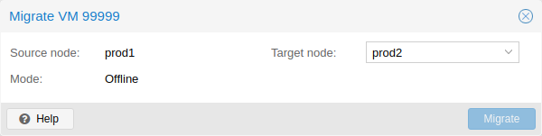

# 10.3. 迁移 <a href="#qm_migration" id="qm_migration"></a>

[](https://pve.proxmox.com/pve-docs/images/screenshot/gui-qemu-migrate.png)

如果您有集群，可以使用以下命令将 VM 迁移到另一台宿主机

```text
# qm migrate <vmid> <target>
```

通常有两种迁移机制

- 在线迁移（亦称 Live Migration）
- 离线迁移

## 10.3.1. 在线迁移 <a href="#_online_migration" id="_online_migration"></a>

If your VM is running and no locally bound resources are configured (such as devices that are passed through), you can initiate a live migration with the `--online` flag in the `qm migration` command evocation. The web interface defaults to live migration when the VM is running.


仅能在采用相同 CPU 架构的宿主机之间进行在线迁移。无法在 x86 与 arm64 宿主机之间传输正在运行的客户机的 CPU 状态。


### 工作原理 <a href="#_how_it_works" id="_how_it_works"></a>

在线迁移首先会在目标宿主机上启动一个带有 *incoming* 标志的新 QEMU 进程，该进程仅执行基本初始化，客户机 vCPU 仍处于暂停状态，然后等待源虚拟机的客户机内存和设备状态数据流。所有其他资源（如磁盘）要么是共享的，要么已在 VM 运行时状态迁移开始前发送完毕；因此，只剩下内存内容和设备状态需要传输。

建立此连接后，源端开始异步向目标端发送内存内容。如果源端上的客户机内存发生变化，这些部分会被标记为脏数据，并再次执行一轮客户机内存数据发送。此循环不断重复，直到正在运行的源 VM 与正在接收的目标 VM 之间的数据差异足够小，可以在几毫秒内发送完毕；因为此时可以完全暂停源 VM，而用户或程序不会察觉到暂停，从而将剩余数据发送到目标端，然后恢复目标 VM 的 CPU 运行，使其在远不到一秒的时间内成为新的运行中 VM。

### 要求 <a href="#_requirements" id="_requirements"></a>

要使在线迁移正常工作，需要满足以下要求：

- VM 没有无法迁移的本地资源。例如，当前直通的 PCI 或 USB 设备会阻止在线迁移。另一方面，本地磁盘完全可以迁移，只需将其发送到目标端即可。
- 这些宿主机位于同一个 Proxmox VE 集群中。
- 这些宿主机之间具有正常（且可靠）的网络连接。
- 目标宿主机必须安装相同或更高版本的 Proxmox VE 软件包。虽然有时反过来也能正常工作，但无法保证。
- 这些宿主机的 CPU 来自同一厂商，并具有相似的功能。不同厂商的 CPU **可能**可行，具体取决于实际型号和配置的 VM CPU 类型，但无法保证——因此在生产环境部署此类配置之前，请先进行测试。

### Conntrack 状态迁移 <a href="#_conntrack_state_migration" id="_conntrack_state_migration"></a>


Conntrack 状态迁移仅被视为尽力而为，可能无法工作，因为它在很大程度上取决于网络配置。例如，在宿主机上使用 [源地址伪装 (SNAT)](../03-system-administration/04-sysadmin-network-configuration.md#sysadmin_network_masquerading) 的配置很可能**无法**工作。


Conntrack 是 Linux 内核的一种机制，通过跟踪各个连接来启用有状态防火墙。在线迁移正在运行的 VM 时，一旦 VM 开始在目标宿主机上运行，活动的入站和/或出站连接**可能**会中断，因为新的宿主机节点没有相同的 conntrack 条目，防火墙可能会因此丢弃数据包。

Conntrack 状态迁移会将宿主机上属于被在线迁移 VM 的所有 conntrack 条目复制到目标节点，随后从源节点的 conntrack 表中清除已迁移的条目。

## 10.3.2. 离线迁移 <a href="#_offline_migration" id="_offline_migration"></a>

如果您有本地资源，只要所有磁盘都位于在两台宿主机上均有定义的存储上，仍然可以离线迁移 VM。随后，迁移会像在线迁移一样通过网络将磁盘复制到目标宿主机。请注意，任何硬件直通配置都可能需要根据目标宿主机上的设备位置进行调整。

---

来源：[Proxmox VE 官方文档](https://pve.proxmox.com/pve-docs/pve-admin-guide.html) · 版本 9.2.13 · 非官方中文翻译。
