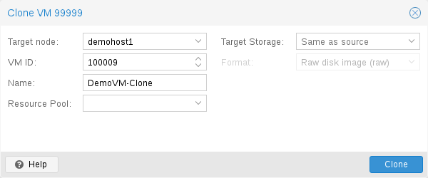

# 10.4. Copies and Clones 

VM installation is usually done using an installation media (CD-ROM) from the operating system vendor. Depending on the OS, this can be a time consuming task one might want to avoid.

An easy way to deploy many VMs of the same type is to copy an existing VM. We use the term *clone* for such copies, and distinguish between *linked* and *full* clones.

**Full Clone**

The result of such copy is an independent VM. The new VM does not share any storage resources with the original.

It is possible to select a **Target Storage**, so one can use this to migrate a VM to a totally different storage. You can also change the disk image **Format** if the storage driver supports several formats.


A full clone needs to read and copy all VM image data. This is usually much slower than creating a linked clone.


Some storage types allows to copy a specific **Snapshot**, which defaults to the *current* VM data. This also means that the final copy never includes any additional snapshots from the original VM.

**Linked Clone**

Modern storage drivers support a way to generate fast linked clones. Such a clone is a writable copy whose initial contents are the same as the original data. Creating a linked clone is nearly instantaneous, and initially consumes no additional space.

They are called *linked* because the new image still refers to the original. Unmodified data blocks are read from the original image, but modification are written (and afterwards read) from a new location. This technique is called *Copy-on-write*.

This requires that the original volume is read-only. With Proxmox VE one can convert any VM into a read-only [Template](05-qm-templates.md#qm_templates)). Such templates can later be used to create linked clones efficiently.


You cannot delete an original template while linked clones exist.


It is not possible to change the **Target storage** for linked clones, because this is a storage internal feature.

The **Target node** option allows you to create the new VM on a different node. The only restriction is that the VM is on shared storage, and that storage is also available on the target node.

To avoid resource conflicts, all network interface MAC addresses get randomized, and we generate a new *UUID* for the VM BIOS (smbios1) setting.

---

来源：[Proxmox VE 官方文档](https://pve.proxmox.com/pve-docs/pve-admin-guide.html) · 版本 9.2.13 · 非官方中文翻译。
