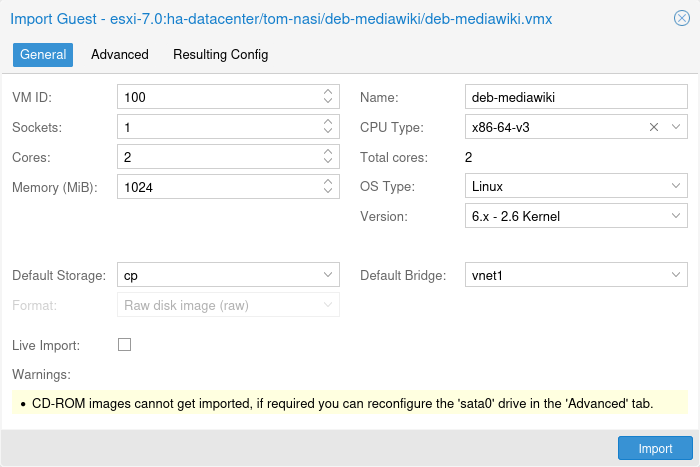
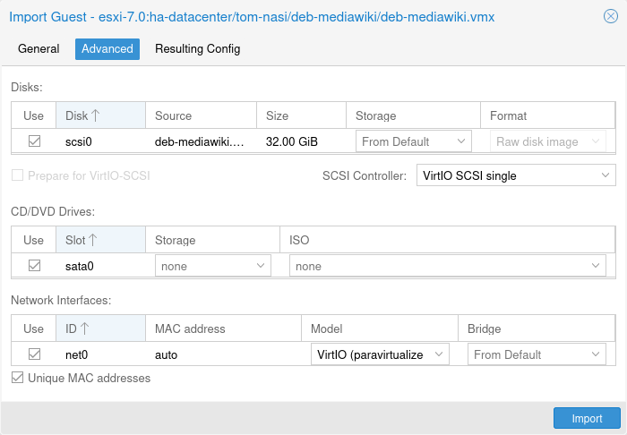

# 10.7. 导入虚拟机 <a href="#qm_import_virtual_machines" id="qm_import_virtual_machines"></a>

可以通过多种方法从其他虚拟机监控程序或其他 Proxmox VE 集群导入现有虚拟机，最常见的方法有：

- 使用原生导入向导，该向导利用 *import* 内容类型，例如 ESXi 特殊存储所提供的内容类型。
- 在源端执行备份，然后在目标端恢复。从另一个 Proxmox VE 实例迁移时，这种方法效果最好。
- 使用 `qm` 命令行工具的 OVF 专用导入命令。

如果从其他虚拟机监控程序将 VM 导入 Proxmox VE，建议先熟悉 [Proxmox VE 的概念](https://pve.proxmox.com/wiki/Migrate_to_Proxmox_VE#Concepts)。

## 10.7.1. 导入向导 <a href="#import_wizard" id="import_wizard"></a>

[](https://pve.proxmox.com/pve-docs/images/screenshot/gui-import-wizard-general.png)

Proxmox VE 提供了一个集成的 VM 导入器，它使用存储插件系统，原生集成到 API 和基于 Web 的用户界面中。你可以使用它整体导入 VM，其大部分配置会映射到 Proxmox VE 的配置模型，同时缩短停机时间。


导入向导是在 Proxmox VE 8.2 开发周期中添加的，目前处于技术预览状态。虽然它已颇具潜力并且运行稳定，但仍在积极开发中。


要使用导入向导，必须先在 Web 界面的 *数据中心 → 存储 → 添加* 下，为导入源设置一个新存储。

然后，可以在资源树中选择新存储，并使用 *虚拟客户机* 内容选项卡，查看所有可导入的客户机。

[](https://pve.proxmox.com/pve-docs/images/screenshot/gui-import-wizard-advanced.png)

选择一个客户机，然后使用 *导入* 按钮（或双击）打开导入向导。你可以在此处修改部分可用选项，然后开始导入。请注意，导入完成后还可以进行更高级的修改。


ESXi 导入向导已经过 ESXi 6.5 至 8.0 版本的测试。请注意，使用 vSAN 存储的客户机无法直接导入；必须首先将其磁盘移动到另一个存储。虽然可以使用 vCenter 作为导入源，但性能会显著下降（慢 5 到 10 倍）。


有关分步指南以及如何让虚拟客户机适应新虚拟机监控程序的提示，请参阅我们的 [迁移到 Proxmox VE 的 wiki 文章](https://pve.proxmox.com/wiki/Migrate_to_Proxmox_VE#Migration)。

### OVA/OVF 导入 <a href="#ova_ovf_import" id="ova_ovf_import"></a>

要导入 OVA/OVF 文件，首先需要一个启用了 *import* 内容类型的基于文件的存储。该存储上会有一个 *import* 文件夹，你可以将 OVA 文件，或 OVF 文件及其对应镜像以扁平目录结构放入其中。或者，也可以使用 Web UI 直接上传或下载 OVA 文件。然后，可以在 Web UI 中选择这些文件，并使用导入向导导入客户机。

对于 OVA 文件，还需要额外的空间来临时解压镜像。这需要一个配置了 *images* 内容类型的基于文件的存储。默认情况下会选择源存储用于此目的，但你可以指定一个 *导入工作存储*，在导入到实际目标存储之前，镜像会先解压到该存储中。


由于 OVA/OVF 文件的结构和内容并不总是得到良好维护或明确定义，因此可能需要手动调整某些客户机设置。例如，OVA/OVF 文件中几乎从不定义 SCSI 控制器类型，但使用 OVMF（UEFI）时默认配置无法启动，因此在遇到这些情况时，应选择 *Virtio SCSI* 或 *VMware PVSCSI*。


## 10.7.2. 通过 CLI 导入 OVF/OVA <a href="#import_ovf_ova_through_cli" id="import_ovf_ova_through_cli"></a>

从其他虚拟机监控程序导出的 VM 通常采用一个或多个磁盘镜像的形式，并带有一个描述 VM 设置（RAM、核心数量）的配置文件。  
 如果磁盘来自 VMware 或 VirtualBox，磁盘镜像可以采用 vmdk 格式；如果磁盘来自 KVM 虚拟机监控程序，则可以采用 qcow2 格式。VM 导出最常用的配置格式是 OVF 标准，但在实践中，由于许多设置并未在该标准本身中实现，而且虚拟机监控程序会通过非标准扩展导出补充信息，因此互操作性受到限制。

除了格式问题外，如果不同虚拟机监控程序之间模拟的硬件差异过大，从其他虚拟机监控程序导入磁盘镜像也可能失败。Windows VM 尤其容易受此影响，因为该操作系统对任何硬件更改都非常敏感。要解决此问题，可以在导出前安装可从互联网获取的 MergeIDE.zip 实用程序，并在启动导入的 Windows VM 之前，将硬盘类型选择为 **IDE**。

最后还有半虚拟化驱动程序的问题，这类驱动程序可提高模拟系统的速度，并且因虚拟机监控程序而异。GNU/Linux 和其他自由 Unix 操作系统默认已安装所有必要的驱动程序，你可以在导入 VM 后立即切换到半虚拟化驱动程序。对于 Windows VM，则需要自行安装 Windows 半虚拟化驱动程序。

GNU/Linux 和其他自由 Unix 通常可以顺利导入。请注意，由于上述问题，我们无法保证在所有情况下都能成功导入或导出 Windows VM。

### Windows OVF 导入的分步示例 <a href="#step_by_step_example_of_a_windows_ovf_import" id="step_by_step_example_of_a_windows_ovf_import"></a>

Microsoft 提供 [虚拟机下载](https://developer.microsoft.com/en-us/windows/downloads/virtual-machines/)，以便开始 Windows 开发。我们将使用其中一个虚拟机来演示 OVF 导入功能。

#### 下载虚拟机 zip 文件 <a href="#download_the_virtual_machine_zip" id="download_the_virtual_machine_zip"></a>

了解用户协议后，选择适用于 VMware 平台的 *Windows 10 Enterprise (Evaluation \- Build)*，并下载 zip 文件。

#### 从 zip 文件中解压磁盘镜像 <a href="#extract_the_disk_image_from_the_zip" id="extract_the_disk_image_from_the_zip"></a>

使用 `unzip` 实用程序或你选择的任何归档工具解压 zip 文件，并通过 ssh/scp 将 ovf 和 vmdk 文件复制到你的 Proxmox VE 宿主机。

#### 导入虚拟机 <a href="#import_the_virtual_machine" id="import_the_virtual_machine"></a>

这将创建一个新的虚拟机，使用从 OVF 清单中读取的核心数、内存和 VM 名称，并将磁盘导入到 `local-lvm` 存储。你需要手动配置网络。

```text
# qm importovf 999 WinDev1709Eval.ovf local-lvm
```

现在可以启动 VM 了。

#### 向虚拟机添加外部磁盘镜像 <a href="#adding_an_external_disk_image_to_a_virtual_machine" id="adding_an_external_disk_image_to_a_virtual_machine"></a>

你还可以向 VM 添加现有磁盘镜像，无论它来自其他虚拟机监控程序，还是由你自己创建。

假设你使用 *vmdebootstrap* 工具创建了 Debian/Ubuntu 磁盘镜像：

```text
vmdebootstrap --verbose \
 --size 10GiB --serial-console \
 --grub --no-extlinux \
 --package openssh-server \
 --package avahi-daemon \
 --package qemu-guest-agent \
 --hostname vm600 --enable-dhcp \
 --customize=./copy_pub_ssh.sh \
 --sparse --image vm600.raw
```

现在可以创建一个新的目标 VM，将镜像导入存储 `pvedir`，并将其连接到 VM 的 SCSI 控制器：

```text
# qm create 600 --net0 virtio,bridge=vmbr0 --name vm600 --serial0 socket \
   --boot order=scsi0 --scsihw virtio-scsi-pci --ostype l26 \
   --scsi0 pvedir:0,import-from=/path/to/dir/vm600.raw
```

现在可以启动 VM 了。

---

来源：[Proxmox VE 官方文档](https://pve.proxmox.com/pve-docs/pve-admin-guide.html) · 版本 9.2.13 · 非官方中文翻译。
