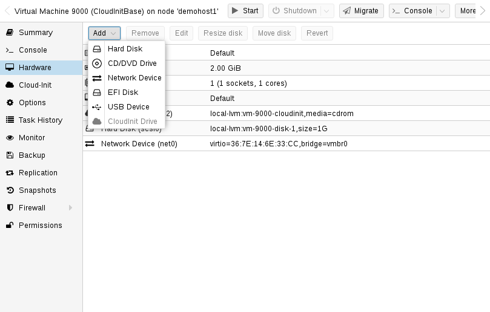
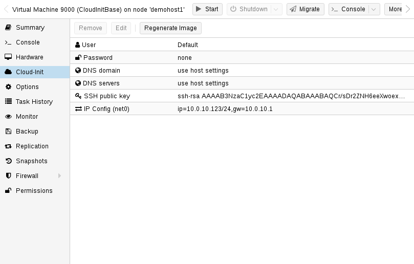

# 10.8. Cloud-Init 支持 <a href="#qm_cloud_init" id="qm_cloud_init"></a>

[Cloud-Init](https://cloudinit.readthedocs.io) 是处理虚拟机实例早期初始化的事实标准多发行版软件包。使用 Cloud-Init，可以在虚拟机监控程序端配置网络设备和 ssh 密钥。VM 首次启动时，VM 内部的 Cloud-Init 软件将应用这些设置。

许多 Linux 发行版提供开箱即用的 Cloud-Init 镜像，这些镜像主要为 *OpenStack* 设计。它们也适用于 Proxmox VE。虽然获取此类现成镜像看似方便，但我们通常建议自行准备镜像。这样做的好处是，你可以确切知道自己安装了什么，并且以后可以根据需要轻松自定义镜像。

创建此类 Cloud-Init 镜像后，我们建议将其转换为 VM 模板。利用 VM 模板可以快速创建链接克隆，因此这是一种快速部署新 VM 实例的方法。你只需在启动新 VM 之前配置网络（可能还要配置 ssh 密钥）。

我们建议使用基于 SSH 密钥的身份验证登录由 Cloud-Init 置备的 VM。也可以设置密码，但这种方式不如基于 SSH 密钥的身份验证安全，因为 Proxmox VE 需要在 Cloud-Init 数据中存储该密码的加密版本。

Proxmox VE 会生成一个 ISO 镜像，用于将 Cloud-Init 数据传递给 VM。为此，所有 Cloud-Init VM 都需要分配一个 CD-ROM 驱动器。通常还应添加串行控制台并将其用作显示设备。许多 Cloud-Init 镜像依赖于此配置，这也是 OpenStack 的要求。不过，其他镜像可能无法使用此配置。如果使用串行控制台不起作用，请切换回默认显示配置。

## 10.8.1. 准备 Cloud-Init 模板 <a href="#_preparing_cloud_init_templates" id="_preparing_cloud_init_templates"></a>

第一步是准备你的 VM。基本上，你可以使用任何 VM。只需 **在要准备的 VM 内部** 安装 Cloud-Init 软件包。在基于 Debian/Ubuntu 的系统上，操作非常简单：

```text
apt-get install cloud-init
```


此命令**不**应在 Proxmox VE 宿主机上执行，而只应在 VM 内部执行。


许多发行版已经提供开箱即用的 Cloud-Init 镜像（以 `.qcow2` 文件的形式提供），因此你也可以直接下载并导入此类镜像。在下面的示例中，我们将使用 Ubuntu 在 [https://cloud-images.ubuntu.com](https://cloud-images.ubuntu.com) 提供的云镜像。

```text
# download the image
wget https://cloud-images.ubuntu.com/bionic/current/bionic-server-cloudimg-amd64.img

# create a new VM with VirtIO SCSI controller
qm create 9000 --memory 2048 --net0 virtio,bridge=vmbr0 --scsihw virtio-scsi-pci

# import the downloaded disk to the local-lvm storage, attaching it as a SCSI drive
qm set 9000 --scsi0 local-lvm:0,import-from=/path/to/bionic-server-cloudimg-amd64.img
```


Ubuntu Cloud-Init 镜像要求 SCSI 驱动器使用 `virtio-scsi-pci` 控制器类型。


[](https://pve.proxmox.com/pve-docs/images/screenshot/gui-cloudinit-hardware.png)

**添加 Cloud-Init CD-ROM 驱动器**

下一步是配置一个 CD-ROM 驱动器，用于将 Cloud-Init 数据传递给 VM。

```text
qm set 9000 --ide2 local-lvm:cloudinit
```

要直接从 Cloud-Init 镜像启动，请将 `boot` 参数设置为 `order=scsi0`，以限制 BIOS 仅从此磁盘启动。这将加快启动速度，因为 VM BIOS 会跳过对可启动 CD-ROM 的检测。

```text
qm set 9000 --boot order=scsi0
```

对于许多 Cloud-Init 镜像，需要配置串行控制台并将其用作显示设备。但是，如果此配置不适用于某个镜像，请改回默认显示设备。

```text
qm set 9000 --serial0 socket --vga serial0
```

最后，建议将 VM 转换为模板。然后，你可以通过此模板快速创建链接克隆。从 VM 模板部署比创建完整克隆（复制）快得多。

```text
qm template 9000
```

## 10.8.2. 部署 Cloud-Init 模板 <a href="#_deploying_cloud_init_templates" id="_deploying_cloud_init_templates"></a>

[](https://pve.proxmox.com/pve-docs/images/screenshot/gui-cloudinit-config.png)

你可以通过克隆轻松部署此类模板：

```text
qm clone 9000 123 --name ubuntu2
```

然后配置用于身份验证的 SSH 公钥，并配置 IP 设置：

```text
qm set 123 --sshkey ~/.ssh/id_rsa.pub
qm set 123 --ipconfig0 ip=10.0.10.123/24,gw=10.0.10.1
```

你也可以只使用一条命令来配置所有 Cloud-Init 选项。上面的示例只是为了缩短行长度，才将命令拆分开来。另外，请确保根据你的具体环境调整 IP 设置。

## 10.8.3. 自定义 Cloud-Init 配置 <a href="#_custom_cloud_init_configuration" id="_custom_cloud_init_configuration"></a>

Cloud-Init 集成还允许使用自定义配置文件，而不是自动生成的配置。这可以通过命令行中的 `cicustom` 选项实现：

```text
qm set 9000 --cicustom "user=<volume>,network=<volume>,meta=<volume>"
```

自定义配置文件必须位于支持片段的存储上，并且必须在虚拟机将要迁移到的所有节点上可用。否则，虚拟机将无法启动。例如：

```text
qm set 9000 --cicustom "user=local:snippets/userconfig.yaml"
```

Cloud-Init 有三种配置。第一种是上面示例中所示的 `user` 配置。第二种是 `network` 配置，第三种是 `meta` 配置。它们可以全部一起指定，也可以根据需要任意混合搭配。对于任何未指定自定义配置文件的配置，都将使用自动生成的配置。

可以导出生成的配置，作为自定义配置的基础：

```text
qm cloudinit dump 9000 user
```

`network` 和 `meta` 也有相同的命令。

## 10.8.4. Windows 上的 Cloud-Init <a href="#_cloud_init_on_windows" id="_cloud_init_on_windows"></a>

Windows 上有一个名为 [cloudbase-init](https://cloudbase.it/) 的 Cloud-Init 重新实现版本。Cloudbase-Init 并不具备 Cloud-Init 的所有功能，而且某些功能与 Cloud-Init 有所不同。

Cloudbase-Init 要求将 `ostype` 设置为任意 Windows 版本，并将 `citype` 设置为 `configdrive2`，后者是任何 Windows `ostype` 的默认设置。

没有可免费使用的现成 Windows 云镜像。使用 Cloudbase-Init 需要手动安装和配置 Windows 客户机。

## 10.8.5. 准备 Cloudbase-Init 模板 <a href="#_preparing_cloudbase_init_templates" id="_preparing_cloudbase_init_templates"></a>

第一步是在虚拟机中安装 Windows。在客户机中下载并安装 Cloudbase-Init。可能有必要安装 Beta 版本。不要在安装结束时运行 Sysprep，而应首先配置 Cloudbase-Init。

一些常见的设置选项如下：

- *username*：设置管理员的用户名
- *groups*：允许将用户添加到 `Administrators` 组
- *inject\_user\_password*：将其设置为 `true`，以允许在虚拟机配置中设置密码
- *first\_logon\_behaviour*：将其设置为 `no`，以在登录时无需设置新密码
- *rename\_admin\_user*：将其设置为 `true`，以允许将默认的 `Administrator` 用户重命名为通过 `username` 指定的用户名
- *metadata\_services*：将其设置为 `cloudbaseinit.metadata.services.configdrive.ConfigDriveService`，使 Cloudbase-Init 首先检查此服务。否则，Cloudbase-Init 可能需要几分钟才能在启动后完成系统配置。

某些插件（例如 SetHostnamePlugin）需要重启，并会自动执行重启。要禁用 Cloudbase-Init 的自动重启，可以将 `allow_reboot` 设置为 `false`。

完整的配置选项集可在 [cloudbase-init 官方文档](https://cloudbase-init.readthedocs.io/en/latest/config.html) 中找到。

完成配置后创建快照是明智的，以防配置的某些部分仍需调整。配置好 Cloudbase-Init 后，即可开始创建模板。关闭 Windows 客户机，添加 Cloud-Init 磁盘，然后将其转换为模板。

```text
qm set 9000 --ide2 local-lvm:cloudinit
qm template 9000
```

将模板克隆为新的虚拟机：

```text
qm clone 9000 123 --name windows123
```

然后设置密码、网络配置和 SSH 密钥：

```text
qm set 123 --cipassword <password>
qm set 123 --ipconfig0 ip=10.0.10.123/24,gw=10.0.10.1
qm set 123 --sshkey ~/.ssh/id_rsa.pub
```

在设置密码之前，请确保 `ostype` 已设置为任意 Windows 版本。否则，密码将被加密，而 Cloudbase-Init 会将加密后的密码用作明文密码。

所有设置完成后，启动克隆的客户机。首次启动时将无法登录，并且会因主机名已更改而自动重启。重启后，新密码应已设置，登录也应可正常使用。

## 10.8.6. Cloudbase-Init 和 Sysprep <a href="#_cloudbase_init_and_sysprep" id="_cloudbase_init_and_sysprep"></a>

Sysprep 是一项用于重置 Windows 配置并提供 `new` 系统的功能。它可以与 Cloudbase-Init 结合使用，以创建一个干净的模板。

使用 Sysprep 时，需要调整 2 个配置文件。第一个是常规配置文件，第二个是以 `-unattend.conf` 结尾的配置文件。

Cloudbase-Init 分 2 个步骤运行：首先使用 `-unattend.conf` 执行 Sysprep 步骤，然后使用主配置文件执行常规步骤。

对于 `Windows Server`，使用提供的 `Unattend.xml` 文件运行 Sysprep 应该可以开箱即用。但是，普通 Windows 版本需要额外的步骤：

1. 打开一个 PowerShell 实例
2. 启用 Administrator 用户：

   ```text
   net user Administrator /active:yes`
   ```
3. 使用 Administrator 用户安装 Cloudbase-Init
4. 修改 `Unattend.xml`，使其包含在执行 Sysprep 后首次启动时启用 Administrator 用户的命令：

   ```text
   <RunSynchronousCommand wcm:action="add">
     <Path>net user administrator /active:yes</Path>
     <Order>1</Order>
     <Description>Enable Administrator User</Description>
   </RunSynchronousCommand>
   ```

   确保 `<Order>` 不与其他同步命令冲突。通过将数值增大到更高的值，修改 Cloudbase-Init 命令的 `<Order>`，使其在此命令之后运行：`<Order>2</Order>`
5. （仅限 Windows 11）删除冲突的 Microsoft.OneDriveSync 软件包：

   ```text
   Get-AppxPackage -AllUsers Microsoft.OneDriveSync | Remove-AppxPackage -AllUsers
   ```
6. `cd` 到 Cloudbase-Init 配置目录中：

   ```text
   cd 'C:\Program Files\Cloudbase Solutions\Cloudbase-Init\conf'
   ```
7. （可选）在执行 Sysprep 前为虚拟机创建快照，以防配置错误
8. 运行 Sysprep：

   ```text
   C:\Windows\System32\Sysprep\sysprep.exe /generalize /oobe /unattend:Unattend.xml
   ```

完成上述步骤后，虚拟机应因 Sysprep 而处于关机状态。现在，您可以将其转换为模板、克隆它并根据需要进行配置。

## 10.8.7. Cloud-Init 特定选项 <a href="#_cloud_init_specific_options" id="_cloud_init_specific_options"></a>

**`cicustom`: `[meta=<volume>] [,network=<volume>] [,user=<volume>] [,vendor=<volume>]`**

指定自定义文件，以在启动时替换自动生成的文件。

**`meta`\=`<volume>`**

指定一个自定义文件，其中包含通过 cloud-init 传递给虚拟机的所有元数据。这是特定于提供商的，也就是说 configdrive2 和 nocloud 有所不同。

**`network`\=`<volume>`**

用于通过 cloud-init 将包含所有网络数据的自定义文件传递给虚拟机。

**`user`\=`<volume>`**

用于通过 cloud-init 将包含所有用户数据的自定义文件传递给虚拟机。

**`vendor`\=`<volume>`**

用于通过 cloud-init 将包含所有供应商数据的自定义文件传递给虚拟机。

**`cipassword`: `<string>`**

分配给用户的密码。通常不建议使用此选项，请改用 SSH 密钥。另请注意，较旧版本的 cloud-init 不支持散列密码。

**`citype`: `<configdrive2 | nocloud | opennebula>`**

指定 cloud-init 配置格式。默认值取决于配置的操作系统类型（`ostype`。Linux 使用 `nocloud` 格式，Windows 使用 `configdrive2`。

**`ciupgrade`：`<boolean>`（*默认值 \=* `1`）**

首次启动后自动升级软件包。

**`ciuser`: `<string>`**

指定要更改其 SSH 密钥和密码的用户名，而非镜像中配置的默认用户。

**`ipconfig[n]`: `[gw=<GatewayIPv4>] [,gw6=<GatewayIPv6>] [,ip=<IPv4Format/CIDR>] [,ip6=<IPv6Format/CIDR>]`**

为相应接口指定 IP 地址和网关。

IP 地址使用 CIDR 表示法，网关是可选的，但需要指定相同类型的 IP 地址。

IP 地址可以使用特殊字符串 *dhcp* 来表示使用 DHCP，在这种情况下不应提供显式网关。对于 IPv6，可以使用特殊字符串 *auto* 来表示使用无状态自动配置。这需要 cloud-init 19.4 或更高版本。

如果启用了 cloud-init，且既未指定 IPv4 地址也未指定 IPv6 地址，则默认在 IPv4 上使用 dhcp。

**`gw`\=`<GatewayIPv4>`**

IPv4 流量的默认网关。


需要选项：`ip`


**`gw6`\=`<GatewayIPv6>`**

IPv6 流量的默认网关。


需要选项：`ip6`


**`ip`\=`<IPv4Format/CIDR>`（*默认值 \=* `dhcp`）**

CIDR 格式的 IPv4 地址。

**`ip6`\=`<IPv6Format/CIDR>`（*默认值 \=* `dhcp`）**

CIDR 格式的 IPv6 地址。

**`nameserver`: `<string>`**

为容器设置 DNS 服务器 IP 地址。如果既未设置 searchdomain 也未设置 nameserver，创建时将自动使用宿主机的设置。

**`searchdomain`: `<string>`**

为容器设置 DNS 搜索域。如果既未设置 searchdomain 也未设置 nameserver，创建时将自动使用宿主机的设置。

**`sshkeys`: `<string>`**

设置 SSH 公钥（每行一个密钥，OpenSSH 格式）。

---

来源：[Proxmox VE 官方文档](https://pve.proxmox.com/pve-docs/pve-admin-guide.html) · 版本 9.2.13 · 非官方中文翻译。
