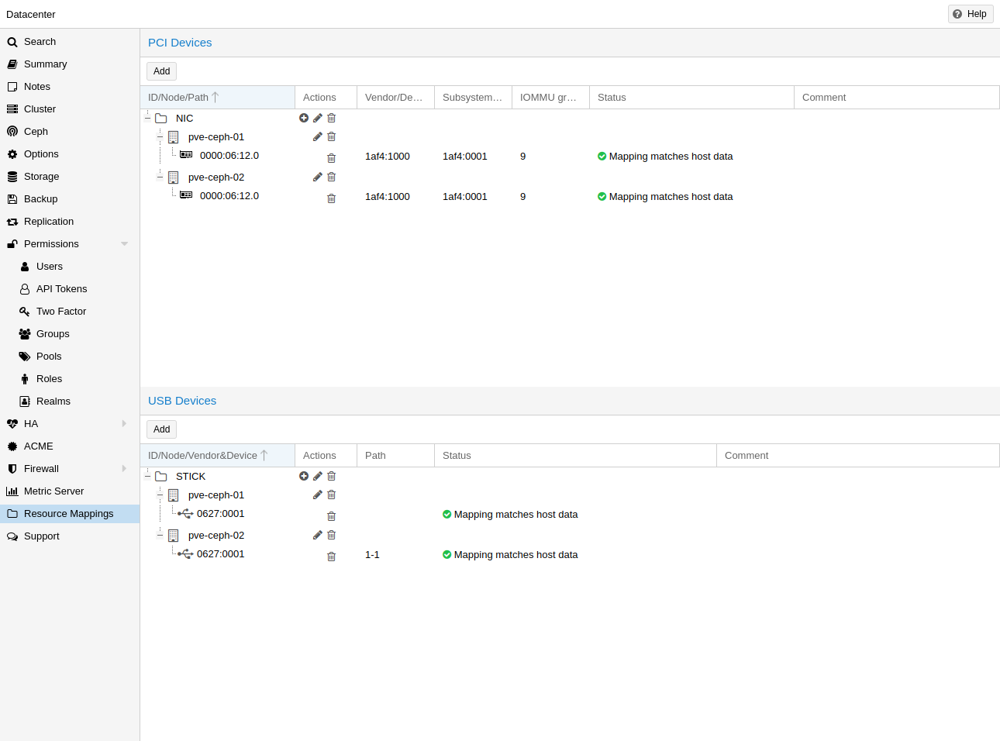
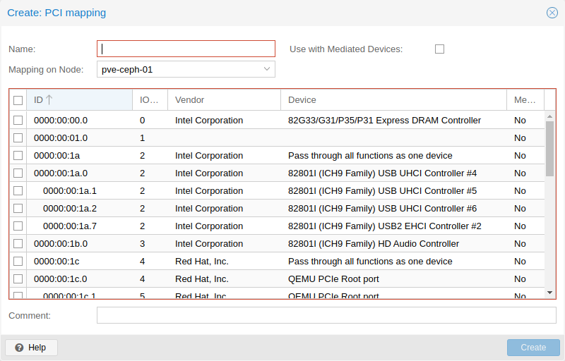
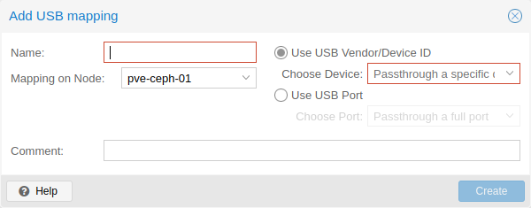

# 10.12. Resource Mapping <a href="#resource_mapping" id="resource_mapping"></a>

[](https://pve.proxmox.com/pve-docs/images/screenshot/gui-datacenter-resource-mappings.png)

When using or referencing local resources (e.g. address of a pci device), using the raw address or id is sometimes problematic, for example:

- when using HA, a different device with the same id or path may exist on the target node, and if one is not careful when assigning such guests to HA groups, the wrong device could be used, breaking configurations.
- changing hardware can change ids and paths, so one would have to check all assigned devices and see if the path or id is still correct.

To handle this better, one can define cluster wide resource mappings, such that a resource has a cluster unique, user selected identifier which can correspond to different devices on different hosts. With this, HA won’t start a guest with a wrong device, and hardware changes can be detected.

Creating such a mapping can be done with the Proxmox VE web GUI under `Datacenter` in the relevant tab in the `Resource Mappings` category, or on the cli with

```text
# pvesh create /cluster/mapping/<type> <options>
```

[](https://pve.proxmox.com/pve-docs/images/screenshot/gui-datacenter-mapping-pci-edit.png)

Where `<type>` is the hardware type (currently either `pci`, `usb` or [dir](02-qm-virtual-machines-settings.md#qm_virtiofs)) and `<options>` are the device mappings and other configuration parameters.

Note that the options must include a map property with all identifying properties of that hardware, so that it’s possible to verify the hardware did not change and the correct device is passed through.

For example to add a PCI device as `device1` with the path `0000:01:00.0` that has the device id `0001` and the vendor id `0002` on the node `node1`, and `0000:02:00.0` on `node2` you can add it with:

```text
# pvesh create /cluster/mapping/pci --id device1 \
 --map node=node1,path=0000:01:00.0,id=0002:0001 \
 --map node=node2,path=0000:02:00.0,id=0002:0001
```

You must repeat the `map` parameter for each node where that device should have a mapping (note that you can currently only map one USB device per node per mapping).

Using the GUI makes this much easier, as the correct properties are automatically picked up and sent to the API.

[](https://pve.proxmox.com/pve-docs/images/screenshot/gui-datacenter-mapping-usb-edit.png)

It’s also possible for PCI devices to provide multiple devices per node with multiple map properties for the nodes. If such a device is assigned to a guest, the first free one will be used when the guest is started. The order of the paths given is also the order in which they are tried, so arbitrary allocation policies can be implemented.

This is useful for devices with SR-IOV, since some times it is not important which exact virtual function is passed through.

You can assign such a device to a guest either with the GUI or with

```text
# qm set ID -hostpci0 <name>
```

for PCI devices, or

```text
# qm set <vmid> -usb0 <name>
```

for USB devices.

Where `<vmid>` is the guests id and `<name>` is the chosen name for the created mapping. All usual options for passing through the devices are allowed, such as `mdev`.

To create mappings `Mapping.Modify` on `/mapping/<type>/<name>` is necessary (where `<type>` is the device type and `<name>` is the name of the mapping).

To use these mappings, `Mapping.Use` on `/mapping/<type>/<name>` is necessary (in addition to the normal guest privileges to edit the configuration).

**Additional Options**

There are additional options when defining a cluster wide resource mapping. Currently there are the following options:

- `mdev` (PCI): This marks the PCI device as being capable of providing `mediated devices`. When this is enabled, you can select a type when configuring it on the guest. If multiple PCI devices are selected for the mapping, the mediated device will be created on the first one where there are any available instances of the selected type.
- `live-migration-capable` (PCI): This marks the PCI device as being capable of being live migrated between nodes. This requires driver and hardware support. Only NVIDIA GPUs with recent kernel are known to support this. Note that live migrating passed through devices is an experimental feature and may not work or cause issues.

---

来源：[Proxmox VE 官方文档](https://pve.proxmox.com/pve-docs/pve-admin-guide.html) · 版本 9.2.13 · 非官方中文翻译。
