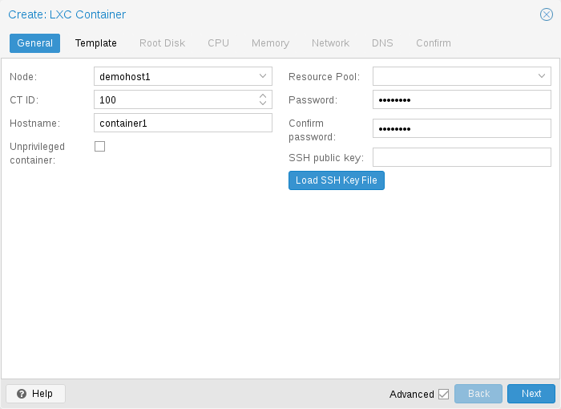
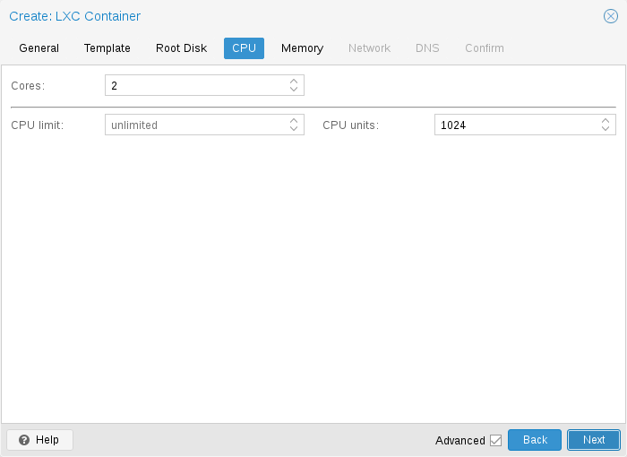
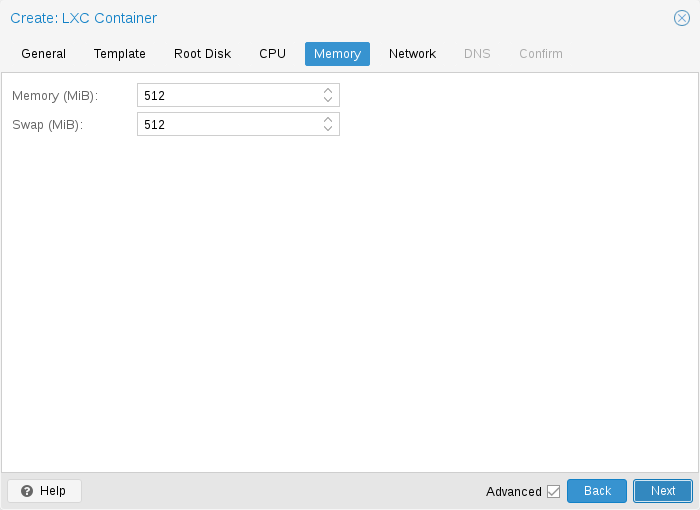
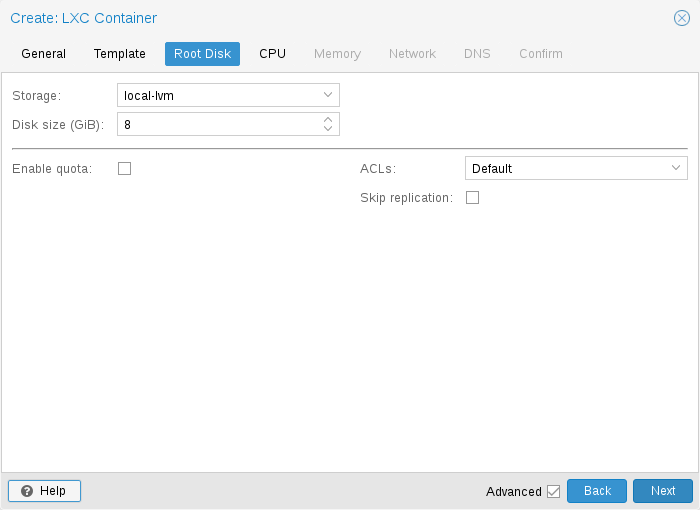
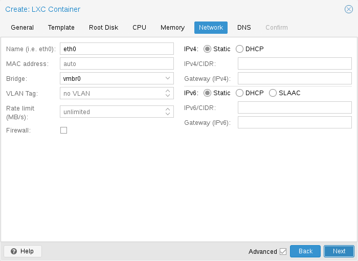
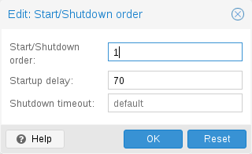

# 11.4. Container Settings <a href="#pct_settings" id="pct_settings"></a>

## 11.4.1. General Settings <a href="#pct_general" id="pct_general"></a>

[](https://pve.proxmox.com/pve-docs/images/screenshot/gui-create-ct-general.png)

容器的常规设置包括

- **Node**：容器将在其上运行的物理服务器
- **CT ID**：此 Proxmox VE 安装中用于标识容器的唯一编号
- **Hostname**：容器的主机名
- **Resource Pool**：容器和 VM 的逻辑组
- **Password**：容器的 root 密码
- **SSH Public Key**：用于通过 SSH 连接 root 账户的公钥
- **Unprivileged container**：此选项允许您在创建时选择要创建特权容器还是非特权容器。
- **Nesting**：暴露 procfs 和 sysfs 以允许嵌套容器。请注意，systemd 也使用此功能来隔离服务。

### 非特权容器 <a href="#_unprivileged_containers" id="_unprivileged_containers"></a>

非特权容器使用一种称为用户命名空间的新内核功能。容器内的 root UID 0 会映射到容器外的非特权用户。这意味着，这些容器中的大多数安全问题（容器逃逸、资源滥用等）将影响某个随机的非特权用户，并且属于通用内核安全漏洞，而不是 LXC 问题。LXC 团队认为，非特权容器在设计上就是安全的。

这是创建新容器时的默认选项。


如果容器使用 systemd 作为 init 系统，请注意，容器内运行的 systemd 版本应等于或高于 220。


### 特权容器 <a href="#_privileged_containers" id="_privileged_containers"></a>

容器中的安全性通过使用强制访问控制 *AppArmor* 限制、*seccomp* 过滤器和 Linux 内核命名空间来实现。LXC 团队认为这种容器不安全，并且不会将新的容器逃逸漏洞视为值得分配 CVE 并快速修复的安全问题。因此，特权容器只应在受信任的环境中使用。

## 11.4.2. CPU <a href="#pct_cpu" id="pct_cpu"></a>

[](https://pve.proxmox.com/pve-docs/images/screenshot/gui-create-ct-cpu.png)

可以使用 `cores` 选项限制容器内可见的 CPU 数量。这是通过 Linux *cpuset* cgroup（**c**ontrol **group**）实现的。`pvestatd` 中的一个特殊任务会定期尝试在可用 CPU 之间分配正在运行的容器。要查看分配的 CPU，请运行以下命令：

```text
# pct cpusets
 ---------------------
 102:              6 7
 105:      2 3 4 5
 108:  0 1
 ---------------------
```

容器直接使用宿主机内核。容器内的所有任务均由宿主机 CPU 调度器处理。Proxmox VE 默认使用 Linux *CFS*（**C**ompletely **F**air **S**cheduler）调度器，该调度器还提供额外的带宽控制选项。

<table>
<tr>
<td>
<code>cpulimit</code>: 
<br/>
</td>
<td>
<p>可以使用此选项进一步限制分配的 CPU 时间。请注意，这是一个浮点数，因此，为容器分配两个核心，同时将总体 CPU 消耗限制为半个核心，是完全有效的。</p>
<div>
<div>
<pre>cores: 2
cpulimit: 0.5</pre>
</div></div>
</td>
</tr>
<tr>
<td>
<code>cpuunits</code>: 
<br/>
</td>
<td>
<p>这是传递给内核调度器的相对权重。数值越大，此容器获得的 CPU 时间就越多。该数值是相对于所有其他正在运行的容器的权重而言的。默认值为 <code>100</code>（如果宿主机使用旧版 cgroup v1，则为 <code>1024</code>）。您可以使用此设置来确定某些容器的优先级。</p>
</td>
</tr>
</table>

## 11.4.3. Memory <a href="#pct_memory" id="pct_memory"></a>

[](https://pve.proxmox.com/pve-docs/images/screenshot/gui-create-ct-memory.png)

容器内存通过 cgroup 内存控制器进行控制。

<table>
<tr>
<td>
<code>memory</code>: 
<br/>
</td>
<td>
<p>限制总体内存使用量。对应于 <code>memory.limit_in_bytes</code> cgroup 设置。</p>
</td>
</tr>
<tr>
<td>
<code>swap</code>: 
<br/>
</td>
<td>
<p>允许容器使用宿主机交换空间中的额外交换内存。对应于 <code>memory.memsw.limit_in_bytes</code> cgroup 设置，该设置被设为两个值之和（<code>memory + swap</code>）。</p>
</td>
</tr>
</table>

## 11.4.4. Mount Points <a href="#pct_mount_points" id="pct_mount_points"></a>

[](https://pve.proxmox.com/pve-docs/images/screenshot/gui-create-ct-root-disk.png)

根挂载点通过 `rootfs` 属性配置。您最多可以配置 256 个额外的挂载点。相应选项称为 `mp0` 至 `mp255`。它们可以包含以下设置：

**`rootfs`: `[volume=]<volume> [,acl=<1|0>] [,idmap=<type:container:disk:range-size[;type:container:disk:range-size;...]>] [,mountoptions=<opt[;opt...]>] [,quota=<1|0>] [,replicate=<1|0>] [,ro=<1|0>] [,shared=<1|0>] [,size=<DiskSize>]`**

将卷用作容器根目录。所有选项的详细说明见下文。

**`mp[n]`: `[volume=]<volume> ,mp=<Path> [,acl=<1|0>] [,backup=<1|0>] [,idmap=<type:container:disk:range-size[;type:container:disk:range-size;...]>] [,keepattrs=<1|0>] [,mountoptions=<opt[;opt...]>] [,quota=<1|0>] [,replicate=<1|0>] [,ro=<1|0>] [,shared=<1|0>] [,size=<DiskSize>]`**

将卷用作容器挂载点。使用特殊语法 STORAGE\_ID:SIZE\_IN\_GiB 可分配新卷。

**`acl`\=`<boolean>`**

显式启用或禁用 ACL 支持。

**`backup`\=`<boolean>`**

是否将挂载点包含在备份中（仅用于卷挂载点）。

**`idmap`\=`<type:container:disk:range-size[;type:container:disk:range-size;...]>`**

自定义 UID/GID 映射，针对此挂载点覆盖容器的 `lxc.idmap`。接受以分号分隔的 `type:container:disk:range-size` 条目列表。

`type` 对于 UID 为 `u`，对于 GID 为 `g`。

`container` 是容器内看到的第一个 ID。

`disk` 是底层文件系统上对应的第一个 ID。

`range-size` 是要映射的连续 ID 数量。

未映射的 ID 回退到容器的 `lxc.idmap`。

示例 1：`u:123:456:1` 将容器内的 UID 123 映射到磁盘上的 UID 456。磁盘上由 UID 456 拥有的文件在容器内将显示为由 UID 123 拥有。

示例 2：`g:100:50:5` 映射 5 个连续的 GID，使容器内的 GID 100-104 映射到磁盘上的 GID 50-54。

示例 3：`passthrough` 对所有 UID 和 GID 进行恒等映射，这意味着容器内的 ID 将与磁盘上的 ID 一致。

**`keepattrs`\=`<boolean>`（*默认 \=* `0`）**

如果挂载点目录已存在，则继承该目录的 UID、GID 和访问模式。

**`mountoptions`\=`<opt[;opt...]>`**

rootfs/mps 的额外挂载选项。

**`mp`\=`<Path>`**

从容器内部看到的挂载点路径。


出于安全原因，不得包含任何符号链接。


**`quota`\=`<boolean>`**

启用容器内的用户配额（zfs 子卷不支持）

**`replicate`\=`<boolean>`（*默认 \=* `1`）**

会将此卷包含到存储复制作业中。

**`ro`\=`<boolean>`**

只读挂载点

**`shared`\=`<boolean>`（*默认 \=* `0`）**

将此非卷挂载点标记为在所有节点上可用。


此选项不会自动共享挂载点，它假定挂载点已被共享！


**`size`\=`<DiskSize>`**

卷大小（只读值）。

**`volume`\=`<volume>`**

要挂载到容器中的卷、设备或目录。

目前有三种类型的挂载点：存储支持的挂载点、绑定挂载和设备挂载。

**典型容器 `rootfs` 配置**

```text
rootfs: thin1:base-100-disk-1,size=8G
```

### 存储支持的挂载点 <a href="#_storage_backed_mount_points" id="_storage_backed_mount_points"></a>

存储支持的挂载点由 Proxmox VE 存储子系统管理，并有三种不同形式：

- 基于镜像：这些是包含单个 ext4 文件系统的 raw 镜像。
- ZFS 子卷：从技术上说，这些是绑定挂载，但使用托管存储，因此允许调整大小和创建快照。
- 目录：传递 `size=0` 会触发一种特殊情况，此时将创建目录而不是 raw 镜像。


存储支持的挂载点卷的特殊选项语法 `STORAGE_ID:SIZE_IN_GB` 会在指定存储上自动分配指定大小的卷。例如，调用


```text
pct set 100 -mp0 thin1:10,mp=/path/in/container
```

将在存储 `thin1` 上分配一个 10GB 的卷，用分配的卷 ID 替换卷 ID 占位符 `10`，并在容器中的 `/path/in/container` 处设置挂载点

### 绑定挂载点 <a href="#_bind_mount_points" id="_bind_mount_points"></a>

绑定挂载允许您在容器内访问 Proxmox VE 宿主机上的任意目录。一些潜在的用例包括：

- 在客户机中访问您的主目录
- 在客户机中访问 USB 设备目录
- 在客户机中访问来自宿主机的 NFS 挂载

绑定挂载被视为不受存储子系统管理，因此您无法创建快照，也无法在容器内处理配额。使用非特权容器时，您可能会遇到由用户映射导致的权限问题，并且无法使用 ACL。


使用 `vzdump` 时，不会备份绑定挂载点的内容。



出于安全原因，绑定挂载应仅使用专门为此目的预留的源目录，例如 `/mnt/bindmounts` 下的目录层次结构。切勿将 `/`、`/var` 或 `/etc` 等系统目录绑定挂载到容器中——这会带来巨大的安全风险。



绑定挂载源路径不得包含任何符号链接。


例如，要使目录 `/mnt/bindmounts/shared` 可在 ID 为 `100` 的容器内的路径 `/shared` 下访问，请添加如下配置行：

```text
mp0: /mnt/bindmounts/shared,mp=/shared
```

添加到 `/etc/pve/lxc/100.conf`。

或者，也可以使用 `pct` 工具：

```text
pct set 100 -mp0 /mnt/bindmounts/shared,mp=/shared
```

以达到相同的结果。

### 设备挂载点 <a href="#_device_mount_points" id="_device_mount_points"></a>

设备挂载点允许将宿主机的块设备直接挂载到容器中。与绑定挂载类似，设备挂载不受 Proxmox VE 存储子系统管理，但 `quota` 和 `acl` 选项会生效。


设备挂载点只应在特殊情况下使用。在大多数情况下，存储支持的挂载点可以提供相同的性能和更多功能。



使用 `vzdump` 时，不会备份设备挂载点的内容。


## 11.4.5. Network <a href="#pct_container_network" id="pct_container_network"></a>

[](https://pve.proxmox.com/pve-docs/images/screenshot/gui-create-ct-network.png)

您可以为单个容器配置多达 10 个网络接口。相应选项称为 `net0` 至 `net9`，它们可以包含以下设置：

**`net[n]`: `name=<string> [,bridge=<bridge>] [,firewall=<1|0>] [,gw=<GatewayIPv4>] [,gw6=<GatewayIPv6>] [,host-managed=<1|0>] [,hwaddr=<XX:XX:XX:XX:XX:XX>] [,ip=<(IPv4/CIDR|dhcp|manual)>] [,ip6=<(IPv6/CIDR|auto|dhcp|manual)>] [,link_down=<1|0>] [,mtu=<integer>] [,rate=<mbps>] [,tag=<integer>] [,trunks=<vlanid[;vlanid...]>] [,type=<veth>]`**

指定容器的网络接口。

**`bridge`\=`<bridge>`**

网络设备要连接到的网桥。

**`firewall`\=`<boolean>`**

控制是否应使用此接口的防火墙规则。

**`gw`\=`<GatewayIPv4>`**

IPv4 流量的默认网关。

**`gw6`\=`<GatewayIPv6>`**

IPv6 流量的默认网关。

**`host-managed`\=`<boolean>`**

此接口的 IP 配置是否应由宿主机管理。启用后，由宿主机（而非容器）负责该接口的 IP 配置。容器不应在此接口上运行自己的 DHCP 客户端或网络管理器。这对于缺少内部网络管理堆栈的容器（例如许多应用程序容器）非常有用。

**`hwaddr`\=`<XX:XX:XX:XX:XX:XX>`**

I/G（Individual/Group，个体/组）位未设置的常见 MAC 地址。

**`ip`\=`<(IPv4/CIDR|dhcp|manual)>`**

CIDR 格式的 IPv4 地址。

**`ip6`\=`<(IPv6/CIDR|auto|dhcp|manual)>`**

CIDR 格式的 IPv6 地址。

**`link_down`\=`<boolean>`**

是否应断开此接口的连接（类似拔掉插头）。

**`mtu`\=`<integer> (64 - 65535)`**

接口的最大传输单元。（lxc.network.mtu）

**`name`\=`<string>`**

从容器内部看到的网络设备名称。（lxc.network.name）

**`rate`\=`<mbps>`**

对接口应用速率限制

**`tag`\=`<integer> (1 - 4094)`**

此接口的 VLAN 标签。

**`trunks`\=`<vlanid[;vlanid...]>`**

允许通过此接口的 VLAN ID

**`type`\=`<veth>`**

网络接口类型。

## 11.4.6. Automatic Start and Shutdown of Containers <a href="#pct_startup_and_shutdown" id="pct_startup_and_shutdown"></a>

要在宿主机系统启动时自动启动容器，请选择 *启动时启动* 选项，该选项位于 Web 界面的容器 *选项* 面板中，也可以运行以下命令：

```text
# pct set CTID -onboot 1
```

[](https://pve.proxmox.com/pve-docs/images/screenshot/gui-qemu-edit-start-order.png)

**启动和关闭顺序**

如果您想微调容器的启动顺序，可以使用以下参数：

- **启动/关闭顺序**：定义启动顺序优先级。例如，如果希望 CT 最先启动，请将其设置为 1。（关闭时我们采用相反的启动顺序，因此启动顺序为 1 的容器将最后关闭）
- **启动延迟**：定义此容器启动与后续容器启动之间的间隔。例如，如果希望在启动其他容器之前等待 240 秒，请将其设置为 240。
- **关闭超时**：定义 Proxmox VE 在发出关闭命令后等待容器离线的时长（秒）。默认情况下，此值设置为 60，这意味着 Proxmox VE 将发出关闭请求，等待 60s 让机器离线；如果 60s 后机器仍在线，则会通知关闭操作失败。

请注意，未设置启动/关闭顺序参数的容器将始终在设置了该参数的容器之后启动，并且此参数仅对宿主机上本地运行的机器之间有意义，在整个集群范围内没有意义。

If you require a delay between the host boot and the booting of the first container, see the section on [Proxmox VE Node Management](../03-system-administration/11-proxmox-node-management.md#first_guest_boot_delay).

## 11.4.7. Hookscripts <a href="#_hookscripts_2" id="_hookscripts_2"></a>

您可以通过配置属性 `hookscript` 为 CT 添加钩子脚本。

```text
# pct set 100 -hookscript local:snippets/hookscript.pl
```

它将在客户机生命周期的各个阶段被调用。有关示例和文档，请参阅 `/usr/share/pve-docs/examples/guest-example-hookscript.pl` 下的示例脚本。

---

来源：[Proxmox VE 官方文档](https://pve.proxmox.com/pve-docs/pve-admin-guide.html) · 版本 9.2.13 · 非官方中文翻译。
