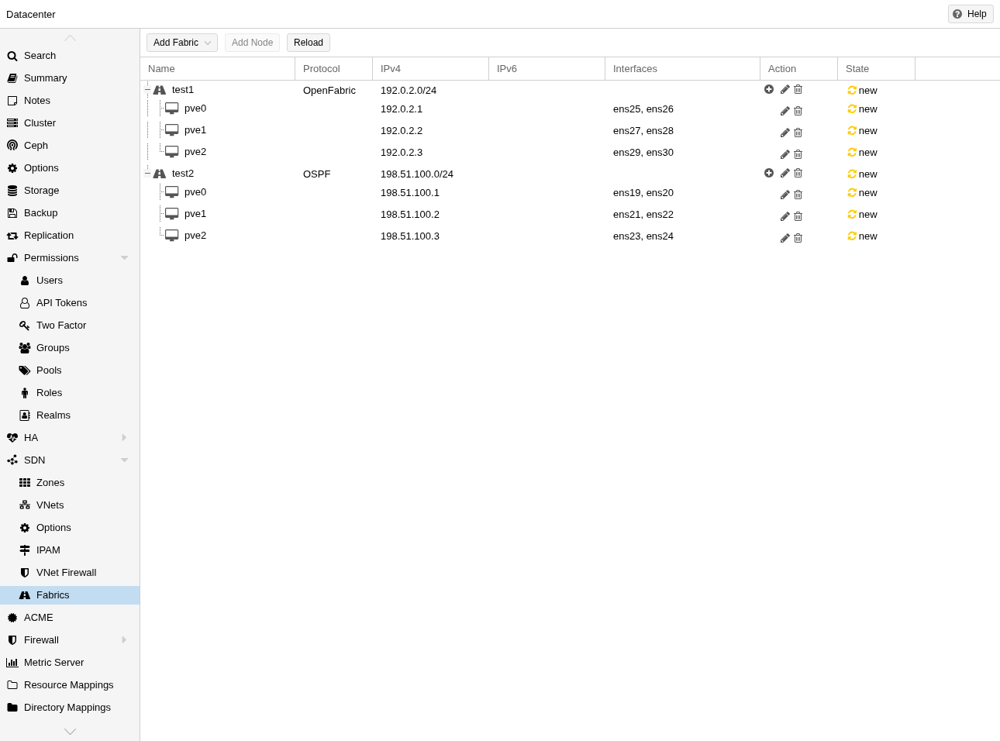
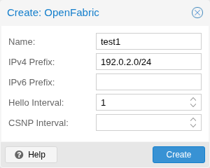
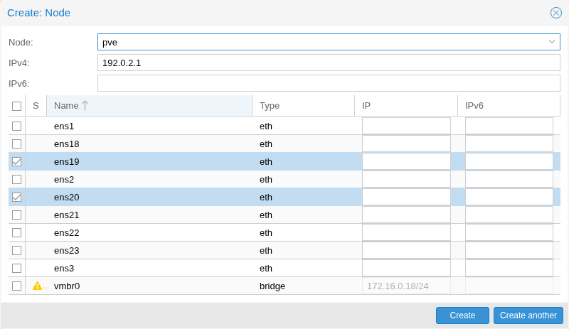
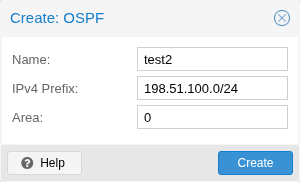
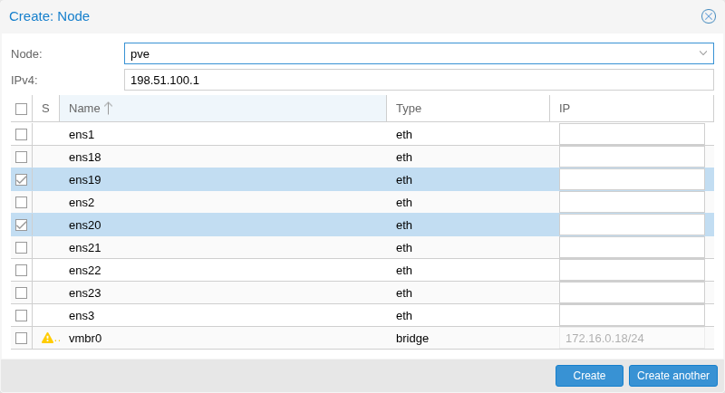

# 12.10. 网络结构 <a href="#pvesdn_config_fabrics" id="pvesdn_config_fabrics"></a>

[](https://pve.proxmox.com/pve-docs/images/screenshot/gui-datacenter-fabrics-overview.png)

Proxmox VE SDN 中的网络结构可在集群节点之间提供自动路由。它们简化节点之间底层网络的配置，为 SDN 部署奠定基础。

它们会自动在物理网络接口上配置路由协议，以建立集群节点之间的连接。这会创建能够适应网络拓扑变化、具备弹性并可自动配置的网络结构。这些网络结构可用作 Ceph 的全网状网络，或用于 EVPN 控制器和 VXLAN 区域。

## 12.10.1. 安装 <a href="#installation" id="installation"></a>

使用 FRR 的 OpenFabric 和 OSPF 实现，因此首先确保安装了 `frr` 和 `frr-pythontools` 软件包：

```text
apt update
apt install frr frr-pythontools
```

## 12.10.2. 权限 <a href="#permissions_2" id="permissions_2"></a>

要查看 SDN 网络结构的配置，用户需要 SDN.Audit 或 SDN.Allocate 权限。要创建或修改网络结构配置，用户需要 SDN.Allocate 权限。要查看节点配置，用户需要 Sys.Audit 或 Sys.Modify 权限。在网络结构内添加或更新节点时，还需要对特定节点具有 Sys.Modify 权限，因为此操作涉及写入节点的 /etc/network/interfaces 文件。

## 12.10.3. 配置 <a href="#configuration_13" id="configuration_13"></a>

要创建网络结构，进入“数据中心→SDN→网络结构”并点击“添加网络结构”。选择所需协议后，即会创建网络结构。通过“\+”按钮，可以选择要添加到网络结构的节点，还必须选择用于与其他节点通信的接口。

### 回环前缀 <a href="#loopback_prefix" id="loopback_prefix"></a>

可以指定 CIDR 网络范围（例如 192.0.2.0/24）作为网络结构的回环前缀。配置后，系统会自动验证所有 router-ID 均包含于此前缀中。这可确保地址方案一致，并有助于防止地址冲突或错误。

### Router-ID 选择 <a href="#router_id_selection" id="router_id_selection"></a>

网络结构中的每个节点都需要一个唯一的 router-ID，它是以点分十进制表示的 IPv4 地址（例如 192.0.2.1）。在 OpenFabric 中，也可以是以冒号分隔的常规十六进制表示的 IPv6 地址（例如 2001:db8::1428:57ab）。系统会自动创建以 router-ID 为地址的 dummy 接口，并将其作为网络结构的回环接口（默认也为被动接口）。

### 路由映射 <a href="#routemaps" id="routemaps"></a>

为每个网络结构自动创建一个 access-list 和一个 route-map。它们配置路由器以重写传出数据包的源地址。与其他节点通信时（例如 ping 该节点），这可确保流量源自本地 dummy 接口的 IP 地址，而非物理接口。这可在整个网络结构中提供一致的路由行为和适当的源地址选择。

### 关于 IPv6 的说明 <a href="#pvesdn_config_fabrics_ipv6" id="pvesdn_config_fabrics_ipv6"></a>

目前，IPv6 仅可用于 OpenFabric 网络结构。这些 IPv6 网络结构需要在其中所有节点上启用全局 IPv6 转发。如果没有 IPv6 转发，非全网状网络结构将无法工作，因为中转节点不会向外部节点转发数据包。目前尚无类似 IPv4 的简单方法按接口启用 IPv6 转发，因此必须全局启用。为此，可追加以下行：

```text
post-up sysctl -w net.ipv6.conf.all.forwarding=1
```

到网络结构接口中，位于 `/etc/network/interfaces` 文件内。这样，该接口启动时就会全局启用 IPv6 转发。请注意，这会影响接口处理自动 IPv6 设置（SLAAC）、邻居通告、路由器请求和路由器通告的方式。更多详情参见：[https://www.kernel.org/doc/Documentation/networking/ip-sysctl.txt](https://www.kernel.org/doc/Documentation/networking/ip-sysctl.txt) 中的 `net.ipv6.conf.all.forwarding`。

## 12.10.4. OpenFabric <a href="#pvesdn_openfabric" id="pvesdn_openfabric"></a>

OpenFabric 是专为数据中心网络结构设计的路由协议。它基于 IS-IS，并针对数据中心常见的脊叶拓扑进行了优化。

[](https://pve.proxmox.com/pve-docs/images/screenshot/gui-datacenter-create-fabric-openfabric.png)

配置选项：

### 网络结构上的选项 <a href="#pvesdn_openfabric_fabric" id="pvesdn_openfabric_fabric"></a>

**名称**

这是 OpenFabric 网络结构的名称，最长为 8 个字符。

**IPv4 前缀**

IPv4 CIDR 网络范围（例如 192.0.2.0/24），用于验证网络结构中的所有 router-ID 都包含于此前缀中。

**IPv6 前缀**

IPv6 CIDR 网络范围（例如 2001:db8::/64），用于验证网络结构中的所有 router-ID 都包含于此前缀中。


要使 IPv6 网络结构正常工作，需要在所有节点上启用全局转发。有关操作方法和更多信息，请查看 [关于 IPv6 的说明](#pvesdn_config_fabrics_ipv6)。


**Hello 间隔**

控制发送 hello 数据包以发现并维护与相邻节点连接的频率（秒）。较低值可更快检测故障，但会增加网络流量。此选项在网络结构中为全局设置，即此网络结构中每个节点的每个接口都会继承此 hello-interval 属性。默认值为 3 秒。

**CSNP 间隔**

设置节点与邻居同步路由数据库的频率（秒）。较低值可更快同步网络拓扑信息，但会增加网络流量。此选项在网络结构中为全局设置，即此网络结构中每个节点的每个接口都会继承此属性。默认值为 10 秒。

### 节点上的选项 <a href="#pvesdn_openfabric_node" id="pvesdn_openfabric_node"></a>

[](https://pve.proxmox.com/pve-docs/images/screenshot/gui-datacenter-create-node-openfabric.png)

属于网络结构的每个节点上都可用的选项：

**节点**

选择要添加到网络结构的节点。仅显示当前在集群中的节点。

**IPv4**

用于生成 OpenFabric 网络实体名称（NET）的唯一 IPv4 地址。同一网络结构中的每个节点必须具有不同的 Router-ID，而单个节点必须在所有网络结构中使用相同的 NET 地址（如果未提供，Proxmox VE 会自动选择一个并确保配置有效）。

**IPv6**

用于生成 OpenFabric 网络实体名称（NET）的唯一 IPv6 地址。同一网络结构中的每个节点必须具有不同的 Router-ID，而单个节点必须在所有网络结构中使用相同的 NET 地址。如果同时配置 IPv4 和 IPv6 地址，将使用 IPv4 地址推导 NET。


使用 IPv6 地址时，使用最后 3 段生成 NET。确保这些段在节点之间各不相同。


**接口**

指定用于与其他 OpenFabric 节点建立对等连接的接口。最好选择未预先分配 IP 地址的接口，然后按需在 IPv4/IPv6 列中配置地址。系统会自动创建具有 router-id 的 dummy“回环”接口。

### 接口上的选项 <a href="#on_the_interface" id="on_the_interface"></a>

启用附加列后，可为每个接口配置以下可选参数：

**IP**

应自动在此接口上配置的 IPv4 地址。必须包含网络掩码（例如 /31）

**IPv6**

应自动在此接口上配置的 IPv6 地址。必须包含网络掩码（例如 /127）。

**Hello 倍数**

定义丢失多少个 hello 数据包后将连接视为故障。较高值可使连接更能容忍丢包，但会减慢故障检测。默认值为 10。


如果移除的接口在 `/etc/network/interfaces` 中有条目且设置了 `manual`，则应用 SDN 配置时不会移除该 IP。


## 12.10.5. OSPF <a href="#pvesdn_ospf" id="pvesdn_ospf"></a>

OSPF（开放最短路径优先）是一种广泛使用的链路状态路由协议，可高效计算通过 IP 网络路由流量的最短路径。

[](https://pve.proxmox.com/pve-docs/images/screenshot/gui-datacenter-create-fabric-ospf.png)

配置选项：

### 网络结构上的选项 <a href="#pvesdn_ospf_fabric" id="pvesdn_ospf_fabric"></a>

**IPv4 前缀**

IPv4 CIDR 网络范围（例如 192.0.2.0/24），用于验证网络结构中的所有 router-ID 都包含于此前缀中。

**区域**

指定 OSPF 区域标识符，可以是 32 位有符号整数或 IP 地址。区域用于以层次方式组织 OSPF 网络，其中区域 0（或 0.0.0.0）作为骨干区域。

**重分发**

可选的源协议列表，其路由将导入 OSPF。每个条目选择一个来源（`bgp`、`connected`、`kernel` 或 `static`），还可引用 [路由映射](11-pvesdn-config-route-filtering.md#pvesdn_config_route_maps)，在通告路由前过滤或转换路由。例如，可用于将 BGP 网络结构路由泄漏到 OSPF，或通告本地直连网络而无需按接口配置。

### 节点上的选项 <a href="#pvesdn_ospf_node" id="pvesdn_ospf_node"></a>

[](https://pve.proxmox.com/pve-docs/images/screenshot/gui-datacenter-create-node-ospf.png)

属于网络结构的每个节点上都可用的选项：

**节点**

选择要添加到网络结构的节点。仅显示当前在集群中的节点。

**IPv4**

用于在 OSPF 网络中标识此路由器的唯一 Router-ID。同一网络结构中的每个节点必须具有不同的 Router-ID。

**接口**

指定用于与其他 OSPF 节点建立对等连接的接口。最好选择未预先分配 IP 地址的接口，然后按需在 IPv4 列中配置地址。系统会自动创建具有 router-id 的 dummy“回环”接口。

### 接口上的选项 <a href="#on_the_interface_2" id="on_the_interface_2"></a>

可为每个接口配置以下可选参数：

**IP**

应自动在此接口上配置的 IPv4 地址。必须包含网络掩码（例如 /31）


如果移除的接口在 `/etc/network/interfaces` 中有条目且设置了 `manual`，则应用 SDN 配置时不会移除该 IP。



dummy 接口将自动配置为 `passive`。每个未配置 ip-address 的接口都将被视为 `point-to-point` 链路。


## 12.10.6. WireGuard <a href="#pvesdn_wireguard" id="pvesdn_wireguard"></a>

WireGuard 可用于在 Proxmox VE 节点和/或外部节点之间建立 VPN。它本身不提供动态路由，但可结合运行在三层及以上的动态路由协议（OSPF、BGP）提供动态路由的加密传输，例如承载 EVPN 或 VXLAN 流量。


要使用 WireGuard，需要安装 `wireguard-tools` 软件包。


配置选项：

### 网络结构上的选项 <a href="#pvesdn_wireguard_fabric" id="pvesdn_wireguard_fabric"></a>

**名称**

这是 WireGuard 网络结构的名称，最长为 8 个字符。

**持久保活**

如果设置此项，WireGuard 会每隔 N 秒向每个已配置的对等方发送一个经过身份验证的空数据包。这有助于在使用有状态防火墙或 NAT 时保持连接。

### 节点上的选项 <a href="#pvesdn_wireguard_node" id="pvesdn_wireguard_node"></a>

节点有两种类型：内部和外部。内部节点是 Proxmox VE 节点，其他都是外部节点。它们本质上是可在整个集群中使用的可复用对等方定义。

**内部**

**端点**

这是其他 Proxmox VE 节点连接此 Proxmox VE 节点时应使用的 IP 或主机名（例如 `192.0.2.1` / `2001:db8::1`）。它与各接口配置的 *监听端口* 结合构成实际端点。例如，如果节点以 IP `192.0.2.1` 作为 *端点*，且接口 `wg0` 配置了 *监听端口* `51820`，则其他节点将使用 `192.0.2.1:51820` 作为连接此节点的端点。

**允许的 IP**

以逗号分隔的 CIDR 列表（例如 `198.51.100.0/24`，或使用 `0.0.0.0/0` 隧道传输所有 IPv4 流量）。在其他节点上选择此节点作为对等方时，该列表将用作 WireGuard 对等方配置中的 `AllowedIPs` 设置，即入站流量的源过滤器，以及到此节点的出站流量的路由目标。

**外部**

**名称**

外部节点的名称。

**公钥**

外部节点使用的公钥。

**端点**

其他节点连接此外部对等方所用的 IP 或主机名以及端口（例如 `192.0.2.1:51820`）。如果端点使用 IPv6 地址，则必须将地址括在方括号中（例如 `[2001:db8::1]:51820`）。

**允许的 IP**

以逗号分隔的 CIDR 列表（例如 `198.51.100.0/24`，或使用 `0.0.0.0/0` 隧道传输所有 IPv4 流量）。在其他节点上选择此节点作为对等方时，该列表将用作 WireGuard 对等方配置中的 `AllowedIPs` 设置，即入站流量的源过滤器，以及到此节点的出站流量的路由目标。

### 接口上的选项 <a href="#pvesdn_wireguard_interface" id="pvesdn_wireguard_interface"></a>

**名称**

Linux 宿主机上网络接口的名称。长度为一到八个字符，必须以字母或数字开头；其余字符可以是字母、数字或连字符。

**IP**

应在此接口上配置的 CIDR 表示的 IPv4 地址（例如 `198.51.100.1/24`）。

**IPv6**

应在此接口上配置的 CIDR 表示的 IPv6 地址（例如 `2001:db8::1/64`）。

**监听端口**

此接口的监听端口。

**对等方**

应为该接口配置的对等方列表。所有属于网络结构的节点都可以被选为对等方；对等方定义会根据节点中的配置自动生成。

定义接口时，Proxmox VE 会在保存接口时自动为其在 `/etc/pve/priv/wg-keys.cfg` 中生成私钥，并将匹配的公钥与接口一起存储在网络结构配置中，以便在编辑节点时在 Web UI 中显示。从节点移除接口时，会在同一 API 调用中从 `wg-keys.cfg` 移除对应私钥。

网络结构会通过 WireGuard 接口为每个对等方的允许 IP 自动生成路由。例如，如果接口 wg0 有两个对等方，其允许 IP 为 `198.51.100.0/24` 和 `203.0.113.0/24`，则会为这两个子网创建路由。如果对等方引用 Proxmox VE 节点的接口，该接口配置的 IP 地址还会作为主机路由添加到允许 IP 中（例如，配置了 `192.0.2.10/24` 的对等节点会添加 `192.0.2.10/32`）。

### 对等方上的选项 <a href="#pvesdn_wireguard_peer" id="pvesdn_wireguard_peer"></a>

**跳过路由生成**

网络结构会在内核路由表中为对等方的所有允许 IP 自动生成路由。设置此选项后，不会向内核路由表插入任何路由。

---

来源：[Proxmox VE 官方文档](https://pve.proxmox.com/pve-docs/pve-admin-guide.html) · 版本 9.2.13 · 非官方中文翻译。
