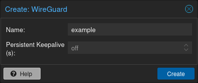
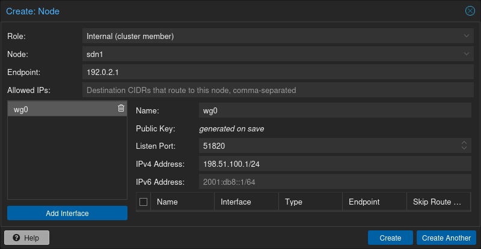
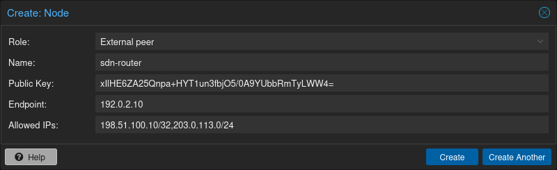
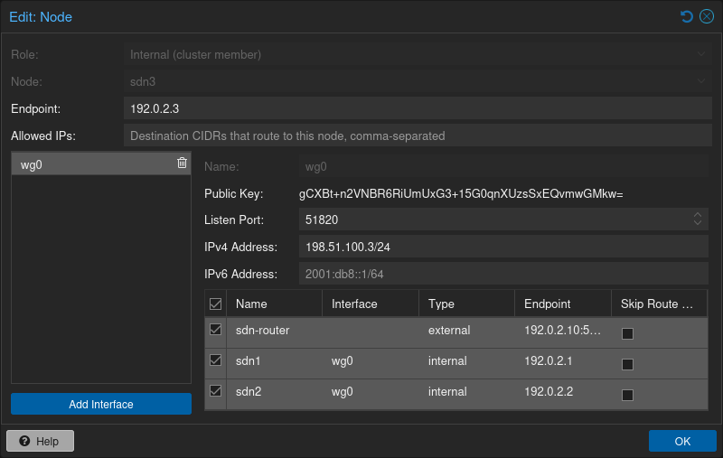

# 12.16. Examples <a href="#pvesdn_setup_examples" id="pvesdn_setup_examples"></a>

This section presents multiple configuration examples tailored for common SDN use cases. It aims to offer tangible implementations, providing additional details to enhance comprehension of the available configuration options.

## 12.16.1. Simple Zone Example <a href="#pvesdn_setup_example_simple" id="pvesdn_setup_example_simple"></a>

Simple zone networks create an isolated network for guests on a single host to connect to each other.


connection between guests are possible if all guests reside on a same host but cannot be reached on other nodes.


- Create a simple zone named `simple`.
- Add a VNet names `vnet1`.
- Create a Subnet with a gateway and the SNAT option enabled.
- This creates a network bridge `vnet1` on the node. Assign this bridge to the guests that shall join the network and configure an IP address.

The network interface configuration in two VMs may look like this which allows them to communicate via the 10.0.1.0/24 network.

```text
allow-hotplug ens19
iface ens19 inet static
        address 10.0.1.14/24
```

```text
allow-hotplug ens19
iface ens19 inet static
        address 10.0.1.15/24
```

## 12.16.2. Source NAT Example <a href="#pvesdn_setup_example_nat" id="pvesdn_setup_example_nat"></a>

If you want to allow outgoing connections for guests in the simple network zone the simple zone offers a Source NAT (SNAT) option.

Starting from the configuration [above](#pvesdn_setup_example_simple), Add a Subnet to the VNet `vnet1`, set a gateway IP and enable the SNAT option.

```text
Subnet: 172.16.0.0/24
Gateway: 172.16.0.1
SNAT: checked
```

In the guests configure the static IP address inside the subnet’s IP range.

The node itself will join this network with the Gateway IP *172.16.0.1* and function as the NAT gateway for guests within the subnet range.

## 12.16.3. VLAN Setup Example <a href="#pvesdn_setup_example_vlan" id="pvesdn_setup_example_vlan"></a>

When VMs on different nodes need to communicate through an isolated network, the VLAN zone allows network level isolation using VLAN tags.

Create a VLAN zone named `myvlanzone`:

```text
ID: myvlanzone
Bridge: vmbr0
```

Create a VNet named `myvnet1` with VLAN tag 10 and the previously created `myvlanzone`.

```text
ID: myvnet1
Zone: myvlanzone
Tag: 10
```

Apply the configuration through the main SDN panel, to create VNets locally on each node.

Create a Debian-based virtual machine (*vm1*) on node1, with a vNIC on `myvnet1`.

Use the following network configuration for this VM:

```text
auto eth0
iface eth0 inet static
        address 10.0.3.100/24
```

Create a second virtual machine (*vm2*) on node2, with a vNIC on the same VNet `myvnet1` as vm1.

Use the following network configuration for this VM:

```text
auto eth0
iface eth0 inet static
        address 10.0.3.101/24
```

Following this, you should be able to ping between both VMs using that network.

## 12.16.4. QinQ Setup Example <a href="#pvesdn_setup_example_qinq" id="pvesdn_setup_example_qinq"></a>

This example configures two QinQ zones and adds two VMs to each zone to demonstrate the additional layer of VLAN tags which allows the configuration of more isolated VLANs.

A typical use case for this configuration is a hosting provider that provides an isolated network to customers for VM communication but isolates the VMs from other customers.

Create a QinQ zone named `qinqzone1` with service VLAN 20

```text
ID: qinqzone1
Bridge: vmbr0
Service VLAN: 20
```

Create another QinQ zone named `qinqzone2` with service VLAN 30

```text
ID: qinqzone2
Bridge: vmbr0
Service VLAN: 30
```

Create a VNet named `myvnet1` with VLAN-ID 100 on the previously created `qinqzone1` zone.

```text
ID: qinqvnet1
Zone: qinqzone1
Tag: 100
```

Create a `myvnet2` with VLAN-ID 100 on the `qinqzone2` zone.

```text
ID: qinqvnet2
Zone: qinqzone2
Tag: 100
```

Apply the configuration on the main SDN web interface panel to create VNets locally on each node.

Create four Debian-bases virtual machines (vm1, vm2, vm3, vm4) and add network interfaces to vm1 and vm2 with bridge `qinqvnet1` and vm3 and vm4 with bridge `qinqvnet2`.

Inside the VM, configure the IP addresses of the interfaces, for example via `/etc/network/interfaces`:

```text
auto eth0
iface eth0 inet static
        address 10.0.3.101/24
```

Configure all four VMs to have IP addresses from the *10.0.3.101* to *10.0.3.104* range.

Now you should be able to ping between the VMs *vm1* and *vm2*, as well as between *vm3* and *vm4*. However, neither of VMs *vm1* or *vm2* can ping VMs *vm3* or *vm4*, as they are on a different zone with a different service-VLAN.

## 12.16.5. VXLAN Setup Example <a href="#pvesdn_setup_example_vxlan" id="pvesdn_setup_example_vxlan"></a>

The example assumes a cluster with three nodes, with the node IP addresses 192.168.0.1, 192.168.0.2 and 192.168.0.3.

Create a VXLAN zone named `myvxlanzone` and add all IPs from the nodes to the peer address list. Use the default MTU of 1450 or configure accordingly.

```text
ID: myvxlanzone
Peers Address List: 192.168.0.1,192.168.0.2,192.168.0.3
```

Create a VNet named `vxvnet1` using the VXLAN zone `myvxlanzone` created previously.

```text
ID: vxvnet1
Zone: myvxlanzone
Tag: 100000
```

Apply the configuration on the main SDN web interface panel to create VNets locally on each nodes.

Create a Debian-based virtual machine (*vm1*) on node1, with a vNIC on `vxvnet1`.

Use the following network configuration for this VM (note the lower MTU).

```text
auto eth0
iface eth0 inet static
        address 10.0.3.100/24
        mtu 1450
```

Create a second virtual machine (*vm2*) on node3, with a vNIC on the same VNet `vxvnet1` as vm1.

Use the following network configuration for this VM:

```text
auto eth0
iface eth0 inet static
        address 10.0.3.101/24
        mtu 1450
```

Then, you should be able to ping between between *vm1* and *vm2*.

## 12.16.6. EVPN Setup Example <a href="#pvesdn_setup_example_evpn" id="pvesdn_setup_example_evpn"></a>

The example assumes a cluster with three nodes (node1, node2, node3) with IP addresses 192.168.0.1, 192.168.0.2 and 192.168.0.3.

Create an EVPN controller, using a private ASN number and the above node addresses as peers.

```text
ID: myevpnctl
ASN#: 65000
Peers: 192.168.0.1,192.168.0.2,192.168.0.3
```

Create an EVPN zone named `myevpnzone`, assign the previously created EVPN-controller and define *node1* and *node2* as exit nodes.

```text
ID: myevpnzone
VRF VXLAN Tag: 10000
Controller: myevpnctl
MTU: 1450
VNet MAC Address: 32:F4:05:FE:6C:0A
Exit Nodes: node1,node2
```

Create the first VNet named `myvnet1` using the EVPN zone `myevpnzone`.

```text
ID: myvnet1
Zone: myevpnzone
Tag: 11000
```

Create a subnet on `myvnet1`:

```text
Subnet: 10.0.1.0/24
Gateway: 10.0.1.1
```

Create the second VNet named `myvnet2` using the same EVPN zone `myevpnzone`.

```text
ID: myvnet2
Zone: myevpnzone
Tag: 12000
```

Create a different subnet on ``myvnet2```:

```text
Subnet: 10.0.2.0/24
Gateway: 10.0.2.1
```

Apply the configuration from the main SDN web interface panel to create VNets locally on each node and generate the FRR configuration.

Create a Debian-based virtual machine (*vm1*) on node1, with a vNIC on `myvnet1`.

Use the following network configuration for *vm1*:

```text
auto eth0
iface eth0 inet static
        address 10.0.1.100/24
        gateway 10.0.1.1
        mtu 1450
```

Create a second virtual machine (*vm2*) on node2, with a vNIC on the other VNet `myvnet2`.

Use the following network configuration for *vm2*:

```text
auto eth0
iface eth0 inet static
        address 10.0.2.100/24
        gateway 10.0.2.1
        mtu 1450
```

Now you should be able to ping vm2 from vm1, and vm1 from vm2.

If you ping an external IP from *vm2* on the non-gateway node3, the packet will go to the configured *myvnet2* gateway, then will be routed to the exit nodes (*node1* or *node2*) and from there it will leave those nodes over the default gateway configured on node1 or node2.


You need to add reverse routes for the *10.0.1.0/24* and *10.0.2.0/24* networks to node1 and node2 on your external gateway, so that the public network can reply back.


If you have configured an external BGP router, the BGP-EVPN routes (10.0.1.0/24 and 10.0.2.0/24 in this example), will be announced dynamically.

## 12.16.7. WireGuard Setup Example <a href="#pvesdn_setup_example_wireguard" id="pvesdn_setup_example_wireguard"></a>

The example assumes a 3-node Proxmox cluster (*sdn1*, *sdn2* and *sdn3*) with the IP addresses `192.0.2.1`, `192.0.2.2` and `192.0.2.3`, as well as an external WireGuard peer (*sdn-router*) with IP address `192.0.2.10`.

In this example the Proxmox nodes as well as the external peer will be connected full-mesh via WireGuard in the `198.51.100.0/24` subnet and additionally the `203.0.113.0/24` subnet will be routed via the external WireGuard peer, `198.51.100.10`.

### Set Up WireGuard Fabric <a href="#_set_up_wireguard_fabric" id="_set_up_wireguard_fabric"></a>

[](https://pve.proxmox.com/pve-docs/images/screenshot/gui-datacenter-create-fabric-wireguard.png)

Click on *Datacenter* in the left-hand resource tree then navigate to *SDN* > *Fabrics* and create a new WireGuard fabric by clicking *Create* and selecting *WireGuard*.

Choose a name for the fabric, in this case *example* has been chosen.

### Set Up WireGuard Interfaces <a href="#_set_up_wireguard_interfaces" id="_set_up_wireguard_interfaces"></a>

[](https://pve.proxmox.com/pve-docs/images/screenshot/gui-datacenter-create-internal-node-wireguard.png)

Each participating node requires a WireGuard interface. This can be configured by adding a new node with type *Internal* to the WireGuard fabric, selecting the respective node and then creating a new WireGuard interface.

On the node itself, two properties can be configured: *Endpoint* and *Allowed IPs*. *Endpoint* refers to the IP/hostname that will be used for connecting to this node, `192.0.2.1` in the case of sdn1. Since no additional subnets should be routed via this node in this example, leave the *Allowed IPs* field empty.

Create a new WireGuard interface, `wg0`, and configure the IP address that should be configured on the WireGuard interface, `198.51.100.1/24` in the case of sdn1. The default listen port is `51820`, but can be manually changed via the *Listen Port* field. A public/private key pair will be automatically created for every new WireGuard interface.

### Set Up External Node <a href="#_set_up_external_node" id="_set_up_external_node"></a>

[](https://pve.proxmox.com/pve-docs/images/screenshot/gui-datacenter-create-external-node-wireguard.png)

In order to add an external node, add another node to the WireGuard fabric, but select type *External* in the node creation dialog. Enter the public key of the interface of the external node, as well as the IP/hostname + port that can be used to reach this external peer (`192.0.2.10:51820` in this example). Add the IP of the node, `198.51.100.10/32`, as well as the `203.0.113.0/24` subnet to the allowed IPs field.

### Set Up WireGuard Peerings <a href="#_set_up_wireguard_peerings" id="_set_up_wireguard_peerings"></a>

[](https://pve.proxmox.com/pve-docs/images/screenshot/gui-datacenter-select-peers-wireguard.png)

Now that all interfaces and external peers have been set up, they can be selected as peers in the WireGuard interface configuration. Add the nodes *sdn2* and *sdn3*, as well as *sdn-router* to the peers of the interface `wg0` on node *sdn1*:

This will generate the following `wg0.conf` file in `/etc/wireguard/proxmox`:

```text
root@sdn1:~# cat /etc/wireguard/proxmox/wg0.conf
[Interface]
PrivateKey = EpP9R0kqNA1UjGGeDL0/y9Ok66G44dqa2ALYJ0jTWwQ=
ListenPort = 51820

[Peer]
PublicKey = xIlHE6ZA25Qnpa+HYT1un3fbjO5/0A9YUbbRmTyLWW4=
AllowedIPs = 198.51.100.10/32, 203.0.113.0/24
Endpoint = 192.0.2.10:51820

[Peer]
PublicKey = CKClJbQ42U1pQM8MqMGCa1IpZbNcqb+OJBxVWJHIrx4=
AllowedIPs = 198.51.100.2/32
Endpoint = 192.0.2.2:51820

[Peer]
PublicKey = gCXBt+n2VNBR6RiUmUxG3+15G0qnXUzsSxEQvmwGMkw=
AllowedIPs = 198.51.100.3/32
Endpoint = 192.0.2.3:51820
```

There is a `[Peer]` section for each selected peer. The IP configured on the WireGuard interfaces will be added to the *Allowed IPs* of a peer as well.

### Verifying the Setup <a href="#_verifying_the_setup" id="_verifying_the_setup"></a>

Verify connectivity to the other participants in the WireGuard fabric by pinging:

```text
root@sdn1:~# ping -c1 198.51.100.2
PING 198.51.100.2 (198.51.100.2) 56(84) bytes of data.
64 bytes from 198.51.100.2: icmp_seq=1 ttl=64 time=2.08 ms

--- 198.51.100.2 ping statistics ---
1 packets transmitted, 1 received, 0% packet loss, time 0ms
rtt min/avg/max/mdev = 2.083/2.083/2.083/0.000 ms


root@sdn1:~# ping -c1 198.51.100.3
PING 198.51.100.3 (198.51.100.3) 56(84) bytes of data.
64 bytes from 198.51.100.3: icmp_seq=1 ttl=64 time=2.26 ms

--- 198.51.100.3 ping statistics ---
1 packets transmitted, 1 received, 0% packet loss, time 0ms
rtt min/avg/max/mdev = 2.255/2.255/2.255/0.000 ms


root@sdn1:~# ping -c1 198.51.100.10
PING 198.51.100.10 (198.51.100.10) 56(84) bytes of data.
64 bytes from 198.51.100.10: icmp_seq=1 ttl=64 time=1.29 ms

--- 198.51.100.10 ping statistics ---
1 packets transmitted, 1 received, 0% packet loss, time 0ms
rtt min/avg/max/mdev = 1.286/1.286/1.286/0.000 ms
```

---

来源：[Proxmox VE 官方文档](https://pve.proxmox.com/pve-docs/pve-admin-guide.html) · 版本 9.2.13 · 非官方中文翻译。
