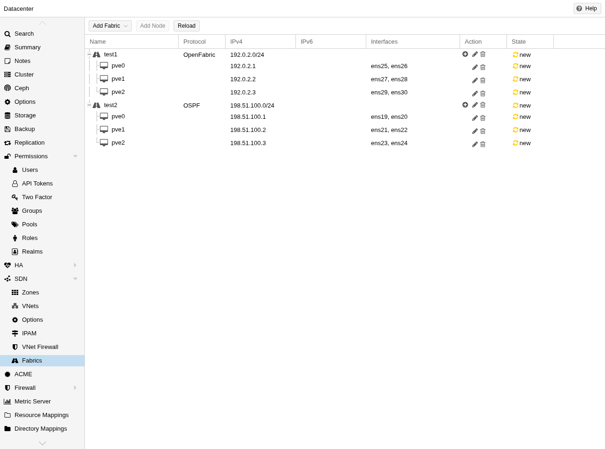
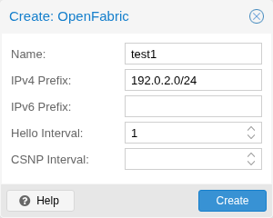
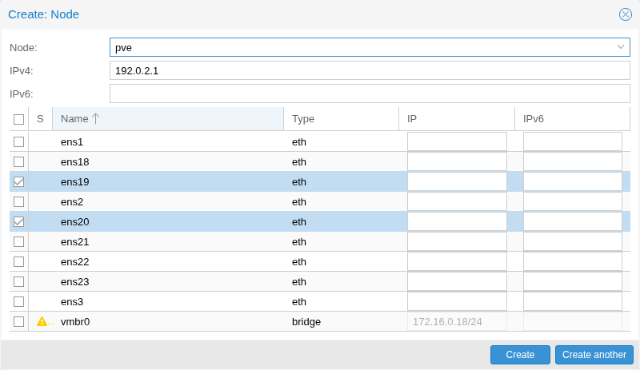
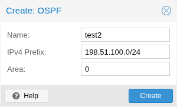
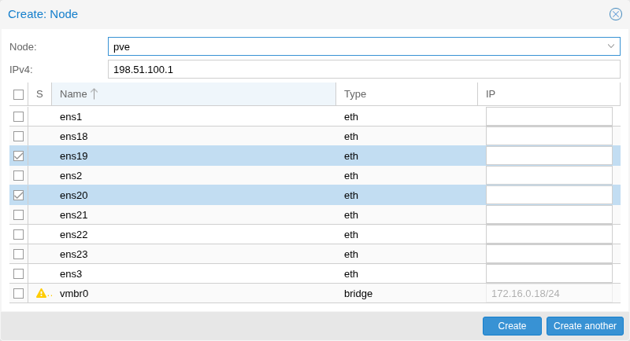
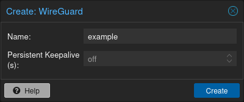
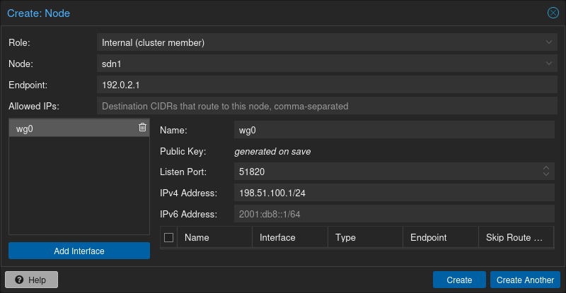
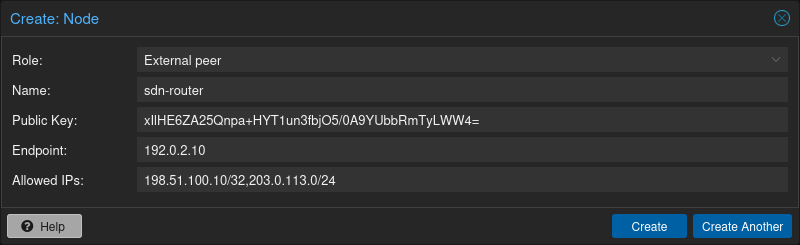
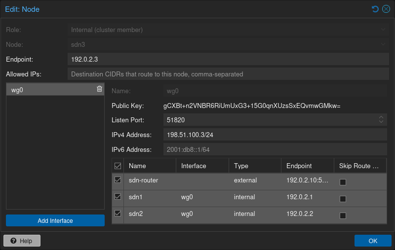

# 12\. 软件定义网络 <a href="#chapter_pvesdn" id="chapter_pvesdn"></a>

Proxmox VE 的 <strong>S</strong>oftware-<strong>D</strong>efined <strong>N</strong>etwork（SDN，软件定义网络）功能支持创建虚拟区域和网络（VNet）。此功能可简化高级网络配置和多租户设置。

## 12.1. 简介 <a href="#pvesdn_overview" id="pvesdn_overview"></a>

Proxmox VE SDN 使用灵活的软件控制配置，实现虚拟客户机网络的隔离和精细控制。

隔离通过 <strong>区域</strong>、虚拟网络（<strong>VNet</strong>）和 <strong>子网</strong> 管理。区域是独立的虚拟隔离网络区域。VNet 是属于某个区域的虚拟网络。子网是 VNet 内的一个 IP 地址范围。

根据区域类型的不同，网络具有不同的行为，并提供特定的功能、优势和限制。

SDN 的用例包括各个节点上隔离的私有网络，以及跨不同地点的多个 PVE 集群的复杂覆盖网络。

在集群范围的数据中心 SDN 管理界面中配置 VNet 后，它会作为普通 Linux 网桥在每个节点本地可用，可分配给虚拟机和容器。

## 12.2. 支持状态 <a href="#pvesdn_support_status" id="pvesdn_support_status"></a>

### 12.2.1. 历史 <a href="#history" id="history"></a>

Proxmox VE SDN 协议栈自 2019 年起作为实验性功能提供，并一直由众多开发者和用户持续改进和测试。在 Proxmox VE 6.2 中集成到 Web 界面，标志着迈向更广泛集成的重要里程碑。在 Proxmox VE 7 发布周期中，增加了许多改进和功能。根据用户反馈，可以看出基本设计选择及其实现相当可靠、稳定。因此，将其标记为“实验性”已不能准确反映 SDN 协议栈的状态。在 Proxmox VE 8 中，决定将网络和接口管理提升为 Proxmox VE 访问控制栈的核心组件，为全面集成 SDN 功能奠定基础。在 Proxmox VE 8.1 中实现了两个主要里程碑：首先，在 IP 地址管理（IPAM）功能中加入了 DHCP 集成；其次，现在默认安装 SDN 集成。

### 12.2.2. 当前状态 <a href="#current_status" id="current_status"></a>

SDN 安装各层的当前支持状态如下：

- 核心 SDN 包括 VNet 管理及其与 Proxmox VE 协议栈的集成，已获得完全支持。
- IPAM（包括虚拟客户机的 DHCP 管理）处于技术预览阶段。
- 通过 FRRouting 的复杂路由和控制器集成处于技术预览阶段。

## 12.3. 安装 <a href="#pvesdn_installation" id="pvesdn_installation"></a>

### 12.3.1. SDN 核心 <a href="#sdn_core" id="sdn_core"></a>

从 Proxmox VE 8.1 开始，默认安装核心软件定义网络（SDN）软件包。

如果从较早版本升级，需要在每个节点上安装 `libpve-network-perl` 软件包：

```text
apt update
apt install libpve-network-perl
```


Proxmox VE 7.0 及以上版本默认安装 `ifupdown2` 软件包。如果系统最初安装的是较早版本，需要显式安装 `ifupdown2` 软件包。


安装后，需要确保所有节点的 `/etc/network/interfaces` 配置文件末尾都包含以下行，以便包含并激活 SDN 配置。

```text
source /etc/network/interfaces.d/*
```

### 12.3.2. DHCP IPAM <a href="#pvesdn_install_dhcp_ipam" id="pvesdn_install_dhcp_ipam"></a>

内置 <em>PVE</em> IP 地址管理栈的 DHCP 集成目前使用 `dnsmasq` 发放 DHCP 租约。目前需要选择启用此功能。

要使用此功能，需要在每个节点上安装 `dnsmasq` 软件包：

```text
apt update
apt install dnsmasq
# disable default instance
systemctl disable --now dnsmasq
```

### 12.3.3. FRRouting <a href="#pvesdn_install_frrouting" id="pvesdn_install_frrouting"></a>

Proxmox VE SDN 协议栈使用 [FRRouting](https://frrouting.org/) 项目实现高级设置。目前需要选择启用此功能。

要使用 SDN 路由集成，需要在所有节点上安装 `frr-pythontools` 软件包：

```text
apt update
apt install frr-pythontools
```

然后在所有节点上启用 frr 服务：

```text
systemctl enable frr.service
```

## 12.4. 配置概述 <a href="#pvesdn_main_configuration" id="pvesdn_main_configuration"></a>

在数据中心级别的 Web UI 中进行配置，分为以下部分：

- SDN：在此可查看当前活动 SDN 状态的概览，并将所有待处理更改应用到整个集群。
- [区域](#pvesdn_config_zone)：创建和管理虚拟隔离的网络区域
- [VNet](#pvesdn_config_vnet)：创建虚拟网桥并管理子网

“选项”类别允许添加和管理 SDN 设置中使用的其他服务。

- [控制器](#pvesdn_config_controllers)：用于控制复杂设置中的三层路由
- [DHCP](#pvesdn_config_dhcp)：为区域定义 DHCP 服务器，自动在 IPAM 中为客户机分配 IP，并通过 DHCP 将其租给客户机。
- [IPAM](#pvesdn_config_ipam)：启用客户机的外部 IP 地址管理
- [DNS](#pvesdn_config_dns)：定义 DNS 服务器集成，用于注册虚拟客户机的主机名和 IP 地址

## 12.5. 技术与配置 <a href="#pvesdn_tech_and_config_overview" id="pvesdn_tech_and_config_overview"></a>

Proxmox VE 软件定义网络实现尽可能使用标准 Linux 网络功能。这是因为现代 Linux 网络功能几乎能够满足功能完整的 SDN 实现的全部需求，同时避免添加外部依赖，并减少可能发生故障的组件总数。

Proxmox VE SDN 配置位于 `/etc/pve/sdn`，通过 Proxmox VE [配置文件系统](../06-pmxcfs/README.md) 与所有其他集群节点共享。这些配置会转换为管理底层网络协议栈的工具（例如 `ifupdown2` 或 `frr`）各自所需的配置格式。

新更改不会立即应用，而是先记录为待处理状态。然后可以在 Web 界面的主 <em>SDN</em> 概览面板中一次性应用一组不同的更改。此系统允许将多项更改作为单个原子更改推出。

SDN 通过 <em>.running-config</em> 和 <em>.version</em> 文件跟踪已推出的状态，这些文件位于 <em>/etc/pve/sdn</em>。

## 12.6. 区域 <a href="#pvesdn_config_zone" id="pvesdn_config_zone"></a>

区域定义一个虚拟隔离的网络。区域被限制到特定节点并分配权限，以便将用户限制在某个区域及其中包含的 VNet 内。

可使用不同技术实现隔离：

- Simple：隔离的网桥。一个简单的三层路由网桥（NAT）
- VLAN：虚拟局域网是细分局域网的传统方法
- QinQ：堆叠 VLAN（正式名称为 `IEEE 802.1ad`）
- VXLAN：通过 UDP 隧道建立的二层 VXLAN 网络
- EVPN（BGP EVPN）：结合 BGP 的 VXLAN，用于建立三层路由

### 12.6.1. 通用选项 <a href="#pvesdn_config_common_options" id="pvesdn_config_common_options"></a>

以下选项适用于所有区域类型：

**节点**

应部署该区域及相关 VNet 的节点。

**IPAM**

使用 IP 地址管理（IPAM）工具管理区域中的 IP。可选，默认为 `pve`。

**DNS**

DNS API 服务器。可选。

**ReverseDNS**

反向 DNS API 服务器。可选。

**DNSZone**

DNS 域名。用于注册主机名，例如 `<hostname>.<domain>`。DNS 区域必须已存在于 DNS 服务器上。可选。

### 12.6.2. Simple 区域 <a href="#pvesdn_zone_plugin_simple" id="pvesdn_zone_plugin_simple"></a>

这是最简单的插件。它会创建一个隔离的 VNet 网桥。此网桥不连接物理接口，虚拟机流量仅在各节点本地流通。可用于 NAT 或路由设置。

### 12.6.3. VLAN 区域 <a href="#pvesdn_zone_plugin_vlan" id="pvesdn_zone_plugin_vlan"></a>

VLAN 插件使用现有的本地 Linux 或 OVS 网桥连接节点的物理接口。它使用 VNet 中定义的 VLAN 标签隔离网段。这可实现不同节点之间的虚拟机连接。

VLAN 区域配置选项：

**网桥**

本地网桥或 OVS 交换机，已在 <strong>每个</strong> 节点上配置，允许节点间连接。

### 12.6.4. QinQ 区域 <a href="#pvesdn_zone_plugin_qinq" id="pvesdn_zone_plugin_qinq"></a>

QinQ 又称 VLAN 堆叠，使用多层 VLAN 标签进行隔离。QinQ 区域定义外层 VLAN 标签（<em>服务 VLAN</em>），而内层 VLAN 标签由 VNet 定义。


物理网络交换机必须支持堆叠 VLAN 才能使用此配置。


QinQ 区域配置选项：

**网桥**

已在每个本地节点上配置的、支持 VLAN 感知的本地网桥

**服务 VLAN**

此区域的主 VLAN 标签

**服务 VLAN 协议**

允许选择 802.1q（默认）或 802.1ad 服务 VLAN 类型。

**MTU**

由于标签双层堆叠，QinQ VLAN 需要额外 4 字节。例如，必须将 MTU 减小为 `1496`，如果物理接口 MTU 为 `1500`。

### 12.6.5. VXLAN 区域 <a href="#pvesdn_zone_plugin_vxlan" id="pvesdn_zone_plugin_vxlan"></a>

VXLAN 插件在现有网络（底层网络）上建立隧道（覆盖网络）。它将二层以太网帧封装在四层 UDP 数据报中，使用默认目标端口 `4789`。

必须自行配置底层网络，以实现所有对等方之间的 UDP 连接。

例如，可以在公共互联网上创建 VXLAN 覆盖网络，使虚拟机看起来就像共享同一个本地二层网络。


VXLAN 本身不提供任何加密。通过 VXLAN 连接多个站点时，务必在站点之间建立安全连接，例如使用站点到站点 VPN。


VXLAN 区域配置选项：

**对等方地址列表**

VXLAN 区域中每个节点的 IP 地址列表。可以是通过此 IP 地址可达的外部节点。此处必须列出集群中的所有节点。

**SDN 网络结构**

使用 [网络结构](#pvesdn_config_fabrics) 自动生成对等方列表，以替代手动定义所有对等方。

**MTU**

由于 VXLAN 封装占用 50 字节，MTU 需要比传出物理接口低 50 字节。

### 12.6.6. EVPN 区域 <a href="#pvesdn_zone_plugin_evpn" id="pvesdn_zone_plugin_evpn"></a>

EVPN 区域创建可跨多个集群的可路由三层网络。这通过建立 VPN 并使用 BGP 作为路由协议来实现。

EVPN 的 VNet 可具有任播 IP 地址和/或 MAC 地址。各节点的网桥 IP 相同，因此虚拟客户机可将此地址用作网关。

路由可通过 VRF（虚拟路由与转发）接口跨不同区域的 VNet 工作。

EVPN 区域配置选项：

**VRF VXLAN ID**

用于 VNet 之间专用路由互联的 VXLAN-ID。必须与 VNet 的 VXLAN-ID 不同。

**主控制器**

此区域使用的主 EVPN 控制器。主控制器用于根据对等方定义自动推导 VTEP IP。更多信息请参阅 [控制器一节](#pvesdn_controller_plugin_evpn)。

**其他控制器**

此区域使用的其他 EVPN 控制器。此处列出的控制器会通告此区域的 L2VPN EVPN 路由。

**VNet MAC 地址**

分配给此区域所有 VNet 的任播 MAC 地址。如果未定义，将自动生成。

**出口节点**

应配置为从 EVPN 网络通过实际网络出去的出口网关的节点。配置的节点会在 EVPN 网络中通告默认路由。可选。

**主出口节点**

如果使用多个出口节点，强制流量通过此主出口节点，而非在所有节点上进行负载均衡。可选，但如果要使用 SNAT 或上游路由器不支持 ECMP，则必须设置。

**出口节点本地路由**

如果需要从出口节点访问虚拟机/容器服务，可使用此特殊选项。（默认情况下，出口节点仅允许在实际网络与 EVPN 网络之间转发流量。）可选。

**通告子网**

在 EVPN 网络中通告整个子网。如果存在静默的虚拟机/容器（例如有多个 IP，而任播网关看不到这些 IP 的流量，则这些 IP 地址将无法在 EVPN 网络内部访问）。可选。

**禁用 ARP ND 抑制**

不抑制 ARP 或 ND（邻居发现）数据包。如果在虚拟机中使用浮动 IP（IP 和 MAC 地址在系统之间移动），则需要此选项。可选。

**导入路由目标**

允许导入外部 EVPN 路由目标列表。用于跨数据中心或不同 EVPN 网络的互联。可选。

**MTU**

由于 VXLAN 封装占用 50 字节，MTU 需要比传出物理接口的最大 MTU 低 50 字节。可选，默认为 1450。

## 12.7. VNet <a href="#pvesdn_config_vnet" id="pvesdn_config_vnet"></a>

通过 SDN GUI 创建虚拟网络（VNet）后，每个节点上都会出现同名的本地网络接口。要将客户机连接到 VNet，请将该接口分配给客户机，并相应设置 IP 地址。

根据区域的不同，这些选项具有不同含义，本文档相应区域的章节中进行了说明。


目前，某些选项可能在特定区域中无效或无法工作。


VNet 配置选项：

**ID**

标识 VNet 的 ID，最多 8 个字符

**别名**

更具描述性的标识符。作为别名分配给接口。可选

**区域**

此 VNet 关联的区域

**标签**

唯一的 VLAN 或 VXLAN ID

**VLAN 感知**

在接口上启用 vlan-aware 选项，允许在客户机中配置。

**隔离端口**

为此接口的所有客户机端口设置隔离标志，但不对接口本身设置。这意味着客户机只能向非隔离的网桥端口发送流量，也就是网桥本身。要使此设置生效，需要重启受影响的客户机。


端口隔离仅在每台宿主机本地生效。使用 [VNET 防火墙](#pvesdn_firewall_integration) 进一步隔离 VNET 内跨节点的流量。例如，默认 DROP，仅允许从 IP 子网到网关及反向的流量。


## 12.8. 子网 <a href="#pvesdn_config_subnet" id="pvesdn_config_subnet"></a>

子网定义由 CIDR 网络地址描述的特定 IP 范围。每个 VNet 可以具有一个或多个子网。

子网可用于：

- 限制可在特定 VNet 上定义的 IP 地址
- 在三层区域中的 VNet 上分配路由/网关
- 在三层区域中的 VNet 上启用 SNAT
- 通过 IPAM 插件为虚拟客户机（虚拟机或容器）自动分配 IP
- 通过 DNS 插件进行 DNS 注册

如果 IPAM 服务器与子网区域关联，子网前缀将自动注册到 IPAM 中。

子网配置选项：

**ID**

CIDR 网络地址，例如 10.0.0.0/8

**网关**

网络默认网关的 IP 地址。在三层区域（Simple/EVPN 插件）中，它将部署在 VNet 上。

**SNAT**

启用源 NAT，将数据包转发到节点的传出接口，使 VNet 内的虚拟机能够连接外部网络。在 EVPN 区域中，转发在 EVPN 网关节点上完成。可选。

**DNS 区域前缀**

向域名注册添加前缀，例如 \<hostname\>.prefix.\<domain\>。可选。

## 12.9. 控制器 <a href="#pvesdn_config_controllers" id="pvesdn_config_controllers"></a>

某些区域实现了分离的控制平面和数据平面，需要外部控制器管理 VNet 的控制平面。

目前，仅 `EVPN` 区域需要外部控制器。

### 12.9.1. EVPN 控制器 <a href="#pvesdn_controller_plugin_evpn" id="pvesdn_controller_plugin_evpn"></a>

`EVPN` 区域需要外部控制器管理控制平面。EVPN 控制器插件配置 Free Range Routing（frr）路由器。

要启用 EVPN 控制器，需要在每个节点上启用 FRR，参见 [安装 FRRouting](#pvesdn_install_frrouting)。

EVPN 控制器配置选项：

**ASN 编号**

唯一的 BGP ASN 编号。强烈建议使用私有 ASN 编号（64512 – 65534、4200000000 – 4294967294），否则可能意外破坏全局路由。在同一节点上配置的每个 EVPN 控制器必须配置相同的 ASN。

**SDN 网络结构**

包含 EVPN 区域中所有节点的 [网络结构](#pvesdn_config_fabrics)。将用作底层网络。

**对等方**

属于 EVPN 区域的所有节点的 IP 列表。（也可以是外部节点或路由反射器服务器）

**节点**

应激活此控制器的节点列表。可用于仅在特定节点上配置 EVPN 对等会话。

**对等组名称**

EVPN 控制器默认使用对等组名称 <em>VTEP</em>。定义多个 EVPN 控制器时，每个额外的控制器都需要指定用于 FRR 配置的自定义对等组名称。

**BGP 模式**

允许手动配置 BGP 会话类型。<em>auto</em> 模式保留 SDN 协议栈的旧行为：除非配置了 BGP 控制器，否则 EVPN 控制器使用 iBGP。如果配置了 BGP 控制器，EVPN 控制器将复用 BGP 控制器的 BGP 会话。通过此选项，可以手动覆盖 BGP 会话类型，从而显式配置应与 EVPN 控制器建立的 BGP 会话类型。

**ebgp-multihop**

如果对等方不直接连接或使用回环，增加到达对等方的跳数。（仅适用于 BGP 模式 <em>external</em>）。

#### ASN <a href="#asn" id="asn"></a>

每个路由器只能属于一个自治系统，因此给定节点上的所有 iBGP 会话（无论地址族如何）都需要配置相同的 ASN。任何包含两个不同 ASN 的 iBGP 会话的配置都会被拒绝并引发错误，因为按定义，同一个 BGP 实例不可能具有两个 ASN 不同的 iBGP 会话，一个实例只能具有一个本地 ASN。

FRR 实例的本地 ASN 根据 SDN 控制器中的设置自动推导：

如果仅存在 BGP 或 EVPN 控制器（但并非两者都存在），则使用相应控制器的 ASN。

出于向后兼容的考虑，SDN 协议栈会检查是否存在处于 auto 模式的 EVPN 控制器。如果存在 BGP 控制器，则无论如何都将使用 BGP 控制器的 ASN。

否则，如果配置了 EVPN 控制器，则使用 EVPN 控制器的 ASN；否则使用 BGP 控制器的 ASN。

SDN 协议栈在 FRR 配置中将 local-as 指令与 `no-prepend
replace-as` 选项结合使用，以处理配置中的多个 ASN 编号。当 BGP 和 EVPN 控制器配置了不同的 ASN 且禁用了 auto 模式时，就属于此情况。

#### VTEP IP 自动生成 <a href="#vtep_ip_auto_generation" id="vtep_ip_auto_generation"></a>

区域的 VXLAN 设备的 VTEP IP 会根据 EVPN 区域中定义的（主）控制器自动推导：

如果使用带有回环接口的 BGP 或 IS-IS 控制器，则将回环接口的 IP 用作 VTEP IP。

如果控制器的对等方列表包含节点本地配置的 IP，则将此 IP 用作 VTEP IP。

否则，EVPN 控制器会检查默认路由表中到第一个对等方 IP 的路由，并将路由表中指定的源 IP 地址用作 VTEP IP。如果路由通过网络结构等方式动态通告，可能会导致问题。在这种情况下，应用 EVPN 控制器配置时，内核路由表必须包含所需条目。

### 12.9.2. BGP 控制器 <a href="#pvesdn_controller_plugin_bgp" id="pvesdn_controller_plugin_bgp"></a>

区域不直接使用 BGP 控制器。可以使用它配置 FRR 来管理 BGP 对等方。

对于 BGP-EVPN，可用它为每个节点定义不同的 ASN，从而实现 EBGP。也可用它向外部 BGP 对等方导出 EVPN 路由。


默认情况下，简单的全网状 EVPN 不需要定义 BGP 控制器。


BGP 控制器配置选项：

**节点**

此 BGP 控制器所在的节点

**ASN 编号**

唯一的 BGP ASN 编号。强烈建议使用范围为（64512 \- 65534）或（4200000000 \- 4294967294）的私有 ASN 编号，否则可能意外破坏全局路由。

**对等方**

希望通过底层 BGP 网络与之通信的对等方 IP 地址列表。

**EBGP**

如果对等方的 remote-AS 不同，此选项将启用 EBGP。

**回环接口**

将回环或 dummy 接口用作 EVPN 网络的源（用于多路径）。

**ebgp-multihop**

如果对等方不直接连接或使用回环，增加到达对等方的跳数。

**bgp-multipath-as-path-relax**

如果对等方具有不同的 ASN，允许 ECMP。

### 12.9.3. ISIS 控制器 <a href="#pvesdn_controller_plugin_isis" id="pvesdn_controller_plugin_isis"></a>

区域不直接使用 ISIS 控制器。可以使用它配置 FRR，将 EVPN 路由导出到 ISIS 域。

ISIS 控制器配置选项：

**节点**

此 ISIS 控制器所在的节点。

**域**

唯一的 ISIS 域。

**网络实体名称**

标识此节点的唯一 ISIS 网络地址。

**接口**

ISIS 使用的物理接口列表。

**回环**

将回环或 dummy 接口用作 EVPN 网络的源（用于多路径）。

## 12.10. 网络结构 <a href="#pvesdn_config_fabrics" id="pvesdn_config_fabrics"></a>

[](https://pve.proxmox.com/pve-docs/images/screenshot/gui-datacenter-fabrics-overview.png)

Proxmox VE SDN 中的网络结构可在集群节点之间提供自动路由。它们简化节点之间底层网络的配置，为 SDN 部署奠定基础。

它们会自动在物理网络接口上配置路由协议，以建立集群节点之间的连接。这会创建能够适应网络拓扑变化、具备弹性并可自动配置的网络结构。这些网络结构可用作 Ceph 的全网状网络，或用于 EVPN 控制器和 VXLAN 区域。

### 12.10.1. 安装 <a href="#installation" id="installation"></a>

使用 FRR 的 OpenFabric 和 OSPF 实现，因此首先确保安装了 `frr` 和 `frr-pythontools` 软件包：

```text
apt update
apt install frr frr-pythontools
```

### 12.10.2. 权限 <a href="#permissions_2" id="permissions_2"></a>

要查看 SDN 网络结构的配置，用户需要 SDN.Audit 或 SDN.Allocate 权限。要创建或修改网络结构配置，用户需要 SDN.Allocate 权限。要查看节点配置，用户需要 Sys.Audit 或 Sys.Modify 权限。在网络结构内添加或更新节点时，还需要对特定节点具有 Sys.Modify 权限，因为此操作涉及写入节点的 /etc/network/interfaces 文件。

### 12.10.3. 配置 <a href="#configuration_13" id="configuration_13"></a>

要创建网络结构，进入“数据中心→SDN→网络结构”并点击“添加网络结构”。选择所需协议后，即会创建网络结构。通过“\+”按钮，可以选择要添加到网络结构的节点，还必须选择用于与其他节点通信的接口。

#### 回环前缀 <a href="#loopback_prefix" id="loopback_prefix"></a>

可以指定 CIDR 网络范围（例如 192.0.2.0/24）作为网络结构的回环前缀。配置后，系统会自动验证所有 router-ID 均包含于此前缀中。这可确保地址方案一致，并有助于防止地址冲突或错误。

#### Router-ID 选择 <a href="#router_id_selection" id="router_id_selection"></a>

网络结构中的每个节点都需要一个唯一的 router-ID，它是以点分十进制表示的 IPv4 地址（例如 192.0.2.1）。在 OpenFabric 中，也可以是以冒号分隔的常规十六进制表示的 IPv6 地址（例如 2001:db8::1428:57ab）。系统会自动创建以 router-ID 为地址的 dummy 接口，并将其作为网络结构的回环接口（默认也为被动接口）。

#### 路由映射 <a href="#routemaps" id="routemaps"></a>

为每个网络结构自动创建一个 access-list 和一个 route-map。它们配置路由器以重写传出数据包的源地址。与其他节点通信时（例如 ping 该节点），这可确保流量源自本地 dummy 接口的 IP 地址，而非物理接口。这可在整个网络结构中提供一致的路由行为和适当的源地址选择。

#### 关于 IPv6 的说明 <a href="#pvesdn_config_fabrics_ipv6" id="pvesdn_config_fabrics_ipv6"></a>

目前，IPv6 仅可用于 OpenFabric 网络结构。这些 IPv6 网络结构需要在其中所有节点上启用全局 IPv6 转发。如果没有 IPv6 转发，非全网状网络结构将无法工作，因为中转节点不会向外部节点转发数据包。目前尚无类似 IPv4 的简单方法按接口启用 IPv6 转发，因此必须全局启用。为此，可追加以下行：

```text
post-up sysctl -w net.ipv6.conf.all.forwarding=1
```

到网络结构接口中，位于 `/etc/network/interfaces` 文件内。这样，该接口启动时就会全局启用 IPv6 转发。请注意，这会影响接口处理自动 IPv6 设置（SLAAC）、邻居通告、路由器请求和路由器通告的方式。更多详情参见：[https://www.kernel.org/doc/Documentation/networking/ip-sysctl.txt](https://www.kernel.org/doc/Documentation/networking/ip-sysctl.txt) 中的 `net.ipv6.conf.all.forwarding`。

### 12.10.4. OpenFabric <a href="#pvesdn_openfabric" id="pvesdn_openfabric"></a>

OpenFabric 是专为数据中心网络结构设计的路由协议。它基于 IS-IS，并针对数据中心常见的脊叶拓扑进行了优化。

[](https://pve.proxmox.com/pve-docs/images/screenshot/gui-datacenter-create-fabric-openfabric.png)

配置选项：

#### 网络结构上的选项 <a href="#pvesdn_openfabric_fabric" id="pvesdn_openfabric_fabric"></a>

**名称**

这是 OpenFabric 网络结构的名称，最长为 8 个字符。

**IPv4 前缀**

IPv4 CIDR 网络范围（例如 192.0.2.0/24），用于验证网络结构中的所有 router-ID 都包含于此前缀中。

**IPv6 前缀**

IPv6 CIDR 网络范围（例如 2001:db8::/64），用于验证网络结构中的所有 router-ID 都包含于此前缀中。


要使 IPv6 网络结构正常工作，需要在所有节点上启用全局转发。有关操作方法和更多信息，请查看 [关于 IPv6 的说明](#pvesdn_config_fabrics_ipv6)。


**Hello 间隔**

控制发送 hello 数据包以发现并维护与相邻节点连接的频率（秒）。较低值可更快检测故障，但会增加网络流量。此选项在网络结构中为全局设置，即此网络结构中每个节点的每个接口都会继承此 hello-interval 属性。默认值为 3 秒。

**CSNP 间隔**

设置节点与邻居同步路由数据库的频率（秒）。较低值可更快同步网络拓扑信息，但会增加网络流量。此选项在网络结构中为全局设置，即此网络结构中每个节点的每个接口都会继承此属性。默认值为 10 秒。

#### 节点上的选项 <a href="#pvesdn_openfabric_node" id="pvesdn_openfabric_node"></a>

[](https://pve.proxmox.com/pve-docs/images/screenshot/gui-datacenter-create-node-openfabric.png)

属于网络结构的每个节点上都可用的选项：

**节点**

选择要添加到网络结构的节点。仅显示当前在集群中的节点。

**IPv4**

用于生成 OpenFabric 网络实体名称（NET）的唯一 IPv4 地址。同一网络结构中的每个节点必须具有不同的 Router-ID，而单个节点必须在所有网络结构中使用相同的 NET 地址（如果未提供，Proxmox VE 会自动选择一个并确保配置有效）。

**IPv6**

用于生成 OpenFabric 网络实体名称（NET）的唯一 IPv6 地址。同一网络结构中的每个节点必须具有不同的 Router-ID，而单个节点必须在所有网络结构中使用相同的 NET 地址。如果同时配置 IPv4 和 IPv6 地址，将使用 IPv4 地址推导 NET。


使用 IPv6 地址时，使用最后 3 段生成 NET。确保这些段在节点之间各不相同。


**接口**

指定用于与其他 OpenFabric 节点建立对等连接的接口。最好选择未预先分配 IP 地址的接口，然后按需在 IPv4/IPv6 列中配置地址。系统会自动创建具有 router-id 的 dummy“回环”接口。

#### 接口上的选项 <a href="#on_the_interface" id="on_the_interface"></a>

启用附加列后，可为每个接口配置以下可选参数：

**IP**

应自动在此接口上配置的 IPv4 地址。必须包含网络掩码（例如 /31）

**IPv6**

应自动在此接口上配置的 IPv6 地址。必须包含网络掩码（例如 /127）。

**Hello 倍数**

定义丢失多少个 hello 数据包后将连接视为故障。较高值可使连接更能容忍丢包，但会减慢故障检测。默认值为 10。


如果移除的接口在 `/etc/network/interfaces` 中有条目且设置了 `manual`，则应用 SDN 配置时不会移除该 IP。


### 12.10.5. OSPF <a href="#pvesdn_ospf" id="pvesdn_ospf"></a>

OSPF（开放最短路径优先）是一种广泛使用的链路状态路由协议，可高效计算通过 IP 网络路由流量的最短路径。

[](https://pve.proxmox.com/pve-docs/images/screenshot/gui-datacenter-create-fabric-ospf.png)

配置选项：

#### 网络结构上的选项 <a href="#pvesdn_ospf_fabric" id="pvesdn_ospf_fabric"></a>

**IPv4 前缀**

IPv4 CIDR 网络范围（例如 192.0.2.0/24），用于验证网络结构中的所有 router-ID 都包含于此前缀中。

**区域**

指定 OSPF 区域标识符，可以是 32 位有符号整数或 IP 地址。区域用于以层次方式组织 OSPF 网络，其中区域 0（或 0.0.0.0）作为骨干区域。

**重分发**

可选的源协议列表，其路由将导入 OSPF。每个条目选择一个来源（`bgp`、`connected`、`kernel` 或 `static`），还可引用 [路由映射](#pvesdn_config_route_maps)，在通告路由前过滤或转换路由。例如，可用于将 BGP 网络结构路由泄漏到 OSPF，或通告本地直连网络而无需按接口配置。

#### 节点上的选项 <a href="#pvesdn_ospf_node" id="pvesdn_ospf_node"></a>

[](https://pve.proxmox.com/pve-docs/images/screenshot/gui-datacenter-create-node-ospf.png)

属于网络结构的每个节点上都可用的选项：

**节点**

选择要添加到网络结构的节点。仅显示当前在集群中的节点。

**IPv4**

用于在 OSPF 网络中标识此路由器的唯一 Router-ID。同一网络结构中的每个节点必须具有不同的 Router-ID。

**接口**

指定用于与其他 OSPF 节点建立对等连接的接口。最好选择未预先分配 IP 地址的接口，然后按需在 IPv4 列中配置地址。系统会自动创建具有 router-id 的 dummy“回环”接口。

#### 接口上的选项 <a href="#on_the_interface_2" id="on_the_interface_2"></a>

可为每个接口配置以下可选参数：

**IP**

应自动在此接口上配置的 IPv4 地址。必须包含网络掩码（例如 /31）


如果移除的接口在 `/etc/network/interfaces` 中有条目且设置了 `manual`，则应用 SDN 配置时不会移除该 IP。



dummy 接口将自动配置为 `passive`。每个未配置 ip-address 的接口都将被视为 `point-to-point` 链路。


### 12.10.6. WireGuard <a href="#pvesdn_wireguard" id="pvesdn_wireguard"></a>

WireGuard 可用于在 Proxmox VE 节点和/或外部节点之间建立 VPN。它本身不提供动态路由，但可结合运行在三层及以上的动态路由协议（OSPF、BGP）提供动态路由的加密传输，例如承载 EVPN 或 VXLAN 流量。


要使用 WireGuard，需要安装 `wireguard-tools` 软件包。


配置选项：

#### 网络结构上的选项 <a href="#pvesdn_wireguard_fabric" id="pvesdn_wireguard_fabric"></a>

**名称**

这是 WireGuard 网络结构的名称，最长为 8 个字符。

**持久保活**

如果设置此项，WireGuard 会每隔 N 秒向每个已配置的对等方发送一个经过身份验证的空数据包。这有助于在使用有状态防火墙或 NAT 时保持连接。

#### 节点上的选项 <a href="#pvesdn_wireguard_node" id="pvesdn_wireguard_node"></a>

节点有两种类型：内部和外部。内部节点是 Proxmox VE 节点，其他都是外部节点。它们本质上是可在整个集群中使用的可复用对等方定义。

**内部**

**端点**

这是其他 Proxmox VE 节点连接此 Proxmox VE 节点时应使用的 IP 或主机名（例如 `192.0.2.1` / `2001:db8::1`）。它与各接口配置的 <em>监听端口</em> 结合构成实际端点。例如，如果节点以 IP `192.0.2.1` 作为 <em>端点</em>，且接口 `wg0` 配置了 <em>监听端口</em> `51820`，则其他节点将使用 `192.0.2.1:51820` 作为连接此节点的端点。

**允许的 IP**

以逗号分隔的 CIDR 列表（例如 `198.51.100.0/24`，或使用 `0.0.0.0/0` 隧道传输所有 IPv4 流量）。在其他节点上选择此节点作为对等方时，该列表将用作 WireGuard 对等方配置中的 `AllowedIPs` 设置，即入站流量的源过滤器，以及到此节点的出站流量的路由目标。

**外部**

**名称**

外部节点的名称。

**公钥**

外部节点使用的公钥。

**端点**

其他节点连接此外部对等方所用的 IP 或主机名以及端口（例如 `192.0.2.1:51820`）。如果端点使用 IPv6 地址，则必须将地址括在方括号中（例如 `[2001:db8::1]:51820`）。

**允许的 IP**

以逗号分隔的 CIDR 列表（例如 `198.51.100.0/24`，或使用 `0.0.0.0/0` 隧道传输所有 IPv4 流量）。在其他节点上选择此节点作为对等方时，该列表将用作 WireGuard 对等方配置中的 `AllowedIPs` 设置，即入站流量的源过滤器，以及到此节点的出站流量的路由目标。

#### 接口上的选项 <a href="#pvesdn_wireguard_interface" id="pvesdn_wireguard_interface"></a>

**名称**

Linux 宿主机上网络接口的名称。长度为一到八个字符，必须以字母或数字开头；其余字符可以是字母、数字或连字符。

**IP**

应在此接口上配置的 CIDR 表示的 IPv4 地址（例如 `198.51.100.1/24`）。

**IPv6**

应在此接口上配置的 CIDR 表示的 IPv6 地址（例如 `2001:db8::1/64`）。

**监听端口**

此接口的监听端口。

**对等方**

应为该接口配置的对等方列表。所有属于网络结构的节点都可以被选为对等方；对等方定义会根据节点中的配置自动生成。

定义接口时，Proxmox VE 会在保存接口时自动为其在 `/etc/pve/priv/wg-keys.cfg` 中生成私钥，并将匹配的公钥与接口一起存储在网络结构配置中，以便在编辑节点时在 Web UI 中显示。从节点移除接口时，会在同一 API 调用中从 `wg-keys.cfg` 移除对应私钥。

网络结构会通过 WireGuard 接口为每个对等方的允许 IP 自动生成路由。例如，如果接口 wg0 有两个对等方，其允许 IP 为 `198.51.100.0/24` 和 `203.0.113.0/24`，则会为这两个子网创建路由。如果对等方引用 Proxmox VE 节点的接口，该接口配置的 IP 地址还会作为主机路由添加到允许 IP 中（例如，配置了 `192.0.2.10/24` 的对等节点会添加 `192.0.2.10/32`）。

#### 对等方上的选项 <a href="#pvesdn_wireguard_peer" id="pvesdn_wireguard_peer"></a>

**跳过路由生成**

网络结构会在内核路由表中为对等方的所有允许 IP 自动生成路由。设置此选项后，不会向内核路由表插入任何路由。

## 12.11. 前缀列表与路由映射 <a href="#pvesdn_config_route_filtering" id="pvesdn_config_route_filtering"></a>

前缀列表和路由映射允许控制 Proxmox VE 节点与其 BGP、EVPN、OSPF 或 OpenFabric 对等方之间交换哪些路由，并在路由传入或传出时修改其属性。两者协同工作：前缀列表按目标 CIDR 对路由分类，而路由映射将匹配条件和操作串联成有序策略。

如果您以前在 FRR、Cisco IOS 或 Juniper 上使用过 `ip prefix-list` 和 `route-map`，Proxmox VE 中的实体行为与之相同。Proxmox VE 层在 `/etc/pve/sdn/` 下将配置作为集群范围的实体管理，并在应用 SDN 配置时将其转换为 FRR 的 `prefix-list` 和 `route-map` 段。合并后的 FRR 配置最终位于每个节点的 `/etc/frr/frr.conf`；`/etc/frr/frr.conf.local` 中任何节点本地的附加内容都会追加其上。

与其他 SDN 配置一样，编辑首先进入待处理状态，仅在主 `SDN` 面板应用更改后才会生效。

### 12.11.1. 前缀列表 <a href="#pvesdn_config_prefix_lists" id="pvesdn_config_prefix_lists"></a>

前缀列表是有名称的有序条目列表，每个条目匹配单个目标 CIDR（或该 CIDR 内的一组前缀长度），并对其执行 `permit` 或 `deny`。FRR 按序号顺序评估条目，在首次匹配时停止；如果没有条目匹配，前缀列表会隐式拒绝，与原生 FRR 相同。

前缀列表在 `Datacenter -> SDN -> Prefix Lists` 下管理。每个列表具有名称，并包含一个或多个带有以下属性的条目：

**序号**

条目在列表中的评估顺序。在每个列表中必须唯一，且至少为 `1`。如果创建时留空，Proxmox VE 会按 `max + 5` 的惯例自动分配下一个可用序号，为以后插入条目留出空间。

**操作**

`permit` 或 `deny`。每个列表末尾都有一个隐式的 `deny`。

**前缀**

CIDR 表示的目标网络，例如 `192.0.2.0/24` 或 `2001:db8::/32`。允许使用前缀 `0.0.0.0/0`（以及 `::/0`），它们匹配默认路由。

**前缀 \>\=（`ge`）**

可选的最小前缀长度。如果设置，条目将匹配 `prefix` 的任意子网，其长度至少为 `ge`。

**前缀 ⇐（`le`）**

可选的最大前缀长度。如果设置，条目将匹配 `prefix` 的任意子网，其长度最多为 `le`。

如果没有 `le` 或 `ge`，条目将精确匹配该前缀。如果两者均设置，则匹配给定长度范围内的任意子网。例如，`10.0.0.0/8 ge 16 le 24` 匹配每个 /16 至 /24 的子网，位于 `10.0.0.0/8` 内。这是标准的 FRR/Cisco 语义。Proxmox VE 还强制进行以下验证：`ge` 不得超过 `le`，两者都不能小于前缀自身的长度，且必须在地址族范围内（IPv4 为 /32，IPv6 为 /128）。


名称 `only_default`、`only_default_v6` 和 `loopbacks_ips` 为保留名称。BGP 和 EVPN 控制器会自动生成这些名称，不能将其用作用户定义的前缀列表名称。


### 12.11.2. 路由映射 <a href="#pvesdn_config_route_maps" id="pvesdn_config_route_maps"></a>

路由映射是有序的条目列表，将传入或传出路由与条件匹配，可选择修改度量值或本地优先级等属性，然后执行 `permit`（转发路由，可能已被修改）或 `deny`（丢弃路由）。FRR 按顺序评估条目；第一个匹配决定操作。每个路由映射都隐含以一个除此之外为空的 `deny` 作为最后条目，拒绝所有未显式匹配条目的路由。

路由映射在 `Datacenter -> SDN -> Route Maps` 下管理。每个条目具有以下属性：

**顺序**

条目的评估顺序，介于 `0` 和 `65535` 之间。必填且在路由映射中必须唯一。在顺序之间留出空隙，例如为条目分配 `10`、`20`、`30`，可为以后插入条目留出空间，而无需重新编号。

**操作**

`permit` 或 `deny`。`permit` 让路由通过（执行所有 `set` 操作后）；`deny` 丢弃路由。

**匹配**

一个或多个匹配条件。可用键为：`route-type`、`vni`、`ip-address-prefix-list`、`ip6-address-prefix-list`、`ip-next-hop-prefix-list`、`ip6-next-hop-prefix-list`、`ip-next-hop-address`、`ip6-next-hop-address`、`metric`、`local-preference`、`peer` 和 `tag`。四个 `*-prefix-list` 键通过名称引用前缀列表。`tag` 匹配 32 位路由标签属性，其值与 `tag` 设置操作分配的值相同；这样，一个条目可用标签标记路由，后续条目（位于同一或其他映射中）可对其执行操作。条目的所有匹配条件都必须为真，该条目才适用。

**设置**

条目匹配时要设置的一个或多个属性。可用键为 `ip-next-hop`、`ip-next-hop-peer-address`、`ip-next-hop-unchanged`、`ip6-next-hop`、`ip6-next-hop-peer-address`、`ip6-next-hop-prefer-global`、`local-preference`、`tag`、`weight`、`metric` 和 `src`。`metric` 值支持 `N`、`+N`、`-N`（调整）、`rtt`、`+rtt`、`-rtt`、`igp` 和 `aigp`。`tag` 值接受整数或字面值 `untagged`。

**退出操作**

控制匹配后如何继续评估。留空则使用默认行为（匹配时终止）。`on-match-next` 继续执行紧接着的下一条目。`on-match-goto <order>` 跳转到顺序大于或等于给定值的第一个条目。`continue <order>` 跳转到顺序恰好为该值的条目。三者均对应 FRR 的 `on-match` / `continue` 指令。

**调用**

可选择在此条目处理结束时调用另一个路由映射。这对应 FRR 的 `call` 指令。


控制器引用的路由映射在仍被使用时不能删除。请先从控制器中删除引用。名称 `MAP_VTEP_IN`、`MAP_VTEP_OUT`、`correct_src` 以及任何以 `pve_` 开头的名称均保留给内部生成的路由映射使用。


### 12.11.3. 前缀列表和路由映射的使用位置 <a href="#pvesdn_config_route_filtering_usage" id="pvesdn_config_route_filtering_usage"></a>

BGP 和 EVPN [控制器](#pvesdn_config_controllers) 各接受一个 `incoming` 和一个 `outgoing` 路由映射。传入映射在安装从对等方收到的路由之前对其执行；传出映射在通告路由之前对其执行。两个字段均可选，并从 SDN 中配置的路由映射中选择。

OSPF 和 OpenFabric [网络结构](#pvesdn_config_fabrics) 接受一个引用前缀列表的 `Route
Filter` 选项。设置后，只有目标通过前缀列表的路由才会安装到内核路由表中。如果未显式指定过滤器，网络结构会根据自身的 `IPv4 Prefix` 和 `IPv6 Prefix` CIDR 生成默认过滤器（一个允许这些网络的 FRR `access-list`）；需要不同策略时，请配置路由过滤器，例如允许从边界节点学习到的默认路由。

### 12.11.4. 示例 <a href="#pvesdn_config_route_filtering_examples" id="pvesdn_config_route_filtering_examples"></a>

仅允许 IPv4 默认路由，例如作为仅应学习上游默认路由的节点上的路由过滤器：

```text
# /etc/pve/sdn/prefix-lists.cfg

prefix-list: default-only
 entries action=permit,prefix=0.0.0.0/0,seq=10
```

允许介于 /16 和 /24 之间、位于 `10.0.0.0/8` 内的所有子网，并拒绝 `10.0.0.0/8` 块内的其他所有内容：

```text
prefix-list: internal-subnets
 entries action=permit,prefix=10.0.0.0/8,ge=16,le=24,seq=10
 entries action=deny,prefix=10.0.0.0/8,le=32,seq=20
```

传出 BGP 策略：将 `local-preference` 降低到 50，针对由 `internal-subnets` 前缀列表匹配的路由，其他路由保持不变。每个路由映射条目各自占一节，顺序以节 ID 后缀编码：

```text
# /etc/pve/sdn/route-maps.cfg

route-map-entry: bgp-out_10
 action permit
 match key=ip-address-prefix-list,value=internal-subnets
 set key=local-preference,value=50

route-map-entry: bgp-out_20
 action permit
```

末尾没有匹配条件的 `permit` 条目是 FRR 中“允许其他所有内容”的模式；如果没有它，路由映射末尾的隐式拒绝将丢弃所有不匹配的路由。

### 12.11.5. BGP <a href="#pvesdn_bgp" id="pvesdn_bgp"></a>

BGP（边界网关协议）可用作 eBGP 无编号网络结构。每个节点都有自己的自治系统编号（ASN），并通过物理接口与相邻节点建立对等关系，无需为网络结构链路分配 IP 地址。

配置选项：

#### 网络结构上的选项 <a href="#pvesdn_bgp_fabric" id="pvesdn_bgp_fabric"></a>

**IPv4 前缀**

IPv4 CIDR 网络范围（例如 192.0.2.0/24），用于验证所有节点 IPv4 地址（BGP router-ID）都包含于此前缀中。

**IPv6 前缀**

IPv6 CIDR 网络范围（例如 2001:db8::/64），用于验证网络结构中的所有节点 IPv6 地址都包含于此前缀中。

**BFD**

为此网络结构中的所有对等会话启用双向转发检测。BFD 为节点之间的链路提供快速故障检测。

**路由过滤器**

应用于网络结构对等组入站方向的前缀列表。设置后，此前缀列表会替换隐式的“必须位于网络结构前缀内”过滤器。可用于扩大接受范围（例如接受通过网络结构重分发的其他非网络结构前缀），或使用表达能力更强的匹配。引用 SDN 下定义的前缀列表。

**传入路由映射**

通过 FRR 的 `call` 操作从网络结构对等组的隐式入站过滤器链接的路由映射。只有已通过隐式前缀检查（或路由过滤器覆盖）的前缀才会到达此路由映射。可用于转换或进一步缩小所接受的路由范围（例如调整 community 或 local-preference），但不能扩大接受集合。使用路由过滤器覆盖隐式过滤器。引用 SDN 下定义的路由映射。

**传出路由映射**

应用于网络结构对等组出站方向的路由映射。用于转换或过滤通告给网络结构邻居的内容。引用 SDN 下定义的路由映射。

**重分发**

每个节点上的 BGP 路由器应将哪些其他协议的路由重分发到网络结构中。支持的来源为 `connected`、`kernel`、`static` 和 `ospf`。可为每个来源附加可选的路由映射，在通告前调整重分发的路由。


必须至少配置 IPv4 前缀或 IPv6 前缀之一。


#### 节点上的选项 <a href="#pvesdn_bgp_node" id="pvesdn_bgp_node"></a>

属于网络结构的每个节点上都可用的选项：

**节点**

选择要添加到网络结构的节点。仅显示当前在集群中的节点。

**ASN**

此节点的 BGP 自治系统编号。建议使用私有 ASN 编号（16 位为 64512-65534，32 位为 4200000000-4294967294）。

**IPv4**

此节点的唯一 IPv4 地址，也用作 BGP router-id。当网络结构配置了 IPv4 前缀时必填；同一网络结构中的每个节点必须具有不同的地址。

**IPv6**

此节点的 IPv6 地址。如果仅配置 IPv6 地址（不配置 IPv4 地址），BGP router-id 会通过 FNV-1a 哈希从中推导。

**接口**

指定用于与其他 BGP 节点建立对等连接的接口。这些接口运行无编号 BGP（无需分配 IP 地址）。配置节点 IP 后，会自动创建具有该 IP 的 dummy“回环”接口。


与 OSPF 和 OpenFabric 不同，无编号 BGP 接口不需要 IP 地址。对等关系通过 IPv6 链路本地地址自动建立。



在 eBGP 无编号网络结构中，直接建立对等关系的节点必须具有不同的 ASN，BGP 会话才能建立。


#### 将 BGP 网络结构与 EVPN 结合使用 <a href="#pvesdn_bgp_evpn" id="pvesdn_bgp_evpn"></a>

配置 EVPN 控制器时，可以选择 BGP 网络结构作为底层网络，而无需手动指定对等方地址。默认配置将 EVPN 覆盖网络（VTEP）会话作为 iBGP 运行，并为路由进程使用 EVPN 控制器的 ASN。每个节点的网络结构 ASN 通过 `local-as` 自动应用于底层邻居组。

这意味着 EVPN 控制器 ASN 和各节点网络结构 ASN 应不同。例如，三个节点的底层网络分别使用 ASN 65001、65002 和 65003 时，EVPN 控制器可为覆盖网络使用 ASN 65000。

或者，在 EVPN 控制器上将 BGP 模式设为“external”，使 VTEP 会话作为 eBGP 运行。此时，每个节点的网络结构 ASN 也会用作 VTEP 对等组的本地 ASN，因此 VTEP 会自然地在不同 ASN 下相互建立对等关系，无需单独的覆盖网络 ASN。EVPN 控制器 ASN 仍用于自动推导的 route-target 值，以使其在整个网络结构中保持一致。


将 BGP 网络结构用作 EVPN 底层网络时，要求每个节点都有 IPv4 地址，因为 EVPN 会将其用作 VTEP 地址。


## 12.12. IPAM <a href="#pvesdn_config_ipam" id="pvesdn_config_ipam"></a>

IP 地址管理（IPAM）工具管理网络上客户端的 IP 地址。Proxmox VE 中的 SDN 使用 IPAM，例如为新客户机查找空闲 IP 地址。

单个 IPAM 实例可关联一个或多个区域。

### 12.12.1. PVE IPAM 插件 <a href="#pvesdn_ipam_plugin_pveipam" id="pvesdn_ipam_plugin_pveipam"></a>

Proxmox VE 集群的默认内置 IPAM。

可以通过数据中心配置的 SDN 部分中的 IPAM 面板查看 PVE IPAM 插件的当前状态。此 UI 可用于创建、更新和删除 IP 映射。与 [DHCP 功能](#pvesdn_config_dhcp) 结合使用时尤其方便。

如果使用 DHCP，可以通过 IPAM 面板为特定虚拟机创建或编辑租约，从而更改通过 DHCP 分配的 IP。编辑使用 DHCP 的虚拟机的 IP 时，必须确保强制客户机获取新的 DHCP 租约。通常可以通过重新加载客户机的网络协议栈或重启客户机来实现。

### 12.12.2. NetBox IPAM 插件 <a href="#pvesdn_ipam_plugin_netbox" id="pvesdn_ipam_plugin_netbox"></a>

[NetBox](https://github.com/netbox-community/netbox) 是开源的 IP 地址管理（IPAM）和数据中心基础设施管理（DCIM）工具。

要将 NetBox 与 Proxmox VE SDN 集成，请按照此处说明在 NetBox 中创建 API 令牌：[https://docs.netbox.dev/en/stable/integrations/rest-api/#tokens](https://docs.netbox.dev/en/stable/integrations/rest-api/#tokens)

NetBox 配置属性为：

**URL**

NetBox REST API 端点：`http://yournetbox.domain.com/api`

**令牌**

API 访问令牌

**指纹**

NetBox API 的 SHA-256 指纹。使用默认证书时可通过 `openssl x509 -in /etc/ssl/certs/netbox.crt -noout -fingerprint -sha256` 获取。

### 12.12.3. phpIPAM 插件 <a href="#pvesdn_ipam_plugin_phpipam" id="pvesdn_ipam_plugin_phpipam"></a>

在 [phpIPAM](https://phpipam.net/) 中，需要创建一个“应用程序”，并向该应用程序添加具有管理员权限的 API 令牌。

phpIPAM 配置属性为：

**URL**

REST-API 端点：`http://phpipam.domain.com/api/<appname>/`

**令牌**

API 访问令牌

**分区**

整数 ID。在 phpIPAM 中，分区是一组子网。默认安装为客户使用 `sectionid=1`。

## 12.13. DNS <a href="#pvesdn_config_dns" id="pvesdn_config_dns"></a>

Proxmox VE SDN 中的 DNS 插件用于定义 DNS API 服务器，以注册主机名和 IP 地址。DNS 配置关联一个或多个区域，为某个区域配置的所有子网 IP 提供 DNS 注册。

### 12.13.1. PowerDNS 插件 <a href="#pvesdn_dns_plugin_powerdns" id="pvesdn_dns_plugin_powerdns"></a>

[https://doc.powerdns.com/authoritative/http-api/index.html](https://doc.powerdns.com/authoritative/http-api/index.html)

需要在 PowerDNS 配置中启用 Web 服务器和 API：

```text
api=yes
api-key=arandomgeneratedstring
webserver=yes
webserver-port=8081
```

PowerDNS 配置选项为：

**url**

REST API 端点：[http://yourpowerdnserver.domain.com:8081/api/v1/servers/localhost](http://yourpowerdnserver.domain.com:8081/api/v1/servers/localhost)

**key**

API 访问密钥

**ttl**

记录的默认 TTL

## 12.14. DHCP <a href="#pvesdn_config_dhcp" id="pvesdn_config_dhcp"></a>

Proxmox VE SDN 中的 DHCP 插件可用于自动为区域部署 DHCP 服务器。它为区域中所有配置了 DHCP 范围的子网提供 DHCP。目前唯一可用的 DHCP 后端插件是 dnsmasq 插件。

DHCP 插件的工作方式是：向虚拟机/容器添加新网络接口时，在区域中配置的 IPAM 插件中分配 IP。有关如何配置 IPAM 的更多信息，请参阅 [文档中的相应章节](#pvesdn_config_ipam)。

虚拟机启动时，会在该区域的 DHCP 插件中创建 MAC 地址与 IP 的映射。移除网络接口或销毁虚拟机/容器时，也会删除 IPAM 和 DHCP 服务器中的条目。


某些功能（添加/编辑/移除 IP 映射）目前仅在使用 [PVE IPAM 插件](#pvesdn_ipam_plugin_pveipam) 时可用。


### 12.14.1. 配置 <a href="#configuration_14" id="configuration_14"></a>

可以在 Web UI 中通过区域面板，并在区域的高级选项中启用 DHCP，来为区域启用自动 DHCP。


目前仅 Simple 区域支持自动 DHCP


为区域启用自动 DHCP 后，需要为区域中的子网配置 DHCP 范围。为此，进入 VNet 面板并选择要配置 DHCP 范围的子网。在编辑对话框的相应选项卡中，可以配置 DHCP 范围。也可以通过以下 CLI 命令为子网设置 DHCP 范围：

```text
pvesh set /cluster/sdn/vnets/<vnet>/subnets/<subnet>
 -dhcp-range start-address=10.0.1.100,end-address=10.0.1.200
 -dhcp-range start-address=10.0.2.100,end-address=10.0.2.200
```

还需要为子网配置网关，否则自动 DHCP 将无法工作。

DHCP 插件随后仅在配置的范围内通过 IPAM 分配 IP。

不要忘记同时按照 [dnsmasq DHCP 插件](#pvesdn_install_dhcp_ipam) 的安装步骤操作。

### 12.14.2. 插件 <a href="#plugins" id="plugins"></a>

#### Dnsmasq 插件 <a href="#dnsmasq_plugin" id="dnsmasq_plugin"></a>

目前这是唯一的 DHCP 插件，因此在为区域启用 DHCP 时会使用此插件。

**安装**

有关安装，请参阅 [DHCP IPAM](#pvesdn_install_dhcp_ipam) 一节。

**配置**

该插件会为部署 dnsmasq 的每个区域创建一个新的 systemd 服务。服务名称为 `dnsmasq@<zone>`。此服务的生命周期由 DHCP 插件管理。

该插件会在文件夹 `/etc/dnsmasq.d/<zone>` 中自动生成以下配置文件：

**`00-default.conf`**

其中包含 dnsmasq 实例的默认全局配置。

**`10-<zone>-<subnet_cidr>.conf`**

此文件配置子网的特定选项，例如应通过 DHCP 配置的 DNS 服务器。

**`10-<zone>-<subnet_cidr>.ranges.conf`**

此文件配置 dnsmasq 实例的 DHCP 范围。

**`ethers`**

此文件包含 IPAM 插件提供的 MAC 地址和 IP 映射。要覆盖这些映射，请使用相应的 IPAM 插件，不要编辑此文件，因为它会被 dnsmasq 插件覆盖。

不得编辑以上任何文件，因为它们由 DHCP 插件管理。要自定义 dnsmasq 配置，可以在配置文件夹中创建其他文件（例如 `90-custom.conf`），dnsmasq DHCP 插件不会修改这些文件。

配置文件按顺序读取，因此可以通过适当命名自定义配置文件来控制配置指令的顺序。

DHCP 租约存储在文件 `/var/lib/misc/dnsmasq.<zone>.leases` 中。

使用 PVE IPAM 插件时，可以更新、创建和删除 DHCP 租约。更多信息请查阅 [PVE IPAM 插件](#pvesdn_ipam_plugin_pveipam) 文档。其他 IPAM 插件目前不支持更改 DHCP 租约。

## 12.15. 防火墙集成 <a href="#pvesdn_firewall_integration" id="pvesdn_firewall_integration"></a>

SDN 通过自动生成 IPSet 与 Proxmox VE 防火墙集成，这些 IPSet 随后可在防火墙规则的源/目标字段中引用。VNet 和 IPAM 条目会自动执行此操作。

### 12.15.1. VNet 与子网 <a href="#vnets_and_subnets" id="vnets_and_subnets"></a>

防火墙会为每个 VNet 在 SDN 作用域中自动生成以下 IPSet：

**`vnet-all`**

包含 VNet 中所有子网的 CIDR

**`vnet-gateway`**

包含 VNet 中所有子网网关的 IP

**`vnet-no-gateway`**

包含 VNet 中所有子网的 CIDR，但不包括网关

**`vnet-dhcp`**

包含 VNet 中子网配置的所有 DHCP 范围

更改配置时，IPSet 会自动更新，因此更改子网配置时无需更新防火墙规则。

#### Simple 区域示例 <a href="#simple_zone_example" id="simple_zone_example"></a>

假设 VNet 及其包含的子网配置如下：

```text
# /etc/pve/sdn/vnets.cfg

vnet: vnet0
        zone simple

# /etc/pve/sdn/subnets.cfg

subnet: simple-192.0.2.0-24
        vnet vnet0
        dhcp-range start-address=192.0.2.100,end-address=192.0.2.199
        gateway 192.0.2.1

subnet: simple-2001:db8::-64
        vnet vnet0
        dhcp-range start-address=2001:db8::1000,end-address=2001:db8::1999
        gateway 2001:db8::1
```

在此示例中，我们在 VNet `vnet0` 中配置了 IPv4 子网，IP 范围为 <em>192.0.2.0/24</em>，网关为 <em>192.0.2.1</em>，DHCP 范围为 <em>192.0.2.100</em> \- <em>192.0.2.199</em>。

此外，我们还配置了 IPv6 子网，IP 范围为 <em>2001:db8::/64</em>，网关为 <em>2001:db8::1</em>，DHCP 范围为 <em>2001:db8::1000</em> \- <em>2001:db8::1999</em>。

vnet0 对应的自动生成 IPSet 将包含以下元素：

**`vnet0-all`**

- <em>192.0.2.0/24</em>
- <em>2001:db8::/64</em>

**`vnet0-gateway`**

- <em>192.0.2.1</em>
- <em>2001:db8::1</em>

**`vnet0-no-gateway`**

- <em>192.0.2.0/24</em>
- <em>2001:db8::/64</em>
- <em>!192.0.2.1</em>
- <em>!2001:db8::1</em>

**`vnet0-dhcp`**

- <em>192.0.2.100 \- 192.0.2.199</em>
- <em>2001:db8::1000 \- 2001:db8::1999</em>

### 12.15.2. IPAM <a href="#ipam" id="ipam"></a>

如果使用内置的 PVE IPAM，防火墙会为 IPAM 中有条目的每个客户机自动生成一个 IPSet。ID 为 100 的客户机对应的 IPSet 为 `guest-ipam-100`。其中包含所有 IPAM 条目的所有 IP 地址。因此，如果客户机 100 属于多个 VNet，则 IPSet 将包含 <strong>所有</strong> VNet 中的 IP。

添加/更新/删除条目时，相应的 IPSet 也会同步更新。


如果移除了某客户机的所有条目，但仍有防火墙规则引用自动生成的 IPSet，则防火墙将无法更新规则集，因为它引用了不存在的 IPSet。


## 12.16. 示例 <a href="#pvesdn_setup_examples" id="pvesdn_setup_examples"></a>

本节介绍针对常见 SDN 用例的多个配置示例，旨在提供具体实现及更多细节，帮助理解可用的配置选项。

### 12.16.1. Simple 区域示例 <a href="#pvesdn_setup_example_simple" id="pvesdn_setup_example_simple"></a>

Simple 区域网络为单台宿主机上的客户机创建隔离网络，使其相互连接。


如果所有客户机都位于同一宿主机上，客户机之间可以连接，但无法从其他节点访问。


- 创建名为 `simple` 的 Simple 区域。
- 添加名为 `vnet1` 的 VNet。
- 创建子网，设置网关并启用 SNAT 选项。
- 这会在节点上创建网桥 `vnet1`。将此网桥分配给要加入网络的客户机，并配置 IP 地址。

两台虚拟机的网络接口配置可以如下所示，使它们能够通过 10.0.1.0/24 网络通信。

```text
allow-hotplug ens19
iface ens19 inet static
        address 10.0.1.14/24
```

```text
allow-hotplug ens19
iface ens19 inet static
        address 10.0.1.15/24
```

### 12.16.2. 源 NAT 示例 <a href="#pvesdn_setup_example_nat" id="pvesdn_setup_example_nat"></a>

如果希望允许 Simple 网络区域中的客户机建立出站连接，Simple 区域提供源 NAT（SNAT）选项。

从 [上述](#pvesdn_setup_example_simple) 配置开始，向 VNet `vnet1` 添加子网，设置网关 IP 并启用 SNAT 选项。

```text
Subnet: 172.16.0.0/24
Gateway: 172.16.0.1
SNAT: checked
```

在客户机中配置位于子网 IP 范围内的静态 IP 地址。

节点本身将使用网关 IP <em>172.16.0.1</em> 加入此网络，并充当子网范围内客户机的 NAT 网关。

### 12.16.3. VLAN 设置示例 <a href="#pvesdn_setup_example_vlan" id="pvesdn_setup_example_vlan"></a>

当不同节点上的虚拟机需要通过隔离网络通信时，VLAN 区域允许使用 VLAN 标签进行网络级隔离。

创建名为 `myvlanzone` 的 VLAN 区域：

```text
ID: myvlanzone
Bridge: vmbr0
```

创建名为 `myvnet1` 的 VNet，使用 VLAN 标签 10 和先前创建的 `myvlanzone`。

```text
ID: myvnet1
Zone: myvlanzone
Tag: 10
```

通过主 SDN 面板应用配置，在每个节点本地创建 VNet。

在 node1 上创建基于 Debian 的虚拟机（<em>vm1</em>），其虚拟网卡位于 `myvnet1`。

为此虚拟机使用以下网络配置：

```text
auto eth0
iface eth0 inet static
        address 10.0.3.100/24
```

在 node2 上创建第二台虚拟机（<em>vm2</em>），其虚拟网卡与 vm1 位于同一 VNet `myvnet1`。

为此虚拟机使用以下网络配置：

```text
auto eth0
iface eth0 inet static
        address 10.0.3.101/24
```

完成后，应能够通过该网络在两台虚拟机之间相互 ping 通。

### 12.16.4. QinQ 设置示例 <a href="#pvesdn_setup_example_qinq" id="pvesdn_setup_example_qinq"></a>

此示例配置两个 QinQ 区域，并向每个区域添加两台虚拟机，以演示额外的一层 VLAN 标签如何支持配置更多隔离 VLAN。

此配置的典型用例是托管服务提供商：为客户提供用于虚拟机通信的隔离网络，同时将其虚拟机与其他客户隔离。

创建名为 `qinqzone1`、服务 VLAN 为 20 的 QinQ 区域

```text
ID: qinqzone1
Bridge: vmbr0
Service VLAN: 20
```

再创建一个名为 `qinqzone2`、服务 VLAN 为 30 的 QinQ 区域

```text
ID: qinqzone2
Bridge: vmbr0
Service VLAN: 30
```

创建名为 `myvnet1`、VLAN-ID 为 100 的 VNet，位于先前创建的 `qinqzone1` 区域中。

```text
ID: qinqvnet1
Zone: qinqzone1
Tag: 100
```

创建一个 `myvnet2`，VLAN-ID 为 100，位于 `qinqzone2` 区域中。

```text
ID: qinqvnet2
Zone: qinqzone2
Tag: 100
```

在主 SDN Web 界面面板中应用配置，在每个节点本地创建 VNet。

创建四台基于 Debian 的虚拟机（vm1、vm2、vm3、vm4），为 vm1 和 vm2 添加使用网桥 `qinqvnet1` 的网络接口，为 vm3 和 vm4 添加使用网桥 `qinqvnet2` 的网络接口。

在虚拟机内部配置接口的 IP 地址，例如通过 `/etc/network/interfaces`：

```text
auto eth0
iface eth0 inet static
        address 10.0.3.101/24
```

为全部四台虚拟机配置地址，范围从 <em>10.0.3.101</em> 到 <em>10.0.3.104</em>。

现在，虚拟机 <em>vm1</em> 和 <em>vm2</em> 之间，以及 <em>vm3</em> 和 <em>vm4</em> 之间应能够相互 ping 通。但是，虚拟机 <em>vm1</em> 或 <em>vm2</em> 都无法 ping 通虚拟机 <em>vm3</em> 或 <em>vm4</em>，因为它们位于不同区域，使用不同的服务 VLAN。

### 12.16.5. VXLAN 设置示例 <a href="#pvesdn_setup_example_vxlan" id="pvesdn_setup_example_vxlan"></a>

此示例假定集群有三个节点，其节点 IP 地址分别为 192.168.0.1、192.168.0.2 和 192.168.0.3。

创建名为 `myvxlanzone` 的 VXLAN 区域，并将所有节点 IP 添加到对等方地址列表。使用默认 MTU 1450，或进行相应配置。

```text
ID: myvxlanzone
Peers Address List: 192.168.0.1,192.168.0.2,192.168.0.3
```

创建名为 `vxvnet1` 的 VNet，使用先前创建的 VXLAN 区域 `myvxlanzone`。

```text
ID: vxvnet1
Zone: myvxlanzone
Tag: 100000
```

在主 SDN Web 界面面板中应用配置，在每个节点本地创建 VNet。

在 node1 上创建基于 Debian 的虚拟机（<em>vm1</em>），其虚拟网卡位于 `vxvnet1`。

为此虚拟机使用以下网络配置（注意较低的 MTU）。

```text
auto eth0
iface eth0 inet static
        address 10.0.3.100/24
        mtu 1450
```

在 node3 上创建第二台虚拟机（<em>vm2</em>），其虚拟网卡与 vm1 位于同一 VNet `vxvnet1`。

为此虚拟机使用以下网络配置：

```text
auto eth0
iface eth0 inet static
        address 10.0.3.101/24
        mtu 1450
```

然后，<em>vm1</em> 和 <em>vm2</em> 之间应能够相互 ping 通。

### 12.16.6. EVPN 设置示例 <a href="#pvesdn_setup_example_evpn" id="pvesdn_setup_example_evpn"></a>

此示例假定集群有三个节点（node1、node2、node3），IP 地址分别为 192.168.0.1、192.168.0.2 和 192.168.0.3。

创建 EVPN 控制器，使用私有 ASN 编号，以上节点地址作为对等方。

```text
ID: myevpnctl
ASN#: 65000
Peers: 192.168.0.1,192.168.0.2,192.168.0.3
```

创建名为 `myevpnzone` 的 EVPN 区域，分配先前创建的 EVPN 控制器，并将 <em>node1</em> 和 <em>node2</em> 定义为出口节点。

```text
ID: myevpnzone
VRF VXLAN Tag: 10000
Controller: myevpnctl
MTU: 1450
VNet MAC Address: 32:F4:05:FE:6C:0A
Exit Nodes: node1,node2
```

创建第一个名为 `myvnet1` 的 VNet，使用 EVPN 区域 `myevpnzone`。

```text
ID: myvnet1
Zone: myevpnzone
Tag: 11000
```

在 `myvnet1` 上创建子网：

```text
Subnet: 10.0.1.0/24
Gateway: 10.0.1.1
```

创建第二个名为 `myvnet2` 的 VNet，使用相同的 EVPN 区域 `myevpnzone`。

```text
ID: myvnet2
Zone: myevpnzone
Tag: 12000
```

在 ``myvnet2``` 上创建不同的子网：

```text
Subnet: 10.0.2.0/24
Gateway: 10.0.2.1
```

通过主 SDN Web 界面面板应用配置，在每个节点本地创建 VNet 并生成 FRR 配置。

在 node1 上创建基于 Debian 的虚拟机（<em>vm1</em>），其虚拟网卡位于 `myvnet1`。

为 <em>vm1</em> 使用以下网络配置：

```text
auto eth0
iface eth0 inet static
        address 10.0.1.100/24
        gateway 10.0.1.1
        mtu 1450
```

在 node2 上创建第二台虚拟机（<em>vm2</em>），其虚拟网卡位于另一个 VNet `myvnet2`。

为 <em>vm2</em> 使用以下网络配置：

```text
auto eth0
iface eth0 inet static
        address 10.0.2.100/24
        gateway 10.0.2.1
        mtu 1450
```

现在应能够从 vm1 ping 通 vm2，也能从 vm2 ping 通 vm1。

如果从非网关节点 node3 上的 <em>vm2</em> ping 外部 IP，数据包会先到配置的 <em>myvnet2</em> 网关，然后路由到出口节点（<em>node1</em> 或 <em>node2</em>），再经由 node1 或 node2 上配置的默认网关离开这些节点。


需要在外部网关上为 <em>10.0.1.0/24</em> 和 <em>10.0.2.0/24</em> 网络添加指向 node1 和 node2 的反向路由，以便公共网络可以返回响应。


如果配置了外部 BGP 路由器，BGP-EVPN 路由（此示例中为 10.0.1.0/24 和 10.0.2.0/24）将动态通告。

### 12.16.7. WireGuard 设置示例 <a href="#pvesdn_setup_example_wireguard" id="pvesdn_setup_example_wireguard"></a>

此示例假定有一个包含 3 个节点的 Proxmox 集群（<em>sdn1</em>、<em>sdn2</em> 和 <em>sdn3</em>），IP 地址分别为 `192.0.2.1`、`192.0.2.2` 和 `192.0.2.3`，以及外部 WireGuard 对等方（<em>sdn-router</em>），其 IP 地址为 `192.0.2.10`。

在此示例中，Proxmox 节点及外部对等方将通过 WireGuard 在 `198.51.100.0/24` 子网中进行全网状连接，此外，`203.0.113.0/24` 子网会通过外部 WireGuard 对等方 `198.51.100.10` 路由。

#### 设置 WireGuard 网络结构 <a href="#set_up_wireguard_fabric" id="set_up_wireguard_fabric"></a>

[](https://pve.proxmox.com/pve-docs/images/screenshot/gui-datacenter-create-fabric-wireguard.png)

点击左侧资源树中的 <em>数据中心</em>，然后导航到 <em>SDN</em> \> <em>网络结构</em>，点击 <em>创建</em> 并选择 <em>WireGuard</em>，创建新的 WireGuard 网络结构。

为网络结构选择名称，此处选择 <em>example</em>。

#### 设置 WireGuard 接口 <a href="#set_up_wireguard_interfaces" id="set_up_wireguard_interfaces"></a>

[](https://pve.proxmox.com/pve-docs/images/screenshot/gui-datacenter-create-internal-node-wireguard.png)

每个参与节点都需要 WireGuard 接口。为此，可向 WireGuard 网络结构添加类型为 <em>内部</em> 的新节点，选择相应节点，然后创建新的 WireGuard 接口。

节点本身可以配置两个属性：<em>端点</em> 和 <em>允许的 IP</em>。<em>端点</em> 指用于连接此节点的 IP/主机名，sdn1 的情况下为 `192.0.2.1`。由于本示例不应通过此节点路由其他子网，请将 <em>允许的 IP</em> 字段留空。

创建新的 WireGuard 接口 `wg0`，并配置应设置在该 WireGuard 接口上的 IP 地址，sdn1 的情况下为 `198.51.100.1/24`。默认监听端口为 `51820`，但可以通过 <em>监听端口</em> 字段手动更改。系统会为每个新的 WireGuard 接口自动创建公钥/私钥对。

#### 设置外部节点 <a href="#set_up_external_node" id="set_up_external_node"></a>

[](https://pve.proxmox.com/pve-docs/images/screenshot/gui-datacenter-create-external-node-wireguard.png)

要添加外部节点，请向 WireGuard 网络结构再添加一个节点，但在创建节点对话框中选择类型 <em>外部</em>。输入外部节点接口的公钥，以及可用于访问此外部对等方的 IP/主机名 \+ 端口（本示例中为 `192.0.2.10:51820`）。将节点 IP `198.51.100.10/32` 以及 `203.0.113.0/24` 子网添加到允许的 IP 字段。

#### 设置 WireGuard 对等连接 <a href="#set_up_wireguard_peerings" id="set_up_wireguard_peerings"></a>

[](https://pve.proxmox.com/pve-docs/images/screenshot/gui-datacenter-select-peers-wireguard.png)

所有接口和外部对等方设置完成后，即可在 WireGuard 接口配置中将它们选为对等方。添加节点 <em>sdn2</em>、<em>sdn3</em> 以及 <em>sdn-router</em>，作为接口 `wg0`（位于节点 <em>sdn1</em>）的对等方：

这会生成以下 `wg0.conf` 文件，位于 `/etc/wireguard/proxmox`：

```text
root@sdn1:~# cat /etc/wireguard/proxmox/wg0.conf
[Interface]
PrivateKey = EpP9R0kqNA1UjGGeDL0/y9Ok66G44dqa2ALYJ0jTWwQ=
ListenPort = 51820

[Peer]
PublicKey = xIlHE6ZA25Qnpa+HYT1un3fbjO5/0A9YUbbRmTyLWW4=
AllowedIPs = 198.51.100.10/32, 203.0.113.0/24
Endpoint = 192.0.2.10:51820

[Peer]
PublicKey = CKClJbQ42U1pQM8MqMGCa1IpZbNcqb+OJBxVWJHIrx4=
AllowedIPs = 198.51.100.2/32
Endpoint = 192.0.2.2:51820

[Peer]
PublicKey = gCXBt+n2VNBR6RiUmUxG3+15G0qnXUzsSxEQvmwGMkw=
AllowedIPs = 198.51.100.3/32
Endpoint = 192.0.2.3:51820
```

每个选定的对等方都有一个 `[Peer]` 节。WireGuard 接口上配置的 IP 也会添加到对等方的 <em>允许的 IP</em> 中。

#### 验证设置 <a href="#verifying_the_setup" id="verifying_the_setup"></a>

通过 ping 验证与 WireGuard 网络结构中其他参与方的连接：

```text
root@sdn1:~# ping -c1 198.51.100.2
PING 198.51.100.2 (198.51.100.2) 56(84) bytes of data.
64 bytes from 198.51.100.2: icmp_seq=1 ttl=64 time=2.08 ms

--- 198.51.100.2 ping statistics ---
1 packets transmitted, 1 received, 0% packet loss, time 0ms
rtt min/avg/max/mdev = 2.083/2.083/2.083/0.000 ms


root@sdn1:~# ping -c1 198.51.100.3
PING 198.51.100.3 (198.51.100.3) 56(84) bytes of data.
64 bytes from 198.51.100.3: icmp_seq=1 ttl=64 time=2.26 ms

--- 198.51.100.3 ping statistics ---
1 packets transmitted, 1 received, 0% packet loss, time 0ms
rtt min/avg/max/mdev = 2.255/2.255/2.255/0.000 ms


root@sdn1:~# ping -c1 198.51.100.10
PING 198.51.100.10 (198.51.100.10) 56(84) bytes of data.
64 bytes from 198.51.100.10: icmp_seq=1 ttl=64 time=1.29 ms

--- 198.51.100.10 ping statistics ---
1 packets transmitted, 1 received, 0% packet loss, time 0ms
rtt min/avg/max/mdev = 1.286/1.286/1.286/0.000 ms
```

## 12.17. 说明 <a href="#pvesdn_notes" id="pvesdn_notes"></a>

### 12.17.1. 多个 EVPN 出口节点 <a href="#multiple_evpn_exit_nodes" id="multiple_evpn_exit_nodes"></a>

如果有多个网关节点，应禁用 `rp_filter`（严格反向路径过滤器）选项，因为数据包可能从一个节点进入，却从另一个节点发出。

创建 sysctl 配置片段文件 `/etc/sysctl.d/99-rp-filter.conf`：

```text
net.ipv4.conf.default.rp_filter=0
net.ipv4.conf.all.rp_filter=0
```

### 12.17.2. VXLAN IPSEC 加密 <a href="#vxlan_ipsec_encryption" id="vxlan_ipsec_encryption"></a>

要在 VXLAN 之上添加 IPSEC 加密，本示例演示如何使用 `strongswan`。

需要将 <em>MTU</em> 额外减小 60 字节（IPv4）或 80 字节（IPv6），以处理加密。

因此，当实际默认 MTU 为 1500 时，需要使用 MTU 1370（1370 \+ 80（IPSEC）\+ 50（VXLAN）\=\= 1500）。

在宿主机上安装 strongswan。

```text
apt install strongswan
```

向 `/etc/ipsec.conf` 添加配置。只需加密来自 VXLAN UDP 端口 <em>4789</em> 的流量。

```text
conn %default
    ike=aes256-sha1-modp1024!  # the fastest, but reasonably secure cipher on modern HW
    esp=aes256-sha1!
    leftfirewall=yes           # this is necessary when using Proxmox VE firewall rules

conn output
    rightsubnet=%dynamic[udp/4789]
    right=%any
    type=transport
    authby=psk
    auto=route

conn input
    leftsubnet=%dynamic[udp/4789]
    type=transport
    authby=psk
    auto=route
```

使用以下命令生成预共享密钥：

```text
openssl rand -base64 128
```

并将密钥添加到 `/etc/ipsec.secrets`，使文件内容如下所示：

```text
: PSK <generatedbase64key>
```

将 PSK 和配置复制到参与 VXLAN 网络的所有节点。

---

来源：[Proxmox VE 官方文档](https://pve.proxmox.com/pve-docs/pve-admin-guide.html) · 版本 9.2.13 · 非官方中文翻译。
