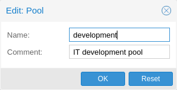

# 14.4. Resource Pools 

A resource pool is a set of virtual machines, containers, and storage devices. It is useful for permission handling in cases where certain users should have controlled access to a specific set of resources, as it allows for a single permission to be applied to a set of elements, rather than having to manage this on a per-resource basis. Resource pools are often used in tandem with groups, so that the members of a group have permissions on a set of machines and storage.

---

来源：[Proxmox VE 官方文档](https://pve.proxmox.com/pve-docs/pve-admin-guide.html) · 版本 9.2.13 · 非官方中文翻译。
