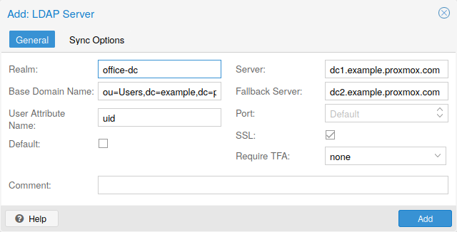
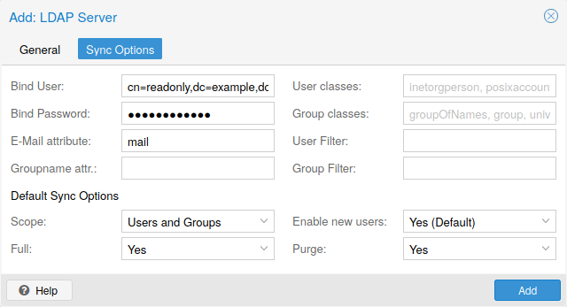

# 14.5. 认证域 <a href="#pveum_authentication_realms" id="pveum_authentication_realms"></a>

由于 Proxmox VE 用户只是某些外部认证域中现有用户的对应项，因此必须在 `/etc/pve/domains.cfg` 中配置认证域。可用的认证域（身份验证方法）如下：

**Linux PAM 标准身份验证**

Linux PAM 是系统范围的用户身份验证框架。这些用户通过 `adduser` 等命令在宿主机系统上创建。如果 Proxmox VE 宿主机系统中存在 PAM 用户，可以向 Proxmox VE 添加相应条目，允许这些用户使用系统用户名和密码登录。

**Proxmox VE 身份验证服务器**

这是类似 Unix 的密码存储，将密码哈希存储在 `/etc/pve/priv/shadow.cfg` 中。密码使用 SHA-256 哈希算法进行哈希。对于小型（甚至中型）安装，如果用户无需访问 Proxmox VE 之外的任何内容，这是最方便的认证域。在这种情况下，用户完全由 Proxmox VE 管理，并且可以通过 GUI 更改自己的密码。

**LDAP**

LDAP（轻量目录访问协议）是使用目录服务进行身份验证的开放跨平台协议。OpenLDAP 是一种流行的 LDAP 协议开源实现。

**Microsoft Active Directory（AD）**

Microsoft Active Directory（AD）是 Windows 域网络的目录服务，Proxmox VE 支持将其作为认证域。它支持使用 LDAP 作为身份验证协议。

**OpenID Connect**

OpenID Connect 作为身份层实现在 OAuth 2.0 协议之上。它允许客户端根据外部授权服务器执行的身份验证来验证用户身份。

## 14.5.1. Linux PAM 标准身份验证 <a href="#user-realms-pam" id="user-realms-pam"></a>

由于 Linux PAM 对应宿主机系统用户，因此在允许用户登录的每个节点上都必须存在系统用户。用户使用其通常的系统密码进行身份验证。此认证域默认添加且无法移除。

通过 GUI 或等效的 `/access/password` API 端点更改密码，仅应用于本地节点，而非整个集群。尽管 Proxmox VE 采用多主设计，为不同节点使用不同密码仍可带来安全收益。

在可配置性方面，管理员可以要求此认证域的登录使用双因素身份验证，并将该认证域设为默认认证域。

## 14.5.2. Proxmox VE 身份验证服务器 <a href="#user-realms-pve" id="user-realms-pve"></a>

Proxmox VE 身份验证服务器认证域是简单的类 Unix 密码存储。该认证域默认创建，与 Linux PAM 一样，唯一可用的配置项是要求此认证域用户进行双因素身份验证，以及将其设为默认登录认证域。

与其他 Proxmox VE 认证域类型不同，用户的创建和身份验证完全通过 Proxmox VE 进行，而非针对其他系统进行身份验证。因此，创建此类用户时必须设置密码。

## 14.5.3. LDAP <a href="#user-realms-ldap" id="user-realms-ldap"></a>

也可以使用外部 LDAP 服务器进行用户身份验证（例如 OpenLDAP）。在此认证域类型中，会在 *基本域名*（`base_dn`）下搜索用户，使用 *用户属性名称*（`user_attr`）字段指定的用户名属性。

可以配置一台服务器和可选的备用服务器，连接可通过 SSL 加密。此外，可以为目录和组配置过滤器。过滤器允许进一步限制认证域的范围。

例如，如果用户通过以下 LDIF 数据集表示：

```text
# user1 of People at ldap-test.com
dn: uid=user1,ou=People,dc=ldap-test,dc=com
objectClass: top
objectClass: person
objectClass: organizationalPerson
objectClass: inetOrgPerson
uid: user1
cn: Test User 1
sn: Testers
description: This is the first test user.
```

*基本域名* 将为 `ou=People,dc=ldap-test,dc=com`，用户属性将为 `uid`。

如果 Proxmox VE 需要先向 LDAP 服务器进行身份验证（绑定）才能查询和验证用户，可以通过 `bind_dn` 属性（位于 `/etc/pve/domains.cfg` 中）配置绑定域名。其密码随后必须存储在 `/etc/pve/priv/realm/<realmname>.pw` 中（例如 `/etc/pve/priv/realm/my-ldap.pw`）。此文件应包含单行明文密码。

要验证证书，需要设置 `capath`。可以将其直接设为 LDAP 服务器的 CA 证书，或包含所有受信任 CA 证书的系统路径（`/etc/ssl/certs`）。此外，还需设置 `verify` 选项，也可以通过 Web 界面设置。

LDAP 服务器认证域的主要配置选项如下：

- `Realm`（`realm`）：Proxmox VE 用户的认证域标识符
- `Base Domain Name`（`base_dn`）：搜索用户的目录
- `User Attribute Name`（`user_attr`）：包含用户登录时所用用户名的 LDAP 属性
- `Server`（`server1`）：托管 LDAP 目录的服务器
- `Fallback Server`（`server2`）：可选的备用服务器地址，以备主服务器无法访问
- `Port`（`port`）：LDAP 服务器监听的端口


要允许特定用户使用 LDAP 服务器进行身份验证，还必须在 Proxmox VE 服务器中将其添加为该认证域的用户。可以通过 [同步](#pveum_ldap_sync) 自动完成。


## 14.5.4. Microsoft Active Directory（AD） <a href="#user-realms-ad" id="user-realms-ad"></a>

要将 Microsoft AD 设置为认证域，需要指定服务器地址和认证域。Active Directory 支持与 LDAP 大部分相同的属性，例如可选的备用服务器、端口和 SSL 加密。此外，配置后可以通过 [同步](#pveum_ldap_sync) 操作自动将用户添加到 Proxmox VE。

与 LDAP 一样，如果 Proxmox VE 在绑定到 AD 服务器之前需要进行身份验证，必须配置 *绑定用户*（`bind_dn`）属性。Microsoft AD 默认通常需要此属性。

Microsoft Active Directory 的主要配置设置为：

- `Realm`（`realm`）：Proxmox VE 用户的认证域标识符
- `Domain`（`domain`）：服务器的 AD 域
- `Server`（`server1`）：服务器的 FQDN 或 IP 地址
- `Fallback Server`（`server2`）：可选的备用服务器地址，以备主服务器无法访问
- `Port`（`port`）：Microsoft AD 服务器监听的端口


Microsoft AD 通常以不区分大小写的方式检查用户名等值。要使 Proxmox VE 采用相同行为，可以在 Web UI 中编辑认证域来禁用默认的 `case-sensitive` 选项，或使用 CLI（将 `ID` 替换为认证域 ID）：`pveum realm modify ID --case-sensitive 0`


## 14.5.5. 同步基于 LDAP 的认证域 <a href="#pveum_ldap_sync" id="pveum_ldap_sync"></a>

[](https://pve.proxmox.com/pve-docs/images/screenshot/gui-datacenter-realm-add-ldap.png)

可以自动同步基于 LDAP 的认证域（LDAP 和 Microsoft Active Directory）的用户和组，无需手动将其添加到 Proxmox VE。可以从 Web 界面 `Authentication` 面板的添加/编辑窗口访问同步选项，或使用 `pveum realm add/modify` 命令。随后可以从 GUI 的 `Authentication` 面板执行同步操作，或使用以下命令：

```text
pveum realm sync <realm>
```

用户和组同步到集群范围的配置文件 `/etc/pve/user.cfg`。

### 属性到用户属性的映射 <a href="#attributes_to_properties" id="attributes_to_properties"></a>

如果同步响应包含用户属性，它们将同步到 `user.cfg` 中匹配的用户属性。例如：`firstname` 或 `lastname`。

如果属性名称与 Proxmox VE 用户属性不匹配，可以使用 `sync_attributes` 选项在配置中设置自定义的字段对字段映射。

如果某些内容消失，可以通过同步选项控制如何处理这些属性，参见下文。

### 同步配置 <a href="#sync_configuration" id="sync_configuration"></a>

基于 LDAP 的认证域的同步配置选项位于添加/编辑窗口的 `Sync Options` 选项卡。

配置选项如下：

- `Bind User`（`bind_dn`）：指用于查询用户和组的 LDAP 账户。此账户需要访问所有所需条目的权限。如果设置，将通过绑定执行搜索；否则匿名搜索。用户必须是完整的 LDAP 格式可分辨名称（DN），例如 `cn=admin,dc=example,dc=com`。
- 组名称属性（group\_name\_attr）：表示用户的组。仅同步遵守 `user.cfg` 常规字符限制的条目。为避免名称冲突，同步组时会在名称后附加 `-$realm`。请确保同步不会覆盖手动创建的组。
- `User classes`（`user_classes`）：与用户关联的对象类。
- `Group classes`（`group_classes`）：与组关联的对象类。
- `E-Mail attribute`：如果基于 LDAP 的服务器指定了用户电子邮件地址，也可以在此设置关联属性，将其包含在同步中。在命令行中，可通过 `--sync_attributes` 参数实现。
- `User Filter`（`filter`）：用于进一步针对特定用户的过滤选项。
- `Group Filter`（`group_filter`）：用于进一步针对特定组的过滤选项。


过滤器允许创建一组附加匹配条件，以缩小同步范围。有关可用 LDAP 过滤器类型及其用法的信息，请参阅 [ldap.com](https://ldap.com/ldap-filters/)。


### 同步选项 <a href="#pveum_ldap_sync_options" id="pveum_ldap_sync_options"></a>

[](https://pve.proxmox.com/pve-docs/images/screenshot/gui-datacenter-realm-add-ldap-sync-options.png)

除上一节指定的选项外，还可以配置其他选项，描述同步操作的行为。

这些选项可以在同步前作为参数设置，也可以通过认证域选项 `sync-defaults-options` 设置为默认值。

同步的主要选项为：

- `Scope`（`scope`）：要同步的范围。可以是 `users`、`groups` 或 `both`。
- `Enable new`（`enable-new`）：如果设置，新同步的用户会被启用并可登录。默认为 `true`。
- `Remove Vanished`（`remove-vanished`）：这是一个选项列表，激活后决定在同步响应未返回相应内容时是否移除它们。选项包括：

  - `ACL`（`acl)`：移除同步响应未返回的用户和组的 ACL。通常与 `Entry` 配合使用最为合理。
  - `Entry`（`entry`）：如果同步响应未返回条目（即用户和组），则移除这些条目。
  - `Properties`（`properties`）：如果同步响应中的用户不包含某些属性，则移除条目的这些属性。这包括所有属性，甚至从未由同步设置的属性。令牌和启用标志除外，即使启用此选项也会保留。
- `Preview`（`dry-run`）：不向配置写入任何数据。如果希望查看哪些用户和组会被同步到 `user.cfg`，此选项很有用。

### 保留字符 <a href="#pveum_ldap_reserved_characters" id="pveum_ldap_reserved_characters"></a>

某些字符为保留字符（参见 [RFC2253](https://www.ietf.org/rfc/rfc2253.txt)），如果未正确转义，就无法轻易在 DN 的属性值中使用。

以下字符需要转义：

- 开头或末尾的空格（ ）
- 开头的井号（`#`）
- 逗号（`,`）
- 加号（`+`）
- 双引号（`"`）
- 正斜杠（`/`）
- 尖括号（`<>`）
- 分号（`;`）
- 等号（`=`）

要在 DN 中使用此类字符，请用双引号括起属性值。例如，要使用 CN（通用名称）为 `Example, User` 的用户绑定，请将 `CN="Example, User",OU=people,DC=example,DC=com` 用作 `bind_dn` 的值。

这适用于 `base_dn`、`bind_dn` 和 `group_dn` 属性。


含有冒号和正斜杠的用户无法同步，因为这些是用户名中的保留字符。


## 14.5.6. OpenID Connect <a href="#pveum_openid" id="pveum_openid"></a>

OpenID Connect 的主要配置选项为：

- `Issuer URL`（`issuer-url`）：这是授权服务器的 URL。Proxmox VE 使用 OpenID Connect Discovery 协议自动配置更多详细信息。

  虽然可以使用未加密的 `http://` URL，但强烈建议使用加密的 `https://` 连接。
- `Realm`（`realm`）：Proxmox VE 用户的认证域标识符
- `Client ID`（`client-id`）：OpenID 客户端 ID。
- `Client Key`（`client-key`）：可选的 OpenID 客户端密钥。
- `Autocreate Users`（`autocreate`）：如果用户不存在，则自动创建。虽然身份验证在 OpenID 服务器上完成，但所有用户仍需要在 Proxmox VE 用户配置中有条目。可以手动添加，或使用 `autocreate` 选项自动添加新用户。
- `Username Claim`（`username-claim`）：用于生成唯一用户名的 OpenID 声明（`subject`、`username` 或 `email`）。
- `Autocreate Groups`（`groups-autocreate`）：创建声明中的所有组，而非使用现有 PVE 组（默认行为）。
- `Groups Claim`（`groups-claim`）：用于从 ID 令牌或 userinfo 端点检索组的 OpenID 声明。
- `Overwrite Groups`（`groups-overwrite`）：覆盖分配给用户的所有组，而非追加到现有组（默认行为）。

### 用户名映射 <a href="#username_mapping" id="username_mapping"></a>

OpenID Connect 规范定义了一个唯一属性（OpenID 术语中称为 *声明*），名为 `subject`。默认使用此属性的值生成 Proxmox VE 用户名，只需添加 `@` 和认证域名称：`${subject}@${realm}`。

遗憾的是，大多数 OpenID 服务器对 `subject` 使用随机字符串，例如 `DGH76OKH34BNG3245SB`，因此典型用户名类似 `DGH76OKH34BNG3245SB@yourrealm`。虽然唯一，但这种随机字符串很难记忆，几乎无法将其与真实用户关联。

`username-claim` 设置允许使用其他属性进行用户名映射。如果 OpenID Connect 服务器提供该属性并保证其唯一性，则优先将其设为 `username`。

另一种选择是使用 `email`，这也会产生易读的用户名。同样，只有服务器保证此属性唯一时才使用此设置。

### 组映射 <a href="#groups_mapping" id="groups_mapping"></a>

在 OpenID 配置中指定 `groups-claim` 设置会启用组映射功能。`groups-claim` 提供的数据应为字符串列表，对应用户在 Proxmox VE 中应加入的组。为防止冲突，OpenID 声明中的组名称会添加后缀 `-<realm name>`（例如，OpenID 组名称为 `my-openid-group`，位于认证域 `oidc`，则 Proxmox VE 中的组名称为 `my-openid-group-oidc`）。

默认情况下，OpenID 提供商报告但在 Proxmox VE 中不存在的组都会被忽略。如果 OpenID 提供商报告的所有组都应在 Proxmox VE 中存在，可使用 `groups-autocreate` 选项，在用户登录时自动创建这些组。

默认情况下，组会追加到用户现有的组中。有时可能希望用 OpenID 提供商的组覆盖用户在 Proxmox VE 中已加入的所有组。启用 `groups-overwrite` 设置后，会先移除用户在 Proxmox VE 中的所有组，再添加 OpenID 提供商报告的组。

某些情况下，OpenID 服务器发送的组声明可能含有 Proxmox VE 组 ID 中不允许的字符。任何包含 Proxmox VE 组名称不允许字符的组都不会被包含，并会向日志发送警告。

### 高级设置 <a href="#advanced_settings" id="advanced_settings"></a>

- `Query userinfo endpoint`（`query-userinfo`）：启用此选项会要求 OpenID Connect 身份验证器查询“userinfo”端点以获取声明值。对于某些不支持“userinfo”端点的身份提供商（例如 ADFS），禁用此选项很有用。

### 示例 <a href="#examples_9" id="examples_9"></a>

以下是使用 Google 创建 OpenID 认证域的示例。需要将 `--client-id` 和 `--client-key` 替换为 Google OpenID 设置中的值。

```text
pveum realm add myrealm1 --type openid --issuer-url  https://accounts.google.com --client-id XXXX --client-key YYYY --username-claim email
```

上述命令使用 `--username-claim email`，因此 Proxmox VE 端的用户名类似 `example.user@google.com@myrealm1`。

Keycloak（[https://www.keycloak.org/](https://www.keycloak.org/)）是一种流行的开源身份和访问管理工具，支持 OpenID Connect。在以下示例中，需要将 `--issuer-url` 和 `--client-id` 替换为您的信息：

```text
pveum realm add myrealm2 --type openid --issuer-url  https://your.server:8080/realms/your-realm --client-id XXX --username-claim username
```

使用 `--username-claim username` 可在 Proxmox VE 端获得简单的用户名，例如 `example.user@myrealm2`。


需要确保不允许用户自行编辑用户名设置（在 Keycloak 服务器上）。


---

来源：[Proxmox VE 官方文档](https://pve.proxmox.com/pve-docs/pve-admin-guide.html) · 版本 9.2.13 · 非官方中文翻译。
