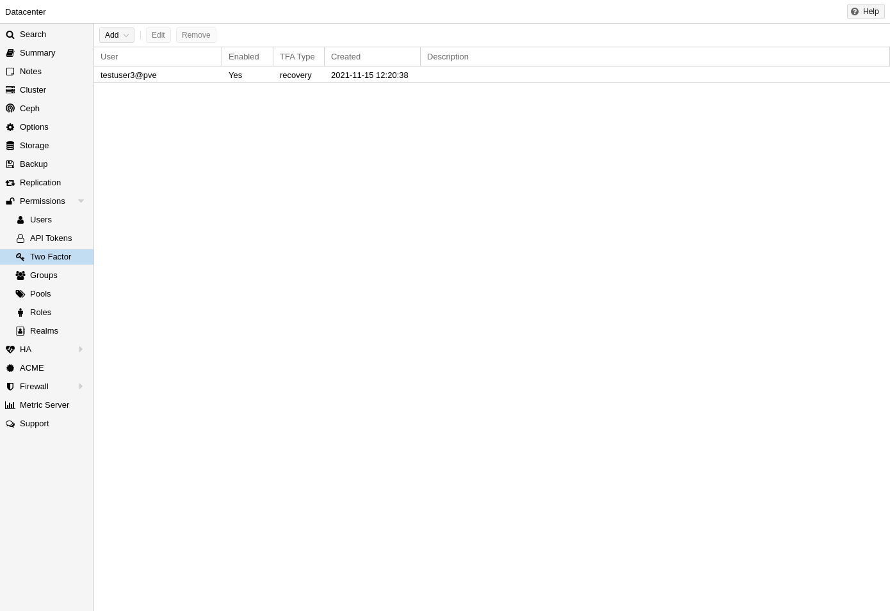
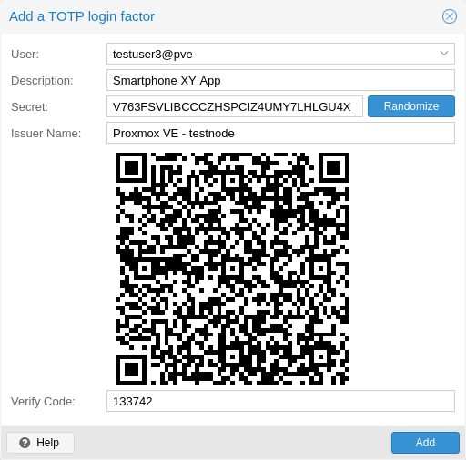
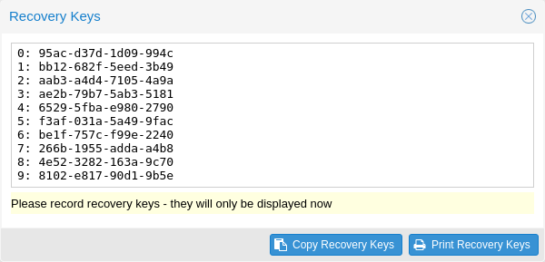
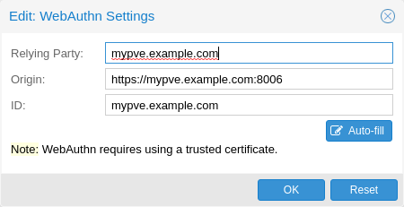

# 14.6. Two-Factor Authentication <a href="#pveum_tfa_auth" id="pveum_tfa_auth"></a>

There are two ways to use two-factor authentication:

It can be required by the authentication realm, either via *TOTP* (Time-based One-Time Password) or *YubiKey OTP*. In this case, a newly created user needs to have their keys added immediately, as there is no way to log in without the second factor. In the case of *TOTP*, users can also change the *TOTP* later on, provided they can log in first.

Alternatively, users can choose to opt-in to two-factor authentication later on, even if the realm does not enforce it.

## 14.6.1. Available Second Factors <a href="#_available_second_factors" id="_available_second_factors"></a>

You can set up multiple second factors, in order to avoid a situation in which losing your smartphone or security key locks you out of your account permanently.

The following two-factor authentication methods are available in addition to realm-enforced TOTP and YubiKey OTP:

- User configured TOTP ([Time-based One-Time Password](https://en.wikipedia.org/wiki/Time-based_One-Time_Password)). A short code derived from a shared secret and the current time, it changes every 30 seconds.
- WebAuthn ([Web Authentication](https://en.wikipedia.org/wiki/WebAuthn)). A general standard for authentication. It is implemented by various security devices, like hardware keys or trusted platform modules (TPM) from a computer or smart phone.
- Single use Recovery Keys. A list of keys which should either be printed out and locked in a secure place or saved digitally in an electronic vault. Each key can be used only once. These are perfect for ensuring that you are not locked out, even if all of your other second factors are lost or corrupt.

Before WebAuthn was supported, U2F could be setup by the user. Existing U2F factors can still be used, but it is recommended to switch to WebAuthn, once it is configured on the server.

## 14.6.2. Realm Enforced Two-Factor Authentication <a href="#_realm_enforced_two_factor_authentication" id="_realm_enforced_two_factor_authentication"></a>

This can be done by selecting one of the available methods via the *TFA* dropdown box when adding or editing an Authentication Realm. When a realm has TFA enabled, it becomes a requirement, and only users with configured TFA will be able to log in.

Currently there are two methods available:

**Time-based OATH (TOTP)**

This uses the standard HMAC-SHA1 algorithm, where the current time is hashed with the user’s configured key. The time step and password length parameters are configurable.

A user can have multiple keys configured (separated by spaces), and the keys can be specified in Base32 (RFC3548) or hexadecimal notation.

Proxmox VE provides a key generation tool (`oathkeygen`) which prints out a random key in Base32 notation, that can be used directly with various OTP tools, such as the `oathtool` command-line tool, or on Android Google Authenticator, FreeOTP, andOTP or similar applications.

**YubiKey OTP**

For authenticating via a YubiKey a Yubico API ID, API KEY and validation server URL must be configured, and users must have a YubiKey available. In order to get the key ID from a YubiKey, you can trigger the YubiKey once after connecting it via USB, and copy the first 12 characters of the typed password into the user’s *Key IDs* field.

Please refer to the [YubiKey OTP](https://developers.yubico.com/OTP/) documentation for how to use the [YubiCloud](https://www.yubico.com/products/services-software/yubicloud/) or [host your own verification server](https://developers.yubico.com/Software_Projects/Yubico_OTP/YubiCloud_Validation_Servers/).

## 14.6.3. Limits and Lockout of Two-Factor Authentication <a href="#pveum_tfa_lockout" id="pveum_tfa_lockout"></a>

A second factor is meant to protect users if their password is somehow leaked or guessed. However, some factors could still be broken by brute force. For this reason, users will be locked out after too many failed 2nd factor login attempts.

For TOTP, 8 failed attempts will disable the user’s TOTP factors. They are unlocked when logging in with a recovery key. If TOTP was the only available factor, admin intervention is required, and it is highly recommended to require the user to change their password immediately.

Since FIDO2/Webauthn and recovery keys are less susceptible to brute force attacks, the limit there is higher (100 tries), but all second factors are blocked for an hour when exceeded.

An admin can unlock a user’s Two-Factor Authentication at any time via the user list in the UI or the command line:

Generator: GNU source-highlight by Lorenzo Bettini http://www.lorenzobettini.it http://www.gnu.org/software/src-highlite

```text
 pveum user tfa unlock joe@pve
```

## 14.6.4. User Configured TOTP Authentication <a href="#pveum_user_configured_totp" id="pveum_user_configured_totp"></a>

Users can choose to enable *TOTP* or *WebAuthn* as a second factor on login, via the *TFA* button in the user list (unless the realm enforces *YubiKey OTP*).

Users can always add and use one time *Recovery Keys*.

[](https://pve.proxmox.com/pve-docs/images/screenshot/gui-datacenter-two-factor.png)

After opening the *TFA* window, the user is presented with a dialog to set up *TOTP* authentication. The *Secret* field contains the key, which can be randomly generated via the *Randomize* button. An optional *Issuer Name* can be added to provide information to the *TOTP* app about what the key belongs to. Most *TOTP* apps will show the issuer name together with the corresponding *OTP* values. The username is also included in the QR code for the *TOTP* app.

After generating a key, a QR code will be displayed, which can be used with most OTP apps such as FreeOTP. The user then needs to verify the current user password (unless logged in as *root*), as well as the ability to correctly use the *TOTP* key, by typing the current *OTP* value into the *Verification Code* field and pressing the *Apply* button.

## 14.6.5. TOTP <a href="#user_tfa_setup_totp" id="user_tfa_setup_totp"></a>

[](https://pve.proxmox.com/pve-docs/images/screenshot/pve-gui-tfa-add-totp.png)

There is no server setup required. Simply install a TOTP app on your smartphone (for example, [FreeOTP](https://freeotp.github.io/)) and use the Proxmox VE web interface to add a TOTP factor.

## 14.6.6. WebAuthn <a href="#user_tfa_setup_webauthn" id="user_tfa_setup_webauthn"></a>

For WebAuthn to work, you need to have two things:

- A trusted HTTPS certificate (for example, by using [Let’s Encrypt](https://pve.proxmox.com/wiki/Certificate_Management)). While it probably works with an untrusted certificate, some browsers may warn or refuse WebAuthn operations if it is not trusted.
- Setup the WebAuthn configuration (see **Datacenter → Options → WebAuthn Settings** in the Proxmox VE web interface). This can be auto-filled in most setups.

Once you have fulfilled both of these requirements, you can add a WebAuthn configuration in the **Two Factor** panel under **Datacenter → Permissions → Two Factor**.

## 14.6.7. Recovery Keys <a href="#user_tfa_setup_recovery_keys" id="user_tfa_setup_recovery_keys"></a>

[](https://pve.proxmox.com/pve-docs/images/screenshot/pve-gui-tfa-add-recovery-keys.png)

Recovery key codes do not need any preparation; you can simply create a set of recovery keys in the **Two Factor** panel under **Datacenter → Permissions → Two Factor**.


There can only be one set of single-use recovery keys per user at any time.


## 14.6.8. Server Side Webauthn Configuration <a href="#pveum_configure_webauthn" id="pveum_configure_webauthn"></a>

[](https://pve.proxmox.com/pve-docs/images/screenshot/gui-datacenter-webauthn-edit.png)

To allow users to use *WebAuthn* authentication, it is necessary to use a valid domain with a valid SSL certificate, otherwise some browsers may warn or refuse to authenticate altogether.


Changing the *WebAuthn* configuration may render all existing *WebAuthn* registrations unusable!


This is done via `/etc/pve/datacenter.cfg`. For instance:

```text
webauthn: rp=mypve.example.com,origin=https://mypve.example.com:8006,id=mypve.example.com
```

## 14.6.9. Server Side U2F Configuration <a href="#pveum_configure_u2f" id="pveum_configure_u2f"></a>


It is recommended to use WebAuthn instead.


To allow users to use *U2F* authentication, it may be necessary to use a valid domain with a valid SSL certificate, otherwise, some browsers may print a warning or reject U2F usage altogether. Initially, an *AppId*   
\[AppId [https://developers.yubico.com/U2F/App\_ID.html](https://developers.yubico.com/U2F/App_ID.html)\]  
 needs to be configured.


Changing the *AppId* will render all existing *U2F* registrations unusable!


This is done via `/etc/pve/datacenter.cfg`. For instance:

```text
u2f: appid=https://mypve.example.com:8006
```

For a single node, the *AppId* can simply be the address of the web interface, exactly as it is used in the browser, including the *https://* and the port, as shown above. Please note that some browsers may be more strict than others when matching *AppIds*.

When using multiple nodes, it is best to have a separate `https` server providing an `appid.json`   
\[Multi-facet apps: [https://developers.yubico.com/U2F/App\_ID.html](https://developers.yubico.com/U2F/App_ID.html)\]  
 file, as it seems to be compatible with most browsers. If all nodes use subdomains of the same top level domain, it may be enough to use the TLD as *AppId*. It should however be noted that some browsers may not accept this.


A bad *AppId* will usually produce an error, but we have encountered situations when this does not happen, particularly when using a top level domain *AppId* for a node that is accessed via a subdomain in Chromium. For this reason it is recommended to test the configuration with multiple browsers, as changing the *AppId* later will render existing *U2F* registrations unusable.


## 14.6.10. Activating U2F as a User <a href="#pveum_user_configured_u2f" id="pveum_user_configured_u2f"></a>

To enable *U2F* authentication, open the *TFA* window’s *U2F* tab, type in the current password (unless logged in as root), and press the *Register* button. If the server is set up correctly and the browser accepts the server’s provided *AppId*, a message will appear prompting the user to press the button on the *U2F* device (if it is a *YubiKey*, the button light should be toggling on and off steadily, roughly twice per second).

Firefox users may need to enable *security.webauth.u2f* via *about:config* before they can use a *U2F* token.

---

来源：[Proxmox VE 官方文档](https://pve.proxmox.com/pve-docs/pve-admin-guide.html) · 版本 9.2.13 · 非官方中文翻译。
