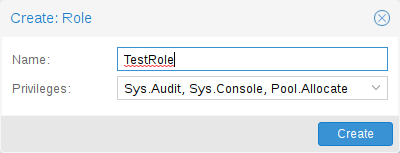

# 14.7. 权限管理 <a href="#pveum_permission_management" id="pveum_permission_management"></a>

用户要执行某项操作（例如列出、修改或删除虚拟机配置的部分内容），需要具备适当的权限。

Proxmox VE 使用基于角色和路径的权限管理系统。权限表中的条目允许用户、组或令牌在访问 *对象* 或 *路径* 时承担特定角色。这意味着此类访问规则可以表示为三元组 *(path, user, role)*、*(path, group, role)* 或 *(path, token, role)*，其中角色包含一组允许的操作，路径表示这些操作的目标。

## 14.7.1. 角色 <a href="#pveum_roles" id="pveum_roles"></a>

角色就是权限列表。Proxmox VE 附带多个预定义角色，可满足大多数需求。

- `Administrator`：具有完整权限
- `NoAccess`：没有任何权限（用于禁止访问）
- `PVEAdmin`：可执行大多数任务，但无权修改系统设置（`Sys.PowerMgmt`、`Sys.Modify`、`Realm.Allocate`）或权限（`Permissions.Modify`）
- `PVEAuditor`：具有只读权限
- `PVEDatastoreAdmin`：创建和分配备份空间与模板
- `PVEDatastoreUser`：分配备份空间并查看存储
- `PVEMappingAdmin`：管理资源映射
- `PVEMappingUser`：查看和使用资源映射
- `PVEPoolAdmin`：分配池
- `PVEPoolUser`：查看池
- `PVESDNAdmin`：管理 SDN 配置
- `PVESDNUser`：访问网桥/VNet
- `PVESysAdmin`：审计、系统控制台和系统日志
- `PVETemplateUser`：查看和克隆模板
- `PVEUserAdmin`：管理用户
- `PVEVMAdmin`：全面管理虚拟机
- `PVEVMUser`：查看、备份、配置 CD-ROM、虚拟机控制台、虚拟机电源管理

可以在 GUI 中查看全部预定义角色。

可以通过 GUI 或命令行添加新角色。

[](https://pve.proxmox.com/pve-docs/images/screenshot/gui-datacenter-role-add.png)

在 GUI 中，导航到 *权限 → 角色* 选项卡（位于 *数据中心*），然后点击 *创建* 按钮。在此可设置角色名称，并从 *权限* 下拉菜单中选择任何所需权限。

要通过命令行添加角色，可以使用 *pveum* CLI 工具，例如：

```text
pveum role add VM_Power-only --privs "VM.PowerMgmt VM.Console"
pveum role add Sys_Power-only --privs "Sys.PowerMgmt Sys.Console"
```


以 `PVE` 开头的角色始终为内置角色，自定义角色不得使用此保留前缀。


## 14.7.2. 权限 <a href="#privileges" id="privileges"></a>

权限是执行特定操作的权利。为简化管理，权限列表被组织为角色，随后可用于权限表中。请注意，如果不是角色的一部分，权限不能直接分配给用户和路径。

目前支持以下权限：

**节点/系统相关权限**

- `Group.Allocate`：创建/修改/移除组
- `Mapping.Audit`：查看资源映射
- `Mapping.Modify`：管理资源映射
- `Mapping.Use`：使用资源映射
- `Permissions.Modify`：修改访问权限
- `Pool.Allocate`：创建/修改/移除池
- `Pool.Audit`：查看池
- `Realm.AllocateUser`：将用户分配到认证域
- `Realm.Allocate`：创建/修改/移除认证域
- `SDN.Allocate`：管理 SDN 配置
- `SDN.Audit`：查看 SDN 配置
- `Sys.Audit`：查看节点状态/配置、Corosync 集群配置和 HA 配置
- `Sys.Console`：访问节点控制台
- `Sys.Incoming`：允许来自其他集群的传入数据流（实验性）
- `Sys.Modify`：创建/修改/移除节点网络参数
- `Sys.PowerMgmt`：节点电源管理（启动、停止、重置、关闭等）
- `Sys.Syslog`：查看 syslog
- `User.Modify`：创建/修改/移除用户访问及详细信息。

**虚拟机相关权限**

- `SDN.Use`：访问 SDN VNet 和本地网桥
- `VM.Allocate`：在服务器上创建/移除虚拟机
- `VM.Audit`：查看虚拟机配置
- `VM.Backup`：备份/恢复虚拟机
- `VM.Clone`：克隆/复制虚拟机
- `VM.Config.CDROM`：弹出/更换 CD-ROM
- `VM.Config.CPU`：修改 CPU 设置
- `VM.Config.Cloudinit`：修改 Cloud-init 参数
- `VM.Config.Disk`：添加/修改/移除磁盘
- `VM.Config.HWType`：修改模拟硬件类型
- `VM.Config.Memory`：修改内存设置
- `VM.Config.Network`：添加/修改/移除网络设备
- `VM.Config.Options`：修改任何其他虚拟机配置
- `VM.Console`：访问虚拟机控制台
- `VM.GuestAgent.Audit`：发出获取信息的 QEMU 客户机代理命令
- `VM.GuestAgent.FileRead`：通过 QEMU 客户机代理读取客户机中的文件
- `VM.GuestAgent.FileSystemMgmt`：通过 QEMU 客户机代理冻结/解冻/修剪文件系统
- `VM.GuestAgent.FileWrite`：通过 QEMU 客户机代理写入客户机中的文件
- `VM.GuestAgent.Unrestricted`：发出任意 QEMU 客户机代理命令
- `VM.Migrate`：将虚拟机迁移到集群中的其他服务器
- `VM.PowerMgmt`：电源管理（启动、停止、重置、关闭等）
- `VM.Replicate`：配置和运行客户机复制
- `VM.Snapshot.Rollback`：将虚拟机回滚到其某个快照
- `VM.Snapshot`：创建/删除虚拟机快照

**存储相关权限**

- `Datastore.Allocate`：创建/修改/移除数据存储并删除卷
- `Datastore.AllocateSpace`：在数据存储上分配空间
- `Datastore.AllocateTemplate`：分配/上传模板和 ISO 镜像
- `Datastore.Audit`：查看/浏览数据存储


`Permissions.Modify` 和 `Sys.Modify` 都应谨慎处理，因为它们允许修改系统及其配置中危险或敏感的部分。



请仔细阅读下面关于继承的章节，了解已分配角色（及其权限）如何沿 ACL 树传播。


## 14.7.3. 对象与路径 <a href="#objects_and_paths" id="objects_and_paths"></a>

访问权限分配给对象，例如虚拟机、存储或资源池。我们使用类似文件系统的路径来定位这些对象。这些路径自然形成一棵树，可选择将较高级别（较短路径）的权限沿层次结构向下传播。

<a id="pveum_templated_paths"></a>


路径可以使用模板。当 API 调用需要模板化路径上的权限时，路径可能包含对 API 调用参数的引用。这些引用使用花括号指定。某些参数隐式取自 API 调用的 URI。例如，权限路径 `/nodes/{node}` 在调用 */nodes/mynode/status* 时要求具有 `/nodes/mynode` 上的权限，而路径 `{path}` 在发往 `/access/acl` 的 PUT 请求中引用该方法的 `path` 参数。

以下是一些示例：

- `/nodes/{node}`：访问 Proxmox VE 服务器
- `/vms`：涵盖所有虚拟机
- `/vms/{vmid}`：访问特定虚拟机
- `/storage/{storeid}`：访问特定存储
- `/pool/{poolname}`：访问特定 [池](#pveum_pools) 中包含的资源
- `/access/groups`：组管理
- `/access/realms/{realmid}`：对认证域的管理访问

### 继承 <a href="#inheritance" id="inheritance"></a>

如前所述，对象路径形成类似文件系统的树，权限可以由树中下层对象继承（默认设置 propagate 标志）。使用以下继承规则：

- 单个用户的权限始终替换组权限。
- 当用户是组成员时，组权限适用。
- 较深层级的权限替换从上层继承的权限。
- `NoAccess` 取消给定路径上的所有其他角色。

此外，权限分离令牌在任何给定路径上都不可能拥有其关联用户不具备的权限。

## 14.7.4. 池 <a href="#pveum_pools" id="pveum_pools"></a>

池可用于将一组虚拟机和数据存储组织在一起。随后只需在池（`/pool/{poolid}`）上设置权限，所有池成员都会继承这些权限。这是简化访问控制的好方法。

## 14.7.5. 我需要哪些权限？ <a href="#which_permissions_do_i_need" id="which_permissions_do_i_need"></a>

每个方法的文档都记录了所需 API 权限，可在 [https://pve.proxmox.com/pve-docs/api-viewer/](../../api/README.md) 查阅。

权限以列表形式指定，可解释为逻辑函数和访问检查函数组成的树：

**`["and", <subtests>...]` 和 `["or", <subtests>...]`**

当前列表中的每个（`and`）或任意（`or`）后续元素必须为真。

**`["perm", <path>, [ <privileges>... ], <options>...]`**

`path` 是模板化参数（参见 [对象与路径](#objects_and_paths)）。在指定路径上，必须允许所列的全部权限（或者，如果使用 `any` 选项，则为任意权限）。如果指定 `require-param` 选项，则其指定参数为必填，即使 API 调用的模式将其列为可选。

**`["userid-group", [ <privileges>... ], <options>...]`**

调用方必须在 `/access/groups` 上具有所列任意权限。此外，根据是否设置 `groups_param` 选项，有两种可能的检查：

- 设置了 `groups_param`：API 调用具有非可选的 `groups` 参数，调用方必须在所列全部组上具有所列任意权限。
- 未设置 `groups_param`：通过 `userid` 参数传入的用户必须存在，并且属于调用方拥有所列任意权限的组（通过 `/access/groups/<group>` 路径）。

**`["userid-param", "self"]`**

为 API 调用的 `userid` 参数提供的值必须指向执行操作的用户（通常与 `or` 结合使用，允许用户对自身执行操作，即使没有提升的权限）。

**`["userid-param", "Realm.AllocateUser"]`**

用户需要具有 `Realm.AllocateUser` 访问权限，目标为 `/access/realm/<realm>`，其中 `<realm>` 指通过 `userid` 参数传入的用户所属认证域。请注意，用户无需存在即可与认证域关联，因为用户 ID 以 `<username>@<realm>` 形式传入。

**`["perm-modify", <path>]`**

`path` 是模板化参数（参见 [对象与路径](#objects_and_paths)）。用户需要具有 `Permissions.Modify` 权限，或根据路径，具备以下可作为替代的权限：

- `/storage/...`：需要“Datastore.Allocate”
- `/vms/...`：需要“VM.Allocate”
- `/pool/...`：需要“Pool.Allocate”

  如果路径为空，需要具有 `Permissions.Modify`，位于 `/access` 上。

  如果用户没有 `Permissions.Modify` 权限，则只能委派其在给定路径上自身权限的子集（例如，拥有 `PVEVMAdmin` 的用户可以分配 `PVEVMUser`，但不能分配 `PVEAdmin`）。

---

来源：[Proxmox VE 官方文档](https://pve.proxmox.com/pve-docs/pve-admin-guide.html) · 版本 9.2.13 · 非官方中文翻译。
