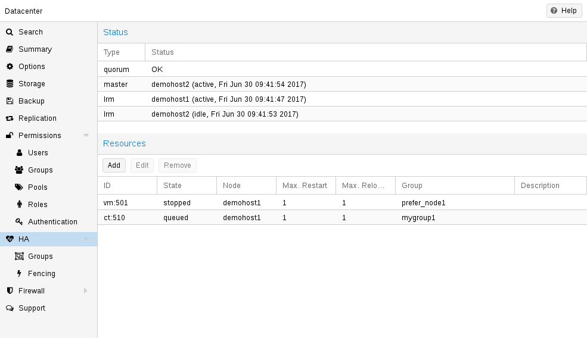

# 15.5. HA 模拟器 <a href="#ha_simulator" id="ha_simulator"></a>

[](https://pve.proxmox.com/pve-docs/images/screenshot/gui-ha-manager-status.png)

通过使用 HA 模拟器，您可以测试和学习 Proxmox VE HA 解决方案的所有功能。

默认情况下，模拟器允许您观察和测试一个包含 6 个 VM 的真实 3 节点集群的行为。您还可以添加或移除其他 VM 或容器。

您无需搭建或配置真实集群，HA 模拟器开箱即用。

使用 apt 安装：

```text
apt install pve-ha-simulator
```

您甚至可以在没有任何其他 Proxmox VE 软件包的任何基于 Debian 的系统上安装该软件包。为此，您需要下载该软件包，并将其复制到要运行它的系统上进行安装。当您使用 apt 从本地文件系统安装该软件包时，它还会为您解析所需的依赖关系。

要在远程机器上启动模拟器，您必须将 X11 重定向到当前系统。

如果您使用的是 Linux 机器，可以使用：

```text
ssh root@<IPofPVE> -Y
```

在 Windows 上，可以使用 [mobaxterm](https://mobaxterm.mobatek.net/)。

连接到已安装模拟器的现有 Proxmox VE，或在本地基于 Debian 的系统上手动安装模拟器后，您可以按如下方式试用。

首先，您需要创建一个工作目录，模拟器将在其中保存当前状态并写入默认配置：

```text
mkdir working
```

然后，只需将创建的目录作为参数传递给 *pve-ha-simulator*：

```text
pve-ha-simulator working/
```

然后，您可以启动、停止、迁移模拟的 HA 服务，甚至可以查看节点发生故障时的情况。

---

来源：[Proxmox VE 官方文档](https://pve.proxmox.com/pve-docs/pve-admin-guide.html) · 版本 9.2.13 · 非官方中文翻译。
