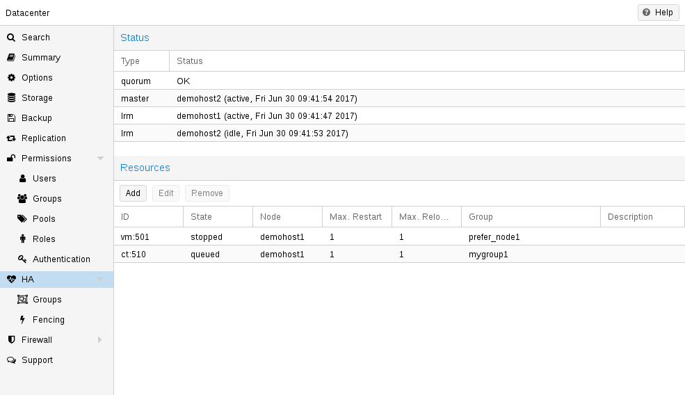
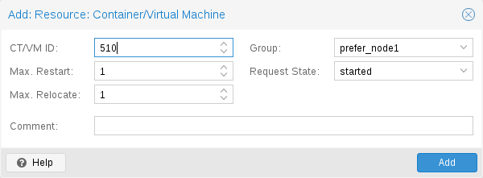
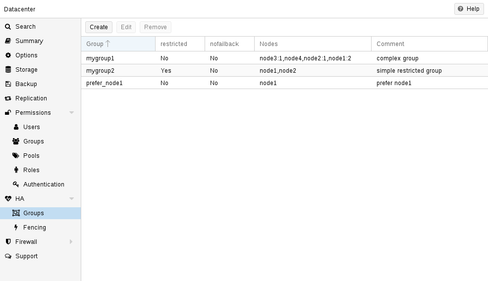
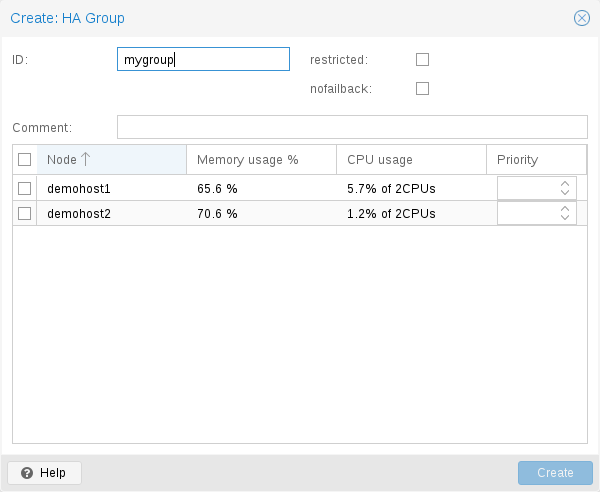

# 15.6. Configuration <a href="#_configuration_15" id="_configuration_15"></a>

HA 栈已很好地集成到 Proxmox VE API 中。因此，例如，可以通过 `ha-manager` 命令行界面或 Proxmox VE Web 界面配置 HA——这两个界面都提供了管理 HA 的简便方法。自动化工具可以直接使用 API。

所有 HA 配置文件都位于 `/etc/pve/ha/` 中，因此它们会自动分发到集群节点，并且所有节点共享相同的 HA 配置。

## 15.6.1. Resources <a href="#ha_manager_resource_config" id="ha_manager_resource_config"></a>

[](https://pve.proxmox.com/pve-docs/images/screenshot/gui-ha-manager-status.png)

资源配置文件 `/etc/pve/ha/resources.cfg` 存储由 `ha-manager` 管理的资源列表。该列表中的资源配置如下所示：

```text
<type>: <name>
        <property> <value>
        ...
```

它以资源类型开头，后跟资源特定名称，两者之间用冒号分隔。它们共同构成 HA 资源 ID，所有 `ha-manager` 命令都使用该 ID 唯一标识资源（例如：`vm:100` 或 `ct:101`）。接下来的行包含其他属性：

**`auto-rebalance`：`<boolean>`（*默认值 \=* `1`）**

自动重新平衡期间可以迁移 HA 资源

**`comment`: `<string>`**

描述。

**`failback`：`<boolean>`（*默认值 \=* `1`）**

如果优先级高于当前节点的节点上线，则根据其节点亲和性规则，自动将 HA 资源迁移到优先级最高的节点。

**`group`: `<string>`**

HA 组标识符。

**`max_relocate`：`<integer> (0 - N)`（*默认值 \=* `1`）**

资源启动失败时，尝试重定位资源的最大次数。

**`max_restart`：`<integer> (0 - N)`（*默认值 \=* `1`）**

资源启动失败后，在节点上重启该资源的最大尝试次数。达到该次数后，HA 管理器将尝试把资源重定位到符合条件的节点。

**`state`：`<disabled | enabled | ignored | started | stopped>`（*默认值 \=* `started`）**

请求的资源状态。CRM 读取此状态并采取相应操作。请注意，`enabled` 只是 `started` 的别名。

**`started`**

CRM 尝试启动资源。成功启动后，服务状态设置为 `started`。在节点故障或启动失败时，它会尝试恢复资源。如果所有尝试都失败，服务状态将设置为 `error`。

**`stopped`**

CRM 尝试将资源保持在 `stopped` 状态，但在节点发生故障时仍会尝试重新定位资源。

**`disabled`**

CRM 尝试将资源置于 `stopped` 状态，但在节点发生故障时不会尝试重新定位资源。此状态的主要用途是错误恢复，因为这是将资源移出 `error` 状态的唯一方法。

**`ignored`**

资源会从管理器状态中移除，因此 CRM 和 LRM 不再操作该资源。影响此资源的所有 {pve} API 调用都将直接执行，绕过 HA 栈。资源处于此状态时，CRM 命令将被丢弃。节点发生故障时，资源不会被重新定位。

下面是一个包含一个 VM 和一个容器的真实示例。如您所见，这些文件的语法非常简单，因此甚至可以使用您喜欢的编辑器读取或编辑这些文件：

**配置示例（`/etc/pve/ha/resources.cfg`）**

```text
vm: 501
    state started
    max_relocate 2

ct: 102
    # Note: use default settings for everything
```

[](https://pve.proxmox.com/pve-docs/images/screenshot/gui-ha-manager-add-resource.png)

上述配置是使用 `ha-manager` 命令行工具生成的：

```text
# ha-manager add vm:501 --state started --max_relocate 2
# ha-manager add ct:102
```

## 15.6.2. Groups <a href="#ha_manager_groups" id="ha_manager_groups"></a>


自 Proxmox VE 9.0 起，HA 组已弃用，并迁移到 HA 节点亲和性规则。


[](https://pve.proxmox.com/pve-docs/images/screenshot/gui-ha-manager-groups-view.png)

HA 组配置文件 `/etc/pve/ha/groups.cfg` 用于定义集群节点组。可以将资源限制为仅在此类组的成员上运行。组配置如下所示：

```text
group: <group>
       nodes <node_list>
       <property> <value>
       ...
```

**`comment`: `<string>`**

描述。

**`nodes`: `<node>[:<pri>]{,<node>[:<pri>]}*`**

集群节点成员列表，可以为每个节点指定优先级。资源将在具有最高优先级的可用节点上运行。如果最高优先级类别中有多个节点，资源将分布到这些节点上。优先级只有相对意义。数值越大，优先级越高。

**`nofailback`：`<boolean>`（*默认值 \=* `0`）**

CRM 会尝试在优先级最高的节点上运行服务。如果优先级更高的节点上线，CRM 会将服务迁移到该节点。启用 nofailback 可阻止此行为。

**`restricted`：`<boolean>`（*默认值 \=* `0`）**

绑定到受限组的资源只能在组定义的节点上运行。如果没有组节点成员在线，资源将被置于停止状态。非受限组上的资源可以在所有组成员离线时运行于任何集群节点，但一旦组成员上线，它们就会迁移回去。使用只有一个成员的非受限组，可以实现*首选节点*行为。

[](https://pve.proxmox.com/pve-docs/images/screenshot/gui-ha-manager-add-group.png)

一个常见需求是资源应在特定节点上运行。通常资源能够在其他节点上运行，因此您可以定义一个只有单个成员的非受限组：

```text
# ha-manager groupadd prefer_node1 --nodes node1
```

对于较大的集群，定义更详细的故障转移行为是有意义的。例如，您可能希望尽可能在 `node1` 上运行一组服务。如果 `node1` 不可用，您希望将它们平均分配到 `node2` 和 `node3` 上运行。如果这些节点也发生故障，服务应在 `node4` 上运行。为此，您可以将节点列表设置为：

```text
# ha-manager groupadd mygroup1 -nodes "node1:2,node2:1,node3:1,node4"
```

另一个用例是资源使用仅在特定节点上可用的其他资源，比如 `node1` 和 `node2`。我们需要确保 HA 管理器不使用其他节点，因此需要创建一个包含上述节点的受限组：

```text
# ha-manager groupadd mygroup2 -nodes "node1,node2" -restricted
```

上述命令创建了以下组配置文件：

**配置示例（`/etc/pve/ha/groups.cfg`）**

```text
group: prefer_node1
       nodes node1

group: mygroup1
       nodes node2:1,node4,node1:2,node3:1

group: mygroup2
       nodes node2,node1
       restricted 1
```

`nofailback` 选项主要用于避免在执行管理任务期间发生不必要的资源移动。例如，如果需要将服务迁移到组中优先级并非最高的节点，则需要通过设置 `nofailback` 选项，告知 HA 管理器不要立即将该服务移回。

另一种场景是，某个服务被隔离后，已在另一个节点上恢复。管理员尝试修复被隔离的节点，并使其重新上线，以调查故障原因并检查其是否能再次稳定运行。设置 `nofailback` 标志可防止已恢复的服务直接移回被隔离的节点。

## 15.6.3. Rules <a href="#ha_manager_rules" id="ha_manager_rules"></a>

HA 规则用于对 HA 管理的资源施加特定约束，这些规则在 HA 规则配置文件 `/etc/pve/ha/rules.cfg` 中定义。

```text
<type>: <rule>
        resources <resources_list>
        <property> <value>
        ...
```

**`comment`: `<string>`**

HA 规则描述。

**`disable`: `<boolean>`**

HA 规则是否已禁用。

**`resources`: `<type>:<name>{,<type>:<name>}*`**

HA 资源 ID 列表。每个 ID 由资源类型和后随的特定于资源的名称组成，二者以冒号分隔（示例：vm:100,ct:101）。

<table>
<caption>Table 18. Available HA Rule Types</caption>


<thead>
<tr>
<th>HA 规则类型</th>
<th>描述</th>
</tr>
</thead>
<tbody>
<tr>
<td><p><code>node-affinity</code></p></td>
<td><p>定义一个或多个 HA 资源与一个或多个节点之间的亲和性。</p>
<p>亲和性 <code>positive</code> 指定 HA 资源应或必须保留在指定节点之一上，而亲和性 <code>negative</code> 指定 HA 资源应或必须避开指定节点。</p>
<p>严格性属性 <code>strict</code> 指定这是软约束（“应”）还是硬约束（“必须”）。</p></td>
</tr>
<tr>
<td><p><code>resource-affinity</code></p></td>
<td><p>定义两个或更多 HA 资源之间的亲和性。</p>
<p>亲和性 <code>positive</code> 指定 HA 资源必须保留在同一节点上，而亲和性 <code>negative</code> 指定 HA 资源必须保留在不同节点上。</p></td>
</tr>
</tbody>
</table>

### 节点亲和性规则 <a href="#ha_manager_node_affinity_rules" id="ha_manager_node_affinity_rules"></a>

默认情况下，HA 资源可以在任何集群节点上运行，但一个常见需求是 HA 资源应在特定节点上运行。可以通过定义 HA 节点亲和性规则，使 HA 资源 `vm:100` 优先选择节点 `node1` 来实现这一点：

```text
# ha-manager rules add node-affinity ha-rule-vm100 --resources vm:100 --nodes node1
```

默认情况下，节点亲和性规则不是严格的，也就是说，如果指定的节点均不可用，HA 资源也可以移动到其他节点。相反，如果必须将 HA 资源限制在指定节点上，则必须将节点亲和性规则设置为严格。

在前面的示例中，可以修改节点亲和性规则，将资源 `vm:100` 限制为只能在 `node1` 上运行：

```text
# ha-manager rules set node-affinity ha-rule-vm100 --strict 1
```

此外，节点亲和性规则默认使用正向亲和性，这意味着必须明确指定首选的集群节点。然而，在较大的集群中，采用排除方式定义节点亲和性通常更实用，以避免冗长繁琐的集群节点列表。例如，以下命令定义了一条 HA 节点亲和性规则，使 HA 资源 `ct:200` 和 `vm:300` 避开节点 `node3`：

```text
# ha-manager rules add node-affinity ha-rule-negative \
        --affinity negative --resources ct:200,vm:300 --nodes node3
```

此外，特定用例可能需要定义更详细的故障转移行为。例如，资源 `vm:400` 和 `ct:500` 应在 `node1` 上运行。如果 `node1` 不可用，这些资源应分布在 `node2` 和 `node3` 上。如果 `node2` 和 `node3` 也不可用，这些资源应在 `node4` 上运行。

要在节点亲和性规则中实现此行为，可以为节点设置优先级，以确定节点的优先顺序。如果两个或更多节点具有相同优先级，资源可以在其中任何一个节点上运行。对于上述示例，`node1` 获得最高优先级，`node2` 和 `node3` 获得相同优先级，最后 `node4` 获得最低优先级；最低优先级可以省略，默认为 `0`：

```text
# ha-manager rules add node-affinity priority-cascade \
        --resources vm:400,ct:500 --nodes "node1:2,node2:1,node3:1,node4"
```

上述命令会在规则配置文件中创建以下规则：

**节点亲和性规则配置示例（`/etc/pve/ha/rules.cfg`）**

```text
node-affinity: ha-rule-vm100
        nodes node1
        resources vm:100
        strict 1

node-affinity: ha-rule-negative
        nodes node3
        resources ct:200,vm:300
        affinity negative

node-affinity: priority-cascade
        nodes node1:2,node2:1,node3:1,node4
        resources vm:400,ct:500
```

#### 节点亲和性规则属性 <a href="#_node_affinity_rule_properties" id="_node_affinity_rule_properties"></a>

**`affinity`: `<negative | positive>` (*默认值 \=* `positive`)**

描述 HA 资源应放置在指定节点上（*positive*），还是应放置在指定节点以外的任何节点上（*negative*）。

**`nodes`: `<node>[:<pri>]{,<node>[:<pri>]}*`**

集群节点成员列表，可以为每个节点指定优先级。资源将在具有最高优先级的可用节点上运行。如果最高优先级类别中有多个节点，资源将分布到这些节点上。优先级只有相对意义。数值越大，优先级越高。

**`resources`: `<type>:<name>{,<type>:<name>}*`**

HA 资源 ID 列表。每个 ID 由资源类型和后随的特定于资源的名称组成，二者以冒号分隔（示例：vm:100,ct:101）。

**`strict`: `<boolean>` (*默认值 \=* `0`)**

描述节点亲和性规则是严格的还是非严格的。

非严格节点亲和性规则使资源优先在定义的节点上运行。如果定义的节点均不可用，资源可以在任何其他节点上运行。

严格节点亲和性规则将资源限制在定义的节点上。如果定义的节点均不可用，资源将被停止。

### 资源亲和性规则 <a href="#ha_manager_resource_affinity_rules" id="ha_manager_resource_affinity_rules"></a>

另一个常见需求是，两个或更多 HA 资源应在同一节点上运行，或者应分布在不同节点上。这些通常也称为“亲和性/反亲和性约束”。

例如，假设 HA 资源 `vm:100` 和 `vm:200` 之间存在大量通信流量，例如 Web 服务器与数据库服务器通信。如果这些 HA 资源位于不同节点上，可能会导致更高的延迟和不必要的网络负载。采用亲和性 `positive` 的资源亲和性规则可实现将 HA 资源保持在同一节点上的约束：

```text
# ha-manager rules add resource-affinity keep-together \
    --affinity positive --resources vm:100,vm:200
```


如果存在两条或更多具有共同 HA 资源的正向资源亲和性规则，则这些规则会被视为一条正向资源亲和性规则。例如，如果 HA 资源 `vm:100` 和 `vm:101` 以及 HA 资源 `vm:101` 和 `vm:102` 分别位于一条正向资源亲和性规则中，那么其效果等同于将 `vm:100`、`vm:101` 和 `vm:102` 放在同一条正向资源亲和性规则中。



如果一条正向资源亲和性规则中的 HA 资源当前运行在不同节点上，CRS 会将这些 HA 资源移动到已有最多此类资源运行的节点。如果 HA 资源数量相同，则选择名称按字母顺序排在最前面的节点。


但是，假设 HA 资源 `vm:200` 和 `ct:300` 上运行着计算开销大的程序和/或分布式程序，例如分片数据库实例。在这种情况下，将它们运行在同一节点上可能会给节点的硬件资源带来压力，并降低这些 HA 资源的运行速度。采用亲和性 `negative` 的资源亲和性规则可实现将 HA 资源分散到不同节点上的约束：

```text
# ha-manager rules add resource-affinity keep-separate \
    --affinity negative --resources vm:200,ct:300
```

与节点亲和性规则不同，资源亲和性规则默认是严格的，也就是说，如果无法满足资源亲和性规则对某个 HA 资源施加的约束，HA 管理器将在故障转移时将该 HA 资源置于恢复状态，在其他情况下则置于错误状态。

上述命令在规则配置文件中创建了以下规则：

**资源亲和性规则配置示例（`/etc/pve/ha/rules.cfg`）**

```text
resource-affinity: keep-together
        affinity positive
        resources vm:100,vm:200

resource-affinity: keep-separate
        affinity negative
        resources vm:200,ct:300
```

#### 正向与负向资源亲和性规则之间的相互作用 <a href="#_interactions_between_positive_and_negative_resource_affinity_rules" id="_interactions_between_positive_and_negative_resource_affinity_rules"></a>

如果某些 HA 资源位于一条正向资源亲和性规则中，同时也属于一条负向资源亲和性规则，那么该正向资源亲和性规则中的所有其他 HA 资源，也与这些负向资源亲和性规则中的 HA 资源具有负向亲和性。

例如，如果 HA 资源 `vm:100`、`vm:101` 和 `vm:102` 位于一条正向资源亲和性规则中，而 `vm:100` 与 HA 资源 `ct:200` 位于一条负向资源亲和性规则中，那么 `vm:101` 和 `vm:102` 也分别与 `ct:200` 具有负向资源亲和性。

Note that if there are two or more HA resources in both a positive and negative resource affinity rule, then those will be disabled as they cause a conflict: Two or more HA resources cannot be kept on the same node and separated on different nodes at the same time. For more information on these cases, see the section about [rule conflicts and errors](#ha_manager_rule_conflicts) below.

#### 节点亲和性规则与正向资源亲和性规则之间的相互作用 <a href="#_interactions_between_node_and_positive_resource_affinity_rules" id="_interactions_between_node_and_positive_resource_affinity_rules"></a>

如果节点亲和性规则中的某些 HA 资源同时属于一条正向资源亲和性规则，那么该正向资源亲和性规则中的所有其他 HA 资源也会继承该节点亲和性规则。

例如，如果 HA 资源 `vm:100`、`vm:101` 和 `vm:102` 位于一条正向资源亲和性规则中，而 `vm:102` 位于一条节点亲和性规则中，该规则将 `vm:102` 限制为只能在 `node3` 上运行，那么 `vm:100` 和 `vm:101` 也将被限制为只能在 `node3` 上运行。

Please note that if there are two or more HA resources in a positive resource affinity rule and in different node affinity rules, then those rules will cause an error and will be disabled as this is currently not supported. For more information on these cases, see the section about [rule conflicts and errors](#ha_manager_rule_conflicts) below.

#### 资源亲和性规则属性 <a href="#_resource_affinity_rule_properties" id="_resource_affinity_rule_properties"></a>

**`affinity`: `<negative | positive>`**

描述 HA 资源是否应保留在同一节点上（*positive*），还是应保留在不同节点上（*negative*）。

**`resources`: `<type>:<name>{,<type>:<name>}*`**

HA 资源 ID 列表。每个 ID 由资源类型和后随的特定于资源的名称组成，二者以冒号分隔（示例：vm:100,ct:101）。

## 15.6.4. Rule Conflicts and Errors <a href="#ha_manager_rule_conflicts" id="ha_manager_rule_conflicts"></a>

HA 规则可以对 HA 资源施加相当复杂的约束。为确保新建或修改的 HA 规则不会给 HA 堆栈的 CRS 调度器引入不确定性，HA 规则会在应用前接受可行性测试。任何未通过这些测试的规则都将被禁用，直到冲突和错误得到解决。

目前，HA 规则会接受以下可行性检查：

- 一个 HA 资源只能属于一条 HA 节点亲和性规则。
- 负向 HA 节点亲和性规则不能指定节点优先级。
- 负向 HA 节点亲和性规则不能指定所有集群节点。
- 一条 HA 资源亲和性规则必须至少包含两个 HA 资源。
- 负向 HA 资源亲和性规则指定的 HA 资源数量不能超过集群中的节点数量。否则，HA 资源将没有足够的节点来彼此分离。
- 正向 HA 资源亲和性规则不能指定与负向 HA 资源亲和性规则相同的两个或更多 HA 资源。也就是说，两个或更多 HA 资源不能同时被保持在一起又彼此分离。
- 只有当 HA 节点亲和性规则具有单一优先级类别时，HA 资源才可以同时属于该 HA 节点亲和性规则和一条 HA 资源亲和性规则。
- 正向 HA 资源亲和性规则中的 HA 资源最多只能属于一条 HA 节点亲和性规则。
- 负向 HA 资源亲和性规则中的 HA 资源，不能被其节点亲和性规则限制到少于 HA 资源数量的节点上。否则，HA 资源将没有足够的节点来彼此分离。

---

来源：[Proxmox VE 官方文档](https://pve.proxmox.com/pve-docs/pve-admin-guide.html) · 版本 9.2.13 · 非官方中文翻译。
