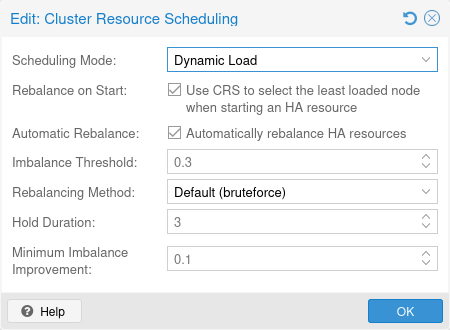

# 15.13. 集群资源调度 

集群资源调度器（CRS）负责为 HA 资源选择新的节点安置位置，并确保 HA 资源位于其允许的节点上。

在 HA 管理器的每一轮中，调度器都会遍历每个 HA 资源，检查该资源是否需要新的节点放置。新的节点放置可能由不同操作引起，例如从已隔离节点恢复 HA 资源，或新的 HA 亲和性规则。有关 CRS 针对集群中特定更改采取哪些操作的更详细说明，请参阅 [CRS 调度时机](#ha_manager_crs_scheduling_points) 一节。

## 15.13.1. CRS 调度模式 

CRS 调度模式控制 CRS 如何计算集群的使用情况信息。这些使用情况信息将作为调度决策的依据。可以在 Web 界面（`Datacenter` → `Options` → `Cluster Resource Scheduling`）中更改 CRS 模式。默认模式为 `basic`。更改将从下一轮 HA Manager 开始生效，这应不超过 10 秒。

### 基本调度器 

根据每个节点上活动客户机的数量，为 HA 资源选择最合适的节点。

### 静态负载调度器 

使用每个节点上活动客户机的静态使用情况信息，为 HA 资源选择最合适的节点。这包括为活动客户机配置的 CPU 和内存配额。

### 动态负载调度器 

使用每个节点上活动客户机的动态使用情况信息，为 HA 资源选择最合适的节点。这包括活动客户机的平均 CPU 和内存使用量，以及为其配置的 CPU 和内存配额。

## 15.13.2. CRS 调度时机 

在每一轮 HA Manager 中，CRS 都会检查是否有 HA 资源需要新的节点安置位置，这可能由以下任一调度点触发：

### HA 资源恢复（始终启用） 

当具有活动 HA 资源的节点发生故障时，其所有 HA 资源都需要恢复到其他节点。此处将使用 CRS 算法，在其余节点之间均衡分配这些恢复任务。

### HA 规则配置更改（始终启用） 

如果规则对 HA 资源施加了不同的约束，HA 栈将根据新规则的类型，使用 CRS 算法为受这些规则影响的 HA 资源查找新的目标节点：

- 节点亲和性规则：如果创建了节点亲和性规则，或向现有节点亲和性规则添加了 HA 资源/节点，HA 栈将使用 CRS 算法，确保根据这些 HA 资源的节点和优先级约束为其分配节点。
- 正向资源亲和性规则：如果创建了正向资源亲和性规则，或向现有正向资源亲和性规则添加了 HA 资源，HA 栈将使用 CRS 算法，确保将这些 HA 资源移动到同一节点。
- 负向资源亲和性规则：如果创建了负向资源亲和性规则，或向现有负向资源亲和性规则添加了 HA 资源，HA 栈将使用 CRS 算法，确保将这些 HA 资源移动到不同节点。

### 启动时重新均衡 HA 资源（需主动启用） 

启动已启用“启动时重新均衡”的 HA 资源时，CRS 将选择最适合该 HA 资源的节点。如果所选节点不是当前节点，则将该 HA 资源迁移到所选节点。

对于 [基本调度器模式](#ha_manager_crs_basic_scheduler)，活动客户机最少的节点被认为是最合适的节点。

对于 [static-load](#ha_manager_crs_static_scheduler) 和 [dynamic-load](#ha_manager_crs_dynamic_scheduler) 调度器模式，会依次假设 HA 资源已经在每个节点上运行，并使用关联客户机配置中的 CPU 和内存用量。然后，对每种候选方案都会考虑所有节点的 CPU 和内存用量，其中内存权重要高得多，因为内存是真正有限的资源。对于 CPU 和内存，都会考虑节点间的最高用量（权重较高，因为理想情况下任何节点都不应超额分配），以及所有节点的平均用量（以便在已经存在分配量较高节点时仍能区分）。

此设置可通过 CRS 选项`ha-rebalance-on-start`启用，该选项位于 Web 界面的`Datacenter` → `Options` → `Cluster Resource Scheduling`下。


对于静态负载和动态负载调度器模式，此功能仍处于技术预览阶段。HA 资源越多，可能的组合就越多，因此，如果有数千个 HA 资源，目前不建议使用此功能。


## 15.13.3. CRS 负载均衡器 

各个集群节点的利用率可能会因客户机当前的运行位置以及这些客户机在任意时刻产生的负载而有很大差异。这可能导致节点利用率随时间推移变得不均衡：一个节点上的 HA 资源因资源争用而成为瓶颈，而另一个节点几乎未得到利用。

HA Manager 的自动负载均衡器可以通过自动发起重新均衡迁移来降低集群的整体不均衡程度。目前，这些迁移仅针对 HA 资源发起，并按顺序执行。此外，这些迁移始终遵循当前的 HA 亲和性规则。

为 HA 资源禁用`auto-rebalance`可防止该资源参与自动发起的重新均衡迁移。


与禁用了`auto-rebalance`的 HA 资源具有正向亲和性的任何 HA 资源，也不会参与重新均衡迁移。


可以在 Web 界面的 `Datacenter` → `Options` → `Cluster Resource Scheduling` 下启用和配置自动负载均衡系统。这允许针对不同集群设置和需求，按照下一段所述微调各种参数。负载均衡器要求使用 [static-load](#ha_manager_crs_static_scheduler) 或 [dynamic-load](#ha_manager_crs_dynamic_scheduler) 调度器模式。

在每一轮 HA Manager 中（每轮持续约 10 秒），自动负载均衡器都会检查集群不均衡程度是否超过*不均衡阈值*。如果集群不均衡程度连续高于阈值的 HA Manager 轮数至少达到*保持时长*所指定的轮数，负载均衡器将为一项 HA 资源选择能够最大程度降低集群整体不均衡程度的重新均衡迁移。可以使用*重新均衡方法*选项设置选择最佳重新均衡迁移的方法。最后，如果所选迁移能够使当前集群不均衡程度至少降低*不均衡改善幅度*选项所指定的百分比，负载均衡器就会发起所选迁移。

集群不平衡度由各个节点负载的标准差和均值计算得出，并归一化到 0-100% 范围。*不平衡阈值*和*不平衡改善度*均以百分比配置。*不平衡阈值*默认为 30%，用于控制负载均衡器的灵敏度；值为 `0` 时，每当超过*保持时长*，它都会尝试选择一次再平衡迁移。*不平衡改善度*默认为 10%，用于筛选可接受的再平衡迁移；值为 `0` 时，即使预期不平衡度完全没有变化，它也总是会执行迁移。该值永远不能为负数，因此均衡器绝不会执行预期不平衡度比当前情况更糟的迁移。


未来计划将非 HA 资源也纳入负载均衡。


---

来源：[Proxmox VE 官方文档](https://pve.proxmox.com/pve-docs/pve-admin-guide.html) · 版本 9.2.13 · 非官方中文翻译。
