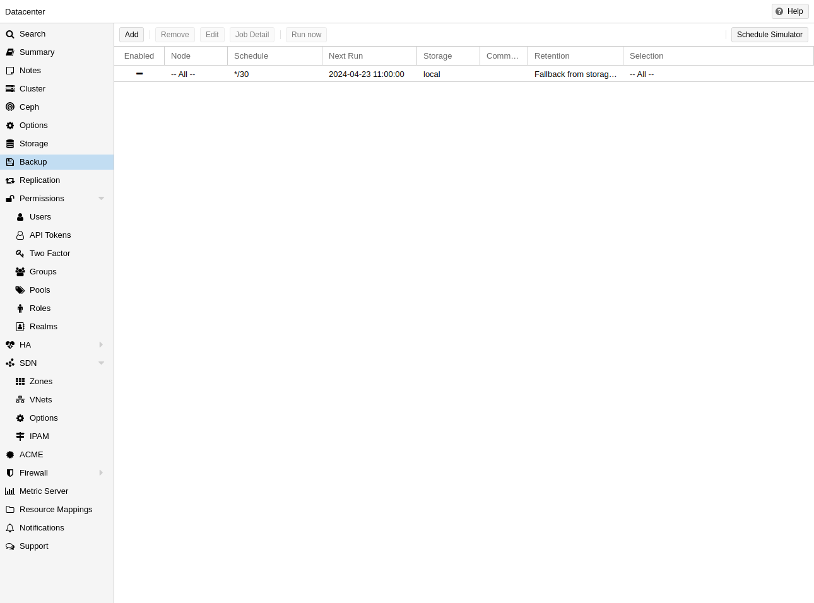
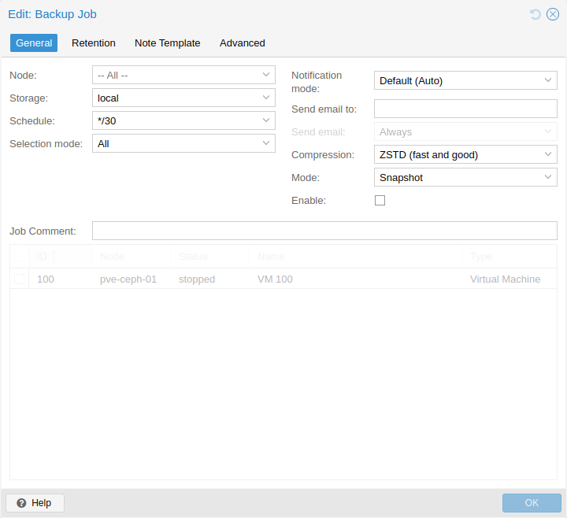
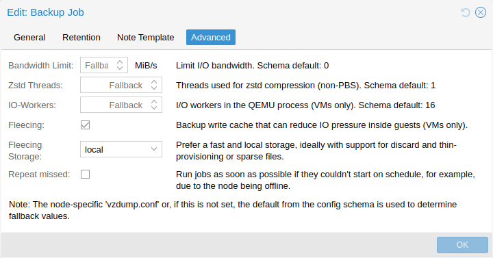

# 16.5. 备份作业 

除手动触发备份外，还可以设置定期作业，将全部或选定的虚拟客户机备份到存储。可以在 UI 的 *数据中心* → *备份* 下管理作业，或通过 `/cluster/backup` API 端点管理。两者都会在 `/etc/pve/jobs.cfg` 中生成作业条目，由 `pvescheduler` 守护进程解析并执行。

作业可以配置为适用于所有集群节点或特定节点，并按给定计划执行。计划格式与 `systemd` 日历事件非常相似，详情参见 [日历事件](../25-calendar-events/01-chapter-calendar-events.md) 一节。UI 中的 *计划* 字段可自由编辑，其下拉列表包含多个可作为起点的示例。

可以配置作业特定的 [保留选项](06-vzdump-retention.md)，覆盖存储或节点配置中的选项，以及 [备注模板](08-vzdump-notes.md)，用于将附加信息与备份一起保存。

当宿主机在计划时间离线或 pvescheduler 被禁用时，计划备份会错过执行，因此可以配置补执行行为。启用 `Repeat missed` 选项（位于 UI 的 *高级* 选项卡，配置中为 `repeat-missed`），即可告知调度器应尽快运行错过的作业。

有一些用于调整备份性能的设置（其中一部分在 UI 的 *高级* 选项卡中提供）。最值得注意的是用于限制 IO 带宽的 `bwlimit`。压缩程序使用的线程数量可分别通过 `pigz`（替代 `gzip`）及 `zstd` 设置控制。此外，还有 `ionice`（使用 BFQ 调度器时），以及作为 `performance` 设置一部分的 `max-workers`（仅影响虚拟机备份）和 `pbs-entries-max`（仅影响容器备份）。详情参见 [配置选项](10-vzdump-configuration.md)。

---

来源：[Proxmox VE 官方文档](https://pve.proxmox.com/pve-docs/pve-admin-guide.html) · 版本 9.2.13 · 非官方中文翻译。
