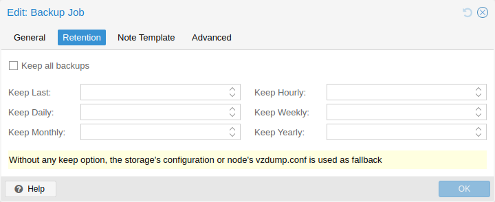

# 16.6. 备份保留 <a href="#vzdump_retention" id="vzdump_retention"></a>

通过 `prune-backups` 选项，可以灵活指定要保留哪些备份。

[](https://pve.proxmox.com/pve-docs/images/screenshot/gui-cluster-backup-edit-02-retention.png)

可用的保留选项如下：

**`keep-all <boolean>`**

保留所有备份。如果此项为 `true`，则不能设置其他选项。

**`keep-last <N>`**

保留最后 `<N>` 个备份。

**`keep-hourly <N>`**

保留最近 `<N>` 小时的备份。如果同一小时有多个备份，只保留最新的。

**`keep-daily <N>`**

保留最近 `<N>` 天的备份。如果同一天有多个备份，只保留最新的。

**`keep-weekly <N>`**

保留最近 `<N>` 周的备份。如果同一周有多个备份，只保留最新的。


一周从星期一开始，到星期日结束。软件使用 `ISO week date` 系统，并正确处理年末的周数。


**`keep-monthly <N>`**

保留最近 `<N>` 个月的备份。如果同一个月有多个备份，只保留最新的。

**`keep-yearly <N>`**

保留最近 `<N>` 年的备份。如果同一年有多个备份，只保留最新的。

保留选项按上述顺序处理。每个选项仅涵盖其时间段内的备份。下一个选项不处理已涵盖的备份，只考虑更早的备份。

以逗号分隔的列表指定要使用的保留选项，例如：

```text
# vzdump 777 --prune-backups keep-last=3,keep-daily=13,keep-yearly=9
```

虽然可以将 `prune-backups` 直接传递给 `vzdump`，但通常在存储级别配置此设置更合理，可通过 Web 界面完成。

## 16.6.1. 清理模拟器 <a href="#prune_simulator" id="prune_simulator"></a>

可以使用 [Proxmox Backup Server 文档中的清理模拟器](https://pbs.proxmox.com/docs/prune-simulator)，探索不同保留选项对各种备份计划的影响。

## 16.6.2. 保留设置示例 <a href="#retention_settings_example" id="retention_settings_example"></a>

备份频率和旧备份的保留可能取决于特定工作负载中数据更改的频繁程度，以及较早状态的重要程度。当备份充当公司的文档归档时，还可能存在关于备份保存期限的法律要求。

在此示例中，假设您每天进行备份，保留期为 10 年，且保存的备份之间的间隔逐渐增长。

`keep-last=3` \- 即使只进行每日备份，管理员也可能希望在重大升级之前或之后创建额外备份。设置 keep-last 可确保这一点。

未设置 `keep-hourly` \- 对于每日备份，这无关紧要。keep-last 已涵盖额外的手动备份。

`keep-daily=13` \- 与至少涵盖一天的 keep-last 一起使用，确保至少拥有两周的备份。

`keep-weekly=8` \- 确保至少拥有两个完整月的每周备份。

`keep-monthly=11` \- 与前面的保留设置一起使用，确保至少拥有一年的每月备份。

`keep-yearly=9` \- 用于长期归档。由于前面的选项已涵盖当前年份，应将此项设为九以保留其余年份，从而总共至少覆盖 10 年。

建议使用长于环境最低要求的保留期；如果发现不必要地过长，可以随时缩短，但一旦备份被移除，就无法重新创建。

---

来源：[Proxmox VE 官方文档](https://pve.proxmox.com/pve-docs/pve-admin-guide.html) · 版本 9.2.13 · 非官方中文翻译。
