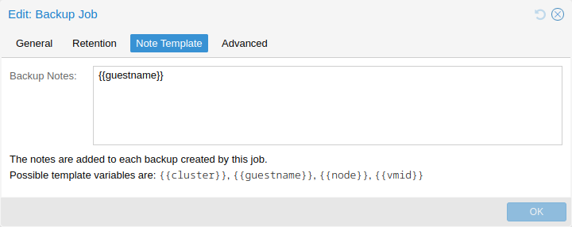

# 16.8. 备份备注 

可以使用 UI 中的 *编辑备注* 按钮，或通过存储内容 API 为备份添加备注。

还可以指定模板，为备份作业和手动备份动态生成备注。模板字符串可包含由两个花括号包围的变量，在执行备份时会替换为相应值。

目前支持：

- `{{cluster}}` 集群名称（如果存在）
- `{{guestname}}` 虚拟客户机分配的名称
- `{{node}}` 创建备份所在节点的主机名
- `{{vmid}}` 客户机的数字 VMID

通过 API 或 CLI 指定时，必须为单行，其中换行和反斜杠分别需要转义为字面值 `\n` 和 `\\`。

---

来源：[Proxmox VE 官方文档](https://pve.proxmox.com/pve-docs/pve-admin-guide.html) · 版本 9.2.13 · 非官方中文翻译。
