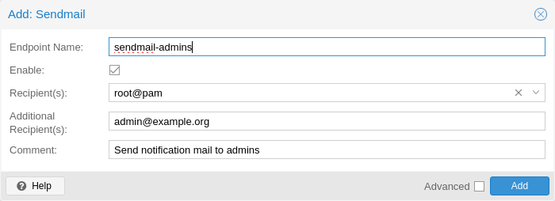
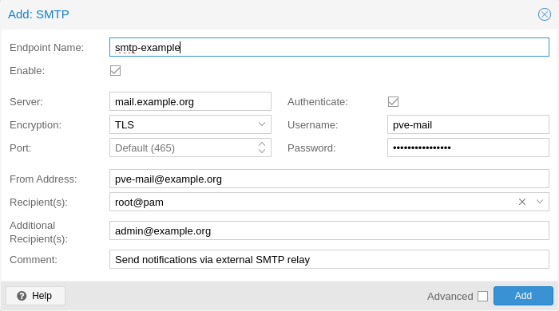
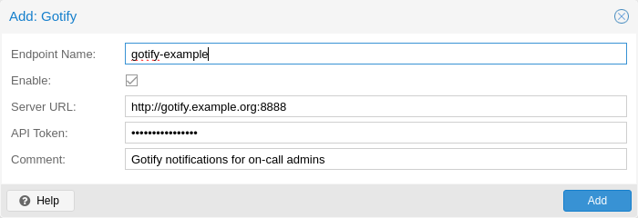

# 17.2. Notification Targets <a href="#notification_targets" id="notification_targets"></a>

Proxmox VE offers multiple types of notification targets.

## 17.2.1. Sendmail <a href="#notification_targets_sendmail" id="notification_targets_sendmail"></a>

[](https://pve.proxmox.com/pve-docs/images/screenshot/gui-datacenter-notification-sendmail.png)

The sendmail binary is a program commonly found on Unix-like operating systems that handles the sending of email messages. It is a command-line utility that allows users and applications to send emails directly from the command line or from within scripts.

The sendmail notification target uses the `sendmail` binary to send emails to a list of configured users or email addresses. If a user is selected as a recipient, the email address configured in user’s settings will be used. For the `root@pam` user, this is the email address entered during installation. A user’s email address can be configured in `Datacenter → Permissions → Users`. If a user has no associated email address, no email will be sent.


In standard Proxmox VE installations, the `sendmail` binary is provided by Postfix. It may be necessary to configure Postfix so that it can deliver mails correctly \- for example by setting an external mail relay (smart host). In case of failed delivery, check the system logs for messages logged by the Postfix daemon.


The configuration for Sendmail target plugins has the following options:

- `mailto`: E-Mail address to which the notification shall be sent to. Can be set multiple times to accommodate multiple recipients.
- `mailto-user`: Users to which emails shall be sent to. The user’s email address will be looked up in `users.cfg`. Can be set multiple times to accommodate multiple recipients.
- `author`: Sets the author of the E-Mail. Defaults to `Proxmox VE`.
- `from-address`: Sets the from address of the E-Mail. If the parameter is not set, the plugin will fall back to the `email_from` setting from `datacenter.cfg`. If that is also not set, the plugin will default to `root@$hostname`, where `$hostname` is the hostname of the node. The `From` header in the email will be set to `$author <$from-address>`.
- `comment`: Comment for this target

Example configuration (`/etc/pve/notifications.cfg`):

```text
sendmail: example
        mailto-user root@pam
        mailto-user admin@pve
        mailto max@example.com
        from-address pve1@example.com
        comment Send to multiple users/addresses
```

## 17.2.2. SMTP <a href="#notification_targets_smtp" id="notification_targets_smtp"></a>

[](https://pve.proxmox.com/pve-docs/images/screenshot/gui-datacenter-notification-smtp.png)

SMTP notification targets can send emails directly to an SMTP mail relay. This target does not use the system’s MTA to deliver emails. Similar to sendmail targets, if a user is selected as a recipient, the user’s configured email address will be used.


Unlike sendmail targets, SMTP targets do not have any queuing/retry mechanism in case of a failed mail delivery.


The configuration for SMTP target plugins has the following options:

- `mailto`: E-Mail address to which the notification shall be sent to. Can be set multiple times to accommodate multiple recipients.
- `mailto-user`: Users to which emails shall be sent to. The user’s email address will be looked up in `users.cfg`. Can be set multiple times to accommodate multiple recipients.
- `author`: Sets the author of the E-Mail. Defaults to `Proxmox VE`.
- `from-address`: Sets the From-address of the email. SMTP relays might require that this address is owned by the user in order to avoid spoofing. The `From` header in the email will be set to `$author <$from-address>`.
- `username`: Username to use during authentication. If no username is set, no authentication will be performed. The PLAIN and LOGIN authentication methods are supported.
- `password`: Password to use when authenticating.
- `mode`: Sets the encryption mode (`insecure`, `starttls` or `tls`). Defaults to `tls`.
- `server`: Address/IP of the SMTP relay.
- `port`: The port to connect to. If not set, the used port defaults to 25 (`insecure`), 465 (`tls`) or 587 (`starttls`), depending on the value of `mode`.
- `comment`: Comment for this target

Example configuration (`/etc/pve/notifications.cfg`):

```text
smtp: example
        mailto-user root@pam
        mailto-user admin@pve
        mailto max@example.com
        from-address pve1@example.com
        username pve1
        server mail.example.com
        mode starttls
```

The matching entry in `/etc/pve/priv/notifications.cfg`, containing the password:

```text
smtp: example
        password somepassword
```

## 17.2.3. Gotify <a href="#notification_targets_gotify" id="notification_targets_gotify"></a>

[](https://pve.proxmox.com/pve-docs/images/screenshot/gui-datacenter-notification-gotify.png)

[Gotify](http://gotify.net) is an open-source self-hosted notification server that allows you to send and receive push notifications to various devices and applications. It provides a simple API and web interface, making it easy to integrate with different platforms and services.

The configuration for Gotify target plugins has the following options:

- `server`: The base URL of the Gotify server, e.g. `http://<ip>:8888`
- `token`: The authentication token. Tokens can be generated within the Gotify web interface.
- `comment`: Comment for this target


The Gotify target plugin will respect the HTTP proxy settings from the [datacenter configuration](../24-configuration-files-2/02-datacenter-configuration-file.md#datacenter_configuration_file)


Example configuration (`/etc/pve/notifications.cfg`):

```text
gotify: example
        server http://gotify.example.com:8888
        comment Send to multiple users/addresses
```

The matching entry in `/etc/pve/priv/notifications.cfg`, containing the secret token:

```text
gotify: example
        token somesecrettoken
```

## 17.2.4. Webhook <a href="#notification_targets_webhook" id="notification_targets_webhook"></a>

Webhook notification targets perform HTTP requests to a configurable URL.

The following configuration options are available:

- `url`: The URL to which to perform the HTTP requests. Supports templating to inject message contents, metadata and secrets.
- `method`: HTTP Method to use (POST/PUT/GET)
- `header`: Array of HTTP headers that should be set for the request. Supports templating to inject message contents, metadata and secrets.
- `body`: HTTP body that should be sent. Supports templating to inject message contents, metadata and secrets.
- `secret`: Array of secret key-value pairs. These will be stored in a protected configuration file only readable by root. Secrets can be accessed in body/header/URL templates via the `secrets` namespace.
- `comment`: Comment for this target.

For configuration options that support templating, the [Handlebars](https://handlebarsjs.com/) syntax can be used to access the following properties:

- `{{ title }}`: The rendered notification title
- `{{ message }}`: The rendered notification body
- `{{ severity }}`: The severity of the notification (`info`, `notice`, `warning`, `error`, `unknown`)
- `{{ timestamp }}`: The notification’s timestamp as a UNIX epoch (in seconds).
- `{{ fields.<name> }}`: Sub-namespace for any metadata fields of the notification. For instance, `fields.type` contains the notification type \- for all available fields refer to [Notification Events](04-notification-events.md#notification_events).
- `{{ secrets.<name> }}`: Sub-namespace for secrets. For instance, a secret named `token` is accessible via `secrets.token`.

For convenience, the following helpers are available:

- `{{ url-encode <value/property> }}`: URL-encode a property/literal.
- `{{ escape <value/property> }}`: Escape any control characters that cannot be safely represented as a JSON string.
- `{{ json <value/property> }}`: Render a value as JSON. This can be useful to pass a whole sub-namespace (e.g. `fields`) as a part of a JSON payload (e.g. `{{ json fields }}`).

### Examples <a href="#_examples_11" id="_examples_11"></a>

#### `ntfy.sh` <a href="#_span_class_monospaced_ntfy_sh_span" id="_span_class_monospaced_ntfy_sh_span"></a>

- Method: `POST`
- URL: `https://ntfy.sh/{{ secrets.channel }}`
- Headers:

  - `Markdown`: `Yes`
- Body:

````text
```
{{ message }}
```
````

- Secrets:

  - `channel`: `<your ntfy.sh channel>`

#### Discord <a href="#_discord" id="_discord"></a>

- Method: `POST`
- URL: `https://discord.com/api/webhooks/{{ secrets.token }}`
- Headers:

  - `Content-Type`: `application/json`
- Body:

````text
{
  "content": "``` {{ escape message }}```"
}
````

- Secrets:

  - `token`: `<token>`

#### Slack <a href="#_slack" id="_slack"></a>

- Method: `POST`
- URL: `https://hooks.slack.com/services/{{ secrets.token }}`
- Headers:

  - `Content-Type`: `application/json`
- Body:

````text
{
  "text": "``` {{escape message}}```",
  "type": "mrkdwn"
}
````

- Secrets:

  - `token`: `<token>`

---

来源：[Proxmox VE 官方文档](https://pve.proxmox.com/pve-docs/pve-admin-guide.html) · 版本 9.2.13 · 非官方中文翻译。
