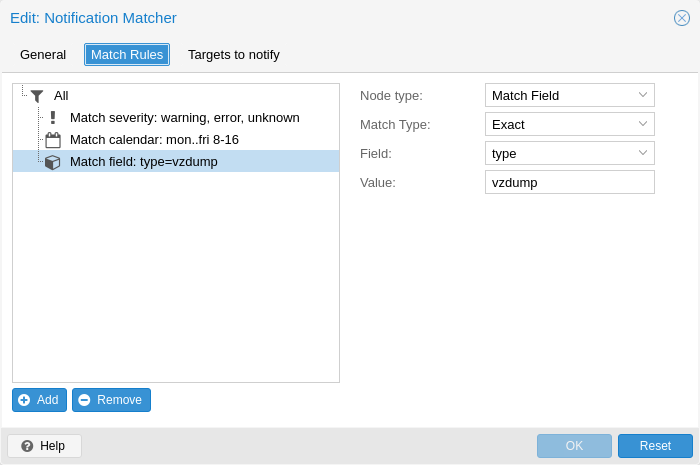

# 17.3. Notification Matchers <a href="#notification_matchers" id="notification_matchers"></a>

[](https://pve.proxmox.com/pve-docs/images/screenshot/gui-datacenter-notification-matcher.png)

Notification matchers route notifications to notification targets based on their matching rules. These rules can match certain properties of a notification, such as the timestamp (`match-calendar`), the severity of the notification (`match-severity`) or metadata fields (`match-field`). If a notification is matched by a matcher, all targets configured for the matcher will receive the notification.

An arbitrary number of matchers can be created, each with with their own matching rules and targets to notify. Every target is notified at most once for every notification, even if the target is used in multiple matchers.

A matcher without any matching rules is always true; the configured targets will always be notified.

```text
matcher: always-matches
        target admin
        comment This matcher always matches
```

## 17.3.1. Matcher Options <a href="#_matcher_options" id="_matcher_options"></a>

- `target`: Determine which target should be notified if the matcher matches. can be used multiple times to notify multiple targets.
- `invert-match`: Inverts the result of the whole matcher
- `mode`: Determines how the individual match rules are evaluated to compute the result for the whole matcher. If set to `all`, all matching rules must match. If set to `any`, at least one rule must match. Defaults to `all`.
- `match-calendar`: Match the notification’s timestamp against a schedule.
- `match-field`: Match the notification’s metadata fields.
- `match-severity`: Match the notification’s severity.
- `comment`: Comment for this matcher.

## 17.3.2. Calendar Matching Rules <a href="#notification_matchers_calendar" id="notification_matchers_calendar"></a>

A calendar matcher matches the time when a notification is sent against a configurable schedule.

- `match-calendar 8-12`
- `match-calendar 8:00-15:30`
- `match-calendar mon..fri 9:00-17:00`
- `match-calendar sun,tue..wed,fri 9-17`

## 17.3.3. Field Matching Rules <a href="#notification_matchers_field" id="notification_matchers_field"></a>

Notifications have a selection of metadata fields that can be matched. When using `exact` as a matching mode, a `,` can be used as a separator. The matching rule then matches if the metadata field has **any** of the specified values.

- `match-field exact:type=vzdump` Only match notifications about backups.
- `match-field exact:type=replication,fencing` Match `replication` and `fencing` notifications.
- `match-field regex:hostname=^.+\.example\.com$` Match the hostname of the node.

If a matched metadata field does not exist, the notification will not be matched. For instance, a `match-field regex:hostname=.*` directive will only match notifications that have an arbitrary `hostname` metadata field, but will not match if the field does not exist.

## 17.3.4. Severity Matching Rules <a href="#notification_matchers_severity" id="notification_matchers_severity"></a>

A notification has a associated severity that can be matched.

- `match-severity error`: Only match errors
- `match-severity warning,error`: Match warnings and error

The following severities are in use: `info`, `notice`, `warning`, `error`, `unknown`.

## 17.3.5. Examples <a href="#_examples_12" id="_examples_12"></a>

```text
matcher: workday
        match-calendar mon..fri 9-17
        target admin
        comment Notify admins during working hours

matcher: night-and-weekend
        match-calendar mon..fri 9-17
        invert-match true
        target on-call-admins
        comment Separate target for non-working hours
```

```text
matcher: backup-failures
        match-field exact:type=vzdump
        match-severity error
        target backup-admins
        comment Send notifications about backup failures to one group of admins

matcher: cluster-failures
        match-field exact:type=replication,fencing
        target cluster-admins
        comment Send cluster-related notifications to other group of admins
```

---

来源：[Proxmox VE 官方文档](https://pve.proxmox.com/pve-docs/pve-admin-guide.html) · 版本 9.2.13 · 非官方中文翻译。
